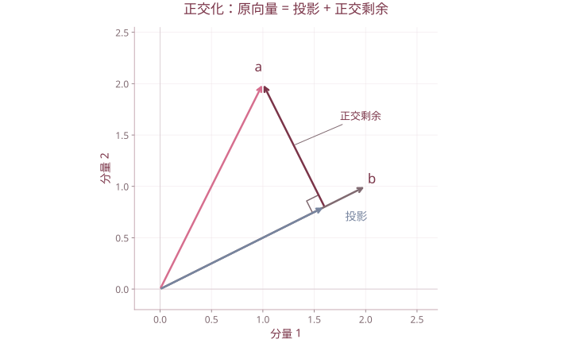

# 基础一 矩阵代数

| 复习要点 | 掌握目标 |
| --- | --- |
| 运算与维数 | 判断能否相加、相乘，按行乘列计算 |
| 分块与逆矩阵 | 保留乘法次序，利用零块与对角块简化 |
| 向量组与线性表示 | 将线性表示转成方程组，区分相关与无关 |
| 特征值与特征向量 | 解特征方程，再解齐次方程 |
| 内积与正交化 | 掌握投影、Gram–Schmidt 与正交矩阵 |

## 1. 矩阵、向量与特殊矩阵

矩阵是按行、列排列的数表：

$$
A=(a_{ij})_{m\times n},\qquad a_{ij}\text{ 是第 }i\text{ 行第 }j\text{ 列的元素。}
$$

行向量为 $1\times n$，列向量为 $n\times1$；没有特别说明时，本课程的向量按列向量处理。两个矩阵相等，须先同型，再对应元素相等。

| 名称 | 条件或形式 |
| --- | --- |
| 方阵 | 行数等于列数 |
| 零矩阵 $O_{m\times n}$ | 全部元素为 0，维数仍不可省略不管 |
| 单位矩阵 $I_n$ | 主对角线为 1，其余为 0 |
| 对角阵 | 非主对角线元素为 0 |
| 上、下三角阵 | 主对角线下方、上方元素分别为 0 |
| 对称阵 | $A^{\mathsf T}=A$ |
| 反对称阵 | $A^{\mathsf T}=-A$，实数域上主对角线必为 0 |

线性方程组 $A\boldsymbol x=\boldsymbol b$ 的系数矩阵为 $A$，增广矩阵为 $(A\mid\boldsymbol b)$。常数列不是系数矩阵的一部分。

## 2. 加法、数乘与乘法

### 2.1 线性运算

同型矩阵才能相加；数乘作用于每一个元素：

$$
A+B=(a_{ij}+b_{ij}),\qquad cA=(ca_{ij}).
$$

加法满足交换律、结合律；数乘满足分配律。$A+B$ 不是把两个矩阵拼接起来。

### 2.2 矩阵乘法的维数

$$
A_{m\times r}B_{r\times n}=C_{m\times n},\qquad
c_{ij}=\sum_{k=1}^{r}a_{ik}b_{kj}.
$$

先检查“左矩阵列数 = 右矩阵行数”，再用左矩阵的第 $i$ 行与右矩阵的第 $j$ 列作内积。逐元素相乘与矩阵相乘是两种运算。

**课件例：季度利润。**

$$
A=\begin{pmatrix}40&20&30\\30&10&50\end{pmatrix},\qquad
B=\begin{pmatrix}400\\300\\500\end{pmatrix}.
$$

$A$ 的行对应季度、列对应产品，$B$ 是各产品的单位利润，则

$$
AB=\begin{pmatrix}37000\\40000\end{pmatrix}.
$$

结果每行是一个季度的总利润；使用课件给出的单位，结果单位为万元。不能只报两个数而不说明行的含义。

**课件例：能否相乘。**

$$
A=\begin{pmatrix}1&0&-1\\-1&1&3\end{pmatrix},\quad
B=\begin{pmatrix}0&-4\\1&2\\0&1\end{pmatrix},\quad
C=\begin{pmatrix}1&1\\2&1\end{pmatrix}.
$$

$$
AB=\begin{pmatrix}0&-5\\1&9\end{pmatrix},\qquad AC\text{ 无定义。}
$$

### 2.3 运算规律与反例

维数适合时有 $(AB)C=A(BC)$、$A(B+C)=AB+AC$、$(A+B)C=AC+BC$。但一般 **$AB\ne BA$**，而且可能一个有定义、另一个没有定义。

课件给出

$$
A=\begin{pmatrix}1&1\\-1&-1\end{pmatrix},\quad
B=\begin{pmatrix}1&-1\\-1&1\end{pmatrix},
$$

则 $AB=O$，但

$$BA=\begin{pmatrix}2&2\\-2&-2\end{pmatrix}\ne O.$$

所以 $AB=O$ 不能推出 $A=O$ 或 $B=O$；$AX=AY$ 也不能只凭 $A\ne O$ 就约去 $A$。若 $A$ 可逆，才可以左乘 $A^{-1}$ 消去。

### 2.4 行乘列、列乘行

$$
\boldsymbol a^{\mathsf T}\boldsymbol b=\sum_i a_ib_i\quad\text{是标量},\qquad
\boldsymbol a\boldsymbol b^{\mathsf T}=(a_ib_j)\quad\text{是矩阵}.
$$

后者称外积。若 $A=BC$，$B$ 为列向量、$C$ 为行向量，那么 $CB$ 为标量，可以利用

$$A^k=B(CB)^{k-1}C\quad(k\ge1)$$

计算高次幂。课件中 $B=(-2,0,3,1)^{\mathsf T}$、$C=(1,-2,0,3)$，$CB=1$，因而 $A^{101}=A$。

### 2.5 矩阵幂与矩阵多项式

$A^k$ 要求 $A$ 为方阵，$A^0=I$。若

$$f(t)=c_0+c_1t+\cdots+c_kt^k,$$

则 $f(A)=c_0I+c_1A+\cdots+c_kA^k$，常数项不能写成把一个数直接加到矩阵上。

课件的上三角例可写为 $A=\lambda I+N$，其中

$$N=\begin{pmatrix}0&1&0\\0&0&1\\0&0&0\end{pmatrix},\qquad N^3=O.$$

因为 $\lambda I$ 与 $N$ 可交换，二项式展开只保留至 $N^2$：

$$
A^k=\sum_{j=0}^{\min(k,2)}\binom{k}{j}\lambda^{k-j}N^j.
$$

这个有限和写法也避免在 $k=0,1$ 或 $\lambda=0$ 时误写负次幂。一般 $(AB)^k=A^kB^k$ 并不成立；需要额外的可交换条件。

## 3. 转置与逆矩阵

### 3.1 转置

转置将行、列互换：

$$
(A^{\mathsf T})^{\mathsf T}=A,\quad
(A+B)^{\mathsf T}=A^{\mathsf T}+B^{\mathsf T},\quad
(cA)^{\mathsf T}=cA^{\mathsf T},\quad
(AB)^{\mathsf T}=B^{\mathsf T}A^{\mathsf T}.
$$

**乘积转置要倒序。** 对任意实矩阵，$A^{\mathsf T}A$ 和 $AA^{\mathsf T}$ 都对称，但阶数可能不同。

### 3.2 逆矩阵

方阵 $A$ 若存在 $A^{-1}$ 使 $AA^{-1}=A^{-1}A=I$，就称 $A$ 可逆。逆矩阵唯一，且

$$
(AB)^{-1}=B^{-1}A^{-1},\qquad
(A^{\mathsf T})^{-1}=(A^{-1})^{\mathsf T}.
$$

二阶矩阵的求逆公式为

$$
\begin{pmatrix}a&b\\c&d\end{pmatrix}^{-1}
=\frac1{ad-bc}\begin{pmatrix}d&-b\\-c&a\end{pmatrix},\qquad ad-bc\ne0.
$$

“对调主对角线、改变另两项符号”的口诀只适用于二阶。更高阶不能照搬；可通过初等行变换 $(A\mid I)\to(I\mid A^{-1})$ 求逆。

## 4. 分块矩阵

分块只是把矩阵按若干行、列划成子矩阵，并未改变元素的位置。

### 4.1 运算规则

- 加法、数乘要求对应块维数匹配。
- 乘法要求左阵的列分块与右阵的行分块匹配，并保留块内乘法次序。
- 转置既交换块的位置，也转置每一个块。

$$
\begin{pmatrix}A&B\\C&D\end{pmatrix}
\begin{pmatrix}E&F\\G&H\end{pmatrix}
=\begin{pmatrix}AE+BG&AF+BH\\CE+DG&CF+DH\end{pmatrix}.
$$

$$
\begin{pmatrix}A&B\\C&D\end{pmatrix}^{\mathsf T}
=\begin{pmatrix}A^{\mathsf T}&C^{\mathsf T}\\B^{\mathsf T}&D^{\mathsf T}\end{pmatrix}.
$$

### 4.2 对角分块与三角分块

若各 $A_i$ 可逆，

$$\operatorname{diag}(A_1,\ldots,A_s)^{-1}=\operatorname{diag}(A_1^{-1},\ldots,A_s^{-1}).$$

对课件思考题，$B,C$ 可逆时，

$$
\begin{pmatrix}B&D\\O&C\end{pmatrix}^{-1}
=\begin{pmatrix}B^{-1}&-B^{-1}DC^{-1}\\O&C^{-1}\end{pmatrix}.
$$

验证时直接乘回单位矩阵。**右上角三个因子的次序不可交换。**

### 4.3 分块消元与行列式

$A$ 可逆时，令 $S=D-CA^{-1}B$，有

$$
\begin{pmatrix}I&O\\-CA^{-1}&I\end{pmatrix}
\begin{pmatrix}A&B\\C&D\end{pmatrix}
\begin{pmatrix}I&-A^{-1}B\\O&I\end{pmatrix}
=\begin{pmatrix}A&O\\O&S\end{pmatrix}.
$$

两边取行列式，得到

$$\det\begin{pmatrix}A&B\\C&D\end{pmatrix}=\det(A)\det(D-CA^{-1}B).$$

一般不能把块当作可交换的数，直接写成 $\det(AD-BC)$。

## 5. 向量空间与线性相关

### 5.1 向量空间和子空间

$\mathbb R^n$ 是所有 $n$ 维实向量组成的空间，向量加法、数乘逐分量进行。非空集合 $V\subseteq\mathbb R^n$ 是子空间，需要对加法和数乘封闭，因此必含零向量。

### 5.2 线性表示

若存在常数 $c_i$ 使

$$\boldsymbol b=c_1\boldsymbol\alpha_1+\cdots+c_m\boldsymbol\alpha_m,$$

就称 $\boldsymbol b$ 能由该向量组线性表示。将各向量作为列组成 $A$ 后，等价于方程 $A\boldsymbol c=\boldsymbol b$ 有解。

**课件例。** $\alpha_1=(0,1,1)^{\mathsf T}$、$\alpha_2=(1,0,1)^{\mathsf T}$、$\alpha_3=(1,1,0)^{\mathsf T}$，求 $\beta=(1,0,-4)^{\mathsf T}$ 的表示。

$$c_2+c_3=1,\quad c_1+c_3=0,\quad c_1+c_2=-4.$$

解得 $c_1=-5/2,c_2=-3/2,c_3=5/2$。代回三个分量都应成立。

### 5.3 线性相关与线性无关

$$c_1\alpha_1+\cdots+c_m\alpha_m=0$$

仅有全零系数解时线性无关；存在不全为零的解时线性相关。

- 含零向量的向量组线性相关。
- 线性相关组再加入向量仍相关；线性无关组的任意子组仍无关。
- 至少两个向量组成的组线性相关，当且仅当其中至少一个能由其余向量表示。
- 若 $\alpha_1,\ldots,\alpha_m$ 无关，而加入 $\beta$ 后相关，则 $\beta$ 能被它们唯一表示。
- $\mathbb R^n$ 中超过 $n$ 个向量必相关。

**唯一性证明。** 若两套系数均表示 $\beta$，相减后得到原无关向量组的零组合，故对应系数之差全为 0。

### 5.4 秩、基与坐标的衔接

向量组中最大线性无关组的向量个数叫秩。矩阵的行秩等于列秩，记为 $\operatorname{rank}(A)$。

$$A\boldsymbol x=\boldsymbol b\text{ 有解}\iff\operatorname{rank}(A)=\operatorname{rank}(A\mid\boldsymbol b).$$

齐次方程的解空间维数是 $n-\operatorname{rank}(A)$。非齐次方程有解时，通解为“一个特解 + 齐次方程通解”。

空间的一组基既线性无关，又能张成该空间；基的向量个数为维数。坐标是向量在**给定基**下的系数，更换基时坐标会改变。

## 6. 特征值与特征向量

### 6.1 定义与计算步骤

$$A\boldsymbol v=\lambda\boldsymbol v,\qquad\boldsymbol v\ne0.$$

这里 $A$ 为方阵；$\lambda$ 是特征值，$\boldsymbol v$ 是属于该特征值的特征向量。特征值可以为 0，特征向量不能为 0。

1. 解 $\det(A-\lambda I)=0$ 得特征值。
2. 对每个特征值解 $(A-\lambda I)\boldsymbol v=0$。
3. 给出该特征子空间的全部非零向量，而非只写一个零向量解。

**课件例。**

$$A=\begin{pmatrix}3&-1\\-1&3\end{pmatrix},\quad\det(A-\lambda I)=(\lambda-2)(\lambda-4).$$

属于 $2$ 的特征向量为 $c(1,1)^{\mathsf T}$；属于 $4$ 的为 $c(1,-1)^{\mathsf T}$，其中 $c\ne0$。

### 6.2 性质

$$\sum_i\lambda_i=\operatorname{tr}(A),\qquad\prod_i\lambda_i=\det(A).$$

特征值按代数重数计算。三角阵的特征值就是对角线元素。

若 $A\boldsymbol v=\lambda\boldsymbol v$，则 $A^k\boldsymbol v=\lambda^k\boldsymbol v$、$f(A)\boldsymbol v=f(\lambda)\boldsymbol v$；可逆时 $A^{-1}\boldsymbol v=\lambda^{-1}\boldsymbol v$。

课件的幂等矩阵例：$A^2=A$ 推出 $\lambda^2=\lambda$，所以特征值只能取 $0$ 或 $1$。不能由此断言两个值都一定出现。

### 6.3 相似对角化与实对称阵

$A$ 能写成 $P\Lambda P^{-1}$，当且仅当存在 $n$ 个线性无关的特征向量。重根不自动意味着不能对角化，要看特征子空间维数是否足够。

实对称阵可以正交对角化：

$$A=Q\Lambda Q^{\mathsf T},\qquad Q^{\mathsf T}Q=I.$$

其特征值全为实数，不同特征值的特征向量正交。这是协方差阵分解和 PCA 的基础。

## 7. 内积、长度与正交化

### 7.1 内积、范数与投影

$$\langle x,y\rangle=x^{\mathsf T}y,\qquad\|x\|=\sqrt{x^{\mathsf T}x}.$$

$$|x^{\mathsf T}y|\le\|x\|\|y\|\quad\text{（Cauchy–Schwarz 不等式）}.$$

$x^{\mathsf T}y=0$ 时正交。非零向量可单位化为 $x/\|x\|$。

向量 $a$ 在非零向量 $b$ 方向上的投影是

$$\operatorname{proj}_b(a)=\frac{a^{\mathsf T}b}{b^{\mathsf T}b}b.$$

减去投影后的余量与 $b$ 正交。分母是 $b$ 的长度平方，而非 $a$ 的长度平方。

演练向量 a=(1,2)、b=(2,1)，投影为(1.6,0.8)，剩余为(-0.6,1.2)，两者内积为0。

### 7.2 Gram–Schmidt 方法

对线性无关向量 $a_1,\ldots,a_s$：

$$b_1=a_1,\qquad b_k=a_k-\sum_{j=1}^{k-1}\frac{a_k^{\mathsf T}b_j}{b_j^{\mathsf T}b_j}b_j,$$

再令 $q_k=b_k/\|b_k\|$，得到同一张成空间的一组标准正交向量。

**课件例。** $a_1=(1,1,1)^{\mathsf T}$、$a_2=(1,2,1)^{\mathsf T}$、$a_3=(0,-1,1)^{\mathsf T}$，计算得

$$
b_1=(1,1,1)^{\mathsf T},\quad b_2=\tfrac13(-1,2,-1)^{\mathsf T},\quad b_3=\tfrac12(-1,0,1)^{\mathsf T}.
$$

标准化后为

$$q_1=\frac{(1,1,1)^{\mathsf T}}{\sqrt3},\quad q_2=\frac{(-1,2,-1)^{\mathsf T}}{\sqrt6},\quad q_3=\frac{(-1,0,1)^{\mathsf T}}{\sqrt2}.$$

检查 $q_i^{\mathsf T}q_j=\delta_{ij}$。仅两两正交但未单位化时，还不是标准正交组。

### 7.3 正交矩阵

实方阵 $Q$ 满足 $Q^{\mathsf T}Q=I$ 时称正交矩阵，等价于列向量为一组标准正交基。

$$Q^{-1}=Q^{\mathsf T},\quad\det(Q)=\pm1,\quad\|Qx\|=\|x\|.$$

正交变换保持内积、长度、夹角和距离，可以表示旋转或反射，不能一概说它“只会旋转”。

## 8. 课件对照

- `1.1 矩阵代数.pptx`：矩阵、线性运算、乘法、幂、转置。
- `1.2 矩阵代数.ppt`：二阶求逆、分块运算、分块行列式与逆矩阵。
- `1.3 矩阵代数.ppt`：向量空间、线性组合与线性相关；其目录提及的秩、基、解结构在本笔记给出与后续统计所需的衔接定义。
- `1.4 矩阵代数.ppt`、`1.5 矩阵代数.ppt`：特征值、特征向量、内积、正交化、正交矩阵。

[返回课程目录](../人工智能数学基础.md)
