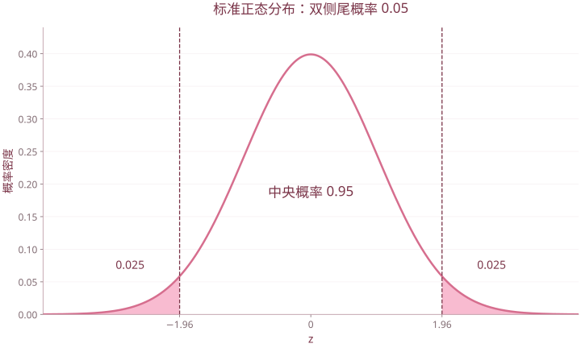

# 基础二 概率论与统计基础

| 复习要点 | 掌握目标 |
| --- | --- |
| 条件概率与 Bayes | 分清“已知什么”，写对分母 |
| 密度与分布函数 | 先确定支持集，再积分 |
| 边缘与条件分布 | 联合密度积分求边缘，除以对应边缘求条件 |
| 正态分布 | 标准化、分位点、二维正态的参数 |
| 抽样分布 | 识别 $\chi^2,t,F$ 的构造与自由度 |

本篇对应“2 概率论与信息论.ppt”的现有内容。该文件没有展开熵、互信息等信息论专节。

## 1. 条件概率与乘法公式

当 $P(B)>0$，

$$P(A\mid B)=\frac{P(A\cap B)}{P(B)}.$$

分母是已知发生的事件。一般 $P(A\mid B)\ne P(B\mid A)$。

$$P(A\cap B)=P(A)P(B\mid A)=P(B)P(A\mid B).$$

对多个事件，按顺序逐层加条件：

$$P(A_1\cdots A_n)=P(A_1)\prod_{k=2}^{n}P(A_k\mid A_1\cdots A_{k-1}).$$

相关条件事件概率应为正。只有具备独立性时才能直接把联合概率写成各自概率的乘积。

**课件例：合格品中的一等品。** 全部产品中废品率为 $4\%$，一等品占 $72\%$。已知抽到的是合格品，则

$$P(\text{一等品}\mid\text{合格品})=\frac{0.72}{0.96}=0.75.$$

**课件例：第三次才取到黑球。** 5 白、2 黑，不放回取 3 次：

$$P(\text{白、白、黑})=\frac57\frac46\frac25=\frac4{21}.$$

“第三次才取到”限定了前两次都为白；它与“第三次取到黑球”不同。

## 2. 全概率公式与 Bayes 公式

若 $A_1,\ldots,A_k$ 两两互斥、并集为样本空间，且 $P(A_i)>0$，则

$$P(B)=\sum_{i=1}^{k}P(A_i)P(B\mid A_i).$$

已知结果 $B$ 后追溯来源：

$$P(A_j\mid B)=\frac{P(A_j)P(B\mid A_j)}{\sum_iP(A_i)P(B\mid A_i)}.$$

| 名称 | 公式中的量 |
| --- | --- |
| 先验概率 | $P(A_j)$ |
| 似然 | $P(B\mid A_j)$ |
| 证据概率 | $P(B)$ |
| 后验概率 | $P(A_j\mid B)$ |

**课件例：三台机器的废品。** 产量占比为 $0.30,0.35,0.35$，废品率为 $0.05,0.04,0.03$：

$$P(B)=0.30\times0.05+0.35\times0.04+0.35\times0.03=0.0395.$$

若抽到废品，来自三台机器的概率依次为

$$\frac{0.015}{0.0395}=\frac{30}{79},\quad\frac{0.014}{0.0395}=\frac{28}{79},\quad\frac{0.0105}{0.0395}=\frac{21}{79}.$$

**课件例：不放回取球。** 5 白、3 黑，第二次为白的概率是 $5/8$；已知第二次为白，第一次为黑的概率为

$$\frac{(3/8)(5/7)}{5/8}=\frac37.$$

## 3. 连续型随机变量、密度与分布函数

概率密度 $f(x)$ 的条件为 $f(x)\ge0$、$\int_{-\infty}^{+\infty}f(x)\,dx=1$。分布函数

$$F(x)=P(X\le x)=\int_{-\infty}^{x}f(t)\,dt.$$

连续型变量有 $P(X=x)=0$，而 $f(x)$ 本身不等于某点概率，也不必小于 1。

$$P(a<X\le b)=F(b)-F(a)=\int_a^b f(x)\,dx.$$

### 3.1 课件例：密度中的待定常数

$$f(x)=\begin{cases}c,&|x|<1,\\0,&\text{其他。}\end{cases}$$

归一化给出 $2c=1$，故 $c=1/2$。求 $P(-3<X<1/2)$ 时，应先与支持集 $(-1,1)$ 取交集：

$$P(-3<X<1/2)=\int_{-1}^{1/2}\tfrac12\,dx=\tfrac34.$$

### 3.2 课件例：分段密度求分布函数

$$f(x)=\begin{cases}x,&0\le x<1,\\2-x,&1\le x<2,\\0,&\text{其他。}\end{cases}$$

$$F(x)=\begin{cases}0,&x<0,\\x^2/2,&0\le x<1,\\-x^2/2+2x-1,&1\le x<2,\\1,&x\ge2.\end{cases}$$

第二段要包含第一段已经累积的概率，不能只积分 $\int_1^x(2-t)dt$。检查 $F(1^-)=F(1)=1/2$、$F(2)=1$。

## 4. 正态分布

$$X\sim N(\mu,\sigma^2),\quad f(x)=\frac1{\sqrt{2\pi}\sigma}\exp\left[-\frac{(x-\mu)^2}{2\sigma^2}\right],\quad\sigma>0.$$

标准化为 $Z=(X-\mu)/\sigma\sim N(0,1)$，用 $\Phi$ 表示标准正态分布函数：

$$P(a<X\le b)=\Phi\left(\frac{b-\mu}{\sigma}\right)-\Phi\left(\frac{a-\mu}{\sigma}\right).$$

$$\Phi(-z)=1-\Phi(z).$$

若采用课件的上侧分位点记号 $u_\alpha$，则 $P(Z>u_\alpha)=\alpha$，即 $u_\alpha=\Phi^{-1}(1-\alpha)$。双侧尾概率为 $\alpha$ 时，界值为 $\pm u_{\alpha/2}$。

$$P(|Z|\le1)\approx0.6827,\quad P(|Z|\le2)\approx0.9545,\quad P(|Z|\le3)\approx0.9973.$$

“$3\sigma$ 规则”是高概率结论，不是绝不会落在区间外的保证。

标准正态曲线，左右各0.025尾面积，中央面积0.95；边界为±1.9599639845。

### 4.1 二维正态

二维正态由 $\mu_X,\mu_Y,\sigma_X^2,\sigma_Y^2,\rho$ 描述。非退化时 $\sigma_X,\sigma_Y>0,|\rho|<1$，密度为

$$
f(x,y)=\frac{1}{2\pi\sigma_X\sigma_Y\sqrt{1-\rho^2}}
\exp\left\{-\frac{1}{2(1-\rho^2)}\left[\frac{(x-\mu_X)^2}{\sigma_X^2}-\frac{2\rho(x-\mu_X)(y-\mu_Y)}{\sigma_X\sigma_Y}+\frac{(y-\mu_Y)^2}{\sigma_Y^2}\right]\right\}.
$$

两个边缘都是一维正态；在**联合正态**条件下，$\rho=0$ 等价于独立。仅知道两个边缘各自正态还不够。

## 5. 联合分布与边缘分布

联合分布函数

$$F_{XY}(x,y)=P(X\le x,Y\le y).$$

$$F_X(x)=F_{XY}(x,+\infty),\qquad F_Y(y)=F_{XY}(+\infty,y).$$

离散型联合分布 $p_{ij}=P(X=x_i,Y=y_j)$：

$$p_{i\cdot}=\sum_jp_{ij},\qquad p_{\cdot j}=\sum_ip_{ij}.$$

连续型联合密度 $f_{XY}(x,y)$：

$$f_X(x)=\int_{-\infty}^{+\infty}f_{XY}(x,y)dy,\quad f_Y(y)=\int_{-\infty}^{+\infty}f_{XY}(x,y)dx.$$

积分限必须与支持区域一致。遇到三角形或曲线区域，应画出区域，再确定另一个变量的取值范围。

## 6. 条件分布

### 6.1 离散型

$$P(X=x_i\mid Y=y_j)=\frac{p_{ij}}{p_{\cdot j}},\qquad p_{\cdot j}>0.$$

固定的是 $Y=y_j$，分母就沿 $X$ 方向求和得到 $Y$ 的边缘概率。

### 6.2 连续型

$$f_{X\mid Y}(x\mid y)=\frac{f_{XY}(x,y)}{f_Y(y)},\qquad f_Y(y)>0.$$

尽管连续型变量的 $P(Y=y)=0$，条件密度仍可通过联合与边缘密度定义；不能把它写成两个“点概率”的比。

### 6.3 课件例：联合密度与条件尾概率

$$f(x,y)=xe^{-x(1+y)},\qquad x>0,y>0.$$

先积分得到

$$f_X(x)=e^{-x}\ (x>0),\qquad f_Y(y)=\frac1{(1+y)^2}\ (y>0).$$

再求

$$f_{X\mid Y}(x\mid y)=x(1+y)^2e^{-x(1+y)},\quad x>0,$$

$$f_{Y\mid X}(y\mid x)=xe^{-xy},\quad y>0.$$

$$P(Y>1\mid X=3)=\int_1^\infty3e^{-3y}dy=e^{-3}.$$

**课件订正：** 第 46 页的 $f_{X\mid Y}$ 右端多写了一个系数 3；固定的是一般 $y$ 时，正确归一化系数如上，不能把后面 $X=3$ 的条件提前混入。

## 7. 期望、方差与样本统计量

$$E(X)=\sum_i x_ip_i\quad\text{或}\quad\int xf(x)dx,$$

$$\operatorname{Var}(X)=E[(X-\mu)^2]=E(X^2)-[E(X)]^2.$$

协方差 $\operatorname{Cov}(X,Y)=E[(X-EX)(Y-EY)]$，相关系数

$$\rho_{XY}=\frac{\operatorname{Cov}(X,Y)}{\sqrt{\operatorname{Var}(X)\operatorname{Var}(Y)}}$$

要求两个方差均大于 0。独立蕴含不相关，反向一般不成立。

对独立同分布样本 $X_1,\ldots,X_n$：

$$\bar X=\frac1n\sum_iX_i,\qquad S_n^2=\frac1n\sum_i(X_i-\bar X)^2,$$

$$S^2=\frac1{n-1}\sum_i(X_i-\bar X)^2.$$

$S_n^2$ 是二阶样本中心矩，$S^2$ 是方差的无偏估计。课件前后采用过两种分母，做抽样分布题时必须与公式匹配。

$k$ 阶原点样本矩、中心样本矩分别为

$$A_k=\frac1n\sum_iX_i^k,\qquad B_k=\frac1n\sum_i(X_i-\bar X)^k.$$

多元随机向量的均值、协方差阵及数据矩阵计算见[第 2 章](02-多元数据的数学表达.md)。

## 8. 三大抽样分布

### 8.1 卡方分布

若 $Z_1,\ldots,Z_\nu$ 独立且均为 $N(0,1)$，则

$$Q=\sum_{i=1}^{\nu}Z_i^2\sim\chi^2(\nu).$$

$$E(Q)=\nu,\qquad\operatorname{Var}(Q)=2\nu.$$

独立卡方变量相加，自由度相加。正态样本满足

$$\frac{(n-1)S^2}{\sigma^2}\sim\chi^2(n-1),\quad\bar X\perp S^2.$$

### 8.2 t 分布

若 $Z\sim N(0,1)$、$Q\sim\chi^2(\nu)$ 且独立，则

$$T=\frac Z{\sqrt{Q/\nu}}\sim t(\nu).$$

正态总体、方差未知时，

$$\frac{\bar X-\mu}{S/\sqrt n}\sim t(n-1).$$

分布关于 0 对称，尾部比标准正态厚；自由度趋大时趋近标准正态。注意是样本标准差 $S$，不是总体标准差 $\sigma$。

### 8.3 F 分布

若 $U\sim\chi^2(\nu_1)$、$V\sim\chi^2(\nu_2)$ 独立，则

$$F=\frac{U/\nu_1}{V/\nu_2}\sim F(\nu_1,\nu_2).$$

$$1/F\sim F(\nu_2,\nu_1),\qquad T^2\sim F(1,\nu)\quad[T\sim t(\nu)].$$

分子、分母自由度有先后次序。若采用上侧 $\alpha$ 分位点，

$$F_\alpha(\nu_1,\nu_2)=1/F_{1-\alpha}(\nu_2,\nu_1).$$

**课件例。** 当 $T\sim t(4)$，$P(T^2>4.54)=P(|T|>\sqrt{4.54})\approx0.10$；这是双侧尾，不能只查一个单侧尾概率。

## 9. 题目检查顺序

1. 条件概率题：先写已知事件，再区分交集概率、条件概率、先验与后验。
2. 密度题：先检查非负与归一化，再画支持区域。
3. 条件密度题：先求条件变量的边缘密度，最后检查条件密度积分为 1。
4. 抽样分布题：核对正态性、独立性、自由度、样本方差的分母。
5. 查表题：先确定使用上侧分位点还是左侧累积概率；双侧检验要分配两边尾概率。

[返回课程目录](../人工智能数学基础.md)
