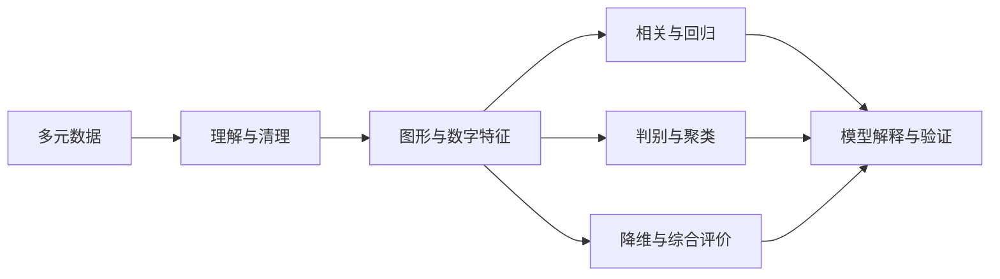

# 第 1 章 多元统计分析概述

| 复习要点 | 掌握目标 |
| --- | --- |
| 多元数据 | 区分一个对象的多个指标与一个指标的多次观测 |
| 方法用途 | 依研究问题选择回归、分类、降维、评价等方法 |
| 分析流程 | 从数据含义走到模型解释与验证 |
| R 基础 | 理解对象、包、函数与脚本的关系 |

## 1. 多元统计分析研究什么

现实中，一个研究对象通常由多个指标共同描述。例如用身高和体重描述人体，或用食品、衣着、交通、居住等支出描述居民消费结构。

多元统计分析运用数理统计方法，研究多个变量的联合变化、相互依赖关系以及对象间差异。保留变量间的联系，是它区别于将每个变量孤立分析的关键。

## 2. 四类主要用途

| 用途 | 代表方法 | 典型问题 |
| --- | --- | --- |
| 变量之间相依性分析 | 简单、偏、复、典型相关 | 哪些变量或变量组相互联系？ |
| 预测与解释 | 回归、广义线性模型、趋势分析 | 连续值或事件概率怎样变化？ |
| 分类与模式识别 | 判别、聚类 | 新样本属于哪类？样本自然分成几类？ |
| 简化结构与综合描述 | PCA、因子、对应、MDS、综合评价 | 怎样用少数坐标或指标解释复杂数据？ |

有类别标签的判别分析与无标签的聚类分析不能混用；相关和回归也不会单凭观察数据自动给出因果结论。

## 3. 课程各方法之间的联系



均值、协方差阵、相关阵贯穿后续章节；特征分解把 PCA、因子、对应分析和 MDS 联系起来，但它们优化的目标并不相同。

## 4. 一次完整分析的基本步骤

1. **明确目标**：预测、分类、探索结构还是评价排名。
2. **识别数据**：行代表谁，列代表什么，单位是什么，是否有标签。
3. **检查质量**：缺失、异常、重复、编码、量纲、样本选择。
4. **描述与作图**：均值、离散程度、分布形态、相关关系。
5. **建立模型**：明确假设与参数含义。
6. **检验与诊断**：检查拟合、残差、稳定性及必要的留出验证。
7. **解释与报告**：将数学结果放回实际问题，说明结论适用范围。

“软件运行成功”只说明算出了某个结果；还需要判断输入变量、方法假设和结果解释是否合理。

## 5. 统计软件与 R 的作用

课件介绍了 SPSS、SAS、S-PLUS、MATLAB、R 等工具。笔记中的上机操作以 R 为主，复习时重点掌握输入对象、调用函数、读取结果三件事。

- **R 对象**保存数据与分析结果，如向量、矩阵、数据框、拟合模型。
- **函数**对对象作运算，如 `mean(x)`、`lm(y ~ x, data=d)`。
- **包**提供函数、数据和帮助文档。安装与加载是不同操作。
- **脚本**保存可重复执行的分析步骤，避免只在命令窗口零散输入。

```r
x <- c(1, 2, 3, 4)
mean(x)
var(x)               # 分母 n-1
length(x)
class(x)
help(mean)

# 需要扩展包时，先安装一次，再在使用的会话加载
# install.packages("MASS")
# library(MASS)
```

课件展示的历史包名和软件界面用于理解工具体系，不必照抄过时的界面操作。`MASS::lda()` 这种写法明确函数来自哪个包，也能减少同名函数冲突。

## 6. 常见误区

| 误区 | 正确理解 |
| --- | --- |
| 变量多就一定优于变量少 | 多余变量可能增加共线性、噪声与估计不稳定 |
| 样本拟合好就能预测好 | 需要考虑过拟合与新样本验证 |
| 降维方法都在做同一件事 | PCA 保留变异，因子解释共同结构，MDS 逼近距离 |
| 排名是完全客观的 | 指标、标准化与权重都会改变排名 |
| 图上分开就证明差异显著 | 图形探索与统计检验的任务不同 |

本章依据 `第1章 多元统计分析概述.pptx`。原课件中授课安排与教材推介不作为统计方法结论。

[返回课程目录](../人工智能数学基础.md)
