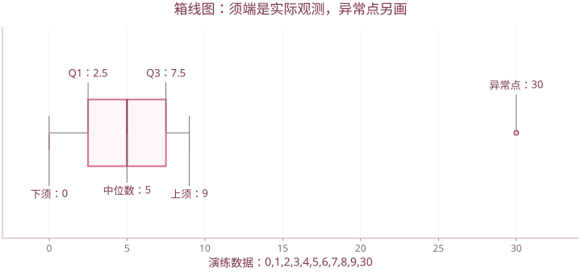

# 第 3 章 多元数据的直观表示

| 图形 | 主要观察对象 |
| --- | --- |
| 条形图 | 不同样本或变量的统计量 |
| 饼图 | 同一总体内可相加的组成比例 |
| 箱线图（箱尾图） | 中位数、离散程度、偏态与异常点 |
| 散点图、散点图矩阵 | 变量间关系及离群点 |
| 星相图 | 多指标轮廓及样本间形状相似性 |

## 1. 图形分析的任务

图形用于先了解分布、趋势、群组、相关性与异常值，再决定后续模型。图形显示的关系需要结合单位和变量含义解释。

课件以 31 个省、市、自治区的 8 项居民消费支出为例：食品、衣着、设备、医疗、交通、教育、居住、杂项。行是地区，列是消费指标。完整表格保存在课件引用的配套工作簿中，不能用几张图反推成未经核实的数据表。

## 2. 均值、中位数的条形图

对 $X_{n\times p}$：

- 行均值：每个对象在各变量上的平均，得到 $n$ 个数。
- 列均值：每个变量在各对象上的平均，得到 $p$ 个数。
- 列中位数：各变量的中间水平，对极端值较均值稳健。

```r
X <- matrix(c(100,20,30, 150,25,40, 120,22,35), nrow=3, byrow=TRUE)
colnames(X) <- c("食品","衣着","居住")
rownames(X) <- c("甲","乙","丙")
barplot(rowMeans(X), las=1, ylab="行均值")
barplot(colMeans(X), col=c("pink","plum","mistyrose"), ylab="列均值")
barplot(apply(X, 2, median), ylab="中位数")
```

此处小矩阵是作图演练数据。不同单位或含义的指标不能不经处理就把行均值解释为“综合水平”。

## 3. 饼图

饼图适合表示同一整体中各部分的比例，要求各部分非负且有可相加意义。课件对消费支出均值作饼图，表达的是各类消费支出在总额中的构成。

```r
pie(colMeans(X), labels=colnames(X))
```

一般不能把身高、体重、年龄等不同单位的均值混在一张饼图中。

## 4. 箱线图

### 4.1 组成与解释

- 箱内线：中位数。
- 箱两端：下、上四分位位置，箱高反映四分位距 $IQR=Q_3-Q_1$。
- 须：通常延伸到界限 $Q_1-1.5IQR$、$Q_3+1.5IQR$ 内最远的实际观测。
- 须外点：供进一步检查的潜在异常值。

R 的箱线图使用 Tukey hinges，小样本时可能与 `quantile()` 默认算法的四分位数略有差异。须端不必等于最大值或最小值，也不是置信区间边界。



演练数据11个数，Q1=2.5，中位数5，Q3=7.5，IQR=5；30超过上侧界限15。

### 4.2 R 操作

```r
boxplot(as.data.frame(X), ylab="消费支出")
boxplot(as.data.frame(X), horizontal=TRUE, las=1)
```

箱体偏长说明中间一半数据较分散；上下须不对称可能提示偏态。异常点应结合录入错误、真实特殊样本等原因调查，不能见到就删除。

## 5. 散点图与变量关系

散点图每点对应一个样本的两项观测。观察方向、曲线趋势、群组和离群点，而非只盯一条回归直线。

```r
plot(X[,"食品"], X[,"居住"], xlab="食品支出", ylab="居住支出")
pairs(as.data.frame(X))
```

正相关不等于因果；散点接近一条曲线也不一定意味着线性相关系数接近 1。

## 6. 星相图

每个样本画一个星形，射线分别对应变量，长度对应数值。相似轮廓提示样本在多个指标上的结构相近。

```r
stars(X)
stars(X, draw.segments=TRUE)
```

`stars()` 可以按列缩放数据，比较图形时应统一变量次序、缩放规则和图例。改变射线排列可能改变人眼判断的形状，因此图形相似不代替正式聚类。

“星相图”也可理解为多对象的雷达轮廓展示；单独一张雷达图和多个对象的星相图在布局上有所不同。

## 7. 课件列举的其他多元图形

课件的内容要求还列举了脸谱图和调和曲线图，现有具体演示主要集中在条图、箱线图和星相图。

- **脸谱图**：把变量映射为脸部特征。适合直观比较，但不同面部特征的视觉显著性不相同。
- **调和曲线图（Andrews 曲线）**：把每行向量转为一条曲线，例如

$$f_i(t)=\frac{x_{i1}}{\sqrt2}+x_{i2}\sin t+x_{i3}\cos t+x_{i4}\sin2t+x_{i5}\cos2t+\cdots,\quad-\pi\le t\le\pi.$$

相似曲线提示相似数据轮廓；绘图前仍需考虑量纲与变量次序。这些图形是探索工具，不自动产生统计显著性结论。

## 8. 读图检查表

1. 标题和坐标分别表示什么，单位是否一致？
2. 一根柱、一个点或一个星形代表一个样本，还是一个变量？
3. 图中用的是原值、均值、中位数、总和还是标准化值？
4. 是否存在强烈偏态、异常点、缺失处理或坐标截断？
5. 得出的结论是描述性观察，还是已经做过检验的推断？

依据 `第3章 多元数据直观表示.pptx`。

[返回课程目录](../人工智能数学基础.md)
