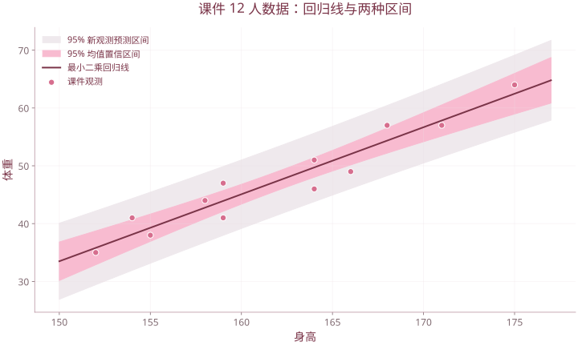

# 第 4 章 多元相关与回归分析

| 复习要点 | 掌握目标 |
| --- | --- |
| 简单、偏、复相关 | 分清两变量、控制其他变量、多个变量联合解释 |
| 最小二乘 | 写出目标函数、正规方程及矩阵解 |
| 回归检验 | 区分模型整体 F 检验与单系数 t 检验 |
| 变量选择 | 理解 RSS、调整 $R^2$、$C_p$、AIC/BIC |
| 结果解释 | 区分相关、拟合、预测与因果 |

## 1. 关系分析与回归分析

确定的函数关系中，给定 $x$ 即确定 $y$；统计关系中，同一个 $x$ 下的 $y$ 仍存在随机差异。回归分析通常研究条件均值 $E(Y\mid X)$，而不保证每个观测都落在拟合线上。

“线性”指**对参数线性**。$y=\beta_0+\beta_1x+\beta_2x^2+\varepsilon$ 仍属于线性模型；回归并不要求各解释变量之间必须相关。

## 2. 简单相关

### 2.1 Pearson 样本相关系数

$$L_{xy}=\sum_i(x_i-\bar x)(y_i-\bar y)=\sum_ix_iy_i-\frac{\sum_ix_i\sum_iy_i}{n},$$

$$r=\frac{L_{xy}}{\sqrt{L_{xx}L_{yy}}},\qquad L_{xx},L_{yy}>0.$$

$-1\le r\le1$。符号表示线性变化方向，绝对值表示线性关系强弱；$r=0$ 不能排除非线性关系。

### 2.2 相关系数检验

在独立的二元正态样本等条件下，检验 $H_0:\rho=0$：

$$t=\frac{r\sqrt{n-2}}{\sqrt{1-r^2}}\sim t(n-2)\quad(H_0\text{ 下}).$$

双侧检验比较 $|t|$ 与上侧 $\alpha/2$ 分位点；拒绝原假设表示有线性相关证据，不能由此推出因果。

### 2.3 课件例：12 名学生身高与体重

```r
x <- c(171,175,159,155,152,158,154,164,168,166,159,164)
y <- c(57,64,41,38,35,44,41,51,57,49,47,46)
plot(x,y,xlab="身高",ylab="体重")
cor(x,y)
cor.test(x,y)
```

课件结果 $r\approx0.9593031$，$t\approx10.743$，自由度 10，双侧 $p\approx8.21\times10^{-7}$。注意后续 PCA 课件另有 14 人数据，其相关系数约 0.9672，不能混成同一个例题。

## 3. 一元线性回归

### 3.1 模型与假设

$$Y_i=\beta_0+\beta_1x_i+\varepsilon_i.$$

最小二乘的计算不必先假设正态；经典无偏性与检验分别还需要条件。通常设 $E(\varepsilon_i\mid X)=0$、方差为 $\sigma^2$，误差不相关；精确 t/F 推断再使用正态误差假设。

### 3.2 参数估计

$$Q(b_0,b_1)=\sum_i(y_i-b_0-b_1x_i)^2.$$

令偏导为 0 得到正规方程，解为

$$\hat\beta_1=\frac{L_{xy}}{L_{xx}},\qquad\hat\beta_0=\bar y-\hat\beta_1\bar x.$$

预测值 $\hat y_i=\hat\beta_0+\hat\beta_1x_i$，残差 $e_i=y_i-\hat y_i$。含截距时 $\sum e_i=0$，且回归线经过 $(\bar x,\bar y)$。

上例身高与体重的估计方程为

$$\widehat{\text{体重}}=-140.36436+1.15906\times\text{身高}.$$

系数解释是样本所支持范围内的条件平均变化；不能用负截距推断“身高为 0 时真实体重为负”。

```r
fit <- lm(y~x)
coef(fit)
summary(fit)
anova(fit)
plot(x,y)
abline(fit,col="deeppink3")
```

### 3.3 平方和分解与检验

$$SST=\sum_i(y_i-\bar y)^2,\quad SSR=\sum_i(\hat y_i-\bar y)^2,\quad SSE=\sum_ie_i^2.$$

含截距的最小二乘模型有 $SST=SSR+SSE$。有些资料用 RSS 指残差平方和，另一些用它指回归平方和；本笔记用 **SSE 表示残差**，看输出时先确认定义。

$$s^2=\frac{SSE}{n-2},\quad SE(\hat\beta_1)=\frac{s}{\sqrt{L_{xx}}},\quad t=\frac{\hat\beta_1-\beta_{1,0}}{SE(\hat\beta_1)}.$$

检验 $\beta_1=0$ 时也可用 $F=(SSR/1)/(SSE/(n-2))$，此时 $F=t^2$。

### 3.4 均值区间与预测区间

在 $x_0$ 处，均值响应的标准误为

$$s\sqrt{\frac1n+\frac{(x_0-\bar x)^2}{L_{xx}}}.$$

预测一个新观测的标准误多出随机误差项：

$$s\sqrt{1+\frac1n+\frac{(x_0-\bar x)^2}{L_{xx}}}.$$

所以相同置信水平下预测区间更宽。超出观测范围的外推还可能有模型失配风险。

```r
predict(fit,newdata=data.frame(x=165),interval="confidence")
predict(fit,newdata=data.frame(x=165),interval="prediction")
```



使用课件12人完整数据拟合。浅灰为单个新观测预测区间，粉色为均值区间；均以经典正态回归假设为前提。

## 4. 多元线性回归

### 4.1 设计矩阵与最小二乘

$p$ 表示解释变量个数，截距另计：

$$\boldsymbol y=X\beta+\varepsilon,\quad X\in\mathbb R^{n\times(p+1)},\quad\beta\in\mathbb R^{p+1}.$$

$X$ 第一列全为 1。目标是最小化 $\|y-X\beta\|^2$，正规方程

$$X^{\mathsf T}X\hat\beta=X^{\mathsf T}y.$$

列满秩时

$$\hat\beta=(X^{\mathsf T}X)^{-1}X^{\mathsf T}y,\qquad\operatorname{Cov}(\hat\beta\mid X)=\sigma^2(X^{\mathsf T}X)^{-1}.$$

**条件不能省：** 解释变量完全线性相关时参数不唯一，不能直接求该逆。实际数值计算通常用 QR 等分解，避免手工显式求逆。

### 4.2 方差分析与整体 F 检验

检验 $H_0:\beta_1=\cdots=\beta_p=0$：

| 变异来源 | 平方和 | 自由度 | 均方 |
| --- | --- | --- | --- |
| 回归 | SSR | $p$ | $SSR/p$ |
| 残差 | SSE | $n-p-1$ | $MSE=SSE/(n-p-1)$ |
| 总计 | SST | $n-1$ | — |

$$F=\frac{SSR/p}{SSE/(n-p-1)}\sim F(p,n-p-1)\quad(H_0\text{ 下}).$$

显著说明至少一个斜率不为 0，不说明每个解释变量都显著。

### 4.3 单个系数与部分 F 检验

令 $C=(X^{\mathsf T}X)^{-1}$：

$$t_j=\frac{\hat\beta_j-\beta_{j,0}}{s\sqrt{C_{jj}}},\quad s^2=MSE,$$

在原假设与经典正态模型条件下自由度为 $n-p-1$。

比较嵌套的简化模型与完整模型，若简化模型减少 $q$ 个参数，则

$$F=\frac{(SSE_R-SSE_F)/q}{SSE_F/(n-p-1)}.$$

两个模型须使用同一批观测；比较一个系数时部分 F 等于对应 t 的平方。

### 4.4 课件例：财政收入

课件把财政收入作为 $y$，用国民生产总值、税收、进出口贸易额、经济活动人口作为 $x_1,\ldots,x_4$。补充课件《4-2回归分析2（多元）》第 23—24 页给出 1978—2008 年的 31 行数据，据此复算得到

$$\hat y=23.5321100-0.00338663x_1+1.16411504x_2+0.000291923x_3-0.043741610x_4.$$

下列数据按课件表格原值录入，量纲沿用课件；例如 1983 年 $y=18.6695$，未以外部统计资料替换。

```r
fiscal <- read.table(header=TRUE, text="
year y x1 x2 x3 x4
1978 11.3262 36.241 5.1928 3.55 406.82
1979 11.4638 40.382 5.3782 4.12 415.92
1980 11.5993 45.178 5.717 5.7 429.03
1981 11.7579 48.603 6.2989 8.904 441.65
1982 12.1233 53.018 7.0002 12.801 456.74
1983 18.6695 59.574 7.5559 15.903 467.07
1984 16.4286 72.067 9.4735 18.202 484.33
1985 20.0482 89.891 20.4079 20.667 501.12
1986 21.2201 102.014 20.9073 26.019 515.46
1987 21.9935 119.545 21.4036 32.202 530.6
1988 23.5724 149.223 23.9047 41.6 546.3
1989 26.649 169.178 27.274 49.802 557.07
1990 29.371 185.984 28.2187 55.601 653.23
1991 31.4948 216.625 29.9017 72.258 660.91
1992 34.8337 266.519 32.9691 91.196 667.82
1993 43.4895 345.605 42.553 112.71 674.68
1994 52.181 466.7 51.2688 203.819 681.35
1995 62.422 574.949 60.3804 234.999 688.55
1996 74.0799 668.505 69.0982 241.338 697.65
1997 86.5114 731.427 82.3404 269.672 708
1998 98.7595 769.672 92.628 268.577 720.87
1999 114.4408 805.794 106.8258 298.963 727.91
2000 133.9523 882.281 125.8151 392.742 739.92
2001 163.8604 943.464 153.0138 421.933 744.32
2002 189.0364 1203.327 176.3645 513.782 753.6
2003 217.1525 1358.228 200.1731 704.835 760.75
2004 263.9647 1598.783 241.6568 955.391 768.23
2005 316.4929 1832.174 287.7854 1169.218 778.77
2006 387.602 2119.235 348.0435 1409.714 782.44
2007 513.2178 2495.299 456.2197 1667.402 786.45
2008 613.3035 3006.7 542.1962 1778.898 790.48
")
full <- lm(y~x1+x2+x3+x4, data=fiscal)
summary(full)
anova(full)
```

系数估计与课件输出相符，个别末位差异来自输出舍入。残差自由度为 $31-4-1=26$，$R^2\approx0.99971615$，整体回归检验 $F(4,26)\approx22892.9955$。

| 变量 | 斜率估计 | 双侧 t 检验 p 值（约） | 5% 水平 |
| --- | ---: | ---: | --- |
| $x_1$ | -0.003386631 | 0.67837 | 不显著 |
| $x_2$ | 1.164115040 | 3.0987e-21 | 显著 |
| $x_3$ | 0.000291923 | 0.97303 | 不显著 |
| $x_4$ | -0.043741610 | 7.0049e-05 | 显著 |

这里 $x_2,x_4$ 的单系数检验显著，$x_1,x_3$ 不显著。这是控制其他变量后的效应；不能因为两两相关都高，就断言所有变量入模后都显著。历史时间序列中的共同趋势、自相关和因果方向还需另作分析。

## 5. 偏相关与复相关

### 5.1 偏相关

控制一个变量 $Z$ 后：

$$r_{XY\cdot Z}=\frac{r_{XY}-r_{XZ}r_{YZ}}{\sqrt{(1-r_{XZ}^2)(1-r_{YZ}^2)}}.$$

也可分别把 $X,Y$ 对 $Z$ 回归，再计算两个残差的相关。控制多个变量时可使用对应残差法；若相关阵可逆，还可由精度阵 $P=R^{-1}$ 求得 $r_{ij\cdot\text{其他}}=-P_{ij}/\sqrt{P_{ii}P_{jj}}$。

偏相关为 0 只表示控制变量后的线性相关为 0；一般不等于条件独立。

### 5.2 复相关与决定系数

在含截距的最小二乘模型中：

$$R^2=1-\frac{SSE}{SST}=\frac{SSR}{SST},\qquad R=\sqrt{R^2}.$$

复相关 $R$ 衡量一个响应变量与一组解释变量的整体线性联系，通常取非负值。高 $R^2$ 不保证模型假设正确，也不保证新样本预测好。

调整决定系数

$$\bar R^2=1-\frac{SSE/(n-p-1)}{SST/(n-1)}$$

会对加入变量作自由度惩罚，可以为负。无截距模型的平方和分解与输出定义另有差别，不宜直接套上述解释。

## 6. 回归变量选择

### 6.1 为什么不能只看 RSS 或 $R^2$

在同一批样本、嵌套模型中，增加变量不会使最小 SSE 增大，$R^2$ 也不会减小。因此只追求这两项，会倾向选择全部变量。

### 6.2 常用准则

| 准则 | 原理与选择方向 |
| --- | --- |
| MSE | $SSE/(n-k)$，$k$ 为含截距参数数目；越小越好 |
| 调整 $R^2$ | 平衡拟合与模型大小；越大越好 |
| Mallows $C_p$ | $SSE_k/\hat\sigma^2_{full}-(n-2k)$；结合 $C_p$ 接近 $k$ 与模型简洁性判断 |
| AIC | $-2\ell(\hat\theta)+2k_{\mathrm{lik}}$；越小越好 |
| BIC | $-2\ell(\hat\theta)+k_{\mathrm{lik}}\log n$；越小越好 |

AIC/BIC 中 $k_{\mathrm{lik}}$ 是似然模型估计参数总数，正态模型通常还包括误差方差；不同软件可能省略共同常数或采用等价比较形式。

### 6.3 全部子集与逐步选择

$p$ 个候选解释变量共有 $2^p$ 个子集（含空模型）；不含空模型是 $2^p-1$。$p=50$ 时非空子集约 $1.126\times10^{15}$，课件简写数量级时不能读作 1015 个。

| 方法 | 操作 |
| --- | --- |
| 向前引入 | 从较小模型开始，尝试加入变量 |
| 向后剔除 | 从完整模型开始，尝试删除变量 |
| 双向逐步 | 加入后也允许重新删除 |

课件有按 F 阈值引入、剔除的讲法，也有 R 的 `step()` 演示。**`step()` 默认按 AIC 比较，不是默认按 F 显著性筛选。**

```r
# 示例使用自带数据，不依赖未提供的课程工作簿
d <- mtcars
full <- lm(mpg~wt+hp+disp,data=d)
null <- lm(mpg~1,data=d)
forward <- step(null,
                scope=list(lower=~1,upper=~wt+hp+disp),
                direction="forward",trace=0)
backward <- step(full,direction="backward",trace=0)
both <- step(full,scope=list(lower=~1,upper=~wt+hp+disp),
             direction="both",trace=0)
```

**课件订正：** 直接从完整模型 `step(full,direction="forward")` 出发，若没有更大的上界模型，就无变量可加入；向前选择应给定小起点与上界范围。[R 的 step 文档](https://stat.ethz.ch/R-manual/R-devel/library/stats/html/step.html)

## 7. 共线性与模型诊断

多重共线性不仅限于“某两列完全相同”，也可能是某列由多列线性组合得到。近似共线性会增大系数方差，使单个系数不稳定。

拟合后检查残差与拟合值图、正态 Q–Q 图、异常点和高杠杆点；时间数据还需关注误差相关。变量选择的结果应接受独立验证，选择后再直接解释原模型的 p 值要谨慎。

```r
par(mfrow=c(2,2))
plot(fit)
par(mfrow=c(1,1))
```

## 8. 课件对照

合并 `第4章 多元相关与回归分析.pptx`、`4-0章变量间的相关性.pptx`、`4-1回归分析1（一元）.pptx`、`4-2回归分析2（多元）.pptx`、`4-3回归分析3(逐步回归).ppt`。复习主线为：**问题与假设 → 参数估计 → 整体检验 → 单系数/部分检验 → 诊断 → 预测或变量选择**。

[返回课程目录](../人工智能数学基础.md)
