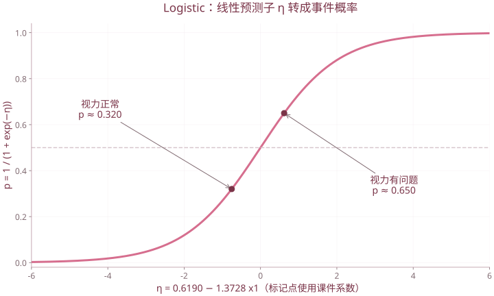

# 第 5 章 广义与一般线性模型

| 复习要点 | 掌握目标 |
| --- | --- |
| 模型选择 | 依据响应变量类型选分布与模型 |
| GLM 三要素 | 随机部分、线性预测子、连接函数 |
| Logistic | 从 log-odds 转成概率，解释优势比 |
| Poisson 对数线性模型 | 解释计数或列联表频数 |
| 一般线性模型 | 理解方差分析、区组和协变量 |

## 1. 先识别响应变量

| 响应变量 $Y$ | 典型模型 | 备注 |
| --- | --- | --- |
| 连续型 | 线性回归、方差分析 | 解释变量可连续也可分类 |
| 二分类 0/1 | Logistic、probit | 模型输出事件概率 |
| 非负整数计数 | Poisson 对数线性模型 | 检查暴露量与过度离散 |
| 有序分类 | 累积比数等有序模型 | 不能忽略类别顺序 |
| 无序多分类 | 多项 Logistic | 类别编码不代表数值间距 |
| 连续且伴删失的生存时间 | 如 Cox 比例风险模型 | 课件用于模型选择概览，并非标准 GLM 的全部都覆盖 |

解释变量的类型决定设计矩阵怎样编码，响应变量的性质决定分布模型怎样选择。

## 2. 广义线性模型的三个组成

### 2.1 随机部分

观测通常独立，响应分布属于指数族：

$$f(y;\theta,\phi)=\exp\left\{\frac{y\theta-b(\theta)}{a(\phi)}+c(y,\phi)\right\}.$$

这里 $\theta$ 为典型参数、$\phi$ 为离散参数，$E(Y)=b'(\theta)$、$\operatorname{Var}(Y)=b''(\theta)a(\phi)$。不同 GLM 不必有恒定响应方差。

### 2.2 系统部分与连接函数

$$\eta_i=\beta_0+\sum_j\beta_jx_{ij},\qquad g(\mu_i)=\eta_i,\quad\mu_i=E(Y_i\mid x_i).$$

| 分布 | 常用连接函数 | 均值形式 |
| --- | --- | --- |
| 正态 | 恒等 $g(\mu)=\mu$ | $\mu=\eta$ |
| 二项 | logit $g(p)=\log[p/(1-p)]$ | $p=e^\eta/(1+e^\eta)$ |
| Poisson | 对数 $g(\mu)=\log\mu$ | $\mu=e^\eta$ |

不能把“对 $Y$ 取对数后做普通回归”与“对条件均值使用 log 连接的 Poisson 回归”当作同一件事。

## 3. Logistic 回归

### 3.1 模型和解释

$$Y_i\sim\operatorname{Bernoulli}(p_i),\quad\log\frac{p_i}{1-p_i}=\eta_i=x_i^{\mathsf T}\beta.$$

$$p_i=\frac1{1+e^{-\eta_i}}.$$

优势 $p/(1-p)$ 与概率不同。控制其他变量后，$x_j$ 增加 1，优势乘以 $e^{\beta_j}$；不能把 $e^{\beta_j}$ 直接解释为概率倍数。

参数一般通过极大似然估计，Bernoulli 对数似然为

$$\ell(\beta)=\sum_i\{y_i\log p_i+(1-y_i)\log(1-p_i)\}.$$

通常使用迭代算法，不存在与普通最小二乘完全相同的闭式解。

### 3.2 课件例：驾驶员事故

课件调查 45 名驾驶员：$x_1$ 为视力是否正常，$x_2$ 为年龄，$x_3$ 为是否参加驾车教育，$y=1$ 表示去年出过事故。

课件全变量拟合后，逐步模型仅保留视力变量，报告

$$\operatorname{logit}(p)=0.6190-1.3728x_1.$$

故视力正常 $x_1=1$ 时 $p\approx0.3200$，有问题 $x_1=0$ 时 $p\approx0.6500$。这些是该样本拟合的条件概率，不是对任意驾驶员的普遍事故率。

```r
# 完整驾驶员表需由课程数据提供
# fit <- glm(y~x1+x2+x3,family=binomial(link="logit"),data=driver)
# fit.step <- step(fit,direction="both",trace=0)
# predict(fit.step,newdata=data.frame(x1=c(1,0)),type="response")

# 独立复算课件所列系数对应的概率
plogis(0.6190-1.3728*c(1,0))
```

`predict(..., type="response")` 直接返回响应尺度上的概率；默认 `link` 返回 log-odds。只有最终模型确实只含 $x_1$ 时，新数据才可以只给 $x_1$。[R 的 predict.glm 文档](https://stat.ethz.ch/R-manual/R-devel/library/stats/html/predict.glm.html)



标记点按课件简化驾驶员模型，x1=1和0的预测概率约0.32、0.65。曲线横轴是线性预测子而非年龄或原始类别。

### 3.3 检验与分类

常见输出有系数、标准误、Wald z 检验、偏差（deviance）与 AIC。比较嵌套模型时可用偏差差的似然比检验；p 值小与预测准确不是同一个概念。

概率转成类别还须给定阈值，阈值应结合错判代价。模型评价可考察独立测试集上的混淆矩阵、灵敏度、特异度及概率校准。

## 4. Poisson 与列联表的对数线性模型

### 4.1 Poisson 回归

$$Y_i\sim\operatorname{Poisson}(\mu_i),\quad\log\mu_i=x_i^{\mathsf T}\beta.$$

Poisson 模型中 $\operatorname{Var}(Y_i\mid x_i)=\mu_i$。在其他变量不变时，解释变量增加 1，均值乘以 $e^{\beta_j}$。若观测暴露量不同，可在模型中加入相应 offset。

### 4.2 课件例：收入与满意程度

| 收入 | 满意 | 不满意 | 合计 |
| --- | ---: | ---: | ---: |
| 高 | 53 | 38 | 91 |
| 中 | 434 | 108 | 542 |
| 低 | 111 | 48 | 159 |
| 合计 | 598 | 194 | 792 |

计数表的独立模型为

$$\log m_{ij}=\mu+\alpha_i+\beta_j.$$

若加入交互项 $\gamma_{ij}$，允许两分类因素之间存在关联。要判断是否独立，应比较独立模型与带关联的模型，或作列联表独立性检验。

```r
tab <- matrix(c(53,38,434,108,111,48),nrow=3,byrow=TRUE,
              dimnames=list(income=c("高","中","低"),sat=c("满意","不满意")))
d <- as.data.frame(as.table(tab))
m0 <- glm(Freq~income+sat,family=poisson(link="log"),data=d)
m1 <- glm(Freq~income*sat,family=poisson(link="log"),data=d)
anova(m0,m1,test="Chisq")
chisq.test(tab,correct=FALSE)
```

**课件修正：** 收入等级与满意类别应按因子处理。把它们编码为连续的 1、2、3 后直接回归会另加线性趋势约束；两个主效应系数显著，也不能代替收入与满意度的独立性检验。

## 5. 一般线性模型与方差分析

一般线性模型以 $Y=X\beta+\varepsilon$ 为框架。分类因素通过虚拟变量进入 $X$，连续协变量也可进入，因此回归、方差分析与协方差分析可以用同一框架理解。

### 5.1 单因素完全随机设计

$$Y_{ij}=\mu+\alpha_i+\varepsilon_{ij}.$$

检验各组总体均值是否相等。独立、正态、方差齐性等经典条件下：

$$SS_A=\sum_i n_i(\bar y_i-\bar y)^2,\quad SS_E=\sum_{i,j}(y_{ij}-\bar y_i)^2,$$

$$F=\frac{SS_A/(g-1)}{SS_E/(N-g)}\sim F(g-1,N-g)\quad(H_0\text{ 下}).$$

显著只说明并非所有均值相等；若问具体哪两组不同，还需适当的多重比较。

**课件例：三台机器的薄板厚度。** 课件文字写“各 5 块”，表中实际每组 6 个数，下面按完整表格的 **18 个观测**分析：

```r
Y <- c(2.36,2.38,2.48,2.45,2.47,2.43,
       2.57,2.53,2.55,2.54,2.56,2.61,
       2.58,2.64,2.59,2.67,2.66,2.62)
A <- factor(rep(1:3,each=6))
fit.a <- lm(Y~A)
anova(fit.a)
TukeyHSD(aov(Y~A))
```

分组变量必须使用因子，否则 `Y~A` 中数值 1、2、3 会被解释为一条直线趋势，而不是任意三组均值。

### 5.2 随机区组设计

课件称“随机单位组设计”：

$$Y_{ij}=\mu+\alpha_i+\beta_j+\varepsilon_{ij}.$$

$\alpha_i$ 为处理效应，$\beta_j$ 为区组效应。每组合只有一次观测时，交互作用通常不能与误差单独估计，简单加性模型应有相应的无交互或可忽略交互假设。

课件有 4 种燃料 $A$、3 种推进器 $B$，每组合 1 次：

```r
d <- data.frame(
  Y=c(582,491,601,758,562,541,709,582,653,516,392,487),
  A=factor(rep(1:4,3)),
  B=factor(rep(1:3,each=4))
)
anova(lm(Y~A+B,data=d))
```

课件输出约为 $p_A=0.7387,p_B=0.4491$，在 0.05 水平下均未发现显著主效应。**不拒绝并不证明效应严格为零**；也不能在无重复的这张表上随意拟合并检验完整交互项。

### 5.3 协方差分析

分类处理因素与连续协变量共同解释响应，如 $Y\sim A+x$。若加入 $A:x$，表示不同处理组允许不同斜率。协变量须有实际含义，不能仅为了得到显著结果随意筛选。

## 6. 本章易错点

| 易错点 | 正确理解 |
| --- | --- |
| 一般线性模型与广义线性模型同名混淆 | 关注 GLM 的分布族与连接函数；一般线性模型以正态线性框架理解 |
| Logistic 系数就是概率增量 | 它作用于 log-odds；概率增量随其他变量而变 |
| Poisson 频数模型中的类别按数字直接拟合 | 通常应使用因子编码，除非明确检验线性趋势 |
| 分组显著意味着所有组两两都不同 | 整体检验与两两比较不同 |
| $p>0.05$ 证明完全没有差异 | 只是当前数据未提供足够拒绝证据 |

依据 `第5章 广义与一般线性模型.pptx`。同目录的两份“趋势分析”课件见[趋势面分析专题](05A-趋势面分析.md)。

[返回课程目录](../人工智能数学基础.md)
