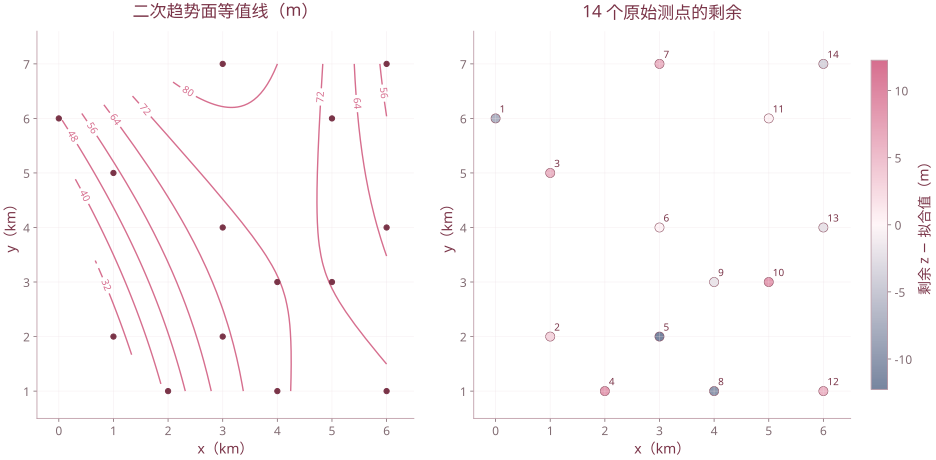

# 专题 趋势面分析

| 复习要点 | 掌握目标 |
| --- | --- |
| 趋势与剩余 | 将观测分解为区域背景与局部偏离 |
| 多项式趋势面 | 构造设计矩阵，用最小二乘估计 |
| 模型阶数 | 计算项数与自由度，避免过度拟合 |
| 拟合检验 | 区分拟合度、整体显著性与升阶检验 |

本专题对应 `5-1趋势分析1.pptx`、`5-2趋势分析2.pptx`。它研究空间变量的趋势拟合，与广义线性模型是不同专题。

## 1. 趋势的含义

沿空间某一方向，若观测的平均变化超出局部偶然起伏，就可研究该方向的趋势。趋势可以是直线、曲线、曲面或更高维超曲面。

$$z_i=\hat z_i+e_i,$$

其中 $\hat z_i$ 表示区域性背景，$e_i=z_i-\hat z_i$ 称剩余或残差。正剩余表示高于拟合背景，负剩余表示低于背景；其实际含义还取决于指标是厚度、深度、产量还是浓度。

## 2. 多项式趋势面

二维坐标 $(x,y)$、响应为 $z$：

一次：

$$z=\beta_0+\beta_1x+\beta_2y+\varepsilon.$$

二次：

$$z=\beta_0+\beta_1x+\beta_2y+\beta_3x^2+\beta_4xy+\beta_5y^2+\varepsilon.$$

一般总次数不超过 $q$ 的二元多项式为

$$z=\sum_{a+b\le q}\beta_{ab}x^ay^b+\varepsilon.$$

含截距项数为 $m=(q+1)(q+2)/2$。虽然关于坐标非线性，但对待估参数仍是线性的，可以使用线性回归。

| 阶数 $q$ | 含截距项数 $m$ | 非截距项数 |
| --- | ---: | ---: |
| 1 | 3 | 2 |
| 2 | 6 | 5 |
| 3 | 10 | 9 |
| 4 | 15 | 14 |

## 3. 最小二乘与正规方程

一次设计矩阵每行为 $(1,x_i,y_i)$，二次每行为 $(1,x_i,y_i,x_i^2,x_iy_i,y_i^2)$。令设计矩阵为 $T$，则

$$\hat\beta=\arg\min_\beta\|z-T\beta\|^2,\qquad T^{\mathsf T}T\hat\beta=T^{\mathsf T}z.$$

只有列满秩时才能写 $\hat\beta=(T^{\mathsf T}T)^{-1}T^{\mathsf T}z$。坐标分布不合适也可能使设计阵秩不足，不能只凭观测个数判断。

一次正规方程为

$$
\begin{pmatrix}n&\sum x_i&\sum y_i\\\sum x_i&\sum x_i^2&\sum x_iy_i\\\sum y_i&\sum x_iy_i&\sum y_i^2\end{pmatrix}
\begin{pmatrix}\hat\beta_0\\\hat\beta_1\\\hat\beta_2\end{pmatrix}
=\begin{pmatrix}\sum z_i\\\sum x_iz_i\\\sum y_iz_i\end{pmatrix}.
$$

## 4. 等值线与剩余图

趋势面 $\hat z=f(x,y)$ 的等值线满足 $f(x,y)=c$。一次趋势面对应一簇平行直线；若 $\beta_2\ne0$，可写

$$y=-\frac{\beta_1}{\beta_2}x+\frac{c-\beta_0}{\beta_2}.$$

剩余图显示 $e_i$ 的空间分布，用于发现背景之上的局部偏离。对不规则测点绘连续等值线需要插值；插值会引入额外假设，应同时保留原始测点，不能把平滑后的闭合线当成直接观测事实。

## 5. 拟合度与显著性

$$SST=\sum_i(z_i-\bar z)^2,\quad SSE=\sum_i(z_i-\hat z_i)^2,\quad SSR=SST-SSE.$$

课件拟合度 $C=SSR/SST=R^2$。在同样观测与嵌套的多项式空间下，升阶不会让最小 SSE 增大，但不意味着预测或解释必然改善。

在误差独立、同方差、正态等经典条件下，整体检验非截距系数是否全为 0：

$$F=\frac{SSR/(m-1)}{SSE/(n-m)}\sim F(m-1,n-m)\quad(H_0\text{ 下}).$$

须有 $n>m$ 且设计阵满秩。$R^2$ 高与整体 F 显著是两种判断；空间误差相关时，简单独立误差 F 检验还可能失准。

整体回归 F 检验使用**上侧 $\alpha$** 临界值，不将 $\alpha$ 再除以 2。对本章 $(2,11)$、$(5,8)$ 两组自由度，上侧 0.05 临界值约为 3.9823、3.6875；课件部分页使用了不同尾概率的临界值，不能直接混抄。

升阶的增量检验比较嵌套模型：

$$F_{\text{增量}}=\frac{(SSE_{低阶}-SSE_{高阶})/(m_{高阶}-m_{低阶})}{SSE_{高阶}/(n-m_{高阶})}.$$

## 6. 课件例：14 个顶板深度测点

下面按课件原表逐项记录，坐标单位 km、$z$ 单位 m：

```r
d <- data.frame(
  x=c(0,1,1,2,3,3,3,4,4,5,5,6,6,6),
  y=c(6,2,5,1,2,4,7,1,3,3,6,1,4,7),
  z=c(40,30,60,50,50,70,90,60,70,80,70,80,60,50)
)
m1 <- lm(z~x+y,data=d)
m2 <- lm(z~x+y+I(x^2)+I(x*y)+I(y^2),data=d)
coef(m1); summary(m1)
coef(m2); summary(m2)
anova(m1,m2)
cbind(d,trend=fitted(m2),residual=residuals(m2))
```

### 6.1 一次趋势面

$$\hat z=42.26460+4.29347x+1.11376y.$$

按原始数据、未提前舍入的系数复算：$SST\approx3571.42857$、$SSE\approx2553.67501$、$R^2\approx0.284971$、$F\approx2.191996$，自由度 $(2,11)$。课件给出的约 28.7% 与 2.21 使用了近似计算，复算结果略有差别，结论仍为 0.05 水平下整体不显著。

### 6.2 二次趋势面

$$\hat z=-20.88891+34.83121x+10.14022y-3.02799x^2-2.53065xy+0.20200y^2.$$

$SSE\approx573.00480$、$R^2\approx0.839559$、$F\approx8.372492$，自由度 $(5,8)$，在 0.05 水平下整体显著。

**关键订正：** 第 19 页一次项 $x$ 的系数印为 **4.83**，与原始测点和后面的预测表不符；按原数据重算应为 **34.83**。例如第一个点 $(0,6)$ 的预测值约 47.225，最后一个点 $(6,7)$ 约 53.683。

### 6.3 为什么不能机械升到四次

14 个观测若拟合完整四次趋势面，会有 15 个参数。此时不满足 $n>m$，常规残差均方及 F 检验**不再适用**。

课件第 22 页把负残差自由度代入得到“负 F”，这是无效计算。F 统计量在适用条件下不为负，不能把负数解释成“模型更差的有效 F 值”。应检查秩、参数数目，选择较低阶模型或增加数据，并用适当验证评估泛化。



使用课件14个测点，二次项系数经复算，x一次项系数34.8312。等值线仅在测点凸包内显示；右图为测点实际剩余，没有伪造连续剩余观测。

## 7. 做题流程


先看项数与满秩条件，再求系数；先用完整精度计算，再在展示表中舍入。不要用逐步舍入后的趋势值代替原模型来计算 SSE。

[返回课程目录](../人工智能数学基础.md)
