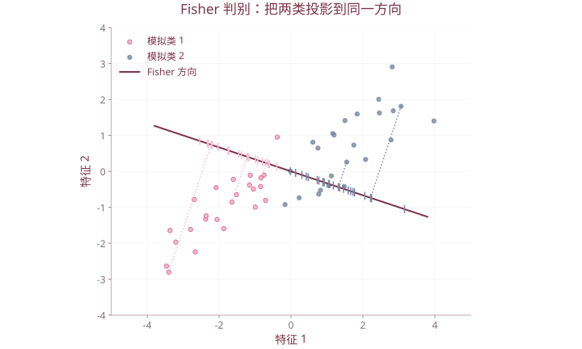

# 第 6 章 判别分析

| 复习要点 | 掌握目标 |
| --- | --- |
| 判别任务 | 从已知类别样本学习规则，再判断新样本 |
| 距离判别 | 欧氏距离、马氏距离、等/异协方差 |
| Fisher | 类间分离大、类内离散小的投影 |
| Bayes | 合并似然、先验与误判代价 |
| 逐步判别 | 用增量判别能力筛选变量 |

## 1. 判别与聚类

判别分析以**已知类别**的训练样本为依据，构造规则给新样本分类；聚类分析则在类别未定时寻找分组。

分类错误应在新样本或交叉验证中评估。用训练样本自身算出的回判正确率，通常偏乐观。

课件天气例用湿温差 $x_1$ 与气温差 $x_2$ 区分雨天、晴天，再判断 $(8.1,2.0)^{\mathsf T}$；电视机例按质量、功能、价格判断畅销、平销、滞销。先明确训练样本类别、特征顺序和单位，再代入函数。

## 2. 距离判别

### 2.1 欧氏距离与马氏距离

$$d_E^2(x,\mu)=(x-\mu)^{\mathsf T}(x-\mu),$$

$$d_M^2(x,\mu)=(x-\mu)^{\mathsf T}\Sigma^{-1}(x-\mu).$$

马氏距离用协方差校正变量的尺度与相关性。使用逆矩阵须保证 $\Sigma$ 正定可逆；高维小样本或共线性时可能需要降维或正则化。

### 2.2 两总体、共同协方差

若两类共有协方差阵 $\Sigma$，距离法比较 $D_1^2,D_2^2$，把 $x$ 判给距离较小的总体。展开后二次项消去，等价于比较线性函数

$$W(x)=(\mu_1-\mu_2)^{\mathsf T}\Sigma^{-1}\left[x-\frac{\mu_1+\mu_2}{2}\right].$$

$W(x)>0$ 判第 1 类，$W(x)<0$ 判第 2 类，等于 0 时在边界上。这个符号规则与上式的减法顺序绑定，不能交换两类后仍沿用旧符号。

用样本估计时，共同协方差通常用合并估计：

$$S_p=\frac{(n_1-1)S_1+(n_2-1)S_2}{n_1+n_2-2}.$$

### 2.3 多总体与异协方差

共同协方差下，最小距离等价于最大化

$$w_g(x)=\mu_g^{\mathsf T}\Sigma^{-1}x-\tfrac12\mu_g^{\mathsf T}\Sigma^{-1}\mu_g.$$

各类协方差不同则距离边界一般为二次曲面。但只比较不同 $\Sigma_g$ 下的马氏距离，并不自动等于正态 Bayes 二次判别，后者还有 $\log|\Sigma_g|$ 和先验项。

## 3. Fisher 线性判别

### 3.1 两类的优化思想

投影 $z=a^{\mathsf T}x$ 后，希望两类均值相隔远、类内波动小：

$$J(a)=\frac{[a^{\mathsf T}(\mu_1-\mu_2)]^2}{a^{\mathsf T}S_Wa}.$$

$S_W$ 为合适的类内散布阵。可逆时最大化方向为

$$a\propto S_W^{-1}(\mu_1-\mu_2).$$

方向乘任意非零常数表示相同投影轴，阈值须同步缩放；若乘负数，判别不等号也要反向。



等协方差模拟数据，仅用于展示投影，非课件天气原始样本。Fisher方向由总体共同协方差与均值差计算。

### 3.2 判别阈值

若采用两类中心中点作阈值，

$$z_0=\tfrac12a^{\mathsf T}(\mu_1+\mu_2).$$

在两类共同协方差下，Fisher 方向与距离判别方向一致。要与正态 Bayes 分类完全对应，还需匹配先验概率、误判损失和阈值；不能省略这些条件。

### 3.3 多类 Fisher

设 $k$ 类，整体均值为 $\bar x$：

$$S_W=\sum_g\sum_{i\in g}(x_i-\bar x_g)(x_i-\bar x_g)^{\mathsf T},$$

$$S_B=\sum_g n_g(\bar x_g-\bar x)(\bar x_g-\bar x)^{\mathsf T}.$$

解广义特征问题 $S_Ba=\lambda S_Wa$，选择较大的根对应方向。有效判别方向最多 $\min(p,k-1)$ 个。Fisher 优化准则本身不需要先指定正态密度；进一步的概率解释与精确检验仍需相应假设。

## 4. Bayes 判别

### 4.1 后验概率与最小误判率

类别先验为 $\pi_g$、类条件密度为 $f_g(x)$：

$$P(g\mid x)=\frac{\pi_gf_g(x)}{\sum_h\pi_hf_h(x)}.$$

所有误判代价相同、正确分类代价为 0 时，选择后验概率最大的类，即最大化 $\pi_gf_g(x)$。

先验反映目标总体中的类别比例，不必等于训练集人为抽样后的类别比例。

### 4.2 最小平均损失

规定 $L(a\mid g)$ 为“真实为 $g$ 却采取分类动作 $a$”的损失：

$$R(a\mid x)=\sum_gL(a\mid g)P(g\mid x).$$

选择风险最小的 $a$。两类中令 $c_{12}=L(1\mid2)$、$c_{21}=L(2\mid1)$，正确分类损失为 0，则判 1 的条件为

$$\frac{f_1(x)}{f_2(x)}>\frac{c_{12}\pi_2}{c_{21}\pi_1}.$$

损失下标必须先定义清楚，不能只背一个可能方向相反的比例。

### 4.3 正态总体的判别函数

若 $X\mid g\sim N_p(\mu_g,\Sigma_g)$，忽略所有类相同的常数后：

$$\delta_g(x)=-\tfrac12\log|\Sigma_g|-\tfrac12(x-\mu_g)^{\mathsf T}\Sigma_g^{-1}(x-\mu_g)+\log\pi_g.$$

- 共同协方差：展开并消去公共二次项，得到线性判别 LDA。
- 不同协方差：保留二次项，得到 QDA。
- 后验概率可以通过 $\exp(\delta_g)/\sum_h\exp(\delta_h)$ 计算；数值实现常先减去最大判别值以避免溢出。

## 5. 三类方法比较

| 方法 | 主要出发点 | 先验与代价 |
| --- | --- | --- |
| 距离判别 | 到哪个总体中心更近 | 朴素距离准则不自动纳入 |
| Fisher | 投影后尽量分离 | 方向本身不直接体现误判损失 |
| Bayes | 后验最大或风险最小 | 明确使用先验、似然和损失 |

只有在正态、共同协方差、相等先验与对称误判损失等相应条件下，常见两类规则才会得到同一分类边界。

## 6. 逐步判别

为减少无效变量、共线性与计算负担，逐步引入有增量判别能力的变量，并在其他变量进入后重新检查已入选变量。

设 $W$ 是组内离差阵、$T=W+B$ 是总离差阵，Wilks 统计量为

$$\Lambda=\frac{|W|}{|T|}.$$

在矩阵可逆等条件下，值较小表示组间分离相对更强。比较不同变量集合时使用相应的部分 $\Lambda$、F 变换与门槛，而不是只按某一列单独分类效果排序。

若已有 $r$ 个变量，考虑新增一个变量，记 $\lambda_{\text{part}}=\Lambda_{r+1}/\Lambda_r$。经典正态模型下常用的新增变量统计量为

$$F=\frac{N-k-r}{k-1}\frac{1-\lambda_{\text{part}}}{\lambda_{\text{part}}},$$

对应自由度 $(k-1,N-k-r)$；需要自由度为正和相关散布阵非奇异。引入与剔除使用各自门槛，并在变量集合改变后重新计算。

**课件表述修正：** 不同变量集合的总离差阵 $T$ 也会改变，不能把不同模型的 $|T|$ 当作一个固定常数，只比较 $|W|$。逐步判别的判据也不等于 `step(lm(...))` 的默认 AIC。

## 7. R 演练与评价

以下使用 R 自带鸢尾花数据演练流程，独立于课件中未附完整数据表的天气、电视机案例。

```r
set.seed(2026)
train <- unlist(lapply(split(seq_len(nrow(iris)),iris$Species),
                       function(i) sample(i,35)))
test <- setdiff(seq_len(nrow(iris)),train)
fit <- MASS::lda(Species~.,data=iris,subset=train,prior=rep(1/3,3))
pr <- predict(fit,newdata=iris[test,])
table(actual=iris$Species[test],predicted=pr$class)
mean(pr$class==iris$Species[test])
head(pr$posterior)

fit.q <- MASS::qda(Species~.,data=iris,subset=train,prior=rep(1/3,3))
predict(fit.q,newdata=iris[test,])$class
cv <- MASS::lda(Species~.,data=iris,CV=TRUE)
mean(cv$class==iris$Species)
```

应报告误判到哪一类，而非只报一个正确率。变量选择、标准化、降维如果使用了全部数据，再作交叉验证会有泄漏；这些操作应放入训练折内。

## 8. 课件对照

合并 `第6章 判别分析.pptx`、`6-1判别分析(距离).pptx`、`6-2判别分析(FIsher).pptx`、`6-3判别分析（多总体和贝叶斯判别）.pptx`、`6-4判别分析4(逐步).ppt`。

[返回课程目录](../人工智能数学基础.md)
