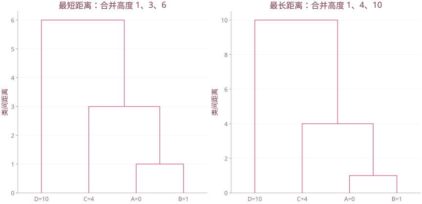

# 第 7 章 聚类分析

| 复习要点 | 掌握目标 |
| --- | --- |
| Q 型与 R 型 | 分清聚样本还是聚变量 |
| 相似性 | 结合量纲、变量类型选择距离 |
| 系统聚类 | 掌握合并步骤与六种类间距离 |
| k-means | 迭代分配与更新中心，最小化类内平方和 |
| 结果解释 | 聚类不自带真实标签，也不保证唯一 |

## 1. 基本思想与分类

聚类在事先没有确定类别标签的条件下，将相似对象归入同一组，使组内较相近、组间较有差异。

- **Q 型聚类**：对样本（数据矩阵的行）分组。
- **R 型聚类**：对变量（列）分组，常借助相关系数。
- **系统聚类**：逐层形成嵌套分组，画树状图。
- **快速聚类**：如 k-means，预先给出类数，在分配与更新中迭代。

## 2. 变量类型与预处理

课件区分数量尺度、顺序尺度、名义尺度等。均值和欧氏距离适合有数值意义的变量；对职业编号求欧氏距离没有一般合理性。

常见变换：平移、极差标准化、标准差标准化、主成分变换、正数数据的对数变换。平移所有样本同一向量不改变欧氏距离；不同变量的缩放则会改变各变量在距离中的权重。

缺失、异常值、单位差异、零方差列要先检查。标准化的选择会影响聚类结果，并非无关紧要的绘图步骤。

## 3. 样本距离与变量相似性

### 3.1 常用距离

$$d_1(x,y)=\sum_j|x_j-y_j|\quad\text{（曼哈顿距离）},$$

$$d_2(x,y)=\sqrt{\sum_j(x_j-y_j)^2}\quad\text{（欧氏距离）},$$

$$d_\infty(x,y)=\max_j|x_j-y_j|.$$

Minkowski 距离为 $[\sum_j|x_j-y_j|^q]^{1/q}$，$q\ge1$。马氏距离使用 $(x-y)^{\mathsf T}S^{-1}(x-y)$，要检查协方差阵是否可逆。

**距离不等于相似度：** 距离越小越相近，相关或余弦相似度通常越大越相近。

### 3.2 相关系数与夹角余弦

变量的 Pearson 相关消除了均值；余弦 $x^{\mathsf T}y/(\|x\|\|y\|)$ 未自动中心化，两者不能不加条件地等同。

若变量先中心化并归一化为长度 1，则

$$\|u-v\|^2=2(1-r).$$

因此 $\sqrt{2(1-r)}$ 可用于基于标准化变量轮廓的距离。若希望正负相关都视为相似而采用 $1-|r|$，其含义已改变，需要明确说明。

## 4. 系统聚类的步骤

1. 每个样本单独成类，共 $n$ 类。
2. 计算当前类间距离。
3. 合并最近的两类。
4. 按所选准则更新新类与其他类之间的距离。
5. 重复至只剩一类，得到 $n-1$ 次合并。
6. 画树状图，结合问题和稳定性选择截取层次。

树状图横向叶子位置可交换；关键是合并关系与高度。某些方法（如重心、中间法）可能出现合并高度倒退，不能强行按所有方法都单调的假设解释。

## 5. 六种类间距离

令 $G,H$ 为两类，样本量 $n_G,n_H$，均值 $\bar x_G,\bar x_H$：

| 方法 | 定义或准则 | 常见表现 |
| --- | --- | --- |
| 最短 single | $\min_{i\in G,j\in H}d_{ij}$ | 容易形成链式长簇 |
| 最长 complete | $\max_{i\in G,j\in H}d_{ij}$ | 倾向较紧凑的类，对极端点敏感 |
| 类平均 average | $\sum_{i\in G,j\in H}d_{ij}/(n_Gn_H)$ | 使用两类全部成对距离 |
| 重心 centroid | $\|\bar x_G-\bar x_H\|$ | 新中心按样本量加权 |
| 中间 median | 合并中心按两个旧中心等权平均 | 与按样本量的重心法不同 |
| 离差平方和 Ward | 最小化合并后增加的类内平方和 | 倾向平方和较小的紧凑类 |

Ward 的增量为

$$\Delta(G,H)=\frac{n_Gn_H}{n_G+n_H}\|\bar x_G-\bar x_H\|^2.$$

**平方距离约定：** 补充课件把类平均等部分公式写在平方距离上；R 的 `average` 默认平均传入的不相似度。传入 $d$ 与传入 $d^2$ 会得到不同准则。重现计算前先约定 $D$ 还是 $D^2$，不能混用。

### 5.1 统一递推公式

将 $G,H$ 合并为 $U$，对另一类 $K$，Lance–Williams 形式为

$$\delta(U,K)=\alpha_G\delta(G,K)+\alpha_H\delta(H,K)+\beta\delta(G,H)+\gamma|\delta(G,K)-\delta(H,K)|.$$

| 方法 | $\alpha_G$ | $\alpha_H$ | $\beta$ | $\gamma$ |
| --- | --- | --- | --- | --- |
| single | $1/2$ | $1/2$ | 0 | $-1/2$ |
| complete | $1/2$ | $1/2$ | 0 | $1/2$ |
| average | $n_G/n_U$ | $n_H/n_U$ | 0 | 0 |
| median | $1/2$ | $1/2$ | $-1/4$ | 0 |
| centroid | $n_G/n_U$ | $n_H/n_U$ | $-n_Gn_H/n_U^2$ | 0 |
| Ward | $(n_G+n_K)/(n_U+n_K)$ | $(n_H+n_K)/(n_U+n_K)$ | $-n_K/(n_U+n_K)$ | 0 |

其中 $n_U=n_G+n_H$。median、centroid 的欧氏几何递推使用平方量；Ward 也按相应平方和量计算。系数表只有连同 $\delta$ 的定义一起使用才有意义。

### 5.2 手算演练：最短与最长法

对一维点 $A=0,B=1,C=4,D=10$，先合并 $A,B$，距离为 1。

- single：$d(\{A,B\},C)=\min(4,3)=3$，再合并 $C$；最后到 $D$ 的最短距离为 6。
- complete：$d(\{A,B\},C)=\max(4,3)=4$，再合并 $C$；最后到 $D$ 的最长距离为 10。

同一数据，方法改变会改变合并高度与后续关系；不能把一张图的高度用于另一种方法。



一维演练点0、1、4、10，在两种类间距离准则下的合并关系与高度。

## 6. R 的系统聚类

```r
X <- as.matrix(iris[,1:4])
Z <- scale(X)
d <- dist(Z,method="euclidean")
hc <- hclust(d,method="complete")
plot(hc,labels=FALSE,hang=-1)
rect.hclust(hc,k=3,border="deeppink3")
group <- cutree(hc,k=3)
table(group)
cbind(hc$merge,hc$height)

hc.ward <- hclust(d,method="ward.D2")
# 变量聚类：用相关距离
dv <- as.dist(sqrt(pmax(2*(1-cor(X)),0)))
hv <- hclust(dv,method="average")
```

`dist()` 输入的是数据、输出不相似度；`hclust()` 输入距离对象。课件中把其称为“相似矩阵”时，应结合实际含义理解。`merge` 中负数表示原始样本编号，正数表示前面某步形成的类。

R 的 `ward.D` 与 `ward.D2` 不完全相同。通常按标准 Ward 平方和准则使用 `hclust(dist(Z), "ward.D2")`；它内部处理平方，不要再随意把输入距离平方。[R 的 hclust 文档](https://www.stat.ethz.ch/R-manual/R-devel/library/stats/html/hclust.html)

## 7. k-means

### 7.1 目标函数

给定类数 $k$：

$$\min_{G_1,\ldots,G_k}\sum_{g=1}^{k}\sum_{i\in G_g}\|x_i-\mu_g\|^2,\qquad\mu_g=\frac1{|G_g|}\sum_{i\in G_g}x_i.$$

目标是类内平方和，而不是任意距离下的“最近中心”。平方欧氏距离下，均值才是最小化该目标的中心。

### 7.2 迭代过程


每一步不增加目标，但可能停在局部最优。不同初始中心可能得到不同结果，空类与相同点也需要由具体算法处理。

### 7.3 R 操作与结果解释

```r
set.seed(2026)
km <- kmeans(Z,centers=3,nstart=30)
km$cluster
km$centers
km$size
km$withinss
km$tot.withinss
km$betweenss
```

$totss=tot.withinss+betweenss$。`nstart` 增加不同初始划分的尝试；它不保证找到全局最优。比较标准化前后中心时，要注意中心所处的单位。

### 7.4 局限

k-means 对尺度、离群点与初始值敏感，偏好由均值有效描述的簇。不能直接将任意类别编码、非欧氏不相似度或明显非凸结构都交给 k-means。

类数可结合业务目标、树状图、肘部、轮廓及稳定性选择；不能因为给了 $k=3$，就宣称数据已证明存在三个真实自然类别。

## 8. 课件对照

合并 `第7章 聚类分析.pptx`、`7-1聚类分析1.pptx`、`7-2聚类分析2.pptx`。保留居民消费案例的变量含义与分析流程；没有原始工作簿时不补造省份归类结果。

[返回课程目录](../人工智能数学基础.md)
