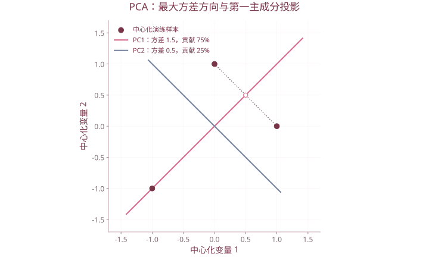

# 第 8 章 主成分分析

| 复习要点 | 掌握目标 |
| --- | --- |
| PCA 目标 | 用少量线性组合保留主要方差 |
| 数学推导 | 单位长度约束下最大化投影方差 |
| 系数、载荷、得分 | 分清方向、与原变量的相关、样本坐标 |
| 贡献率 | 根据特征值选择成分数 |
| 实际应用 | 标准化、解释方向、排名与验证 |

## 1. 为什么做主成分分析

多个指标高度相关时，信息可能重叠。PCA 将它们转换为一组互不相关的线性组合，按方差从大到小排列，保留前几个来近似原始数据。

二维直观上，是把坐标轴转到数据云主要延伸的方向，再考虑是否舍弃较短方向。完整正交变换不丢失信息；只保留部分成分才产生降维误差。

**课件订正：** PCA 一般保证“互不相关”，不自动保证“相互独立”；联合正态等额外条件下才能进一步推出独立。它也不会让每个新变量的方差同时变为最大，而是按约束顺序提取。

## 2. 第一主成分的推导

设中心化随机向量 $x$ 的协方差为 $\Sigma$，线性组合 $y_1=a_1^{\mathsf T}x$ 的方差为 $a_1^{\mathsf T}\Sigma a_1$。

若不限制 $a_1$ 的长度，任意放大系数就能无限放大方差，因此必须解

$$\max_{a_1}a_1^{\mathsf T}\Sigma a_1,\qquad a_1^{\mathsf T}a_1=1.$$

拉格朗日函数 $L=a_1^{\mathsf T}\Sigma a_1-\lambda(a_1^{\mathsf T}a_1-1)$，求导得到

$$\Sigma a_1=\lambda a_1.$$

最大值为最大特征值 $\lambda_1$，对应单位特征向量 $a_1$。第一主成分为 $y_1=a_1^{\mathsf T}x$。

## 3. 后续成分与性质

第二成分在单位长度、与第一成分不相关的约束下最大化方差，依次得到

$$\lambda_1\ge\lambda_2\ge\cdots\ge\lambda_p\ge0,\qquad A=(a_1,\ldots,a_p),\quad A^{\mathsf T}A=I.$$

$$y=A^{\mathsf T}x,\qquad\operatorname{Cov}(y)=A^{\mathsf T}\Sigma A=\operatorname{diag}(\lambda_1,\ldots,\lambda_p).$$

- $\operatorname{Var}(y_j)=\lambda_j$，不同成分协方差为 0。
- $\sum_j\lambda_j=\operatorname{tr}(\Sigma)$，保留全部成分时总方差不变。
- 特征向量整体变号仍是同一个主方向，对应得分也整体变号。
- 重复特征值的特征子空间内，可选不同的正交基；不能据此认定软件算错。
- 协方差阵可为半正定，特征值可能为 0；不能一概写成全部严格大于 0。

## 4. 协方差 PCA 与相关阵 PCA

| 基础矩阵 | 输入处理 | 适用考虑 |
| --- | --- | --- |
| 样本协方差阵 $S$ | 中心化 | 单位相同且希望保留原方差大小 |
| 相关阵 $R$ | 中心化并按标准差缩放 | 单位或数量级不同，希望变量起点可比 |

标准化后总方差为 $p$，因为 $\operatorname{tr}(R)=p$。是否标准化需要结合问题，不能把“总是用相关阵”当成数学定理。常数列标准差为 0，必须先处理。

## 5. 贡献率与成分数

$$\eta_j=\frac{\lambda_j}{\sum_{k=1}^{p}\lambda_k},\qquad C_m=\frac{\sum_{j=1}^{m}\lambda_j}{\sum_{k=1}^{p}\lambda_k}.$$

课件以累计贡献率达到约 80% 作为选取参考，还提到碎石图与特征值大于 1 的经验。后者主要用于相关阵 PCA，不能直接套到任意单位的协方差阵。

保留几个成分还要结合解释性、后续预测或分类任务及误差容许度。解释主要方差不等于必然保留对标签最有用的低方差方向。

## 6. 系数、载荷与得分

### 6.1 主成分系数

$a_j$ 是第 $j$ 个成分的系数向量，即单位特征向量。它决定投影方向。

### 6.2 统计意义上的载荷

原变量 $x_k$ 与主成分 $y_j$ 的相关为

$$\ell_{kj}=\operatorname{Corr}(x_k,y_j)=\frac{\sqrt{\lambda_j}a_{kj}}{\sqrt{\sigma_{kk}}}.$$

在标准化变量上为 $\sqrt{\lambda_j}a_{kj}$。因此**系数不是一般意义上的相关载荷**。R 中 `prcomp()$rotation` 虽常称 loading matrix，存的实际是成分方向系数，解释时要区分命名。

### 6.3 样本得分与重构

设 $Z$ 为中心化或标准化后的行样本矩阵，保留 $m$ 个成分：

$$T=ZA_m,\qquad\hat Z=TA_m^{\mathsf T}=ZA_mA_m^{\mathsf T}.$$

$T$ 为 $n\times m$，第 $i$ 行是样本的低维得分。在对应欧氏平方误差下，保留最大特征值方向得到最佳秩 $m$ 近似；丢弃部分对应剩余方差之和。

## 7. 手算演练：两个标准化变量

取相关阵

$$R=\begin{pmatrix}1&1/2\\1/2&1\end{pmatrix}.$$

特征值为 $1.5,0.5$，取单位特征向量

$$a_1=(1,1)^{\mathsf T}/\sqrt2,\quad a_2=(1,-1)^{\mathsf T}/\sqrt2.$$

$$y_1=(z_1+z_2)/\sqrt2,\qquad y_2=(z_1-z_2)/\sqrt2.$$

贡献率为 75%、25%。第一成分可解释为两指标共同水平，第二成分反映差异。若严格要求累计达到 80%，这个演练例必须保留两个成分，不能看起来相关就只取一个。



第2章三样本两变量演练矩阵，协方差[[1,.5],[.5,1]]，特征值1.5和0.5。图中空心点为第一方向投影。

## 8. R 中的 PCA

```r
X <- as.matrix(iris[,1:4])
pc <- prcomp(X,center=TRUE,scale.=TRUE)
summary(pc)
lambda <- pc$sdev^2
ratio <- lambda/sum(lambda)
cumratio <- cumsum(ratio)
m <- which(cumratio>=0.80)[1]
pc$rotation             # 系数：列为主成分
head(pc$x)              # 样本得分
plot(pc,type="l")
biplot(pc)

# 对原标准化变量的相关载荷
load <- sweep(pc$rotation,2,pc$sdev,"*")

# 新观测须沿用训练均值、尺度与方向
predict(pc,newdata=X[1:3,,drop=FALSE])
```

`prcomp()` 通过 SVD 实现，默认 `scale.=FALSE`；想做相关阵 PCA 要明确标准化。`princomp()` 与 `prcomp()` 的计算路线及方差分母约定不同，小数结果可能不同，不能将二者输出中的标准差不加换算混用。[R 的 prcomp 文档](https://www.stat.ethz.ch/R-manual/R-devel/library/stats/html/prcomp.html)

### 8.1 用 SVD 连接特征值

若中心化矩阵 $Z=UDV^{\mathsf T}$，则

$$S=\frac1{n-1}Z^{\mathsf T}Z=V\frac{D^2}{n-1}V^{\mathsf T}.$$

所以系数是 $V$ 的列，得分是 $UD$，特征值为 $d_j^2/(n-1)$。课件某页将分解简写为不匹配的矩阵乘积，应以维数和该式核对。

## 9. 综合得分与实际解释

课件居民消费案例在选定成分后，以贡献率构造综合得分：

$$F_i=\sum_{j=1}^{m}\frac{\eta_j}{\sum_{k=1}^{m}\eta_k}T_{ij}.$$

这是一种评价方案，不是 PCA 自动给出的唯一“优劣排名”。应先统一效益/成本指标方向，并固定成分符号及其实际解释；仅因软件改变特征向量符号就改变排名，说明评价规则尚未定义清楚。

课件中 14 人身高体重例说明两个高度相关变量可由主要共同方向概括；31 地区消费例用于展示完整分析流程。完整数据未附时，不能据此补造所有地区的得分和排名。

## 10. 课件对照

合并 `第8章 主成分分析.pptx`、`8-1主成分分析.pptx`、`8-2主成分分析.pptx`。与[因子分析](09-因子分析.md)、[典型相关](11-典型相关分析.md)、[MDS](12-多维标度分析.md)比较各自的优化目标。

[返回课程目录](../人工智能数学基础.md)
