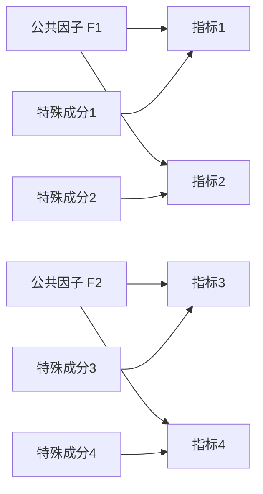
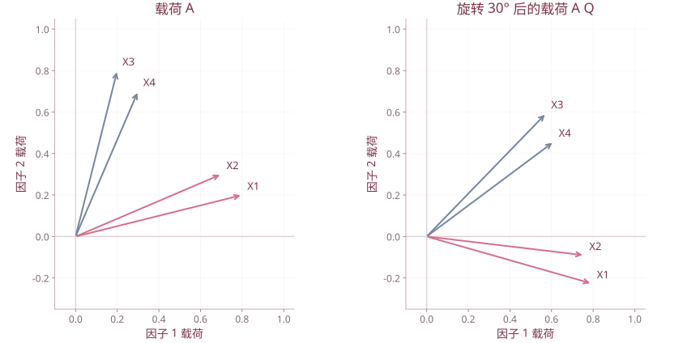

# 第 9 章 因子分析

| 复习要点 | 掌握目标 |
| --- | --- |
| 因子模型 | 用少数公共因子解释变量的相关结构 |
| 因子载荷 | 区分载荷、共同度、特殊方差与方差贡献 |
| 估计方法 | 理解主成分初解、主因子、极大似然的区别 |
| 因子旋转 | 改善解释性，区分正交与斜交 |
| 得分与适用性 | KMO、Bartlett、得分估计与评价 |

## 1. 基本思想及与 PCA 的区别

PCA 将观测变量线性组合成新变量，首先解释总方差；因子分析建立一个统计模型，用少数不可直接观测的公共因子解释观测变量的共同变化，并允许每个变量有自己的特殊成分。

| 比较 | PCA | 因子分析 |
| --- | --- | --- |
| 主要目标 | 以较低维保留总变异 | 解释共同协方差结构 |
| 基本形式 | $T=ZA$ | $Z=AF+\varepsilon$ |
| 特殊方差 | 不单独建模 | 明确引入 |
| 得分 | 给定系数即可直接计算 | 潜在因子需要估计 |
| 旋转 | 标准 PCA 按方差排序，一般不旋转 | 常为改善解释而旋转 |

PCA 可用于因子载荷的初始构造，但两者不是同一个模型。课件的“推广”应理解为方法联系，而非所有公式都可直接通用。

## 2. 正交因子模型

对中心化或标准化列向量 $Z\in\mathbb R^p$：

$$Z=AF+\varepsilon,\quad A\in\mathbb R^{p\times m},\quad F\in\mathbb R^m,\quad m<p.$$

常用假设：

$$E(F)=0,\quad\operatorname{Cov}(F)=I_m,\quad E(\varepsilon)=0,$$

$$\operatorname{Cov}(\varepsilon)=\Psi=\operatorname{diag}(\psi_1,\ldots,\psi_p),\quad\operatorname{Cov}(F,\varepsilon)=O.$$

于是

$$\Sigma=AA^{\mathsf T}+\Psi.$$

模型的常见图解如下，箭头表示载荷关系，并不单凭图就证明因果：



特殊成分分别对应各自指标；公共因子可以共同影响多个指标。一般模型也可存在交叉载荷，图中省略不表示其在所有问题中都严格为零。

## 3. 载荷、共同度和贡献

### 3.1 因子载荷

$a_{ij}$ 是第 $j$ 个公共因子在第 $i$ 个变量上的载荷。在变量标准化、因子单位方差且正交的条件下，$a_{ij}=\operatorname{Corr}(Z_i,F_j)$。

解释依赖程度通常看载荷**绝对值**；负号表示反向关系，不表示依赖程度一定弱。

### 3.2 共同度与特殊方差

$$h_i^2=\sum_{j=1}^{m}a_{ij}^2,\qquad\operatorname{Var}(Z_i)=h_i^2+\psi_i.$$

标准化时 $1=h_i^2+\psi_i$。共同度是对某个变量而言；特殊方差不等于某个因子的贡献率。

### 3.3 因子的方差贡献

$$v_j=\sum_{i=1}^{p}a_{ij}^2.$$

标准化模型中，该因子对总方差贡献可记为 $v_j/p$；已提取公共部分中占比为 $v_j/\sum_kv_k$。两个分母含义不同，计算综合得分时应说明采用哪个。

## 4. 载荷的估计

### 4.1 主成分初解

从相关阵的前 $m$ 个特征对构造

$$\hat A=(\sqrt{\lambda_1}u_1,\ldots,\sqrt{\lambda_m}u_m),\quad\hat\psi_i=1-\sum_j\hat a_{ij}^2.$$

它给出一种初始分解，但使用的是总方差谱，不等同于全部因子估计方法。

### 4.2 主因子法

将相关阵对角线替换为共同度估计，对约化相关阵求特征分解，再更新共同度，必要时迭代。这里不是简单把原相关阵每个对角线永久设为 1。

### 4.3 极大似然法

正态因子模型下，通过 $\Sigma=AA^{\mathsf T}+\Psi$ 的似然估计载荷及特殊方差。可对拟合优度作相应检验，但需要模型可识别、样本充分和优化收敛等条件。

模型约束的常用自由度计数为

$$df=\frac12[(p-m)^2-(p+m)].$$

这是可拟合性的检查之一，非“满足就保证拟合成功”。特殊方差逼近 0、出现 Heywood 类异常、结果不稳定时应检查因子数、样本和模型。

## 5. 因子数与适用性检查

### 5.1 因子数

可结合碎石图、特征值经验、解释性、累计贡献和模型拟合。课件常用约 80% 为参考，不是所有问题必须达到的定理，也不能为凑贡献率无限增加因子。

### 5.2 KMO

设 $r_{ij}$ 为相关、$p_{ij}$ 为控制其他变量后的偏相关：

$$KMO=\frac{\sum_{i\ne j}r_{ij}^2}{\sum_{i\ne j}r_{ij}^2+\sum_{i\ne j}p_{ij}^2}.$$

相关明显而偏相关较小时，较适合用公共因子解释。课件给出由 0.9 以上至 0.5 以下的经验等级；应作为参考，同时检查变量意义和样本质量。

### 5.3 Bartlett 球形检验

检验 $H_0:R=I$。近似统计量为

$$\chi^2=-\left[n-1-\frac{2p+5}{6}\right]\log|R|,$$

自由度 $p(p-1)/2$，有相应正态近似与样本量条件。显著说明相关阵不是单位阵，并不单独保证因子模型一定良好。

## 6. 因子旋转

### 6.1 正交旋转

若 $Q^{\mathsf T}Q=I$，取 $A_*=AQ,F_*=Q^{\mathsf T}F$，则

$$A_*A_*^{\mathsf T}=AA^{\mathsf T}.$$

共同度、共同部分总方差与模型拟合不变；但各因子如何分配贡献会改变。旋转旨在让载荷结构更清楚，不是增加解释总量。

Varimax（最大方差旋转）力求各因子的平方载荷更分化，便于命名。



演练载荷经30度正交旋转，AA^T不变，各行载荷平方和不变。本图不把给定角度冒充Varimax自动最优角。

### 6.2 斜交旋转

如 Promax，允许因子之间相关。此时令因子相关阵为 $\Phi$，协方差为

$$\Sigma=A\Phi A^{\mathsf T}+\Psi.$$

不能在斜交模型中继续机械套用正交条件下的所有共同度、载荷相关解释；pattern 与 structure 也需区分。

## 7. 因子得分

从观测指标估计每个样本的潜在因子，不是把因子载荷直接当作得分系数。

在正交模型的相应条件下：

回归法：

$$\hat F_{reg}=A^{\mathsf T}\Sigma^{-1}Z.$$

Bartlett 加权最小二乘法：

$$\hat F_B=(A^{\mathsf T}\Psi^{-1}A)^{-1}A^{\mathsf T}\Psi^{-1}Z.$$

两种得分估计一般不同；因子得分不是可唯一观测的真实量。进行旋转后，载荷、因子命名和得分必须使用同一套解。

**课件订正：** 第 24 页把 $(A^{\mathsf T}A)^{-1}A^{\mathsf T}Z$ 标为“回归估计法”。它实际是普通最小二乘形式，在特殊方差为同一常数等条件下也是 Bartlett 加权最小二乘的特例；不要与上面的 Thomson 回归因子得分公式混为一谈。

## 8. R 演练

以下模拟数据只用于复现模型步骤，不冒充课件公司的真实数据：

```r
set.seed(2026)
F <- matrix(rnorm(400*2),400,2)
A <- rbind(c(.8,.1),c(.7,.2),c(.9,.1),
           c(.1,.8),c(.2,.7),c(.1,.9))
psi <- 1-rowSums(A^2)
E <- sweep(matrix(rnorm(400*6),400,6),2,sqrt(psi),"*")
X <- F%*%t(A)+E
fa <- factanal(X,factors=2,rotation="varimax",scores="regression")
print(fa$loadings,cutoff=.2)
fa$uniquenesses
head(fa$scores)
fa$STATISTIC
fa$PVAL
```

`factanal()` 是极大似然因子分析，默认不输出得分，必须指定 `scores`；默认旋转为 varimax。不能把它直接称为“主因子法函数”。[R 的 factanal 文档](https://stat.ethz.ch/R-manual/R-devel/library/stats/html/factanal.html)

## 9. 课件案例与综合评价

课件讨论水泥行业上市公司经营业绩与居民消费结构。分析报告应包含：指标含义、适用性、因子数、旋转载荷、因子命名、共同度、得分和结论。

补充课件某次因子评价给出

$$F=\frac{0.333F_1+0.300F_2+0.228F_3}{0.861}.$$

这是在该次提取/旋转与得分方案下的加权公式；不能拿另一套因子得分直接套用。评价前还应统一指标方向、因子符号，并检查权重和排名的稳定性。

## 10. 课件对照

合并 `第9章 因子分析.pptx`、`9-1因子分析1.pptx`、`9-2因子分析2.pptx`、`9-3因子分析3.pptx`。课件中“因子之间没有相关”的说法限于正交因子方案；采用斜交旋转时可允许相关。

[返回课程目录](../人工智能数学基础.md)
