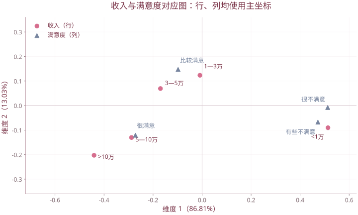

# 第 10 章 对应分析

| 复习要点 | 掌握目标 |
| --- | --- |
| 分析对象 | 非负列联表中的行类别、列类别及其关联 |
| 卡方检验 | 区分检验独立与可视化关联 |
| 过渡矩阵 | 相对频率、行列边际、标准化独立残差 |
| SVD | 连接行分析、列分析和主惯量 |
| 对应图 | 注意坐标缩放与近似误差 |

## 1. 为什么需要对应分析

只分析变量间关系是 R 型角度，只分析样本间关系是 Q 型角度。对应分析把行类别与列类别放到相关联的低维表示中，帮助解释列联表中偏离独立的结构。

典型输入是频数表。不能对负值数据直接使用频数型 CA；也不能把普通协方差分析与“对应分析”混淆，二者只是中文名称相近。

## 2. 先检验是否独立

设频数表 $N=(n_{ij})_{r\times c}$，总数 $n=\sum_{ij}n_{ij}$。独立假设下期望频数

$$e_{ij}=\frac{n_{i\cdot}n_{\cdot j}}n.$$

Pearson 统计量为

$$\chi^2=\sum_{i,j}\frac{(n_{ij}-e_{ij})^2}{e_{ij}},\qquad df=(r-1)(c-1).$$

在观测独立、期望频数适当等条件下使用卡方近似。若数据接近独立，总惯量小，探索性对应图中的结构也应谨慎解释。对应分析本身不替代独立性检验。

## 3. 课件例：收入与职业满意度

| 收入 | 很不满意 | 有些不满意 | 比较满意 | 很满意 |
| --- | ---: | ---: | ---: | ---: |
| 小于 1 万 | 42 | 82 | 67 | 55 |
| 1—3 万 | 35 | 62 | 165 | 118 |
| 3—5 万 | 13 | 28 | 92 | 81 |
| 5—10 万 | 7 | 18 | 54 | 75 |
| 大于 10 万 | 3 | 7 | 32 | 54 |

总人数 1090，自由度 $(5-1)(4-1)=12$，课件报告 $\chi^2\approx118.1$，有显著关联。第二收入档在第 10 页印作“1—2 万”，后续页统一为“1—3 万”；这里按后续图表一致标记，并保留原频数。

```r
N <- matrix(c(42,82,67,55,35,62,165,118,13,28,92,81,
              7,18,54,75,3,7,32,54),nrow=5,byrow=TRUE)
rownames(N) <- c("<1万","1-3万","3-5万","5-10万",">10万")
colnames(N) <- c("很不满意","有些不满意","比较满意","很满意")
chisq.test(N,correct=FALSE)
```

## 4. 从频数表到过渡矩阵

定义相对频率与行列质量：

$$P=N/n,\qquad r=P\boldsymbol1_c,\qquad c=P^{\mathsf T}\boldsymbol1_r.$$

为避免符号混淆，这里的向量 $r,c$ 是边际比例，维数由上下文区别于行列数。令 $D_r=\operatorname{diag}(r)$、$D_c=\operatorname{diag}(c)$，均须为正；零和行列应先处理。

独立时 $P=rc^{\mathsf T}$。过渡矩阵为

$$Z=D_r^{-1/2}(P-rc^{\mathsf T})D_c^{-1/2}.$$

元素

$$z_{ij}=\frac{p_{ij}-r_ic_j}{\sqrt{r_ic_j}}=\frac{n_{ij}-e_{ij}}{\sqrt{n_{i\cdot}n_{\cdot j}}}.$$

它是 Pearson 标准化残差再除以 $\sqrt n$，因此

$$\|Z\|_F^2=\frac{\chi^2}{n}.$$

这叫总惯量，描述偏离独立的程度。整体频数同时乘常数时，CA 几何结构不变，但卡方统计量随总样本量变化。

## 5. 行剖面、列剖面与卡方距离

第 $i$ 行剖面是 $(p_{ij}/r_i)_j$，表示给定行类别后的列比例。两行的卡方距离为

$$d_{\chi^2}^2(i,i')=\sum_j\frac{(p_{ij}/r_i-p_{i'j}/r_{i'})^2}{c_j}.$$

列剖面与列距离同理，以行质量作权重。剖面相同的两行，即使行总数不同，在该意义下距离仍为 0。

## 6. 用 SVD 联结行、列分析

令

$$Z=U\Delta V^{\mathsf T},\qquad\Delta=\operatorname{diag}(\delta_1,\ldots,\delta_m).$$

非零维数最多 $m\le\min(r-1,c-1)$。主惯量为 $\lambda_k=\delta_k^2$，贡献率为 $\lambda_k/\sum_j\lambda_j$。

$Z^{\mathsf T}Z$ 与 $ZZ^{\mathsf T}$ 有相同的非零特征值，分别对应列与行方向。

**课件订正：** 若 $v_k$ 为 $Z^{\mathsf T}Z$ 的单位特征向量，行方向应为 $u_k=Zv_k/\sqrt{\lambda_k}$。课件直接写 $u_k=Zv_k$ 得到的是缩放后的特征向量，不能同时再把它当作单位向量。

### 6.1 标准坐标和主坐标

$$\Phi=D_r^{-1/2}U,\qquad\Gamma=D_c^{-1/2}V,$$

$$F=\Phi\Delta\quad\text{（行主坐标）},\qquad G=\Gamma\Delta\quad\text{（列主坐标）}.$$

选择主坐标还是标准坐标会改变坐标数值及其几何解释，不能把软件输出的两种坐标混用。

## 7. R 中直接复现矩阵计算

以下代码接续第 3 节的 `N`，无需课件自定义函数：

```r
P <- N/sum(N)
r <- rowSums(P); c <- colSums(P)
Z <- diag(1/sqrt(r)) %*% (P-outer(r,c)) %*% diag(1/sqrt(c))
s <- svd(Z)
m <- min(nrow(N)-1,ncol(N)-1)
delta <- s$d[1:m]
inertia <- delta^2
ratio <- inertia/sum(inertia)
F <- sweep(s$u[,1:m,drop=FALSE],1,sqrt(r),"/")
F <- sweep(F,2,delta,"*")
G <- sweep(s$v[,1:m,drop=FALSE],1,sqrt(c),"/")
G <- sweep(G,2,delta,"*")
sum(inertia)
as.numeric(chisq.test(N,correct=FALSE)$statistic)/sum(N)
```

该例课件主惯量约为 $0.094050,0.014121,0.000174$，前两维合计约 99.8%。课件也演示扩展包 `ca::ca(N)`；其行列坐标输出需要结合包的缩放定义阅读。

## 8. 对应图如何解释

- 同一侧的行点之间可解释行剖面的相似性；同一侧列点同理。
- 低维图只保留部分惯量，应看各点的表示质量。
- 行点与列点的关联应结合坐标方案、方向及独立残差判断，**不能一概把跨集合欧氏距离解释为关联强度**。
- 远离原点不一定代表该类整体人数多；稀少类别也可能因偏离独立而位置很远。

课件图把低收入与不满意、高收入与很满意的方向相联系；这是该调查的关联模式，不自动构成“收入造成满意”的因果结论。



课件1090人频数表的实际对应分析，使用行、列主坐标。跨集合点距不直接解释为一般关联强度，应结合缩放和残差。

## 9. 适用范围与课件另一案例

课件还对各地区经济类型资产比重作对应图。非负比例表可以作相应探索性分解，但比例不是独立计数；不能把比例相加得到的“总数”直接当作人数套频数卡方检验。

类别应互斥并覆盖所研究范围，行列具有可比性；极稀少类别、零行列、结构零和不同标准化都可能影响结果。

依据 `第10章 对应分析.pptx`、`10-1对应分析1.pptx`、`10-2对应分析2.pptx`。

[返回课程目录](../人工智能数学基础.md)
