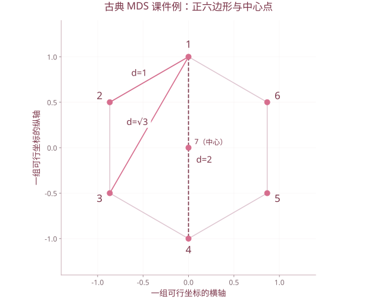

# 第 12 章 多维标度分析

| 复习要点 | 掌握目标 |
| --- | --- |
| 输入与目标 | 从对象间距离或不相似度恢复低维坐标 |
| 古典解 | 平方距离、双中心化、特征分解 |
| 欧氏性 | 检查双中心化矩阵是否半正定 |
| 非度量 MDS | 保留不相似度顺序，理解 stress |
| 解释 | 坐标可旋转、反射，不能直接等同评分 |

## 1. 基本概念

多维标度分析 MDS 根据对象之间的相似性或不相似性，寻找低维点的位置，使点间距离反映输入关系。它可以只输入距离矩阵，而不要求知道每个对象的原始指标。

不相似矩阵常满足对称、对角为 0、非负；这些条件不足以保证它来自某个欧氏空间，甚至不自动保证三角不等式。

- 度量方法：尽量保留不相似度的数量信息。
- 非度量方法：更关注次序关系，允许单调变换后拟合。

相似度越大表示越相近，距离越大表示越不相近。输入方向要先转换清楚，不能把相似度直接当距离。

## 2. 古典 MDS 的数学推导

### 2.1 从坐标到距离

设 $X$ 的行是中心化坐标 $x_i^{\mathsf T}$：

$$d_{ij}^2=\|x_i-x_j\|^2=x_i^{\mathsf T}x_i+x_j^{\mathsf T}x_j-2x_i^{\mathsf T}x_j.$$

用中心化矩阵 $H=I_n-\boldsymbol1\boldsymbol1^{\mathsf T}/n$ 消去只依赖单个下标的项，得到 Gram 阵

$$B=-\frac12HD^{(2)}H,$$

其中 $D^{(2)}=(d_{ij}^2)$ 是**逐元素平方**，不是矩阵乘法 $DD$。

### 2.2 双中心化的元素形式

$$b_{ij}=-\frac12\left[d_{ij}^2-\overline{d_{i\cdot}^2}-\overline{d_{\cdot j}^2}+\overline{d_{\cdot\cdot}^2}\right].$$

横线分别表示行均值、列均值和全体元素均值。既不是只减去一次总均值，也不是把原始距离先中心化后再平方。

### 2.3 特征分解得到坐标

$$B=U\Lambda U^{\mathsf T}.$$

保留最大的 $k$ 个正特征值及单位特征向量：

$$X_k=U_k\Lambda_k^{1/2}.$$

**坐标是特征向量乘特征值平方根**；只取 $U_k$ 会丢失距离的尺度。古典解主要对应 Gram 矩阵的低秩近似，不宜把它与直接最小化所有原始距离平方误差的算法完全等同。

## 3. 欧氏距离的判定

$$D\text{ 为欧氏型距离阵}\iff B\succeq0.$$

若 $B$ 半正定，则其非零特征值个数给出精确表示所需的最小维数，至多为 $n-1$。存在明显负特征值时，原距离不能在任意有限维实欧氏空间中完全再现。

数值计算产生的极小负值可能是舍入误差，应结合最大特征值设容差，而不是见到 $-10^{-14}$ 就断言原数据非欧氏。

## 4. 课件例：正六边形与中心点

第 12 章给出 7 点的距离阵，其中 6 点位于单位圆上，相邻距离 1、隔一点距离 $\sqrt3$、相对点距离 2，中心到各顶点距离为 1。

一组可行坐标为

$$
\begin{aligned}
x_1&=(0,1),&x_2&=(-\sqrt3/2,1/2),&x_3&=(-\sqrt3/2,-1/2),\\
x_4&=(0,-1),&x_5&=(\sqrt3/2,-1/2),&x_6&=(\sqrt3/2,1/2),&x_7&=(0,0).
\end{aligned}
$$

由这些坐标构造 $B=XX^{\mathsf T}$，两个正特征值均为 3，其余为 0，可在二维精确表示。

**课件订正：** 第 10 页列点坐标时，第 6 点横坐标应取正号；否则与第 2 点重合，与给定非零距离矛盾。后面的 R 输出给出正确的不同位置。

```r
s <- sqrt(3)/2
X0 <- rbind(c(0,1),c(-s,.5),c(-s,-.5),c(0,-1),
            c(s,-.5),c(s,.5),c(0,0))
D <- dist(X0)
mds <- cmdscale(D,k=2,eig=TRUE)
mds$eig
round(as.matrix(dist(mds$points))-as.matrix(D),10)
plot(mds$points,asp=1,pch=19,xlab="坐标1",ylab="坐标2")
text(mds$points,labels=1:7,pos=3)
```

恢复坐标可以与上表旋转或反射后不同，但成对距离相同；不要要求每个坐标的小数与课件逐项同号。



课件7点例的可行坐标：单位圆上的六边形加中心。两个正特征值均为3；第6点横坐标为正。任意整体正交变换仍保持所有距离。

## 5. 维数选择与拟合指标

对非欧氏输入，课件使用

$$a_{1,k}=\frac{\sum_{j=1}^{k}\lambda_j}{\sum_j|\lambda_j|},\qquad a_{2,k}=\frac{\sum_{j=1}^{k}\lambda_j^2}{\sum_j\lambda_j^2},$$

这里保留的是前 $k$ 个正方向。两者衡量不同，不能都叫同一个贡献率。

`cmdscale()` 的两个 `GOF` 分量使用绝对特征值和正特征值之和作为分母；第二项不是上面的平方特征值比例，阅读课件与软件输出时应区分。[R 的 cmdscale 文档](https://stat.ethz.ch/R-manual/R-devel/library/stats/html/cmdscale.html)

**课件城市例的数字核对。** 按该页列出的 10 个特征值

$$958214,168682,8157,1433,509,25,0,-898,-5468,-35479,$$

前两维的 $a_{1,2}\approx95.59\%$，$a_{2,2}\approx99.86\%$；按正特征值和计算的比例约 99.11%。与课件所印 99.5%、100.0% 不一致，作题应以明确的定义与实际数值复算。出现负特征值本身也提示该公路距离阵非精确欧氏型。

## 6. 非度量 MDS 与 Shepard–Kruskal 思路

用输入不相似度 $\delta_{ij}$ 的顺序约束，拟合单调的差异值 $\hat d_{ij}$，同时寻找坐标距离 $d_{ij}(X)$。

常见归一化应力形式为

$$Stress=\sqrt{\frac{\sum_{i<j}[d_{ij}(X)-\hat d_{ij}]^2}{\sum_{i<j}d_{ij}(X)^2}}.$$

不同软件的 stress 定义、分母与百分比缩放可能不同，不能只比较一个没有定义的数。

基本过程：

1. 输入不相似度并确定维数与初始坐标。
2. 根据当前坐标计算点间距离。
3. 在不相似度顺序约束下估计差异值。
4. 调整坐标使 stress 减小。
5. 多初值比较，结合 stress、图形和解释选择维数。

非度量法可能有局部最优。课件以低于 5%、5%—10% 等作经验分级，应用时还需结合点数、噪声、具体 stress 定义及稳定性。

```r
# 接续上例；输入为不相似度，不是原始特征表
nm <- MASS::isoMDS(D,y=mds$points,k=2,trace=FALSE)
nm$stress
plot(nm$points,asp=1,pch=19)
```

`MASS::isoMDS()` 的 stress 输出按百分比表达，读取时不要再把 5 当成 500%；有重复点导致非对角距离为 0 时，应先按方法要求处理。

## 7. 与 PCA 的关系及图形解释

若输入距离来自中心化原始矩阵 $X$ 的欧氏距离，古典 MDS 的主坐标与 PCA 样本得分相同到正交变换。

| 方法 | 通常的输入 | 主要保持对象 |
| --- | --- | --- |
| PCA | 样本 × 变量矩阵 | 变量总方差与线性重构 |
| 古典 MDS | 对象间距离矩阵 | 对应的 Gram 几何结构 |
| 非度量 MDS | 不相似度及其次序 | 相对远近顺序 |

MDS 图应使用相同坐标比例 `asp=1`。点的位置可平移、旋转、反射，所以坐标轴本身没有天然的“高分方向”。课件农村发展案例中的综合排名须依赖额外评价定义，不能仅按一条可反向的 MDS 轴自动排名。

## 8. 课件对照

依据 `第12章 多维标度分析.pptx`：基本概念、古典解、7 点例、美国城市公路距离、非度量 MDS、农村发展案例。复习时先核对 **距离还是相似度 → 平方 → 双中心化 → 正负特征值 → 坐标缩放 → 拟合解释**。

[返回课程目录](../人工智能数学基础.md)
