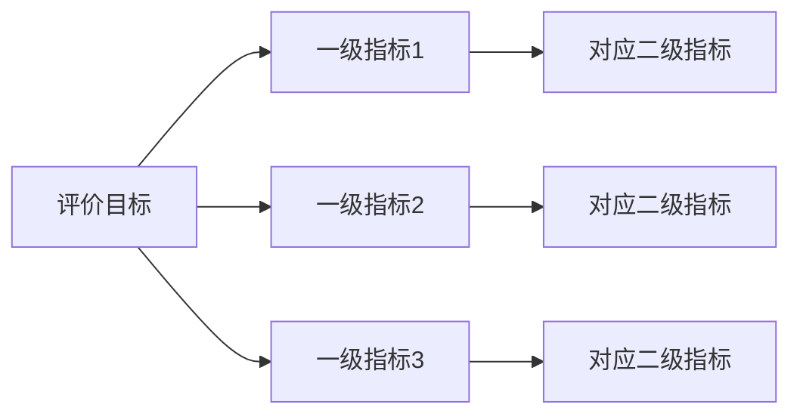
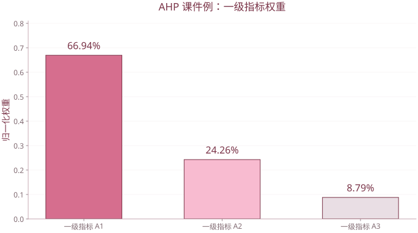

# 第 13 章 综合评价方法

| 复习要点 | 掌握目标 |
| --- | --- |
| 指标体系 | 根据研究目标选择有代表性、可比的指标 |
| 同向化与无量纲化 | 统一指标含义、尺度和比较基准 |
| 权重 | 区分专家判断、层次分析与数据驱动方案 |
| AHP | 判断矩阵、权重计算、一致性检查 |
| 综合得分 | 说明聚合方法及排名的条件性 |

## 1. 综合评价的基本概念

用若干指标描述对象不同方面，再按一定规则合成为总指标，给出整体比较。评价结论同时依赖指标、数据、变换、权重和聚合规则，不存在脱离这些约定的唯一排名。

课件案例研究广东省各地区专利发展状况，展示指标体系、一级与二级权重，以及等权和层次加权结果的差异。

## 2. 构建指标体系

课件提出四项原则：系统全面、稳定可比、简明科学、灵活可操作。

实际检查：

- 是否覆盖目标的关键方面，而非只选方便获得的数据。
- 定义、单位、期间和统计口径是否一致。
- 是否存在高度重复的指标，导致同一方面被多次计权。
- 缺失值与异常值怎样处理。
- 指标是效益型、成本型还是有最优目标区间。



## 3. 同向化与无量纲化

### 3.1 先同向化

效益型“越大越好”，成本型“越小越好”。例如极差处理可分别取

$$z_{ij}^{+}=\frac{x_{ij}-\min_i x_{ij}}{\max_i x_{ij}-\min_i x_{ij}},\qquad z_{ij}^{-}=\frac{\max_i x_{ij}-x_{ij}}{\max_i x_{ij}-\min_i x_{ij}}.$$

中间型和区间型需按业务定义另作变换，不能一概作正向累加。

### 3.2 课件的四种无量纲化

| 方法 | 形式 | 含义 |
| --- | --- | --- |
| 标准化 | $(x_{ij}-\bar x_j)/s_j$ | 相对均值的标准差距离，可为负 |
| 规格化（极差） | $(x_{ij}-x_{j,min})/(x_{j,max}-x_{j,min})$ | 当前样本最小到最大的相对位置 |
| 功效系数 | $(x_{ij}-x_{j,s})/(x_{j,h}-x_{j,s})$ | 相对预设不允许值与满意值 |
| 指数化 | $x_{ij}/x_{j,0}$ | 相对基准值，非指数函数 $e^x$ |

可再作线性变换 $a+bz$。课件常用 $40+60z$ 映射到 40—100 分；若功效系数的基准不是样本极值，可能超出该区间，是否截断应另行规定。

分母为 0 的常数列、零基准或缺失数据要明确处理。把常数列偷偷改为全 0 或全 100 都会附加评价约定，不能不说明。

```r
range.score <- function(x,a=40,b=60,cost=FALSE) {
  if (anyNA(x)) stop("先处理缺失值")
  if (diff(range(x))==0) stop("常数指标无法作极差评分")
  z <- (x-min(x))/diff(range(x))
  if (cost) z <- 1-z
  a+b*z
}
range.score(c(10,20,30))
range.score(c(10,20,30),cost=TRUE)
```

## 4. 权重的确定

权重表示相对重要程度，通常要求 $w_j\ge0$、$\sum_jw_j=1$。

- 德尔菲法：领域专家多轮反馈、汇总与修订判断。
- AHP：按层次对指标两两比较，构造判断矩阵。
- 等权：各指标或各层平均分配，是明确的评价选择，并非“没有权重”。

数据驱动权重如 PCA/因子贡献率在前章讨论；统计上变化大的方向不自动等于价值上重要的方向。

## 5. AHP 判断矩阵

$$A=(a_{ij}),\quad a_{ij}>0,\quad a_{ii}=1,\quad a_{ji}=1/a_{ij}.$$

$a_{ij}$ 表示指标 $i$ 相对指标 $j$ 的重要程度。课件用 1、3、5、7、9 及其倒数表示同等、逐渐更重要或更不重要，2、4、6、8 可作中间判断。

完全一致时 $a_{ij}=w_i/w_j$，于是 $a_{ik}=a_{ij}a_{jk}$。正互反只保证比较相反，不保证传递一致。

## 6. 权重的两种求法

### 6.1 几何平均法（课件主要做法）

$$g_i=\left(\prod_{j=1}^{m}a_{ij}\right)^{1/m},\qquad w_i=\frac{g_i}{\sum_kg_k}.$$

可在对数尺度上计算，减少乘积溢出。

### 6.2 主特征向量法

求 $Aw=\lambda_{max}w$ 的正特征向量并归一化。完全一致时两种方法相同；一般不应未经说明就把它们当成同一个算法。使用近似权重时常估计

$$\hat\lambda_{max}=\frac1m\sum_i\frac{(Aw)_i}{w_i}.$$

这是对最大根的常用估计；对任意近似权重并不总是严格等于实际最大特征值。

## 7. 一致性检查

$$CI=\frac{\lambda_{max}-m}{m-1},\qquad CR=\frac{CI}{RI_m}.$$

课件以 $CR\le0.10$ 作为可接受的经验标准。$RI$ 为所采用表中的平均随机一致性指标，应说明表的来源；通过一致性检查不等于专家判断一定正确。

课件表中的部分数值：

| 阶数 | 2 | 3 | 4 | 5 | 6 | 7 | 8 | 9 | 10 |
| --- | ---: | ---: | ---: | ---: | ---: | ---: | ---: | ---: | ---: |
| $RI$ | 0 | 0.52 | 0.89 | 1.12 | 1.25 | 1.35 | 1.42 | 1.46 | 1.49 |

1、2 阶情形不机械做 $0/0$；正互反二阶矩阵本身完全一致。对更高阶表若使用其他约定，必须连同该表计算，不能一边查一张表、一边抄另一套输出。

## 8. 课件例：一级专利指标权重

$$A=\begin{pmatrix}1&3&7\\1/3&1&3\\1/7&1/3&1\end{pmatrix}.$$

几何平均法给出

$$w\approx(0.66941687,0.24263692,0.08794621)^{\mathsf T}.$$

本例 $\lambda_{max}\approx3.00702177$，$CI\approx0.00351088$。

**课件数字订正：** 按其 RI 表 $RI_3=0.52$ 计算，$CR\approx0.00675170$；课件示例输出的 $0.006053$ 对应分母 0.58，与同一页所用 RI 表不一致。两种计算都低于 0.10，不改变通过检查的结论，但复算时应统一分母。

```r
A <- matrix(c(1,3,7,1/3,1,3,1/7,1/3,1),3,3,byrow=TRUE)
g <- exp(rowMeans(log(A)))
w <- g/sum(g)
lambda.est <- mean(as.vector(A%*%w)/w)
CI <- (lambda.est-nrow(A))/(nrow(A)-1)
CR <- CI/0.52
c(w=w,lambda=lambda.est,CI=CI,CR=CR)

ev <- eigen(A)
j <- which.max(Re(ev$values))
we <- Re(ev$vectors[,j])
if (sum(we)<0) we <- -we
we <- we/sum(we)
```



使用课件3阶正互反矩阵的几何平均权重，总和为1；本图只表示相对权重，不将其解释为客观统计估计。

## 9. 层次总权重与综合评分

同一层同一父节点下局部权重和为 1。某二级指标的总权重为“上级权重 × 本级局部权重”；多层结构沿路径相乘，必要时对多条路径求和。

$$W_{gj}=w_gv_{j\mid g},\qquad\sum_g\sum_jW_{gj}=1.$$

加权加法评分：

$$S_i=\sum_jW_jz_{ij}.$$

等权评分是 $S_i=\frac1p\sum_jz_{ij}$。加法模型允许强项补偿弱项，是否符合评价目的要先判断。

```r
# 同向化后的演练评分，非课件专利原数据
Z <- rbind(甲=c(60,80,70),乙=c(85,60,65),丙=c(70,70,90))
score <- as.vector(Z%*%w)
data.frame(name=rownames(Z),score=score,
           rank=rank(-score,ties.method="min"))
```

## 10. 结果比较与敏感性

课件比较等权与 AHP 评分，结果有差异，因为权重不同。还应检查变换方法、指标方向和样本基准是否相同，再解释差异。

- 样本增加后极差和均值会变化，原对象评分可能随之改变。
- 指标重复会造成隐性加权。
- 小幅改变权重就大幅改变排名，说明排名不稳定，应报告敏感性。
- 评价高低是既定目标与规则下的结论，不是对象在所有方面的绝对优劣。

依据 `第13章 综合评价方法.pptx`。

[返回课程目录](../人工智能数学基础.md)
