# 概率论与数理统计

按《概率统计》速成课配套电子讲义的讲次组织。公式均使用可编辑 LaTeX；讲义例题保留题意并补齐关键推导，额外内容以“补充说明”标出。

| 讲次 | 内容导航 | PDF 页序 |
| --- | --- | --- |
| 1 | [随机事件及其概率（一）](#lecture-1) | 2–10 |
| 2 | [随机事件及其概率（二）](#lecture-2) | 11–18 |
| 3 | [一维随机变量及其分布（一）](#lecture-3) | 19–27 |
| 4 | [一维随机变量及其分布（二）](#lecture-4) | 28–36 |
| 5 | [二维随机变量及其分布](#lecture-5) | 37–53 |
| 6 | [随机变量的数字特征](#lecture-6) | 54–60 |
| 7 | [中心极限定理与数理统计概念](#lecture-7) | 61–67 |
| 8 | [参数估计](#lecture-8) | 68–76 |
| 9 | [假设检验](#lecture-9) | 77–80 |

**符号约定：** $D(X)$ 与 $\operatorname{Var}(X)$ 均表示方差；$N(\mu,\sigma^2)$ 的第二参数是方差；指数分布用率参数 $\lambda$；样本方差 $S^2$ 分母为 $n-1$。统计分位数统一用下侧定义 $P(W\le q_p)=p$，与讲义上侧临界值的转换在第七讲说明。

## 第一讲 随机事件及其概率（一）

| 题型 | 判断与方法 |
| --- | --- |
| 利用四大公式求概率 | 把文字翻译为事件的并、交、差、补，选加法、减法、乘法或条件概率公式 |
| 古典概型 | 有限且等可能，统一有序/无序的计数口径 |

### 一、事件运算与四大公式

$\Omega$ 表示样本空间，$\varnothing$ 表示不可能事件；$AB$ 简记 $A\cap B$。$A\cup B$ 表示至少一个发生，$AB$ 表示同时发生，$A-B=A\overline B$ 表示 $A$ 发生而 $B$ 不发生，$\overline A$ 是 $A$ 的对立事件。

| 公式 | 表达式 | 条件或注意事项 |
| --- | --- | --- |
| 加法 | $P(A\cup B)=P(A)+P(B)-P(AB)$ | 互不相容时 $AB=\varnothing$，交集项为 0 |
| 减法 | $P(A-B)=P(A)-P(AB)$ | 不能一般写成 $P(A)-P(B)$ |
| 条件概率 | $P(A\mid B)=P(AB)/P(B)$ | 要求 $P(B)>0$ |
| 乘法 | $P(AB)=P(B)P(A\mid B)=P(A)P(B\mid A)$ | 各条件概率须有定义 |
| 对立事件 | $P(\overline A)=1-P(A)$ | “至少一个”常用“一个也没有”的补事件 |

三个事件的容斥公式：

$$
P(A\cup B\cup C)=P(A)+P(B)+P(C)-P(AB)-P(AC)-P(BC)+P(ABC).
$$

“加奇减偶”是按交集包含的事件个数交替加减。

#### 例1 加法公式与容斥

**题目：** （1）$P(A)=0.5$，$P(A\cup B)=0.8$，$A,B$ 互不相容，求 $P(B)$。（2）$P(A)=P(B)=P(C)=1/4$，$P(AC)=1/8$，$P(AB)=P(BC)=0$，求至少一个事件发生的概率。

**解：** （1）$P(AB)=0$，因此

$$P(B)=0.8-0.5=0.3.$$

（2）$ABC\subseteq AB$，故 $0\le P(ABC)\le P(AB)=0$。代入容斥公式：

$$P(A\cup B\cup C)=\frac34-\frac18=\frac58.$$

**易错点：** $P(AB)=0$ 不一定表示集合 $AB$ 为空，但足以推出其子事件 $ABC$ 的概率为 0。

#### 例2 差事件与补事件

**题目：** $P(A)=0.7$，$P(A-B)=0.3$，求 $P(\overline{AB})$。

**解：**

$$P(AB)=P(A)-P(A-B)=0.4,$$

$$P(\overline{AB})=1-0.4=0.6.$$

$\overline{AB}=\overline A\cup\overline B$ 表示“不同时发生”，不是“都不发生”。

#### 例3 以补事件为条件

**题目：** $P(B)=0.4$，$P(A\cup B)=0.5$，求 $P(A\mid\overline B)$。

**解：** 由加法公式，

$$P(A\overline B)=P(A)-P(AB)=P(A\cup B)-P(B)=0.1.$$

所以

$$P(A\mid\overline B)=\frac{P(A\overline B)}{P(\overline B)}=\frac{0.1}{0.6}=\frac16.$$

#### 例4 独立事件

**题目：** $A,B$ 相互独立，$P(B)=0.4$，$P(A\cup B)=0.5$，求 $P(\overline B\mid A)$。

**解：** 独立意味着 $P(AB)=P(A)P(B)$，且把任一事件换成补事件仍独立。

先核对条件事件的概率：

$$0.5=P(A)+0.4-0.4P(A)\quad\Rightarrow\quad P(A)=\frac16>0.$$

**法一（定义）：**

$$P(\overline B\mid A)=\frac{P(A)-P(AB)}{P(A)}=1-P(B)=0.6.$$

**法二（独立性）：** $A$ 与 $\overline B$ 独立，所以 $P(\overline B\mid A)=P(\overline B)=0.6$。

**易错点：** 独立与互不相容不同。若两个事件概率都为正，互不相容反而不能独立。条件概率等式只在条件事件概率为正时使用。

### 二、古典概型与排列组合

样本空间含有限个等可能基本结果时，

$$P(A)=\frac{|A|}{|\Omega|}.$$

从 $n$ 个不同元素中无放回取 $m$ 个，计顺序用排列 $A_n^m=n!/(n-m)!$，不计顺序用组合 $C_n^m=\binom nm=n!/[m!(n-m)!]$。分子分母必须采用同一口径。

#### 例5 无放回抽球

**题目：** 袋中有 5 只白球、6 只黑球，任取 2 球，求（1）1 白 1 黑的概率；（2）至少 1 只黑球的概率。

**解：** （1）**法一（无序取球）：**

$$P(\text{1白1黑})=\frac{C_5^1C_6^1}{C_{11}^2}=\frac{30}{55}=\frac6{11}.$$

**法二（依次抽取）：** 两种互斥顺序分别为先白后黑、先黑后白：

$$P=\frac{5\times6+6\times5}{11\times10}=\frac6{11}.$$

（2）补事件是“两球均为白球”：

$$P(\text{至少1黑})=1-\frac{C_5^2}{C_{11}^2}=1-\frac2{11}=\frac9{11}.$$

**易错点：** 无放回抽取时第二次的总数与各颜色球数改变，不能直接当作独立试验。

## 第二讲 随机事件及其概率（二）

| 题型 | 判断与方法 |
| --- | --- |
| 全概率与贝叶斯 | 按互斥且穷尽的原因分类；先求结果概率，再反推原因 |
| 伯努利概型 | $n$ 次独立重复试验，单次成功概率固定为 $p$ |

### 一、全概率公式与贝叶斯公式

$B_1,\ldots,B_m$ 构成完备事件组：两两互不相容，$\bigcup_i B_i=\Omega$，且 $P(B_i)>0$。则

$$P(A)=\sum_{i=1}^mP(B_i)P(A\mid B_i).$$

当 $P(A)>0$ 时，

$$P(B_j\mid A)=\frac{P(B_j)P(A\mid B_j)}{\sum_{i=1}^mP(B_i)P(A\mid B_i)}.$$

**方法：** 先定义分类事件 $B_i$，再定义所观察的结果 $A$。问“结果发生的概率”用全概率；已知结果发生、问来自哪一类，用贝叶斯。两阶段只是识别方式，关键条件是完备分类。

#### 例1 转移球后的概率

**题目：** 甲袋有 5 红 4 白，乙袋有 4 红 5 白。先从甲袋随机取 1 球放入乙袋，再从乙袋随机取 1 球。求（1）乙袋取出白球的概率；（2）已知乙袋取出白球，甲袋转移的是白球的概率。

**解：** 设 $B_1$ 为“转入红球”，$B_2$ 为“转入白球”，$A$ 为“乙袋取出白球”。

| 分类 | 先验概率 | 转移后乙袋 | $P(A\mid B_i)$ |
| --- | --- | --- | --- |
| $B_1$ | $5/9$ | 5 红 5 白 | $5/10$ |
| $B_2$ | $4/9$ | 4 红 6 白 | $6/10$ |

（1）

$$P(A)=\frac59\frac5{10}+\frac49\frac6{10}=\frac{49}{90}.$$

（2）

$$P(B_2\mid A)=\frac{(4/9)(6/10)}{49/90}=\frac{24}{49}.$$

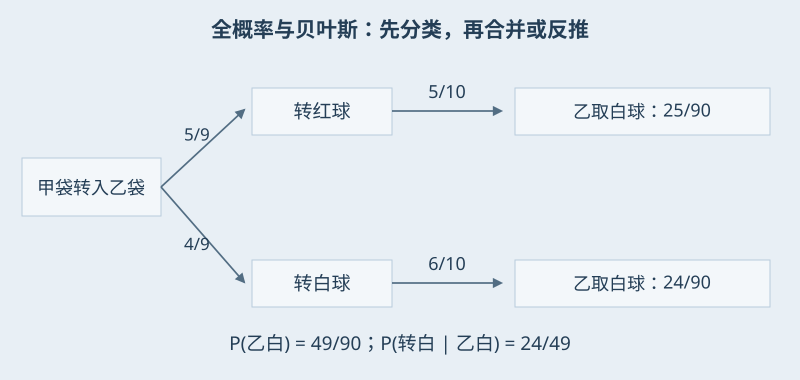

#### 例2 已知色盲反推性别

**题目：** 男性中 5% 是色盲，女性中 0.25% 是色盲。在男女人数相等的人群中随机挑选一人，已知此人是色盲，求为男性的概率。

**解：** 设 $B_1$ 为男性、$B_2$ 为女性、$A$ 为色盲。注意 $0.25\%=0.0025$。

$$P(A)=\frac12\times0.05+\frac12\times0.0025=\frac{21}{800},$$

$$P(B_1\mid A)=\frac{(1/2)\times0.05}{21/800}=\frac{20}{21}.$$

**易错点：** $P(A\mid B_1)$ 与 $P(B_1\mid A)$ 方向不同；后者必须同时考虑先验比例和其他类别。

### 二、伯努利概型

单次只有成功、失败两类，$n$ 次相互独立且成功概率始终为 $p$，则恰成功 $k$ 次的概率为

$$P_n(k)=C_n^kp^k(1-p)^{n-k},\qquad k=0,1,\ldots,n.$$

组合系数选成功出现的位置，再乘每种顺序的概率。

#### 例3 五次射击恰中两次

**题目：** 单次命中率为 0.8，独立射击 5 次，求恰好命中 2 次的概率。

**解：**

$$P_5(2)=C_5^2(0.8)^2(0.2)^3=0.0512.$$

“恰好 2 次”不能与“至少 2 次”混淆；后者需对 $k=2,3,4,5$ 求和或使用补事件。

## 第三讲 一维随机变量及其分布（一）

| 题型 | 方法 |
| --- | --- |
| 求离散分布律 | 先列可能取值，再求各自概率，最后检查非负且总和为 1 |
| 常见离散分布 | 从条件识别二项模型，灵活使用补事件 |
| 连续变量计算 | 密度归一化、积分求 CDF、由 CDF 求区间概率 |

### 一、离散型随机变量的分布律

随机变量将试验结果映射为数。离散型变量用 $p_k=P(X=x_k)$ 描述，要求 $p_k\ge0$、$\sum_kp_k=1$。

#### 例1 两次骰子的较小点数

**题目：** 一枚均匀骰子独立掷两次，以 $X$ 表示两次中较小点数，求分布律。

**解：** $X=1,2,\ldots,6$，36 个有序结果等可能。

**法一（列表计数）：** 最小值等于 $k$ 的结果由“第一次为 $k$、第二次大于 $k$”“第一次大于 $k$、第二次为 $k$”“两次均为 $k$”组成，共 $2(6-k)+1=13-2k$ 个。

| $X$ | 1 | 2 | 3 | 4 | 5 | 6 |
| --- | --- | --- | --- | --- | --- | --- |
| $P$ | $11/36$ | $9/36$ | $7/36$ | $5/36$ | $3/36$ | $1/36$ |

**法二（讲义的排列计数）：** 以 $k=1$ 为例，

$$p_1=\frac{A_1^1A_5^1+A_5^1A_1^1+A_1^1A_1^1}{6\times6}=\frac{11}{36}.$$

对其余 $k$ 同理，将 5 换为 $6-k$ 即得。

**补充说明（尾概率法）：** $P(X\ge k)=((7-k)/6)^2$，所以

$$P(X=k)=P(X\ge k)-P(X\ge k+1)=\frac{(7-k)^2-(6-k)^2}{36}.$$

### 二、二项分布求概率与参数

若 $X$ 为 $n$ 次伯努利试验的成功次数，则 $X\sim B(n,p)$，分布律即上一讲的 $P_n(k)$。

#### 例2 由至少命中一次求命中率

**题目：** 4 次独立射击，每次命中概率为 $p$。已知至少命中 1 次的概率为 $80/81$，求 $p$。

**解：** $X\sim B(4,p)$，

$$P(X=0)=1-\frac{80}{81}=\frac1{81}=(1-p)^4.$$

由 $0\le p\le1$，得 $1-p=1/3$，所以 $p=2/3$。

### 三、密度与分布函数

分布函数定义为 $F(x)=P(X\le x)$，任意分布都满足单调不减、右连续，且 $F(-\infty)=0$、$F(+\infty)=1$。

连续型变量存在密度 $f(x)\ge0$，满足

$$\int_{-\infty}^{+\infty}f(x)\,dx=1,\qquad F(x)=\int_{-\infty}^xf(t)\,dt.$$

密度与 CDF 的导数满足 $f(x)=F'(x)$ 几乎处处成立；在本讲分段光滑区间可用导数选取密度。密度在有限个点的取值不影响分布。密度是曲线高度，概率是面积，不要求 $f(x)\le1$。

$$P(a<X\le b)=F(b)-F(a)=\int_a^bf(x)\,dx.$$

连续型变量有 $P(X=a)=0$，可交换上述区间端点开闭。**补充说明：** 对一般含离散质量的分布，$P(X<a)=F(a-)$，不能总把 $<$ 改成 $\le$。

#### 例3 对数型分布函数

**题目：**

$$F(x)=\begin{cases}0,&x<1,\\ \ln x,&1\le x<e,\\1,&x\ge e.\end{cases}$$

求（1）密度；（2）$P(X<2)$ 和 $P(0<X\le3)$。

**解：** （1）在各光滑区间求导，可取

$$f(x)=\begin{cases}1/x,&1<x<e,\\0,&\text{其他}.\end{cases}$$

在 1、$e$ 处人为规定密度为 0 即可；不是声称 $F$ 在这两处可导。

（2）因 $1<2<e<3$，

$$P(X<2)=F(2)=\ln2,$$

$$P(0<X\le3)=F(3)-F(0)=1.$$

积分法也给出 $\int_0^3f(x)\,dx=\int_1^e dx/x=1$。

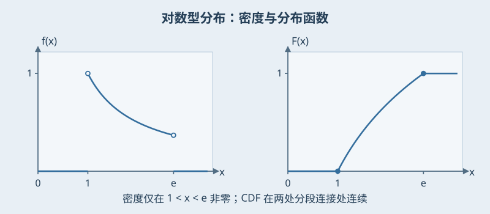

#### 例4 指数型密度的归一化与 CDF

**题目：** $f(x)=ke^{-2x}$（$x>0$），其他处为 0。求 $k$ 和 $F(x)$。

**解：**

$$1=\int_0^\infty ke^{-2x}\,dx=\frac k2\quad\Rightarrow\quad k=2.$$

当 $x\le0$，$F(x)=0$；当 $x>0$，

$$F(x)=\int_0^x2e^{-2t}\,dt=1-e^{-2x}.$$

所以

$$F(x)=\begin{cases}0,&x\le0,\\1-e^{-2x},&x>0.\end{cases}$$

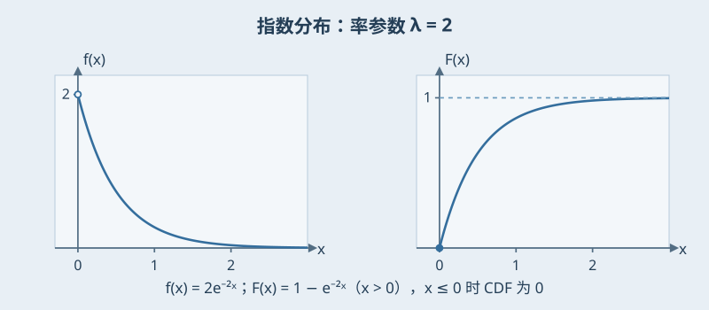

**方法说明：** 讲义采用分段求原函数再定常数；使用该方法时还须检查分段连接条件。直接使用从 $-\infty$ 到 $x$ 的定积分更稳妥。

#### 例5 均匀密度求 CDF

**题目：** $f(x)=1$（$0<x<1$），其他处为 0，求 $F(x)$。

**解：** 积分区间与密度支持区间相交后，

$$F(x)=\begin{cases}0,&x\le0,\\ \int_0^x1\,dt=x,&0<x<1,\\ \int_0^11\,dt=1,&x\ge1.\end{cases}$$

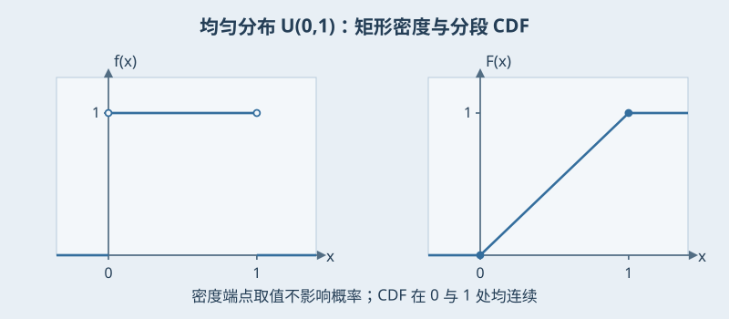

**易错点：** 不能仅凭 $F(-\infty)=0$、$F(+\infty)=1$ 确定所有中间分段的积分常数，还须满足连接处连续。密度分段点不必连续，而本讲连续型变量的 CDF 必须连续。

## 第四讲 一维随机变量及其分布（二）

| 题型 | 方法 |
| --- | --- |
| 常见连续分布的概率 | 均匀分布用长度比；正态分布用对称性或标准化 |
| 离散变量函数的分布 | 列出函数取值，合并映射到同一值的概率 |
| 连续变量函数的分布 | 先求支持范围，再用分布函数法，最后求导 |

### 一、均匀分布与正态分布

若 $X\sim U(a,b)$，$a<b$，则

$$f_X(x)=\begin{cases}1/(b-a),&a<x<b,\\0,&\text{其他}.\end{cases}$$

对 $a\le c<d\le b$，$P(c<X<d)=(d-c)/(b-a)$。一般区间需先与 $(a,b)$ 取交集。

若 $X\sim N(\mu,\sigma^2)$，$\sigma>0$，则

$$f_X(x)=\frac1{\sqrt{2\pi}\sigma}\exp\left[-\frac{(x-\mu)^2}{2\sigma^2}\right],\qquad Z=\frac{X-\mu}{\sigma}\sim N(0,1).$$

令 $\Phi(z)=P(Z\le z)$，则

$$\Phi(0)=\frac12,\qquad \Phi(-z)=1-\Phi(z),$$

$$P(a<X<b)=\Phi\left(\frac{b-\mu}{\sigma}\right)-\Phi\left(\frac{a-\mu}{\sigma}\right).$$

正态密度关于 $x=\mu$ 对称，均值两侧概率各为 $1/2$。

#### 例1 随机系数方程存在实根

**题目：** $X\sim U(0,5)$，求关于 $t$ 的方程 $4t^2+4Xt+X+2=0$ 有实根的概率。

**解：** 实根条件为

$$\Delta=(4X)^2-16(X+2)=16(X-2)(X+1)\ge0.$$

即 $X\le-1$ 或 $X\ge2$。与支持区间 $(0,5)$ 相交后只剩 $[2,5)$，所以

$$P(\Delta\ge0)=\frac{5-2}{5-0}=\frac35.$$

#### 例2 正态对称性

**题目：** $X\sim N(2,\sigma^2)$，且 $P(2<X<4)=0.3$，求 $P(X<0)$。

**解：** **法一（对称性）：** 区间 $(0,2)$ 与 $(2,4)$ 关于均值 2 对称，故 $P(0<X<2)=0.3$。于是

$$P(X<0)=P(X<2)-P(0<X<2)=0.5-0.3=0.2.$$

**法二（标准化）：**

$$0.3=\Phi(2/\sigma)-\Phi(0)\quad\Rightarrow\quad\Phi(2/\sigma)=0.8,$$

$$P(X<0)=\Phi(-2/\sigma)=1-0.8=0.2.$$

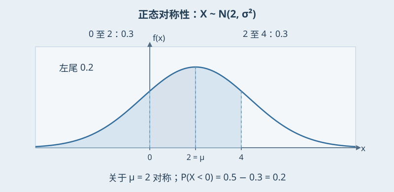

### 二、离散变量函数的分布

若 $Y=g(X)$，多个 $x_i$ 可能映射为同一 $y$，必须把这些概率相加：

$$P(Y=y)=\sum_{i:g(x_i)=y}P(X=x_i).$$

#### 例3 平方变换

**题目：** $X$ 的分布律如下，求 $Y=X^2$ 的分布律。

| $X$ | $-2$ | $-1$ | $0$ | $1$ | $3$ |
| --- | --- | --- | --- | --- | --- |
| $P$ | $1/5$ | $1/6$ | $1/5$ | $1/15$ | $11/30$ |

**解：** $Y$ 的不同取值为 $0,1,4,9$。

$$P(Y=0)=P(X=0)=\frac15,$$

$$P(Y=1)=P(X=-1)+P(X=1)=\frac16+\frac1{15}=\frac7{30},$$

$$P(Y=4)=P(X=-2)=\frac15,\qquad P(Y=9)=P(X=3)=\frac{11}{30}.$$

| $Y$ | 0 | 1 | 4 | 9 |
| --- | --- | --- | --- | --- |
| $P$ | $1/5$ | $7/30$ | $1/5$ | $11/30$ |

概率之和为 1。$X$ 不取 2，因此 $P(X=2)=0$，无需人为增加一个正概率项。

### 三、连续变量函数的分布

分布函数法适用于单调或非单调变换：

$$F_Y(y)=P(g(X)\le y)=\int_{\{x:g(x)\le y\}}f_X(x)\,dx.$$

先确定 $Y$ 的取值范围和积分区域随 $y$ 变化的分段，再求 $F_Y$，最后在可导处求 $f_Y$。**补充说明：** 一般非单调函数需考虑所有反像分支，不能机械地只取一个反函数。

#### 例4 均匀变量的立方

**题目：** $X\sim U(0,2)$，$Y=X^3$。求（1）$F_Y(y)$；（2）$f_Y(y)$。

**解：** $g(x)=x^3$ 在 $(0,2)$ 上严格递增，所以 $0<Y<8$。

当 $y\le0$，$F_Y(y)=0$；当 $0<y<8$，

$$F_Y(y)=P(X^3\le y)=P(X\le\sqrt[3]y)=\int_0^{\sqrt[3]y}\frac12\,dx=\frac{\sqrt[3]y}{2};$$

当 $y\ge8$，$F_Y(y)=1$。综上

$$F_Y(y)=\begin{cases}0,&y\le0,\\ y^{1/3}/2,&0<y<8,\\1,&y\ge8,\end{cases}$$

$$f_Y(y)=\begin{cases}\dfrac1{6y^{2/3}},&0<y<8,\\0,&\text{其他}.\end{cases}$$

归一化检查：$\int_0^8 (6y^{2/3})^{-1}\,dy=[y^{1/3}/2]_0^8=1$。密度在 0 附近无界但可积，不能因为曲线很高就判定不是密度。

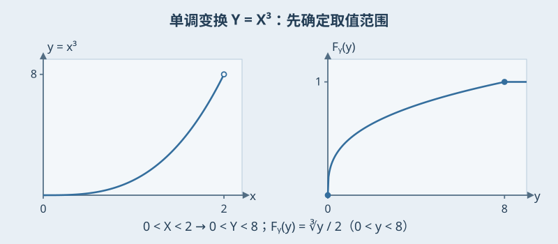

## 第五讲 二维随机变量及其分布

| 题型 | 方法 |
| --- | --- |
| 离散联合、边缘、条件与独立性 | 列联合表，按行列求和，用条件概率，检查联合是否等于边缘乘积 |
| 连续联合、边缘、条件与独立性 | 画支持域，归一化、区域积分、固定一个变量求积分限 |
| 两个离散变量的函数 | 遍历联合表，将函数值相同的单元概率相加 |
| 两个连续变量的函数 | 用移动边界划分积分区域，分段求 CDF 再求导 |

### 一、二维离散分布

设 $p_{ij}=P(X=x_i,Y=y_j)$。本笔记的联合表统一以 $X$ 为行、$Y$ 为列：

$$P(X=x_i)=\sum_jp_{ij},\qquad P(Y=y_j)=\sum_ip_{ij}.$$

当 $P(Y=y_j)>0$，

$$P(X=x_i\mid Y=y_j)=\frac{p_{ij}}{\sum_ip_{ij}}.$$

独立的充要条件是所有 $i,j$ 都满足 $p_{ij}=P(X=x_i)P(Y=y_j)$。检查一个不满足的单元即可否定独立。

#### 例1 两封信投入四个邮筒

**题目：** 将两封信随机投入编号 1、2、3、4 的邮筒。$X,Y$ 分别表示第 1、2 个邮筒中的信数。求（1）联合分布律；（2）各边缘分布律；（3）$Y=1$ 条件下 $X$ 的分布；（4）是否独立。

**解：** 讲义按两封信分别独立、等可能选择邮筒的模型计数，共 $4^2=16$ 个等可能有序结果。$X,Y\in\{0,1,2\}$，且 $X+Y\le2$。

例如两封都投到 3、4 号筒的概率为 $(2/4)^2=1/4$；一封投 2 号、另一封投 3 或 4 号的概率为 $2\times1\times2/16=1/4$；两封分别投到 1、2 号的概率为 $2/16=1/8$。

| $X\backslash Y$ | 0 | 1 | 2 | $P_X$ |
| --- | --- | --- | --- | --- |
| 0 | $1/4$ | $1/4$ | $1/16$ | $9/16$ |
| 1 | $1/4$ | $1/8$ | $0$ | $3/8$ |
| 2 | $1/16$ | $0$ | $0$ | $1/16$ |
| $P_Y$ | $9/16$ | $3/8$ | $1/16$ | $1$ |

（2）两边缘分布相同，取 $0,1,2$ 时的概率分别为 $9/16,3/8,1/16$。

（3）将 $Y=1$ 那一列除以列和 $3/8$：

| $X$ | 0 | 1 | 2 |
| --- | --- | --- | --- |
| $P(X\mid Y=1)$ | $2/3$ | $1/3$ | 0 |

（4）$P(X=2,Y=2)=0$，而 $P(X=2)P(Y=2)=1/256>0$，所以不独立。也可从条件分布不等于边缘分布判断。

**易错点：** 不能把所有“信数分配方案”当作等可能；等可能的是两封信各自选择邮筒的有序结果。

### 二、二维连续分布

联合密度满足非负且二重积分为 1；$P((X,Y)\in G)=\iint_Gf(x,y)\,dx\,dy$。边缘密度为

$$f_X(x)=\int_{-\infty}^{\infty}f(x,y)\,dy,\qquad f_Y(y)=\int_{-\infty}^{\infty}f(x,y)\,dx.$$

当 $f_X(x)>0$，条件密度

$$f_{Y\mid X}(y\mid x)=\frac{f(x,y)}{f_X(x)}.$$

连续变量的 $P(X=x)=0$，此式是通过密度定义的条件分布，不能直接把点事件代入离散型的概率比值式。

#### 例2 三角支持域上的联合密度

**题目：**

$$f(x,y)=\begin{cases}kx,&0\le x\le y\le1,\\0,&\text{其他}.\end{cases}$$

求（1）$k$；（2）$P(X+Y\le1)$；（3）边缘密度；（4）$f_{Y\mid X}(y\mid x)$；（5）是否独立。

**解：** 支持域为三角形 $D=\{(x,y):0\le x\le y\le1\}$。

（1）按先 $y$ 后 $x$ 积分：

$$1=\int_0^1\int_x^1kx\,dy\,dx=k\int_0^1x(1-x)\,dx=\frac k6,$$

所以 $k=6$。

（2）附加条件为 $y\le1-x$。要同时满足 $x\le y\le1-x$，需 $0\le x\le1/2$，所以

$$P(X+Y\le1)=\int_0^{1/2}\int_x^{1-x}6x\,dy\,dx=6\int_0^{1/2}x(1-2x)\,dx=\frac14.$$

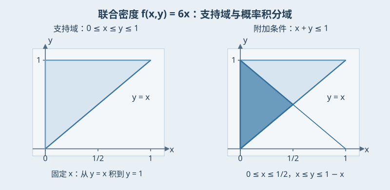

（3）固定 $x$ 时 $x<y<1$；固定 $y$ 时 $0<x<y$：

$$f_X(x)=\begin{cases}\int_x^16x\,dy=6x(1-x),&0<x<1,\\0,&\text{其他},\end{cases}$$

$$f_Y(y)=\begin{cases}\int_0^y6x\,dx=3y^2,&0<y<1,\\0,&\text{其他}.\end{cases}$$

（4）对固定的 $0<x<1$，

$$f_{Y\mid X}(y\mid x)=\begin{cases}\dfrac1{1-x},&x<y<1,\\0,&\text{其他}.\end{cases}$$

其积分为 1，即给定 $X=x$ 后，$Y$ 在 $(x,1)$ 上均匀分布。

（5）在 $0<y<x<1$ 区域，联合密度为 0，但边缘乘积 $6x(1-x)\cdot3y^2>0$，所以不独立。

**易错点：** 不只检查代数式能否分解，支持域也必须纳入判断。密度乘积相等的独立性条件是几乎处处成立；本题在一整块正面积区域上不等。

### 三、两个离散变量函数的分布

#### 例3 由联合表求和变量分布

**题目：** 已知下表，求 $Z=X+Y$ 的分布律。

| $X\backslash Y$ | 1 | 2 | 3 |
| --- | --- | --- | --- |
| 1 | $1/4$ | $1/4$ | $1/8$ |
| 2 | $1/8$ | $0$ | $1/4$ |

**解：** $Z=2,3,4,5$。将相同和对应的单元相加：

$$P(Z=2)=\frac14,\qquad P(Z=3)=\frac14+\frac18=\frac38,$$

$$P(Z=4)=\frac18+0=\frac18,\qquad P(Z=5)=\frac14.$$

| $Z$ | 2 | 3 | 4 | 5 |
| --- | --- | --- | --- | --- |
| $P$ | $1/4$ | $3/8$ | $1/8$ | $1/4$ |

这里已有联合分布，不需要额外假设 $X,Y$ 独立。

### 四、两个连续变量函数的分布

对 $Z=g(X,Y)$，

$$F_Z(z)=\iint_{\{(x,y):g(x,y)\le z\}}f(x,y)\,dx\,dy.$$

把移动边界与支持域相交，观察何时积分限改变。讲义用边界点寻找分段；一般曲线、非单调或无界区域还要检查内部极值和边界行为，不能只看几个角点。

#### 例4 差变量的分布

**题目：**

$$f(x,y)=\begin{cases}\dfrac12e^{-y/2},&0<x<1,\ y>0,\\0,&\text{其他}.\end{cases}$$

求 $Z=X-Y$ 的密度 $f_Z(z)$。

**解：** 事件 $X-Y\le z$ 等价于 $y\ge x-z$。直线 $y=x-z$ 与支持带 $0<x<1,y>0$ 的交法在 $z=0,1$ 改变。

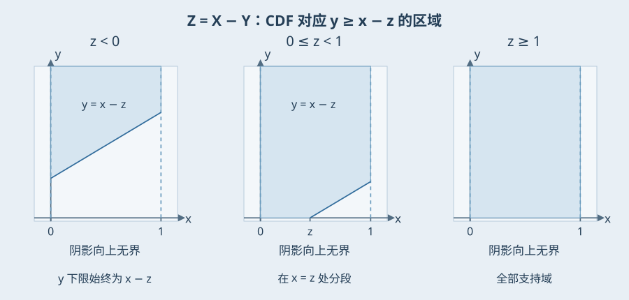

（1）当 $z<0$，对全部 $0<x<1$ 都有 $x-z>0$：

$$F_Z(z)=\int_0^1\int_{x-z}^{\infty}\frac12e^{-y/2}\,dy\,dx=\int_0^1e^{-(x-z)/2}\,dx=2(1-e^{-1/2})e^{z/2}.$$

（2）当 $0\le z<1$，在 $x=z$ 分割：

$$\begin{aligned}F_Z(z)&=\int_0^z\int_0^\infty\frac12e^{-y/2}\,dy\,dx+\int_z^1\int_{x-z}^\infty\frac12e^{-y/2}\,dy\,dx\\&=z+2\left(1-e^{(z-1)/2}\right).
\end{aligned}$$

也可用 1 减去支持带中直线下方的概率。

（3）当 $z\ge1$，因为 $X-Y<1$，所以 $F_Z(z)=1$。

综上

$$F_Z(z)=\begin{cases}2(1-e^{-1/2})e^{z/2},&z<0,\\z+2-2e^{(z-1)/2},&0\le z<1,\\1,&z\ge1.\end{cases}$$

求导得到

$$f_Z(z)=\begin{cases}(1-e^{-1/2})e^{z/2},&z<0,\\1-e^{(z-1)/2},&0\le z<1,\\0,&z\ge1.\end{cases}$$

在 0、1 处分段连接的 $F_Z$ 连续，且 $F_Z(-\infty)=0$、$F_Z(+\infty)=1$。**注意：** $z<0$ 时仍有正概率，不能把 $Z$ 的支持集误写为 $(0,1)$。

## 第六讲 随机变量的数字特征

| 题型 | 方法 |
| --- | --- |
| 常见分布的期望、方差 | 识别参数，用期望线性性和方差公式 |
| 离散协方差、相关系数 | 从分布律计算 $E(X),E(Y),E(XY)$ 与二阶矩 |
| 连续协方差、相关系数 | 在支持域积分，再代协方差公式 |
| 切比雪夫不等式 | 仅由均值和方差给出概率界 |

### 一、期望、方差及常见分布

离散型 $E[g(X)]=\sum_kg(x_k)p_k$，连续型 $E[g(X)]=\int g(x)f_X(x)\,dx$；以下使用的矩均假定存在。

$$D(X)=E[(X-E(X))^2]=E(X^2)-[E(X)]^2.$$

$$E(aX+bY+c)=aE(X)+bE(Y)+c,$$

$$D(aX+bY)=a^2D(X)+b^2D(Y)+2ab\operatorname{Cov}(X,Y).$$

独立蕴含协方差为 0，此时方差中的交叉项消失；期望的线性性不要求独立。$D(aX+c)=a^2D(X)$。

| 分布 | 参数与支持范围 | $E(X)$ | $D(X)$ |
| --- | --- | --- | --- |
| 0-1 分布 | $0\le p\le1$；$P(X=1)=p,\ P(X=0)=1-p$ | $p$ | $p(1-p)$ |
| 二项 $B(n,p)$ | $n$ 为正整数，$0\le p\le1$；$0,\ldots,n$ | $np$ | $np(1-p)$ |
| 泊松 $P(\lambda)$ | $\lambda>0$；$k=0,1,\ldots$，$P(X=k)=e^{-\lambda}\lambda^k/k!$ | $\lambda$ | $\lambda$ |
| 均匀 $U(a,b)$ | $a<b$；$a<x<b$ | $(a+b)/2$ | $(b-a)^2/12$ |
| 指数 $\operatorname{Exp}(\lambda)$ | **率参数** $\lambda>0$；$f(x)=\lambda e^{-\lambda x}$，$x>0$ | $1/\lambda$ | $1/\lambda^2$ |
| 正态 $N(\mu,\sigma^2)$ | $\sigma^2>0$；全实轴 | $\mu$ | $\sigma^2$ |

#### 例1 独立变量线性组合的方差

**题目：** $X_1,X_2,X_3$ 相互独立，$X_1\sim U(0,6)$，$X_2\sim N(0,4)$，$X_3\sim P(3)$，求 $D(X_1-2X_2+3X_3)$。

**解：** $D(X_1)=36/12=3$，$D(X_2)=4$，$D(X_3)=3$，所以

$$D(X_1-2X_2+3X_3)=3+(-2)^2\times4+3^2\times3=46.$$

负系数平方后为正，不能把中间项写成减去 $4D(X_2)$。

#### 例2 由方差计算二阶矩

**题目：** $X$ 表示 10 次独立重复射击命中目标的次数，每次命中概率为 0.4，求 $E(X^2)$。

**解：** $X\sim B(10,0.4)$，$E(X)=4$，$D(X)=2.4$，故

$$E(X^2)=D(X)+[E(X)]^2=2.4+16=18.4.$$

### 二、协方差与相关系数

$$\operatorname{Cov}(X,Y)=E[(X-E(X))(Y-E(Y))]=E(XY)-E(X)E(Y).$$

当两方差均为正时，

$$\rho_{XY}=\frac{\operatorname{Cov}(X,Y)}{\sqrt{D(X)D(Y)}},\qquad -1\le\rho_{XY}\le1.$$

$$\operatorname{Cov}(aX+bY,Z)=a\operatorname{Cov}(X,Z)+b\operatorname{Cov}(Y,Z),\qquad\operatorname{Cov}(Y,Y)=D(Y).$$

**易错点：** 独立推出不相关；不相关一般不能推出独立。$E(XY)$ 是乘积的期望，不是无条件等于 $E(X)E(Y)$。

#### 例3 从三个分布律计算协方差

**题目：** 已知 $X,Y,XY$ 的分布如下，求（1）$\operatorname{Cov}(X-Y,Y)$；（2）$\rho_{XY}$。

| $X$ | 0 | 1 | 2 |
| --- | --- | --- | --- |
| $P$ | $1/2$ | $1/3$ | $1/6$ |

| $Y$ | 0 | 1 | 2 |
| --- | --- | --- | --- |
| $P$ | $1/3$ | $1/3$ | $1/3$ |

| $XY$ | 0 | 1 | 2 | 4 |
| --- | --- | --- | --- | --- |
| $P$ | $7/12$ | $1/3$ | 0 | $1/12$ |

**解：**

$$E(X)=\frac13+\frac26=\frac23,\qquad E(Y)=1,$$

$$E(XY)=\frac13+\frac4{12}=\frac23,\qquad\operatorname{Cov}(X,Y)=\frac23-\frac23\times1=0.$$

$$E(Y^2)=\frac{1+4}{3}=\frac53,\qquad D(Y)=\frac53-1=\frac23.$$

所以

$$\operatorname{Cov}(X-Y,Y)=\operatorname{Cov}(X,Y)-D(Y)=-\frac23.$$

另 $E(X^2)=1/3+4/6=1$，$D(X)=1-4/9=5/9>0$。因此 $\rho_{XY}=0$，即不相关。

#### 例4 连续变量的相关系数

**题目：**

$$f(x,y)=\begin{cases}\dfrac34x^2y,&0\le x\le2,\ 0\le y\le1,\\0,&\text{其他}.\end{cases}$$

求 $\rho_{XY}$。

**解：** 在矩形支持域上积分：

$$E(XY)=\int_0^2\int_0^1\frac34x^3y^2\,dy\,dx=1,$$

$$E(X)=\int_0^2\int_0^1\frac34x^3y\,dy\,dx=\frac32,$$

$$E(Y)=\int_0^2\int_0^1\frac34x^2y^2\,dy\,dx=\frac23.$$

故 $\operatorname{Cov}(X,Y)=1-(3/2)(2/3)=0$。两变量都不是常量且有有限方差，所以 $\rho_{XY}=0$。

**补充说明：** 本题事实上独立，因为

$$f_X(x)=\frac38x^2\quad(0<x<2),\qquad f_Y(y)=2y\quad(0<y<1),$$

联合密度在全平面几乎处处等于两个边缘密度的乘积。这个独立结论来自密度分解，而不是仅凭相关系数为 0。

### 三、切比雪夫不等式

任意具有有限均值 $\mu$ 与方差 $\sigma^2$ 的变量，对 $\varepsilon>0$ 有

$$P(|X-\mu|\ge\varepsilon)\le\frac{\sigma^2}{\varepsilon^2},\qquad P(|X-\mu|<\varepsilon)\ge1-\frac{\sigma^2}{\varepsilon^2}.$$

这是普适概率界，不要求正态分布；右侧若为负，应结合概率非负理解，不能得到负概率。

#### 例5 已知均值方差估计区间概率

**题目：** $E(X)=100$，$D(X)=50$，求 $P(80<X<120)$ 的下界。

**解：** $80<X<120$ 等价于 $|X-100|<20$，因此

$$P(80<X<120)\ge1-\frac{50}{20^2}=\frac78.$$

只能给出下界，不能写成该概率必定等于 $7/8$。

## 第七讲 中心极限定理与数理统计概念

| 题型 | 方法 |
| --- | --- |
| 中心极限定理求概率 | 独立同分布变量和的均值为 $n\mu$、方差为 $n\sigma^2$，再标准化 |
| 三大抽样分布 | 按标准正态平方和、正态除以卡方平方根、卡方比值识别 |

### 一、中心极限定理

设 $X_1,\ldots,X_n$ 独立同分布，$E(X_i)=\mu$，$D(X_i)=\sigma^2\in(0,\infty)$，则随着 $n\to\infty$，

$$\frac{\sum_{i=1}^nX_i-n\mu}{\sigma\sqrt n}\xrightarrow{d}N(0,1).$$

在近似适用时可把 $T_n=\sum_iX_i$ 近似为 $N(n\mu,n\sigma^2)$。这是近似结论；有限样本下不能直接写成精确同分布。样本量是否够大还取决于原分布形状。

#### 例1 元件寿命总和

**题目：** 某电子元件寿命服从均值为 100 小时的指数分布。随机取 16 只，寿命相互独立，求其寿命总和超过 1920 小时的概率。

**解：** $X_i\sim\operatorname{Exp}(1/100)$，所以 $E(X_i)=100$，$D(X_i)=100^2$。

$$E(T)=1600,\quad D(T)=16\times100^2,\quad \sqrt{D(T)}=400.$$

按讲义的正态近似：

$$P(T>1920)\approx1-\Phi\left(\frac{1920-1600}{400}\right)=1-\Phi(0.8)\approx0.2119.$$

**补充说明：** 16 个指数变量之和的分布仍有偏斜，这里的 0.2119 是中心极限定理近似值，不是精确概率。

#### 例2 系统中至少 85 个部件正常

**题目：** 系统由 100 个独立部件组成，每个部件损坏概率为 0.1，求至少 85 个正常的概率。

**解：** 设 $X_i=1$ 表示第 $i$ 个部件损坏，否则为 0；损坏总数 $K=\sum_iX_i\sim B(100,0.1)$。事件为 $K\le15$，且 $E(K)=10$、$D(K)=9$。

讲义采用未作连续性修正的正态近似：

$$P(K\le15)\approx\Phi\left(\frac{15-10}{3}\right)=\Phi(5/3)\approx0.9522.$$

> 数值订正：讲义末行约 0.9529 与 $\Phi(5/3)$ 不符，按未修正公式应为约 0.9522。

**补充说明（离散变量的连续性修正）：** 整数事件 $K\le15$ 用连续正态近似时可把边界取为 15.5：

$$P(K\le15)\approx\Phi\left(\frac{15.5-10}{3}\right)\approx0.9666.$$

精确二项概率为 $\sum_{k=0}^{15}C_{100}^k(0.1)^k(0.9)^{100-k}\approx0.9601$。三者应注明各自方法，不能混成同一个精确结果。

### 二、样本与三大抽样分布

**补充基础：** 简单随机样本指来自同一总体、相互独立且同分布的 $X_1,\ldots,X_n$。统计量是只依赖样本、不含未知参数的函数。常用样本均值与方差为

$$\overline X=\frac1n\sum_iX_i,\qquad S^2=\frac1{n-1}\sum_i(X_i-\overline X)^2.$$

以下 $q_p$ 均表示**下侧分位数** ：$P(W\le q_p)=p$。分别写作 $\chi^2_p(\nu)$、$t_p(\nu)$ 和 $F_p(\nu_1,\nu_2)$。讲义使用的是“上侧面积为 $\alpha$ 的临界值”，对应本文下侧的 $q_{1-\alpha}$。

| 分布 | 构造与独立条件 | 支持范围与形状 |
| --- | --- | --- |
| $\chi^2(\nu)$ | $\sum_{i=1}^{\nu}Z_i^2$，$Z_i$ 独立标准正态 | 非负，通常右偏 |
| $t(\nu)$ | $Z/\sqrt{U/\nu}$，$Z\sim N(0,1)$、$U\sim\chi^2(\nu)$ 独立 | 全实轴，关于 0 对称，比正态尾部厚 |
| $F(\nu_1,\nu_2)$ | $(U/\nu_1)/(V/\nu_2)$，两个卡方变量独立 | 正半轴，通常右偏，两个自由度顺序不可互换 |

对正态总体的简单随机样本，

$$\frac{\overline X-\mu}{\sigma/\sqrt n}\sim N(0,1),\qquad\frac{\overline X-\mu}{S/\sqrt n}\sim t(n-1),$$

$$\frac{(n-1)S^2}{\sigma^2}\sim\chi^2(n-1),\qquad \overline X\text{ 与 }S^2\text{ 独立}.$$

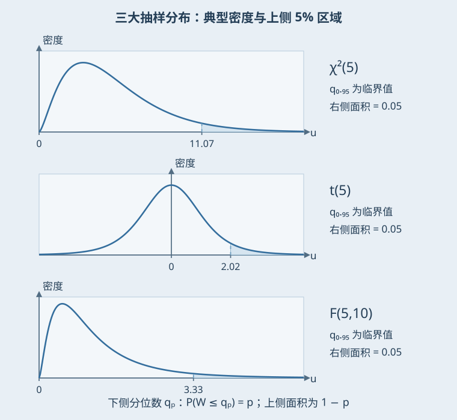

#### 例3 t 变量平方的分布

**题目：** $X\sim t(n)$，证明 $X^2\sim F(1,n)$。

**解：** 由 t 分布构造，可用独立的 $Z\sim N(0,1)$、$U\sim\chi^2(n)$ 表示为 $X=Z/\sqrt{U/n}$，因此

$$X^2=\frac{Z^2/1}{U/n}.$$

$Z^2\sim\chi^2(1)$ 且与 $U$ 独立，所以按 F 分布定义，$X^2\sim F(1,n)$。

#### 例4 构造成卡方分布

**题目：** 总体 $X\sim N(0,1)$，抽取容量为 4 的简单随机样本 $X_1,X_2,X_3,X_4$。若

$$Y=c(X_1+X_2)^2+c(X_3+X_4)^2$$

服从卡方分布，求 $c$。

**解：** 两个和分别服从 $N(0,2)$，并因使用不同的独立样本而相互独立。标准化得

$$Z_1=\frac{X_1+X_2}{\sqrt2},\quad Z_2=\frac{X_3+X_4}{\sqrt2},\quad Z_1^2+Z_2^2\sim\chi^2(2).$$

所以应取 $c=1/2$，此时 $Y\sim\chi^2(2)$。卡方变量前不能保留任意的比例系数。

## 第八讲 参数估计

| 题型 | 方法 |
| --- | --- |
| 矩估计与最大似然 | 用总体矩匹配样本矩；或构造似然并检查参数空间内的最大值 |
| 无偏性与有效性 | 先算期望，只有在都无偏的前提下直接比较方差 |
| 区间估计 | 根据正态总体、方差已知与否选正态、t 或卡方枢轴量 |

### 一、矩估计与最大似然估计

矩估计把总体矩中的未知参数，用相应样本矩代入并解方程。例如单参数模型可先用 $E(X)=\overline X$。

简单随机样本的似然函数：离散型为 $L(\theta)=\prod_ip(X_i;\theta)$，连续型为 $L(\theta)=\prod_if(X_i;\theta)$。连续型似然是**密度的乘积** ，不是“观察到这一组精确实数的概率”。

通常取对数后求驻点，但还需检查最大值、参数边界及支持集依赖，不能把所有驻点都当作极大值。

#### 例1 幂函数密度的两种估计

**题目：** 总体密度为

$$f(x;\theta)=\begin{cases}(\theta+1)x^\theta,&0<x<1,\\0,&\text{其他},\end{cases}\qquad\theta>-1.$$

$X_1,\ldots,X_n$ 是简单随机样本，求（1）$\theta$ 的矩估计量；（2）最大似然估计量。

**解：** （1）

$$E(X)=\int_0^1x(\theta+1)x^\theta\,dx=\frac{\theta+1}{\theta+2}.$$

令 $\overline X=(\theta+1)/(\theta+2)$，解得

$$\widehat\theta_{\mathrm{MM}}=\frac{2\overline X-1}{1-\overline X}.$$

由于样本在 $(0,1)$ 内，$0<\overline X<1$，且 $\widehat\theta_{\mathrm{MM}}+1=\overline X/(1-\overline X)>0$，符合参数空间。

（2）对 $0<X_i<1$，

$$L(\theta)=(\theta+1)^n\prod_iX_i^\theta,\qquad\ell(\theta)=n\ln(\theta+1)+\theta\sum_i\ln X_i.$$

$$\ell'(\theta)=\frac n{\theta+1}+\sum_i\ln X_i=0\quad\Rightarrow\quad\widehat\theta_{\mathrm{MLE}}=-\frac n{\sum_i\ln X_i}-1.$$

因 $\sum_i\ln X_i<0$，该解大于 $-1$；又 $\ell''(\theta)=-n/(\theta+1)^2<0$，所以是唯一极大值点。

### 二、无偏性与有效性

若对所有允许的参数 $\theta$ 都有 $E_\theta(\widehat\theta)=\theta$，称估计量无偏。比较两个无偏估计量时，方差较小者更有效；这只是所比较估计量之间的结论，不自动表示在所有估计量中最优。

#### 例2 两个加权均值的比较

**题目：** $X_1,X_2$ 来自 $N(\mu,1)$ 的简单随机样本，$\mu$ 未知。比较

$$\widehat\mu_1=\frac13X_1+\frac23X_2,\qquad\widehat\mu_2=\frac14X_1+\frac34X_2$$

是否无偏，以及哪一个更有效。

**解：** 权重和均为 1，所以 $E(\widehat\mu_1)=E(\widehat\mu_2)=\mu$，均无偏。样本独立、方差均为 1，故

$$D(\widehat\mu_1)=\frac19+\frac49=\frac59,\qquad D(\widehat\mu_2)=\frac1{16}+\frac9{16}=\frac58.$$

由于 $5/9<5/8$，$\widehat\mu_1$ 更有效。

### 三、正态总体的置信区间

沿用上一讲的**下侧分位数** 约定，$z_p=\Phi^{-1}(p)$。对于正态总体的简单随机样本：

| 目标与条件 | 双侧 $1-\alpha$ 置信区间 |
| --- | --- |
| 均值，$\sigma$ 已知 | $\left(\overline X-z_{1-\alpha/2}\sigma/\sqrt n,\ \overline X+z_{1-\alpha/2}\sigma/\sqrt n\right)$ |
| 均值，$\sigma$ 未知 | $\left(\overline X-t_{1-\alpha/2}(n-1)S/\sqrt n,\ \overline X+t_{1-\alpha/2}(n-1)S/\sqrt n\right)$ |
| 方差，$\mu$ 未知 | $\left((n-1)S^2/\chi^2_{1-\alpha/2}(n-1),\ (n-1)S^2/\chi^2_{\alpha/2}(n-1)\right)$ |

置信水平是构造区间的方法在重复抽样中的覆盖率；频率学派下参数固定，不能把一次算出的区间解释为参数现在以 95% 的概率随机落入其中。

#### 例3 产品直径的均值与方差区间

**题目：** 产品直径 $X\sim N(\mu,\sigma^2)$，随机抽取 6 件，得 $\overline x=14.95$、样本标准差 $s=0.226$。置信度 95%，求（1）$\mu$ 的置信区间；（2）$\sigma^2$ 的置信区间。

**解：** $n=6$，自由度 5，$\alpha=0.05$。

（1）$\sigma$ 未知，用 $t_{0.975}(5)\approx2.5706$：

$$14.95\pm2.5706\frac{0.226}{\sqrt6}=14.95\pm0.23717,$$

所以均值区间约为

$$\boxed{(14.7128,\ 15.1872)}.$$

> 数值订正：原讲义写成 $(14.71,15.81)$，上端点笔误；保留两位小数应为 $(14.71,15.19)$。

（2）$\chi^2_{0.975}(5)\approx12.8325$，$\chi^2_{0.025}(5)\approx0.83121$，所以

$$\left(\frac{5\times0.226^2}{12.8325},\frac{5\times0.226^2}{0.83121}\right)\approx\boxed{(0.01990,\ 0.30724)}.$$

方差区间一般不关于 $s^2$ 对称；除法会反转分母临界值的大小顺序。方差单位为直径单位的平方。

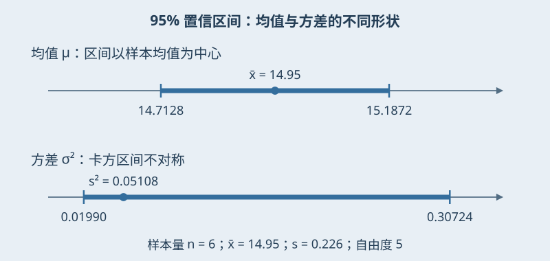

## 第九讲 假设检验

| 题型 | 条件与统计量 |
| --- | --- |
| 正态总体均值检验 | 方差已知用 Z（讲义称 U）检验；未知用 t 检验 |
| 正态总体方差检验 | 使用 $(n-1)S^2/\sigma_0^2$ 的卡方检验 |

### 一、检验的步骤与含义

1. 根据问题提出 $H_0$ 与 $H_1$，区分双侧与单侧。
2. 在 $H_0$ 下选择已知分布的统计量。
3. 按显著性水平 $\alpha$ 确定拒绝域。
4. 代入样本值；落入拒绝域则拒绝 $H_0$，否则不拒绝。

显著性水平控制原假设为真时错误拒绝它的概率。**补充说明：** $p$ 值是在 $H_0$ 下取得至少与观测结果同样极端数据的概率，不是 $H_0$ 为真的概率。未拒绝 $H_0$ 不代表已经证明其正确。

### 二、正态总体均值的检验

对于简单随机样本，双侧检验 $H_0:\mu=\mu_0$ 对 $H_1:\mu\ne\mu_0$：

| 条件 | $H_0$ 下统计量分布 | 拒绝域 |
| --- | --- | --- |
| $\sigma$ 已知 | $Z=(\overline X-\mu_0)/(\sigma/\sqrt n)\sim N(0,1)$ | $|Z|>z_{1-\alpha/2}$ |
| $\sigma$ 未知，正态总体 | $T=(\overline X-\mu_0)/(S/\sqrt n)\sim t(n-1)$ | $|T|>t_{1-\alpha/2}(n-1)$ |

**补充说明：** 右侧备择 $\mu>\mu_0$ 用上尾阈值 $z_{1-\alpha}$ 或 $t_{1-\alpha}$；左侧备择 $\mu<\mu_0$ 用下尾阈值 $z_\alpha$ 或 $t_\alpha$。单侧检验不能照搬双侧的 $\alpha/2$。

#### 例1 食盐包装机是否正常

**题目：** 包装机正常时，每袋质量服从 $N(500,15^2)$。抽取 9 袋，得均值 $\overline x=511.22$ 克，问机器是否正常。

讲义解答采用 $\alpha=5\%$（其解答页补出了这个水平），并把正常时的标准差 15 克作为已知、稳定的总体标准差。

**解：** 检验 $H_0:\mu=500$ 对 $H_1:\mu\ne500$。用已知方差的 Z 检验：

$$Z=\frac{\overline X-500}{15/\sqrt9},\qquad z_{0.975}\approx1.96.$$

拒绝域 $W=(-\infty,-1.96)\cup(1.96,\infty)$。观测值

$$z=\frac{511.22-500}{5}=2.244>1.96.$$

故在 5% 水平下拒绝 $H_0$，有证据认为包装均值偏离 500 克；双侧 $p$ 值约 $2[1-\Phi(2.244)]=0.0248$。

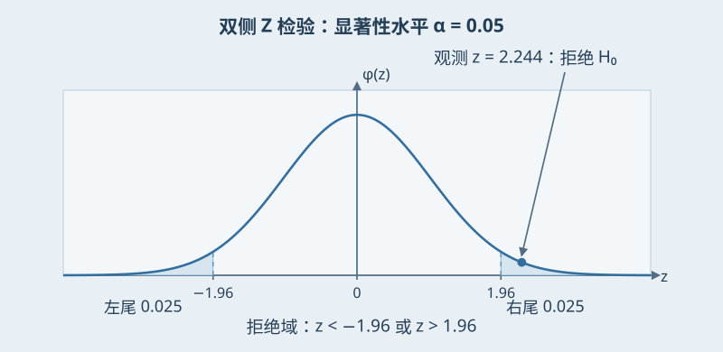

### 三、正态总体方差的检验

正态总体均值未知时，检验 $H_0:\sigma^2=\sigma_0^2$，使用

$$Q=\frac{(n-1)S^2}{\sigma_0^2}\sim\chi^2(n-1)\quad(H_0\text{ 下}).$$

双侧备择 $H_1:\sigma^2\ne\sigma_0^2$ 的拒绝域为

$$Q<\chi^2_{\alpha/2}(n-1)\quad\text{或}\quad Q>\chi^2_{1-\alpha/2}(n-1).$$

卡方分布不对称，两侧临界值不能写成正负同一个数。

#### 例2 袋装饮料的方差要求

**题目：** 某厂袋装饮料要求方差为 $\sigma_0^2=0.0004$。抽取 $n=20$ 袋，得样本标准差 $s=0.03$，假设袋装量服从正态分布。在 $\alpha=0.05$ 下能否认为符合要求？

**解：** 按讲义的“要求等于指定方差”的双侧设定，提出

$$H_0:\sigma^2=0.0004,\qquad H_1:\sigma^2\ne0.0004.$$

自由度为 19，临界值为

$$\chi^2_{0.025}(19)\approx8.9065,\qquad\chi^2_{0.975}(19)\approx32.8523.$$

观测统计量

$$q=\frac{19\times0.03^2}{0.0004}=42.75>32.8523.$$

拒绝 $H_0$；数据不支持符合给定方差要求，观测方向显示波动偏大。

**易错点：** 本题给的是标准差 $s$，代入时必须平方。如果实际质量标准写成“方差不超过某值”，应据其含义另设单侧检验；不能在没有说明时把本题双侧设定悄悄改掉。
