# 大二上物理

本笔记按课程课时整理，保留原有振动、机械波内容，并结合配套讲义补齐光学与热学。考点表中的“必考”、星级和占分是本课程的备考提示，不代表所有学校统一命题要求。

| 课时 | 内容 | 对应材料（PDF 页码） |
| --- | --- | --- |
| 一、二 | 简谐运动、振动能量与合成 | [振动与波动](截图/配套讲义/振动与波动【蜂考突击课】.pdf)，3—11 页 |
| 三 | 机械波方程、能量、干涉、驻波、多普勒效应 | 同上，12—20 页；合并机械波（一）、（二） |
| 四 | 双缝干涉 | [光学](截图/配套讲义/光学【蜂考突击课】.pdf)，3—7 页 |
| 五 | 薄膜、劈尖、牛顿环、迈克尔逊干涉 | 同上，8—15 页 |
| 六 | 单缝衍射、光栅衍射 | 同上，16—21 页 |
| 七 | 偏振光 | 同上，22—23 页 |
| 八 | 气体动理论 | [气体与热力学](截图/配套讲义/气体与热力学【蜂考突击课】.pdf)，3—9 页；合并（一）、（二） |
| 九 | 热力学第一定律与四种过程 | 同上，10—19 页；合并（一）、（二） |
| 十 | 循环过程、热机效率与卡诺循环 | 同上，20—23 页 |

[公式手册](截图/配套讲义/蜂考《大学物理》公式手册.pdf)用于交叉核对，相关部分为第 7—13、23—29 页。正文保留主要知识点、代表例题和选编练习；公式和讲义措辞有歧义时，在对应位置说明条件或订正。

## 课时一 振动学方程

| 考点 | 重要程度 | 占分 | 常见题型 |
| --- | --- | --- | --- |
| 1. 认识简谐运动 | ★★★★ | 3~5 | 选择 / 填空 |
| 2. 振动学方程 | 必考 | 5~10 | 大题 |

### 1. 认识简谐运动

理想水平弹簧振子满足回复力 $F=-kx$，忽略阻力、弹簧质量且位移未超出弹性限度时，做简谐运动。质点在两端最大位移处速度为零，在平衡位置处速率最大。可用旋转矢量法直观表示。

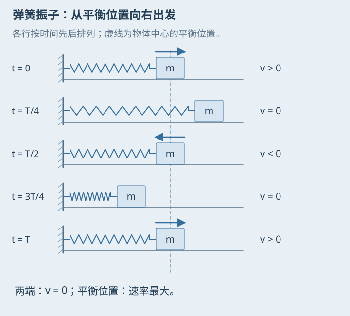

简谐运动的基本公式：

| 物理量 | 表达式 | 说明 |
| --- | --- | --- |
| 运动方程 | $x = A\cos(\omega t + \varphi_0)$ | |
| 振幅 | $A = \sqrt{x_0^2 + \dfrac{v_0^2}{\omega^2}}$ | 由初始条件决定 |
| 角频率 | $\omega = \sqrt{\dfrac{k}{m}} = \dfrac{2\pi}{T}$ | 弹簧振子 |
| 初相 | $\varphi_0$ | 由初始条件决定 |
| 相位 | $\omega t + \varphi_0$ | |
| 周期 | $T = \dfrac{2\pi}{\omega}$ | |
| 频率 | $\nu = \dfrac{1}{T} = \dfrac{\omega}{2\pi}$ | |
| 速度 | $v = \dfrac{dx}{dt} = -A\omega\sin(\omega t + \varphi_0)$，$v_{\max} = A\omega$ | |
| 加速度 | $a = \dfrac{dv}{dt} = -A\omega^2\cos(\omega t + \varphi_0)=-\omega^2x$，$\lvert a\rvert_{\max} = A\omega^2$ | 指向平衡位置 |

初始条件满足

$$\cos\varphi_0=\frac{x_0}{A},\qquad \sin\varphi_0=-\frac{v_0}{A\omega}.$$

当 $A>0$ 时，要同时利用两式确定初相的象限；相差 $2\pi$ 整数倍的初相等价。振幅为零时不存在有意义的初相。速度、加速度的“最大值”在此通常指其大小的最大值。

> [!tip] 旋转矢量法
> 用一个长度为 $A$ 的旋转矢量以角速度 $\omega$ 逆时针旋转，矢量在 $x$ 轴上的投影即对应位移 $x$。矢量与 $x$ 轴的夹角即为相位 $\omega t + \varphi_0$，$t=0$ 时的夹角为初相 $\varphi_0$。
>
> 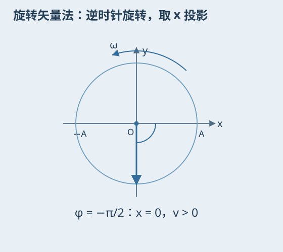

> [!tip] 弹簧串并联
> 弹簧串联：$\dfrac{1}{k} = \dfrac{1}{k_1} + \dfrac{1}{k_2}$
> 弹簧并联：$k = k_1 + k_2$
>
> 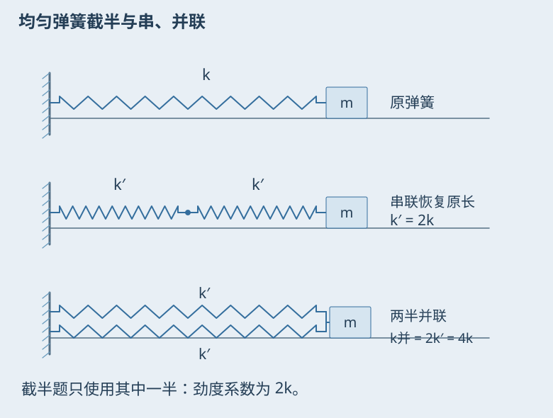

**题1.** 一质点按如下规律沿 $x$ 轴作简谐运动：$x = 0.1\cos\left(8\pi t + \dfrac{2\pi}{3}\right)$ (SI)，求此振动的周期、振幅、初相、速度最大值和加速度最大值。

**解：**

- 振幅 $A = 0.1\,\text{m}$
- 角频率 $\omega = 8\pi$，$T = \dfrac{2\pi}{\omega} = \dfrac{2\pi}{8\pi} = 0.25\,\text{s}$
- 初相 $\varphi_0 = \dfrac{2\pi}{3}$
- 速度最大值 $v_{\max} = A\omega = 0.1 \times 8\pi = 0.8\pi\,\text{m/s} \approx 2.51\,\text{m/s}$
- 加速度最大值 $a_{\max} = A\omega^2 = 0.1 \times (8\pi)^2 \approx 63.2\,\text{m/s}^2$

**题2.** 质点做简谐运动，振动方程 $x = A\cos(\omega t + \varphi)$，当 $t = T/2$（$T$ 为周期）时，质点的速度为（  ）

$A.\ -A\omega\sin\varphi \quad B.\ A\omega\sin\varphi \quad C.\ -A\omega\cos\varphi \quad D.\ A\omega\cos\varphi \quad E.\ 0$

**答：B**

**解：**

$$v = \frac{dx}{dt} = -A\omega\sin(\omega t + \varphi)\Big|_{t=T/2}$$

$$= -A\omega\sin\left(\omega\cdot\frac{T}{2} + \varphi\right) = -A\omega\sin\left(\omega\cdot\frac{2\pi/\omega}{2} + \varphi\right)$$

$$= -A\omega\sin(\pi + \varphi) = A\omega\sin\varphi$$

**题3.** 将劲度系数为 $k$ 的均匀轻质弹簧截去一半，然后一端固定，另一端下挂质量为 $m$ 的小球，组成振动系统。那么该系统的频率是（  ）

$A.\ \dfrac{1}{4\pi}\sqrt{\dfrac{k}{m}} \quad B.\ \dfrac{1}{2\pi}\sqrt{\dfrac{k}{m}} \quad C.\ \dfrac{1}{2\sqrt{2}\pi}\sqrt{\dfrac{k}{m}} \quad D.\ \dfrac{\sqrt{2}}{2\pi}\sqrt{\dfrac{k}{m}}$

**答：D**

**解：** 把两段相同的半弹簧重新**串联**，可恢复原弹簧。每段劲度系数为 $k\prime$，故：$\dfrac{1}{k'} + \dfrac{1}{k'} = \dfrac{1}{k} \Rightarrow k' = 2k$

$$\omega = \sqrt{\frac{k'}{m}} = \sqrt{\frac{2k}{m}}, \quad \nu = \frac{\omega}{2\pi} = \frac{\sqrt{2}}{2\pi}\sqrt{\frac{k}{m}}$$

### 2. 振动学方程 $x = A\cos(\omega t + \varphi_0)$

**题1.** 已知一物体作简谐运动，周期为 $1\,\text{s}$，振动曲线如图所示，求简谐运动的余弦表达式。

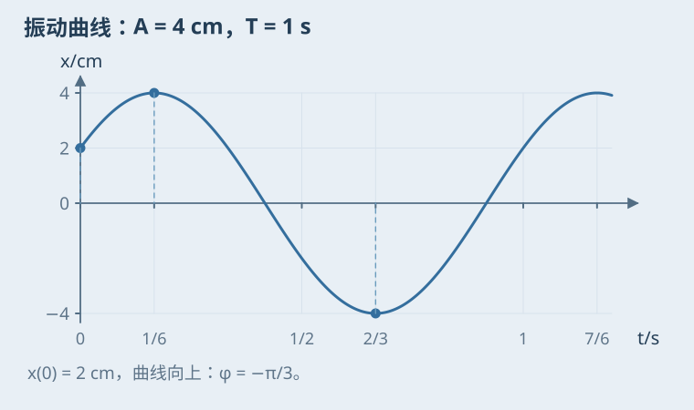

**解：**

- 振幅 $A = 0.04\,\text{m}$
- 周期 $T = 1\,\text{s}$，$\omega = \dfrac{2\pi}{T} = 2\pi\,\text{rad/s}$
- 由图 $x_0=0.02\,\text{m}$，所以 $\cos\varphi_0=x_0/A=1/2$；曲线在 $t=0$ 处上升，故 $v_0>0$、$\sin\varphi_0<0$，取 $\varphi_0=-\pi/3$。

$$x = 0.04\cos\left(2\pi t - \frac{\pi}{3}\right)$$

**题2.** 一质点作简谐运动，振幅为 $A$，在起始位置时刻质点的位移为 $\dfrac{A}{2}$，且向 $x$ 轴的正方向运动，代表此简谐运动的旋转矢量图为：

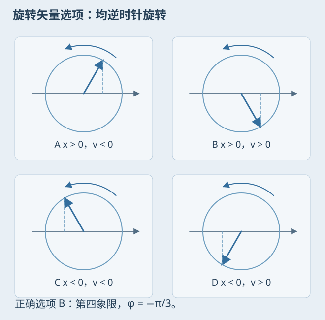

**答：B**

**解：** $x_0=A/2$ 给出 $\cos\varphi_0=1/2$；又因 $v_0=-A\omega\sin\varphi_0>0$，有 $\sin\varphi_0<0$。因此矢量在**第四象限**，$\varphi_0=-\pi/3$（或 $5\pi/3$），并按统一约定逆时针旋转。原笔记“第一象限”的说明有误。

**题3.** 质点沿 $x$ 轴作简谐运动，用余弦函数表示，振幅为 $A$，当 $t=0$ 时，质点处于 $x_0 = -\dfrac{A}{2}$ 处且向 $x$ 轴负方向运动，则其初相为：

$A.\ \dfrac{\pi}{6} \quad B.\ \dfrac{2\pi}{3} \quad C.\ \dfrac{4\pi}{3} \quad D.\ \dfrac{\pi}{3}$

**答：B**

**解：** $\cos\varphi_0=-1/2$；由 $v_0=-A\omega\sin\varphi_0<0$ 得 $\sin\varphi_0>0$，所以初相位于第二象限，$\varphi_0=2\pi/3$。此时速度大小为 $\sqrt{3}A\omega/2$，不是最大值。

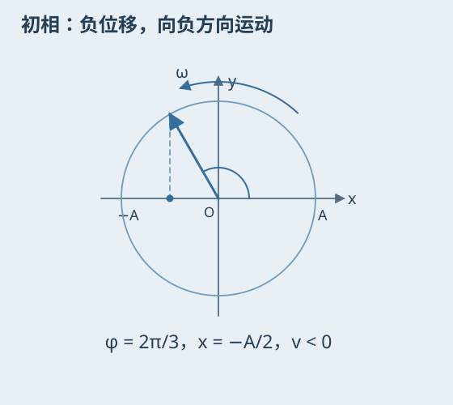

**题4.** 质点振动的 $x-t$ 曲线如图所示，求：

（1）质点的振动方程；

（2）质点从 $t=0$ 的位置到达 $P$ 点相应位置所需的最短时间。

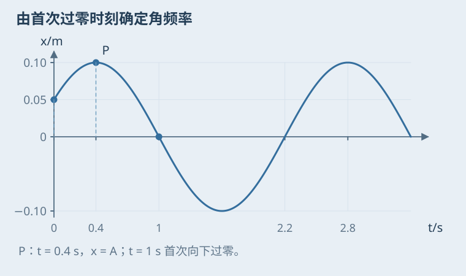

**解：**

（1）由图得 $A=0.1\,\text{m}$，$x_0=0.05\,\text{m}$ 且初速度为正。

由旋转矢量法知 $\varphi_0 = -\dfrac{\pi}{3}$，$x = 0.1\cos\left(\omega t - \dfrac{\pi}{3}\right)$

图中 $t=1\,\text{s}$ 时首次向下通过平衡位置，故 $\omega\times1-\pi/3=\pi/2$，得到 $\omega=5\pi/6\,\text{rad/s}$。

$$x = 0.1\cos\left(\frac{5\pi}{6}t - \frac{\pi}{3}\right)$$

（2）图中 $P$ 对应首次到达正向最大位移 $x=A$，相位由 $-\pi/3$ 增加到 $0$。

$$\Delta t = \frac{\Delta\varphi}{\omega} = \frac{\pi/3}{5\pi/6} = 0.4\,\text{s}$$

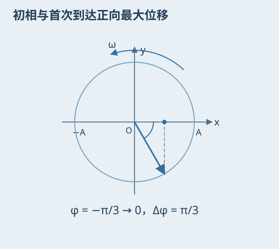

**题5.** 如图所示，质量为 $1.0\times10^{-2}\,\text{kg}$ 的子弹，以 $500\,\text{m/s}$ 的速度射入并嵌在木块中，同时使弹簧压缩而作简谐运动。设木块质量为 $4.99\,\text{kg}$，弹簧的劲度系数为 $k = 8.00\times10^3\,\text{N/m}$。若以弹簧原长时木块所在处为坐标原点，向右为轴正方向，求简谐运动方程。

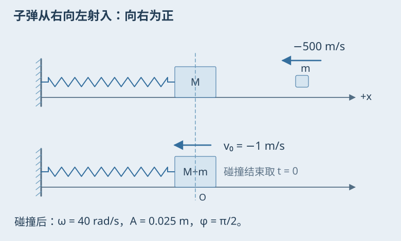

**解：** 图中子弹从右向左射入，坐标正方向向右，所以子弹初速度为 $-500\,\text{m/s}$。以碰撞刚结束为 $t=0$，忽略极短碰撞时间内弹簧的冲量，由动量守恒：

$$m(-500)=(M+m)v_0\quad\Rightarrow\quad v_0=-1\,\text{m/s}.$$

子弹嵌入是完全非弹性碰撞，碰撞过程中机械能不守恒；碰撞结束后的无阻尼振动机械能守恒。

$$\omega = \sqrt{\frac{k}{M + m}} = \sqrt{\frac{8\times10^3}{0.01 + 4.99}} = 40\,\text{rad/s}$$

$$A = \sqrt{x_0^2 + \frac{v_0^2}{\omega^2}} = \sqrt{0^2 + \frac{1^2}{40^2}} = 2.5\times10^{-2}\,\text{m}$$

碰撞刚结束时 $x_0=0$、$v_0=-1\,\text{m/s}$，由 $\cos\varphi_0=0$、$\sin\varphi_0>0$ 得 $\varphi_0=\pi/2$。

$$x = 2.5\times10^{-2}\cos\left(40t + \frac{\pi}{2}\right)$$

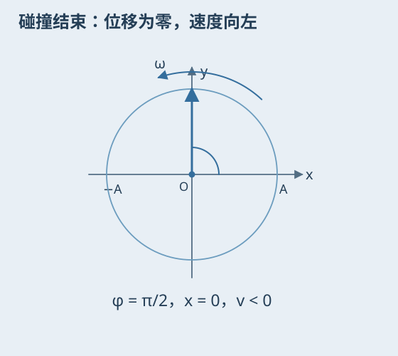

---

## 课时二 振动的能量及合成

| 考点 | 重要程度 | 占分 | 常见题型 |
| --- | --- | --- | --- |
| 1. 振动的能量 | ★★★ | 0~2 | 选择 / 填空 |
| 2. 振动的合成 | ★★★ | 0~2 | 选择 / 填空 |

### 1. 振动的能量

对无阻尼、无外力驱动的理想弹簧振子，取平衡位置为 $x=0$、弹性势能零点，振动阶段的**机械能守恒**：

- 机械能 = 动能 + 势能
- $E = \dfrac{1}{2}mv^2 + \dfrac{1}{2}kx^2$
- 在最大位移处（$x=\pm A$，$v=0$）：动能 $E_k = 0$，势能 $E_p = \dfrac{1}{2}kA^2$
- 总机械能：$E = \dfrac{1}{2}kA^2$（**不变**）

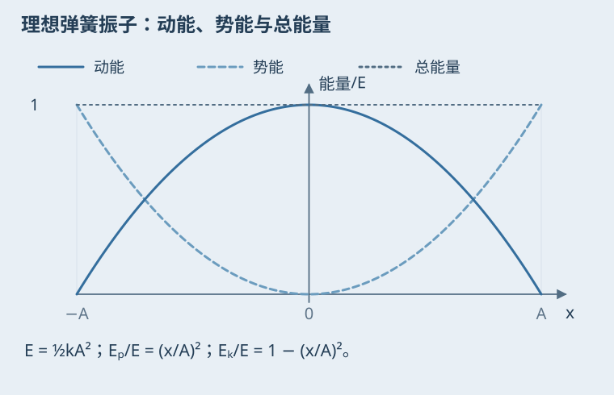

**题1.** 质点做简谐运动，从平衡位置运动到最大位移处时，质点的动能 ______，势能 ______，总的机械能 ______。（填增大、减小或不变）

**答：** 减小，增大，不变

**解：** 从平衡位置（$x=0$，$v$ 最大）到最大位移处（$x=\pm A$，$v=0$），动能 $E_k = \frac{1}{2}mv^2$ 减小，势能 $E_p = \frac{1}{2}kx^2$ 增大；总机械能 $E = \frac{1}{2}kA^2$ 守恒不变。

**题2.** 一弹簧振子作简谐运动，当其偏离平衡位置的位移的大小为振幅的 $\dfrac{1}{4}$ 时，其动能为振动总能量的（　）。

$A.\ \dfrac{9}{16}\quad B.\ \dfrac{11}{16}\quad C.\ \dfrac{13}{16}\quad D.\ \dfrac{15}{16}$

**答：D**

**解：**

- 势能 $E_p = \dfrac{1}{2}k\left(\dfrac{A}{4}\right)^2 = \dfrac{1}{32}kA^2$
- 总机械能 $E = \dfrac{1}{2}kA^2$
- 动能 $E_k = E - E_p = \dfrac{1}{2}kA^2 - \dfrac{1}{32}kA^2 = \dfrac{15}{32}kA^2$
- $\dfrac{E_k}{E} = \dfrac{\dfrac{15}{32}kA^2}{\dfrac{1}{2}kA^2} = \dfrac{15}{16}$

**题3.** 有一水平的弹簧振子，弹簧的劲度系数 $k = 25\,\text{N/m}$，物体质量 $m = 1.0\,\text{kg}$，物体静止在平衡位置。设以水平向左的恒力 $F = 10\,\text{N}$ 作用在物体上（不计一切摩擦），使其由平衡位置向左运动了 $0.05\,\text{m}$，此时撤除力 $F$，当物体运动到最左边时开始计时，求物体的运动方程。

**解：**

取原平衡位置为原点、向右为正。先区分施力和撤力后的两个阶段：

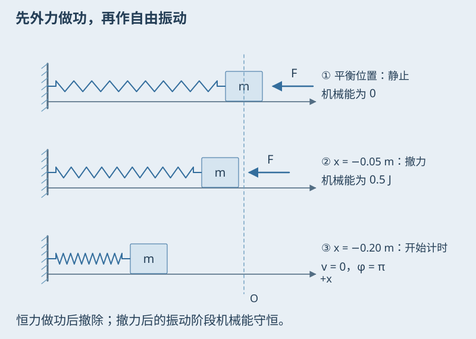

- **施力阶段**：弹簧—物体系统受到外力做功，机械能增加，不能直接称为“机械能守恒”。外力与位移同向，做功 $W_F=(-10)(-0.05)=0.5\,\text{J}$。
- **撤力后**：系统无外力继续做功，机械能保持为 $E=0.5\,\text{J}$。在最左端 $v=0$，因此 $\tfrac12kA^2=0.5$，得 $A=0.2\,\text{m}$。
- 角频率 $\omega = \sqrt{\dfrac{k}{m}} = \sqrt{\dfrac{25}{1}} = 5\,\text{rad/s}$
- 由旋转矢量法知 $\varphi_0 = \pi$（物体从最左边 $x=-A$ 处开始计时）
- 运动方程：$x = 0.2\cos(5t + \pi)$

### 2. 振动的合成

**同方向同频率**的两个简谐运动 $x_1 = A_1\cos(\omega t + \varphi_1)$、$x_2 = A_2\cos(\omega t + \varphi_2)$ 合成：

$$A = \sqrt{A_1^2 + A_2^2 + 2A_1A_2\cos(\varphi_2 - \varphi_1)}$$

令 $C=A_1\cos\varphi_1+A_2\cos\varphi_2$，$S=A_1\sin\varphi_1+A_2\sin\varphi_2$，则

$$A=\sqrt{C^2+S^2},\qquad A\cos\varphi=C,\quad A\sin\varphi=S.$$

当 $C\ne0$ 时有 $\tan\varphi=S/C$，但必须结合 $C,S$ 的正负确定象限；用计算工具时可写作 $\varphi=\operatorname{atan2}(S,C)$。若 $A=0$，两振动完全抵消，合成初相无定义。

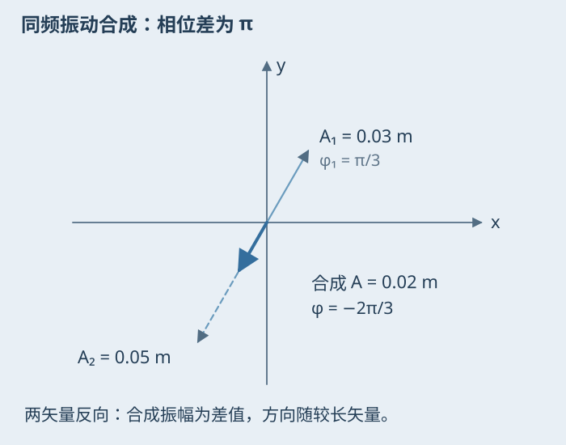

**题1.** 某质点同时参与轴上的两个简谐运动：$x_1 = 0.03\cos\left(2\pi t + \dfrac{\pi}{3}\right)$，$x_2 = 0.05\cos\left(2\pi t - \dfrac{2\pi}{3}\right)$（SI），合成振动的振动方程为 ______。

**解：**

**解法一（旋转矢量法）：** 相位差 $\varphi_2 - \varphi_1 = -\dfrac{2\pi}{3} - \dfrac{\pi}{3} = -\pi$，两振动方向相反，故

$$A = 0.05 - 0.03 = 0.02\,\text{m},\qquad \varphi_0 = -\frac{2\pi}{3}$$

$$\Rightarrow x = 0.02\cos\left(2\pi t - \frac{2\pi}{3}\right)$$

**解法二（公式法）：**

$$A = \sqrt{A_1^2 + A_2^2 + 2A_1A_2\cos(\varphi_2-\varphi_1)} = \sqrt{0.03^2 + 0.05^2 + 2\times0.03\times0.05\cos(-\pi)} = 0.02$$

$$\tan\varphi = \frac{0.03\sin\frac{\pi}{3} + 0.05\sin\left(-\frac{2\pi}{3}\right)}{0.03\cos\frac{\pi}{3} + 0.05\cos\left(-\frac{2\pi}{3}\right)} = \sqrt{3}$$

由旋转矢量法可知 $\varphi = -\dfrac{2\pi}{3}$，故 $x = 0.02\cos\left(2\pi t - \dfrac{2\pi}{3}\right)$。

---

## 课时三 机械波

| 考点 | 重要程度 | 占分 | 常见题型 |
| --- | --- | --- | --- |
| 1. 认识机械波 | ★★★ | 0~3 | 选择、填空 |
| 2. 波动方程 | 必考 | 5~10 | 大题 |

### 1. 认识机械波

**机械波的形成：** 波源振动通过介质中相邻质点的相互作用传播。在线性、小振幅模型中，各质点只在自己的平衡位置附近振动，**不随波整体迁移**，传播的是振动形式和能量。横波中质点振动方向与传播方向垂直，纵波中二者平行；下图为横波示意。

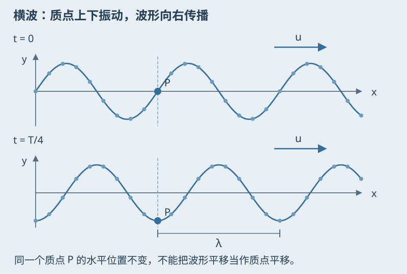

**波速、波长、周期的关系：**

$$u = \frac{\lambda}{T} = \lambda \nu$$

- 波速 $u$：波形传播的速度；对本课讨论的均匀、无色散介质，由介质性质及其状态决定，不等于质点的振动速度
- 波长 $\lambda$：一个完整波形沿传播方向占据的长度，等于波线上相位差为 $2\pi$ 的两点间距离
- 周期 $T$：波传播一个波长所需的时间，等于波源的振动周期（由**波源**决定）

**两点间相位差：**

若只讨论相距 $d$ 的两点之间的相位差大小，不作模 $2\pi$ 约化，则

$$\lvert\Delta\varphi\rvert=\frac{2\pi d}{\lambda}.$$

若定义带符号相位差 $\Delta\varphi=\varphi(x_2,t)-\varphi(x_1,t)$、$\Delta x=x_2-x_1$，则沿 $+x$ 传播时 $\Delta\varphi=-2\pi\Delta x/\lambda$，沿 $-x$ 传播时符号相反。不能混用“相位差大小”和“带符号相位差”。

> [!tip] 记忆口诀
> "见者有份"：波长对应 $2\pi$ 相位，两点距离 $\Delta x$ 占波长多少份，相位差就占 $2\pi$ 多少份。

#### 波动方程与传播方向

原点 $O$ 的振动方程：$y = A\cos(\omega t + \varphi_0)$

对 $x>0$，若波沿 $+x$ 方向传播，$x$ 处质点的振动比 $O$ 点**落后** $\Delta t = \dfrac{x}{u}$，故

$$y = A\cos\left[\omega\left(t - \frac{x}{u}\right) + \varphi_0\right] = A\cos\left[2\pi\left(\nu t - \frac{x}{\lambda}\right) + \varphi_0\right] = A\cos\left[\omega t + \varphi_0 - \frac{2\pi}{\lambda}x\right]$$

对 $x>0$，若波沿 $-x$ 方向传播，$x$ 处质点的振动比 $O$ 点**超前**，则

$$y = A\cos\left[\omega\left(t + \frac{x}{u}\right) + \varphi_0\right] = A\cos\left[2\pi\left(\nu t + \frac{x}{\lambda}\right) + \varphi_0\right] = A\cos\left[\omega t + \varphi_0 + \frac{2\pi}{\lambda}x\right]$$

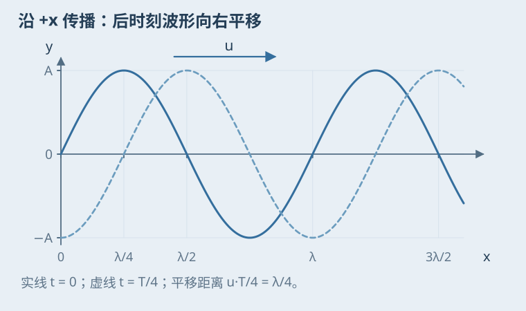

> [!warning] 易错点
> 沿传播方向看波形，“上坡下、下坡上”。用导数可直接判断：沿 $+x$ 传播时 $\partial y/\partial t=-u\,\partial y/\partial x$；沿 $-x$ 传播时 $\partial y/\partial t=+u\,\partial y/\partial x$。波峰、波谷处瞬时振动速度为零。

#### 例题

**题1.** 已知一平面简谐波的波动方程为：$y = 2.0\cos\left[2\pi\left(t - \dfrac{x}{8}\right) + \dfrac{\pi}{3}\right](\text{m})$，则此波沿 $x$ 轴 ______ 方向传播，波速为 ______，波长为 ______，原点处初相为 ______。

**答：** 正；$8\,\text{m/s}$；$8\,\text{m}$；$\dfrac{\pi}{3}$

**解：** 波动方程与标准式 $y = A\cos\left[2\pi\left(\nu t - \dfrac{x}{\lambda}\right) + \varphi_0\right]$ 对照：

- 括号内为 $\left(t - \dfrac{x}{8}\right)$，$x$ 前为负号 ⟹ 沿 $+x$（正）方向传播
- 波长 $\lambda = 8\,\text{m}$，频率 $\nu = 1\,\text{Hz}$
- 波速 $u = \lambda\nu = 8\times1 = 8\,\text{m/s}$
- 初相 $\varphi_0 = \dfrac{\pi}{3}$

**题2.** 一横波沿绳子传播时，波的表达式为 $y = 0.05\cos(10\pi t - 4\pi x)$（SI），则（　）。

$A.\ 波长为\ 0.5\,\text{m} \quad B.\ 波速为\ 5\,\text{m/s} \quad C.\ 波速为\ 25\,\text{m/s} \quad D.\ 频率为\ 2\,\text{Hz}$

**答：A**

**解：** 对照标准式 $y = A\cos\left[\omega t + \varphi_0 - \dfrac{2\pi}{\lambda}x\right]$：

- 由 $-4\pi x = -\dfrac{2\pi}{\lambda}x \Rightarrow \lambda = 0.5\,\text{m}$ ✓
- $\omega = 10\pi \Rightarrow T = \dfrac{2\pi}{\omega} = 0.2\,\text{s}$
- $u = \dfrac{\lambda}{T} = \dfrac{0.5}{0.2} = 2.5\,\text{m/s}$（B、C 均错）
- $\nu = \dfrac{1}{T} = \dfrac{1}{0.2} = 5\,\text{Hz}$（D 错）

**题3.** 频率为 $100\,\text{Hz}$，传播速度为 $300\,\text{m/s}$ 的平面简谐波，波线上距离小于波长的两点振动的相位差为 $\dfrac{\pi}{3}$，则两点相距（　）。

$A.\ 2.86\,\text{m} \quad B.\ 2.19\,\text{m} \quad C.\ 0.5\,\text{m} \quad D.\ 0.25\,\text{m}$

**答：C**

**解：**

$$\lambda = uT = u\cdot\frac{1}{\nu} = 300 \times \frac{1}{100} = 3\,\text{m}$$

$$\lvert\Delta\varphi\rvert = \frac{2\pi d}{\lambda} \Rightarrow \frac{\pi}{3} = \frac{2\pi}{3}d \Rightarrow d = 0.5\,\text{m}$$

### 2. 波动方程

> [!note] 解题三步法
> ① 求原点振动方程 $y = A\cos(\omega t + \varphi_0)$（旋转矢量法定 $\varphi_0$）
> ② 求波速 $u = \dfrac{\lambda}{T} = \lambda\nu$
> ③ 代入波动方程 $y = A\cos\left[\omega\left(t \mp \dfrac{x}{u}\right) + \varphi_0\right]$

#### 例题

**题1.** 已知一沿 $x$ 轴正向传播的平面简谐波，时间 $t = 0$ 时的波形如图所示，且 $T = 2\,\text{s}$，求：

（1）$O$ 点的振动方程；

（2）该波的波动方程；

（3）$x = 60\,\text{m}$ 处质点的振动方程和速度表达式。

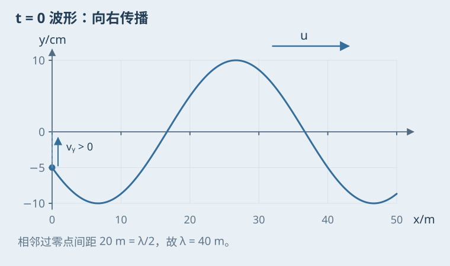

**解：**

（1）振幅 $A = 0.1\,\text{m}$，$\omega = \dfrac{2\pi}{T} = \dfrac{2\pi}{2} = \pi\ \text{rad/s}$

由图 $y(0,0)=-0.05\,\text{m}$，得 $\cos\varphi_0=-1/2$。原点处波形沿 $+x$ 的斜率为负，波又向右传播，所以 $v_y=-u\,\partial y/\partial x>0$，原点质点向 $+y$ 运动。由 $-A\omega\sin\varphi_0>0$ 得 $\sin\varphi_0<0$，故取 $\varphi_0=-2\pi/3$。原笔记将振动方向写反，初相与方程本身无需改变：

$$y = 0.1\cos\left(\pi t - \frac{2\pi}{3}\right)$$

（2）图中相邻两个过零点之间为半波长 $\lambda/2=20\,\text{m}$，所以 $\lambda=40\,\text{m}$，$u=\lambda/T=20\,\text{m/s}$。波沿 $+x$ 传播：

$$y = 0.1\cos\left[\pi\left(t - \frac{x}{20}\right) - \frac{2\pi}{3}\right]$$

（3）将 $x = 60\,\text{m}$ 代入：

$$y = 0.1\cos\left[\pi\left(t - \frac{60}{20}\right) - \frac{2\pi}{3}\right] = 0.1\cos\left(\pi t - \frac{11\pi}{3}\right)$$

速度表达式：

$$v = \frac{dy}{dt} = -0.1\pi\sin\left(\pi t - \frac{11\pi}{3}\right)$$

**题2.** 一平面简谐波在介质中以波速 $u = 2\,\text{m/s}$ 沿 $x$ 轴负方向传播，原点 $O$ 处质点的振动曲线如图所示，求：

（1）原点 $O$ 的质点的振动方程；

（2）该波的波动方程；

（3）$x = 20\,\text{m}$ 处质点的振动方程。

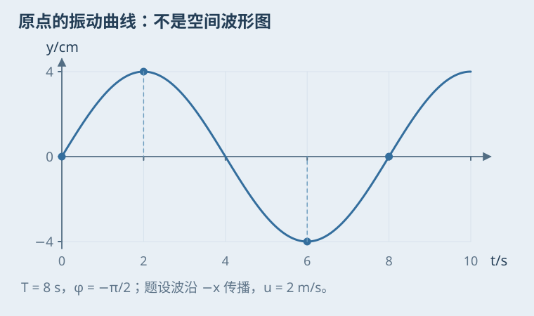

**解：**

（1）振幅 $A = 4\times10^{-2}\,\text{m}$，周期 $T = 8\,\text{s}$，$\omega = \dfrac{2\pi}{T} = \dfrac{2\pi}{8} = \dfrac{\pi}{4}\ \text{rad/s}$

由旋转矢量法得 $\varphi_0 = -\dfrac{\pi}{2}$，故

$$y = 4\times10^{-2}\cos\left(\frac{\pi}{4}t - \frac{\pi}{2}\right)$$

（2）波沿 $-x$ 方向传播，$u = 2\,\text{m/s}$：

$$y = 4\times10^{-2}\cos\left[\frac{\pi}{4}\left(t + \frac{x}{2}\right) - \frac{\pi}{2}\right]$$

（3）$x = 20\,\text{m}$ 处：

$$y = 4\times10^{-2}\cos\left[\frac{\pi}{4}\left(t + \frac{20}{2}\right) - \frac{\pi}{2}\right] = 4\times10^{-2}\cos\left(\frac{\pi}{4}t + 2\pi\right) = 4\times10^{-2}\cos\left(\frac{\pi}{4}t\right)$$

**题3.** 一平面简谐波沿 $Ox$ 轴负方向传播，波长为 $\lambda$，$P$ 在原点 $O$ 右侧且相距 $d$。$P$ 点在 $t=0$ 位于负向最大位移，$t=1\,\text{s}$ 首次向上过零。求：

（1）$P$ 点的振动方程；

（2）以 $O$ 为原点、向右为正的波动方程。

配套《振动与波动》讲义 PDF 第 14 页补全了原题图：**$P$ 在 $O$ 右侧，$x_P=d$**；$P$ 点初始位移为 $-A$，在 $t=1\,\text{s}$ 首次向上过零。以下坐标与振动曲线均采用讲义图示，不能只由两点距离 $d$ 决定正负号。

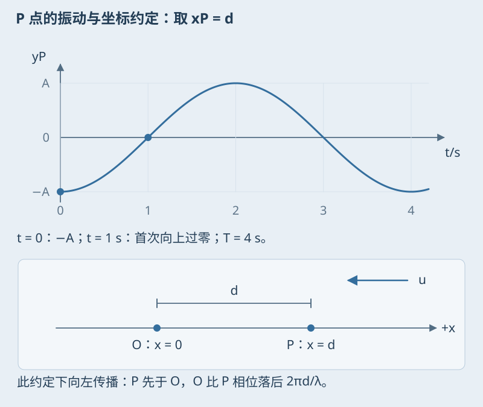

**解：**

（1）由讲义振动图，$y_P(0)=-A$、$v_P(0)=0$，取 $\varphi_P=\pi$；从负向最大位移到首次向上过零需要 $T/4=1\,\text{s}$，所以

$$T=4\,\text{s},\quad\omega=\frac{\pi}{2}\,\text{rad/s},\quad y_P(t)=A\cos\left(\frac{\pi}{2}t+\pi\right).$$

（2）波速 $u=\lambda/T=\lambda/(4\,\text{s})$。先以 $P$ 为原点、向右为正，位置坐标记为 $\xi$，则

$$y(\xi,t)=A\cos\left[\omega\left(t+\frac{\xi}{u}\right)+\pi\right].$$

改以 $O$ 为原点后，若 $x_P=d$，同一位置满足 $\xi=x-d$。代入得

$$\boxed{y(x,t)=A\cos\left[\frac{\pi}{2}t+\frac{2\pi}{\lambda}(x-d)+\pi\right]}.$$

上式中 $t$ 的数值以秒计。代回 $x=d$，恰好恢复 $y_P(t)$。原点 $O$ 处有

$$y_O(t)=A\cos\left(\frac{\pi}{2}t-\frac{2\pi d}{\lambda}+\pi\right).$$

波向左传播，在这一位置约定下，右侧 $P$ 点比左侧 $O$ 点先振动，$O$ 比 $P$ 相位落后 $2\pi d/\lambda$。

作为坐标变换的比较：若另一道题中 **$P$ 在 $O$ 左侧**，则 $x_P=-d$，相应应写为

$$y(x,t)=A\cos\left[\frac{\pi}{2}t+\frac{2\pi}{\lambda}(x+d)+\pi\right].$$

这时 $O$ 才比 $P$ 相位超前。原笔记把“$O$ 在 $P$ 左侧”与“$O$ 相位超前”同时使用，二者不一致，应分别按上述坐标情形处理。

> [!tip] 从任意参考点写行波方程
> 若已知 $x=x_P$ 处的振动方程为 $y_P=A\cos(\omega t+\varphi_P)$，则沿 $+x$ 传播用 $y=A\cos[\omega t+\varphi_P-k(x-x_P)]$，沿 $-x$ 传播用 $y=A\cos[\omega t+\varphi_P+k(x-x_P)]$，其中 $k=2\pi/\lambda$。先写清 $x_P$，再代入，最后把 $x=x_P$ 代回核对。

### 3. 波的能量

| 考点 | 重要程度 | 占分 | 常见题型 |
| --- | --- | --- | --- |
| 波动的能量 | ★★★ | 0～2 | 选择、填空 |
| 波的干涉 | ★★★★★ | 0～2 | 选择、填空 |
| 驻波 | ★★★ | 0～2 | 选择、填空 |
| 多普勒效应 | ★★ | 0～2 | 选择、填空 |

以上是讲义“机械波（二）”的考点，在本笔记中接续到课时三，后面的光学仍从课时四开始。

#### 行波中的动能与势能

波传播时，相邻质元之间相互做功，能量在介质中传递。**一个介质质元的机械能通常不守恒**，不能直接套用孤立弹簧振子“动能增大、势能必减小”的结论。

对理想均匀、无耗散介质中的单一平面简谐行波，记 $\Theta=\omega t-kx+\varphi$，其动能密度与弹性势能密度满足

$$w_k=\frac12\rho A^2\omega^2\sin^2\Theta,\qquad w_p=w_k.$$

其中 $\rho$ 为介质质量密度，$w_k,w_p$ 是单位体积内的能量，单位为 $\mathrm{J/m^3}$；弦波若按单位长度计能量，应相应使用弦的线密度。

例如均匀弦上的小振幅横波，动能由 $\partial y/\partial t$ 决定，弹性势能由弦的局部斜率 $\partial y/\partial x$ 决定；二者都与 $\sin^2\Theta$ 成正比。由此可得：

| 质元瞬时位置 | 振动速率 | 局部形变 | 动能与势能 |
| --- | --- | --- | --- |
| 通过平衡位置 | 最大 | 最大 | 同时最大 |
| 波峰或波谷 | 零 | 局部斜率为零 | 同时为零 |

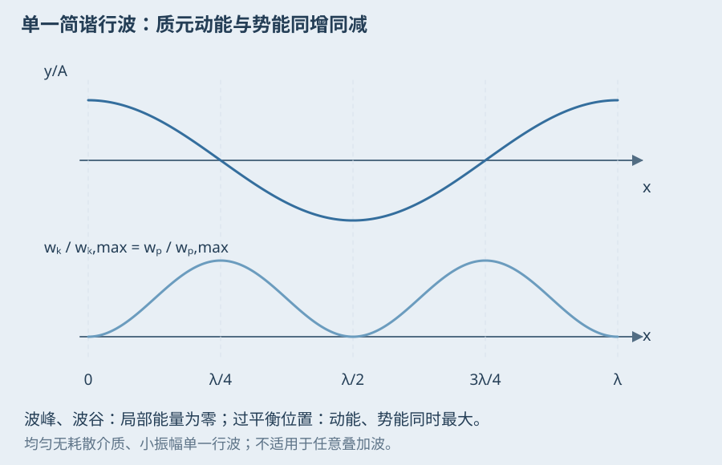

平均能量密度 $\bar w=\tfrac12\rho A^2\omega^2$，平均能流密度（波强）为

$$I=\bar w u=\frac12\rho u A^2\omega^2.$$

同一介质、同一频率下 $I\propto A^2$。上述动能与势能瞬时相等的结论有**单一简谐行波**的模型条件，不能直接推广到驻波或任意叠加波。

**题1.** 平面简谐行波中，某质元正通过平衡位置，此时其动能、弹性势能如何？最大形变发生在什么位置？

**答：** 动能、势能同时最大；最大形变发生在平衡位置。对应讲义两道选择题均选 C。

**解：** 平衡位置处 $\cos\Theta=0$、$\sin^2\Theta=1$，速度与局部形变达到最大；注意势能取决于相邻质元的相对位移，不是该质元偏离自身平衡位置的距离。

### 4. 波的干涉

两列波在同一区域叠加，若**频率相同、振动方向相同或具有共同分量、相位差恒定**，可形成稳定干涉图样。讲义讨论同方向标量振动；振幅相等不是相干条件。

设两波源初相分别为 $\varphi_1,\varphi_2$，到观察点 $P$ 的距离为 $r_1,r_2$，则

$$\begin{aligned}
y_1&=A_1\cos(\omega t+\varphi_1-kr_1),\\
y_2&=A_2\cos(\omega t+\varphi_2-kr_2),\\
\Delta\varphi&=\varphi_2-\varphi_1-k(r_2-r_1),\quad k=\frac{2\pi}{\lambda}.
\end{aligned}$$

到达点的相位差同时包含**源的初相差**与**传播路程造成的相位差**。合振幅为

$$A=\sqrt{A_1^2+A_2^2+2A_1A_2\cos\Delta\varphi}.$$

| 情况 | 相位条件，$m\in\mathbb Z$ | 合振幅 |
| --- | --- | --- |
| 干涉极大 | $\Delta\varphi=2m\pi$ | $A_1+A_2$ |
| 干涉极小 | $\Delta\varphi=(2m+1)\pi$ | $\lvert A_1-A_2\rvert$ |

只有振幅相等时极小才为零。若两源同相，极大对应 $r_2-r_1=m\lambda$，极小对应 $r_2-r_1=(m+\tfrac12)\lambda$；不同相时不能直接套这组路程条件。

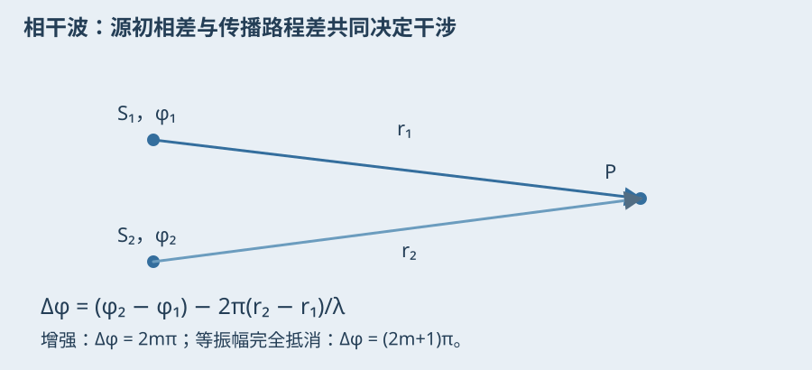

**题1.** 两相干源 $S_1,S_2$ 相距 $\lambda/4$，$S_1$ 的初相超前 $S_2$ 为 $\pi/2$。在 $S_1$ 外侧的连线上取点 $P$，求到达 $P$ 的相位差。

**解：** 此时 $r_2-r_1=\lambda/4$、$\varphi_2-\varphi_1=-\pi/2$，所以

$$\Delta\varphi=-\frac\pi2-\frac{2\pi}{\lambda}\frac\lambda4=-\pi.$$

相位差大小为 $\pi$，讲义选 B；两波反相，若在 $P$ 的振幅相等则完全抵消。

**题2（讲义练习）.** 两波在 $B,C$ 的振动分别为 $0.2\cos(2\pi t)$、$0.2\cos(2\pi t+\pi)$，$BP=0.4\,\text{m}$、$CP=0.5\,\text{m}$、波速 $u=0.2\,\text{m/s}$。求 $P$ 点相位差和合振幅。

**解：** $\nu=1\,\text{Hz}$、$\lambda=u/\nu=0.2\,\text{m}$，所以

$$\Delta\varphi=\pi-\frac{2\pi}{0.2}(0.5-0.4)=0,\qquad A=0.4\,\text{m}.$$

### 5. 驻波

两列**同频率、同振幅、沿同一直线反向传播**的简谐波可形成驻波。例如

$$\begin{aligned}
y_1&=A\cos(\omega t-kx),\quad y_2=A\cos(\omega t+kx),\\
y&=2A\cos(kx)\cos(\omega t).
\end{aligned}$$

驻波中各点的振幅为 $A(x)=2A\lvert\cos kx\rvert$，不是统一的 $2A$。

| 名称 | 以上坐标、相位约定下的位置 | 特征 |
| --- | --- | --- |
| 波节 | $x=(2m+1)\lambda/4$ | 振幅恒为零 |
| 波腹 | $x=m\lambda/2$ | 振幅最大，为 $2A$ |
| 相邻波节、相邻波腹 | 间距均为 $\lambda/2$ | 不能写成 $\lambda/4$ |
| 相邻波节与波腹 | 间距 $\lambda/4$ | |

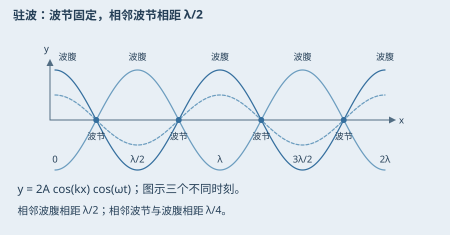

同一对相邻波节之间的各质点同相，相邻两段反相；波节本身振幅为零，不能赋予确定的振动相位。理想驻波一个周期内的平均净能流为零，但局部仍可交换能量。波节、波腹的绝对位置会随边界与初相改变，不应把上表的位置公式用于所有驻波。

**题1.** $y_1=6\cos(4\pi t-0.02\pi x)$、$y_2=6\cos(4\pi t+0.02\pi x)$（SI），求驻波方程与波节位置。

**解：**

$$y=12\cos(0.02\pi x)\cos(4\pi t).$$

由 $k=0.02\pi$ 得 $\lambda=100\,\text{m}$，由 $\omega=4\pi$ 得 $\nu=2\,\text{Hz}$。因此

$$x_{\text{节}}=25(2m+1)\,\text{m},\qquad m\in\mathbb Z.$$

**题2.** 驻波为 $y=0.1\cos(\pi x/2)\cos(6\pi t)$（SI），求分波波长、频率、相邻波腹间距。

**解：** $k=\pi/2$、$\omega=6\pi$，故 $\lambda=4\,\text{m}$、$\nu=3\,\text{Hz}$、相邻波腹间距 $2\,\text{m}$。每列分波的振幅为 $0.05\,\text{m}$。

**题3（讲义练习）.** 入射波 $y_i=A\cos[2\pi(x/\lambda+t/T)]$ 在 $x=0$ 固定端无损反射，写出反射波。

**解：** 固定端位移必须恒为零，故

$$y_r=-A\cos[2\pi(x/\lambda-t/T)].$$

负号等价于反射时增加相位 $\pi$。代回 $x=0$，$y_i+y_r=0$。

### 6. 多普勒效应

对静止介质中的声波，源与接收者运动会改变接收频率。统一规定：$v_R>0$ 表示接收者**朝向声源**，$v_S>0$ 表示声源**朝向接收者**，二者均为沿连线、相对介质的速度分量，则

$$\nu_R=\nu_S\frac{u+v_R}{u-v_S}.$$

远离时对应速度取负。适用于本课讨论的亚声速、经典声学情形；光的多普勒效应不能直接套用此式。声源移动改变波长，接收者移动改变单位时间遇到的波面数。

**题1.** 汽车以 $40\,\text{m/s}$ 驶离静止工厂，工厂汽笛频率 $800\,\text{Hz}$，声速 $340\,\text{m/s}$，司机听到的频率是多少？

**解：** $v_S=0$、$v_R=-40\,\text{m/s}$，所以

$$\nu_R=800\frac{340-40}{340}\approx705.88\,\text{Hz}\approx706\,\text{Hz}.$$

### 7. 机械波自检

- 弹簧振子势能由自身位移决定；行波质元势能与相邻质元的形变有关，不能混同。
- 算干涉时先计算到达相位差，再判断极大、极小；不要忽略源初相差。
- 驻波的最大振幅为分波振幅的两倍，不是每个点都达到这一振幅。
- 确定驻波位置时先看空间因子是正弦还是余弦，再找零点。
- 多普勒题先写出谁动、朝向还是远离、相对什么介质，再代速度符号。

材料：[振动与波动讲义](截图/配套讲义/振动与波动【蜂考突击课】.pdf)，PDF 第 17—20 页；波强等公式参照公式手册第 9—10 页。

---

## 课时四 双缝干涉

| 考点 | 重要程度 | 占分 | 常见题型 |
| --- | --- | --- | --- |
| 相干光 | ★★ | 0～2 | 选择、填空 |
| 光程差 | ★★★★★ | 2～5 | 填空 |
| 杨氏双缝干涉 | 必考 | 5～10 | 大题 |

本课至课时七，$\lambda$ 默认表示真空波长，空气折射率近似为 1；若讨论介质内波长，则另写 $\lambda_n=\lambda/n$。

### 1. 相干光与光程

稳定干涉要求两束光频率相同、相位差恒定，且具有相同方向的电场振动分量。常见获得方法：**分波阵面法**（如杨氏双缝）、**分振幅法**（如薄膜反射）。两盏独立普通光源不能仅因颜色相同就视为相干。

几何路程相同，不代表传播产生的相位延迟相同。均匀介质中光程为 $L=nr$，不均匀介质中为 $L=\int n\,\mathrm ds$。规定两路光程差

$$\delta=L_2-L_1.$$

对应的相位**延迟差**为 $2\pi\delta/\lambda$。若直接计算到达点的 $\varphi_2-\varphi_1$，还需使用“源初相差减去传播延迟差”；同相源的明暗条件不受整体取反影响。

**题1.** 两同相单色光源到 $P$ 的几何距离均为 $r$，分别经过折射率为 $n_1,n_2$ 的介质。求几何路程差、光程差和相位延迟差。

**解：**

$$\Delta r=0,\quad\delta=(n_2-n_1)r,\quad\Delta\phi_{\text{延迟}}=\frac{2\pi(n_2-n_1)r}{\lambda}.$$

这对应讲义选项 D；若题目定义的是光 2 到达时相对光 1 的带符号相位差，则传播项带负号。

### 2. 杨氏双缝的明暗条件

设双缝中心距为 $d$，双缝到屏的距离为 $D$，原中央明纹为屏上原点 $O$，$x$ 向上为正，$S_1$ 在上、$S_2$ 在下。两缝同相，空气中传播时

$$\delta=r_2-r_1\approx d\sin\theta\approx\frac{dx}{D}.$$

其中第二个近似要求 $D\gg d$ 且 $|x|\ll D$。若在介质中做实验，应使用相应介质中的波长，或在光程差中乘折射率，不能重复计算。

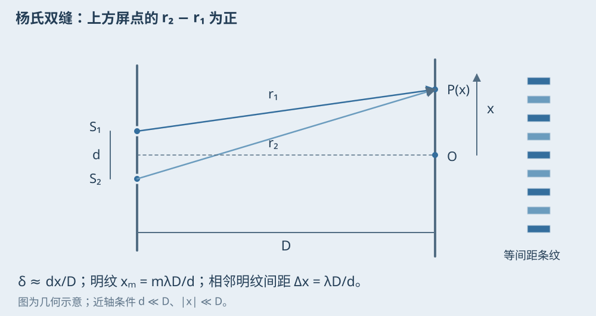

| 条纹 | 光程差 | 屏上位置 |
| --- | --- | --- |
| 明纹 | $\delta=m\lambda,\ m\in\mathbb Z$ | $x_m=mD\lambda/d$ |
| 暗纹 | $\delta=(m+\tfrac12)\lambda$ | $x_m=(m+\tfrac12)D\lambda/d$ |
| 相邻明纹或相邻暗纹 | 光程差改变 $\lambda$ | $\Delta x=D\lambda/d$ |

中央明纹为零级。若“第 $j$ 条暗纹”从中央向一侧依次计数，$j=1,2,\ldots$，则

$$|x_{j,\text{暗}}|=\left(j-\frac12\right)\frac{D\lambda}{d}.$$

讲义使用从 $m=0$ 起的暗纹参数时，参数 $m$ 与按顺序数的第几条相差 1，解题前必须辨认。

**题1.** $\lambda=562.5\,\text{nm}$，$D=1.2\,\text{m}$，相邻明纹间距 $1.5\,\text{mm}$，求缝距。

**解：**

$$d=\frac{D\lambda}{\Delta x}=\frac{1.2\times562.5\times10^{-9}}{1.5\times10^{-3}}=0.45\,\text{mm}.$$

讲义选 C。要增大条纹间距，可以增大 $D$、增大 $\lambda$ 或减小 $d$；单独改变每条缝的宽度主要影响衍射包络，不能与双缝中心距混淆。

**题2.** $\lambda=480\,\text{nm}$、$d=2.0\times10^{-4}\,\text{m}$、$D=2\,\text{m}$，求相邻明纹间距、上方第 5 级明纹和下方第 3 条暗纹位置。

**解：** $\Delta x=4.8\,\text{mm}$；上方明纹 $x_5=5\Delta x=24\,\text{mm}$；下方从中央数第 3 条暗纹

$$x=-\left(3-\frac12\right)\Delta x=-12.0\,\text{mm}.$$

> [!warning] 讲义编号订正
> 讲义在此题把“下方第 3 级暗纹”直接代入 $m=3$，得到 $-16.8\,\text{mm}$。按从 $m=0$ 起的公式，这是下方**第 4 条**暗纹；若坚持称其“$m=3$ 级”，必须说明编号约定。通常“从中央数第三条暗纹”应为 $-12.0\,\text{mm}$。

### 3. 插入薄片后的条纹移动

厚度 $e$、折射率 $n$ 的薄片替代同厚空气，增加光程 $(n-1)e$。若只在上缝 $S_1$ 后插片，则

$$\delta=\frac{dx}{D}-(n-1)e.$$

新中央明纹满足 $\delta=0$，故

$$x_0=\frac{D(n-1)e}{d},\qquad N=\frac{(n-1)e}{\lambda}.$$

条纹整体向**插片的那条缝**方向移动，间距在上述近似下不变；$N$ 可不是整数。

**题1.** 两缝分别覆盖同厚薄片，$n_1=1.4$、$n_2=1.7$，$\lambda=480\,\text{nm}$。原中央位置变为第 5 级明纹，求薄片厚度。

**解：** 原中央位置几何路程相等，新增光程差为 $(n_2-n_1)e$，故

$$e=\frac{5\lambda}{n_2-n_1}=8.0\times10^{-6}\,\text{m}=8.0\,\mu\text{m}.$$

**题2.** 在一条光路中插入 $n=1.5$ 的玻璃片，使原第 5 级明纹位置变为中央明纹，$\lambda=600\,\text{nm}$，求厚度。

**解：** 应把薄片放在该点原来光程较短的支路，使两路光程相等。由 $(n-1)e=5\lambda$，得 $e=6.0\,\mu\text{m}$。

### 4. 讲义练习与检查

**题1.** $d=1\,\text{mm}$、$D=4.00\,\text{m}$、$\lambda=600\,\text{nm}$，求条纹间距。

**解：** $\Delta x=D\lambda/d=2.40\,\text{mm}$。

**题2.** $\lambda=546.1\,\text{nm}$、$D=300\,\text{mm}$，中央两侧的两个第 5 级明纹相距 $12.2\,\text{mm}$，求缝距。

**解：** 两侧间隔含 10 个条纹间距，因此 $d=10D\lambda/(12.2\,\text{mm})\approx0.1343\,\text{mm}$，不能只代 5 倍。

可见最大级数还受几何角度、屏幕范围、缝宽衍射包络影响。由 $d\sin\theta=m\lambda$，有限屏幕上应满足 $|m|\lambda<d$；当比值恰为整数时，$\theta=90^\circ$ 的掠射方向不算有限屏幕上可见条纹。

材料：[光学讲义](截图/配套讲义/光学【蜂考突击课】.pdf)，PDF 第 3—7 页。

---

## 课时五 薄膜干涉

| 考点 | 重要程度 | 占分 | 常见题型 |
| --- | --- | --- | --- |
| 等倾干涉、劈尖干涉 | 必考 | 5～10 | 大题 |
| 牛顿环 | ★★★★ | 0～2 | 选择、填空 |
| 迈克尔逊干涉仪 | ★★ | 0～2 | 选择、填空 |

### 1. 反射相位突变与薄膜光程差

在本课讨论的透明、无吸收介质、近法向入射情形中，光从低折射率介质射向高折射率介质，**反射光**产生 $\pi$ 相位突变；反向反射无此突变。这不是光线实际多走半个波长，而是把相位差等效成 $\lambda/2$ 光程。

比较两束反射光，关键是两次反射的**相对**相位突变：

| 上、下界面的反射 | 相对半波损失 | 等效光程差 |
| --- | --- | --- |
| 两次都有 $\pi$，或两次都没有 | 无 | $2n_2e\cos r$ |
| 只有一次有 $\pi$ | 有 | $2n_2e\cos r+\lambda/2$ |

其中 $e$ 为膜厚、$n_2$ 为膜折射率、$r$ 为膜内折射角。正入射时 $\cos r=1$。等效光程差中加或减 $\lambda/2$，只差一个整波长，明暗判断等价。

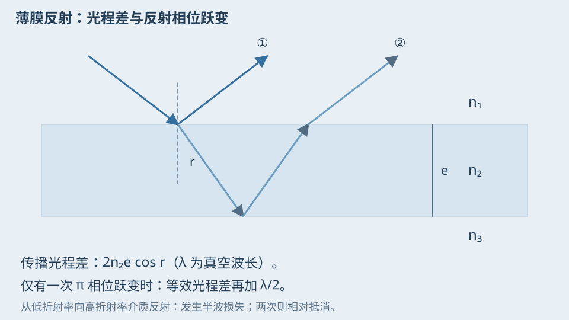

明纹满足 $\delta=m\lambda$，暗纹满足 $\delta=(m+\tfrac12)\lambda$。均匀薄膜中相同入射角对应相同光程差，称为**等倾干涉**；入射角相同、膜厚变化时，同厚度处同级，称为**等厚干涉**。

**题1.** $n_1<n_2<n_3$，光从上方正入射，求两束反射光的光程差。

**解：** 两个界面反射均有 $\pi$ 突变，相对抵消，$\delta=2n_2e$。讲义选 A。应说“无**相对**半波损失”，不能说两界面反射都没有相位突变。

**题2.** 空气中的透明薄膜，折射率 $n$，使反射增强的最小非零厚度是多少？

**解：** 空气—膜的反射有 $\pi$ 突变，膜—空气的反射无突变。增强要求 $2ne+\lambda/2=\lambda$，故 $e_{\min}=\lambda/(4n)$。

**题3.** 空气中镜头玻璃 $n_3=1.52$，增透膜 $n_2=1.38$，中心波长 $550\,\text{nm}$，求最小膜厚。

**解：** 两次反射均有相位突变，相对为零；反射相消要求 $2n_2e=\lambda/2$，故

$$e_{\min}=\frac{550}{4\times1.38}\,\text{nm}\approx99.64\,\text{nm}.$$

这是使反射减弱的相位条件；若要反射**完全**抵消，还要求两束反射光振幅相等，理想单层增透膜另有 $n_2^2=n_1n_3$ 的匹配条件。

**题4.** 白光正入射空气中厚 $0.40\,\mu\text{m}$、折射率 $1.50$ 的玻璃片，在 $400～760\,\text{nm}$ 内，哪些波长反射增强、哪些透射增强？

**解：** 存在一次相对半波损失。反射增强满足 $2ne=(m+\tfrac12)\lambda$，即 $\lambda=2400/(2m+1)\,\text{nm}$，范围内只有 $480\,\text{nm}$。忽略吸收时透射增强对应反射减弱，$2ne=m\lambda$，得到 $600\,\text{nm}$ 与 $400\,\text{nm}$。

### 2. 劈尖干涉

设膜内折射率 $n$，劈尖角 $\theta\ll1$，距棱边水平位置为 $x$，则膜厚 $e\approx x\theta$。通常的玻璃—空气—玻璃劈尖有一次相对半波损失：

$$\delta=2ne+\frac\lambda2.$$

| 条纹 | 膜厚位置 |
| --- | --- |
| 暗纹 | $e_m=m\lambda/(2n),\ m=0,1,\ldots$ |
| 从棱边数第 $j$ 条明纹 | $e_j=(j-\tfrac12)\lambda/(2n),\ j=1,2,\ldots$ |
| 相邻同类条纹 | $\Delta e=\lambda/(2n)$，$\Delta x\approx\lambda/(2n\theta)$ |

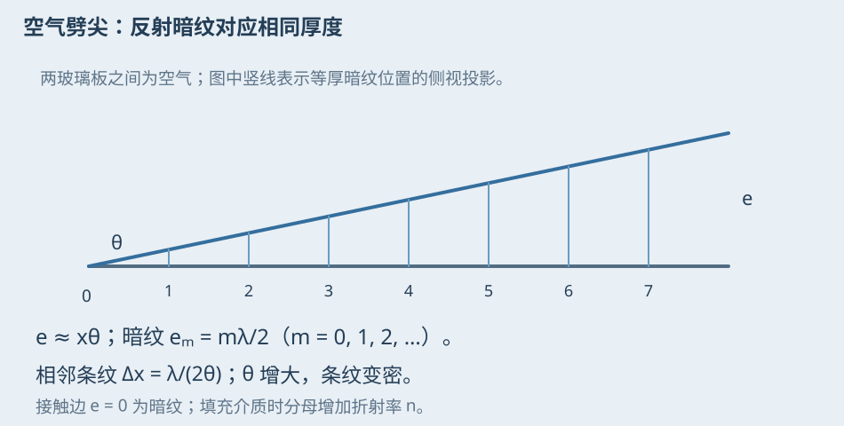

**题1.** 玻璃长 $L=7\,\text{cm}$，另一端间隔 $h=2.8\times10^{-4}\,\text{cm}$，形成空气劈尖，正入射光 $\lambda=600\,\text{nm}$。求劈尖角、条纹间距、棱边明暗、第 2 条明纹位置及明暗纹总数。

**解：** 先换算 $L=0.07\,\text{m}$、$h=2.8\times10^{-6}\,\text{m}$。

$$\theta\approx\frac hL=4.0\times10^{-5}\,\text{rad},\qquad\Delta x=\frac\lambda{2\theta}=7.5\,\text{mm}.$$

棱边 $e=0$ 为暗纹。第 2 条明纹的膜厚为 $3\lambda/4=4.5\times10^{-7}\,\text{m}$，故 $x_2=11.25\,\text{mm}$。在 $0\le e\le h$ 内，暗纹 $m=0,\ldots,9$ 共 **10 条**（包括棱边），明纹 $j=1,\ldots,9$ 共 **9 条**。计数应直接检查各级位置是否落在膜内，避免对“级数”机械取整。

**题2.** 左边为棱边，上玻璃绕棱边逆时针抬起，条纹如何变化？若条纹中部向左侧棱边弯曲，工件中部是凸起还是凹陷？

**解：** 抬起使 $\theta$ 增大，$\Delta x$ 减小；固定级次对应固定膜厚，$x_j\propto1/\theta$，所以向棱边移动。若工件局部凹陷，空气层变厚，同一厚度条纹须移向本来更薄的棱边，因此中部向棱边弯曲对应**凹陷**。这套左右说法以棱边在左为前提，换图时应重新分析膜厚。

### 3. 牛顿环

平凸透镜与平板之间形成薄膜，曲率半径为 $R$。离中心半径 $r$ 处，若 $e\ll R$，球面几何给出

$$e\approx\frac{r^2}{2R}.$$

通常玻璃间为空气或折射率较小的透明液体，存在一次相对半波损失；反射光中的暗环和明环半径为

$$r_{m,\text{暗}}^2=\frac{m\lambda R}{n}\ (m=0,1,\ldots),\qquad r_{j,\text{明}}^2=\frac{(j-\tfrac12)\lambda R}{n}\ (j=1,2,\ldots).$$

中心暗、同类环的 $r^2$ 等间隔，而**半径本身不等间隔，内疏外密**。增加膜介质折射率，同级半径按 $1/\sqrt n$ 缩小。

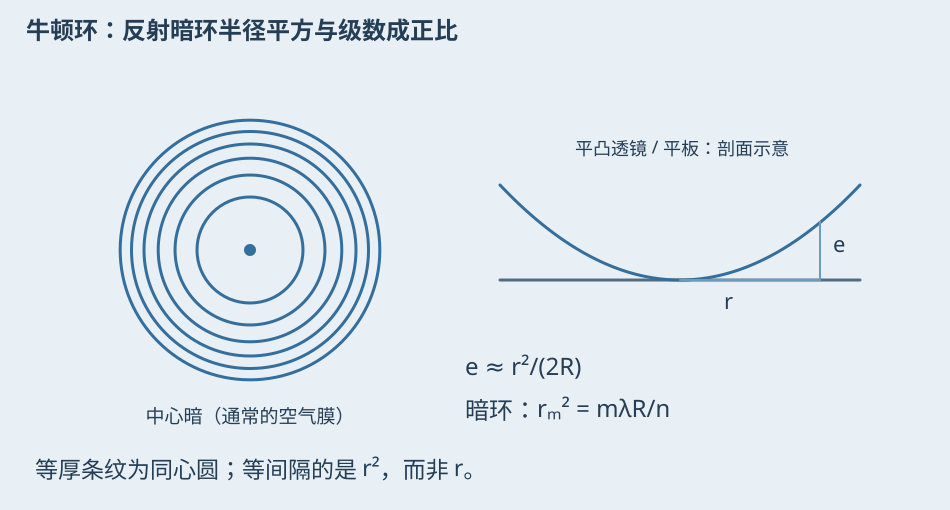

**题1.** 透镜 $n=1.52$，中间膜层 $n=1.62$，下面平板左半为 $1.75$、右半为 $1.52$。接触点两侧的反射光明暗如何？

**解：** 左侧两次反射均从低折射率到高折射率，相对相位突变为零，零厚处为明；右侧只有上界面反射有 $\pi$ 突变，零厚处为暗。故**左明右暗**，讲义选 D。中心是否暗不能只凭“牛顿环”三个字判断。

**题2.** 空气膜中 $r_k=4\,\text{mm}$、$r_{k+5}=6\,\text{mm}$、$R=10\,\text{m}$，求波长和级数。

**解：**

$$\lambda=\frac{r_{k+5}^2-r_k^2}{5R}=4.0\times10^{-7}\,\text{m}=400\,\text{nm},\qquad k=\frac{r_k^2}{\lambda R}=4.$$

**题3.** 透镜竖直上移时，同级环向哪里移动？

**解：** 若中心间隙增为 $e_0$，则 $e=e_0+r^2/(2R)$。同级暗环有 $r_m^2=R(m\lambda/n-2e_0)$，$e_0$ 增大使半径减小，环向中心收缩并依次消失。

### 4. 迈克尔逊干涉仪

可动反射镜沿光路移动 $\Delta d$，光往返一次，光程差变化为 $2n\Delta d$。介质为空气时，移动条纹数

$$N=\frac{2|\Delta d|}{\lambda},\qquad\lambda=\frac{2|\Delta d|}{N}.$$

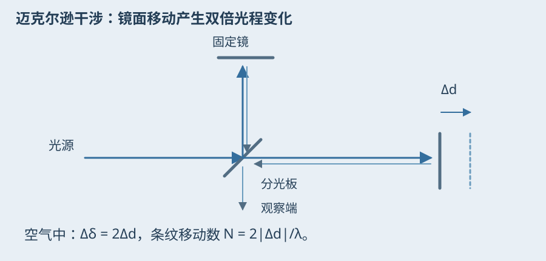

**题1.** 反射镜移动 $0.600\,\text{mm}$，条纹移动 2000 条，求光波长。

**解：** $\lambda=2\times0.600\,\text{mm}/2000=600\,\text{nm}$。不要漏掉往返的系数 2。

材料：[光学讲义](截图/配套讲义/光学【蜂考突击课】.pdf)，PDF 第 8—15 页。

---

## 课时六 单缝衍射、光栅衍射

| 考点 | 重要程度 | 占分 | 常见题型 |
| --- | --- | --- | --- |
| 单缝衍射、光栅衍射 | 必考 | 5～10 | 选择、填空、大题 |

### 1. 单缝夫琅禾费衍射

平行单色光正入射宽度 $a$ 的单缝，用透镜在焦平面观察远场衍射。缝两端到方向 $\theta$ 的最大光程差为 $a\sin\theta$。暗纹条件

$$a\sin\theta_m=m\lambda,\qquad m=\pm1,\pm2,\ldots$$

中央 $\theta=0$ 是明纹，不能把 $m=0$ 代入“暗纹”。小角度下，焦距为 $f$，有

$$x_m\approx\frac{mf\lambda}{a},\qquad \Delta x_0\approx\frac{2f\lambda}{a}.$$

$\Delta x_0$ 是中央明纹两侧第一级暗纹之间的宽度。单侧半角宽度为 $\theta_1=\arcsin(\lambda/a)$；当 $\lambda/a$ 不小时，不能用小角近似代替三角函数。

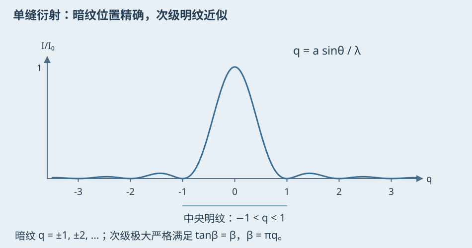

#### 明纹位置是近似公式

精确相对强度为

$$\frac I{I_0}=\left(\frac{\sin\beta}{\beta}\right)^2,\qquad\beta=\frac{\pi a\sin\theta}{\lambda}.$$

中央以外的精确极大满足 $\tan\beta=\beta$。课程的半波带近似使用

$$a\sin\theta_j\approx\left(j+\frac12\right)\lambda,\quad j=1,2,\ldots$$

即侧面第 $j$ 条明纹位置 $x_j\approx(j+\tfrac12)f\lambda/a$。该式不能标成严格等式。两个相邻暗纹之间的间隔约为 $f\lambda/a$，但侧明纹光强并不相同。

**题1.** $a=4\lambda$，求第二级暗纹的衍射角。

**解：** $4\lambda\sin\theta=2\lambda$，所以 $\theta=30^\circ=\pi/6$，讲义选 C。

**题2.** 某点原为第 3 级暗纹，缝处能分成多少个半波带？缝宽减半后，该方向发生什么变化？

**解：** 原光程差为 $3\lambda$，可分为 6 个半波带。减半后变为 $1.5\lambda$，共 3 个半波带，按课程近似判为第 1 侧明纹附近；严格强度曲线的极大并非恰在 $1.5\lambda$，因此这是半波带近似判断。

**题3.** 用 $589\,\text{nm}$ 光时中央明纹宽 $4.0\,\text{mm}$；改用 $442\,\text{nm}$，其余不变，宽度是多少？

**解：** $\Delta x_0\propto\lambda$，所以 $\Delta x_0'=4.0\times442/589\approx3.00\,\text{mm}$。减小缝宽则使中央明纹变宽。

**题4.** $\lambda=600\,\text{nm}$、$a=0.60\,\text{mm}$、$f=0.60\,\text{m}$，求第 2 侧明纹位置、中央明纹宽度、其他相邻暗纹间距及两侧第 3 级暗纹距离。

**解：** $f\lambda/a=0.600\,\text{mm}$，故课程近似下 $x_{2,\text{明}}\approx2.5f\lambda/a=1.50\,\text{mm}$；中央宽 $1.20\,\text{mm}$；其他相邻暗纹间距 $0.600\,\text{mm}$；两侧第 3 级暗纹相距 $6f\lambda/a=3.60\,\text{mm}$。精确第二侧极大的位置约为 $1.475\,\text{mm}$，用于说明近似误差，不替代课程约定的近似解法。

### 2. 光栅主极大与缺级

设单缝宽 $a$、不透光部分宽 $b$、光栅常数 $d=a+b$，每单位长度的刻线数为 $\sigma$，则 $d=1/\sigma$。正入射的主极大条件

$$d\sin\theta=m\lambda,\qquad m\in\mathbb Z.$$

同一非零级次中，波长越长，衍射角越大，因此白光谱红光离中央较远，紫光较近。

当光栅主极大与单缝暗纹重合时发生缺级：

$$d\sin\theta=m\lambda,\quad a\sin\theta=q\lambda\quad\Rightarrow\quad m=q\frac da,\quad q\ne0.$$

中央 $m=0$ 不属于单缝暗纹，不缺失。先列出有限屏幕可见的 $|m|\lambda<d$，再删掉满足缺级条件的整数级次。

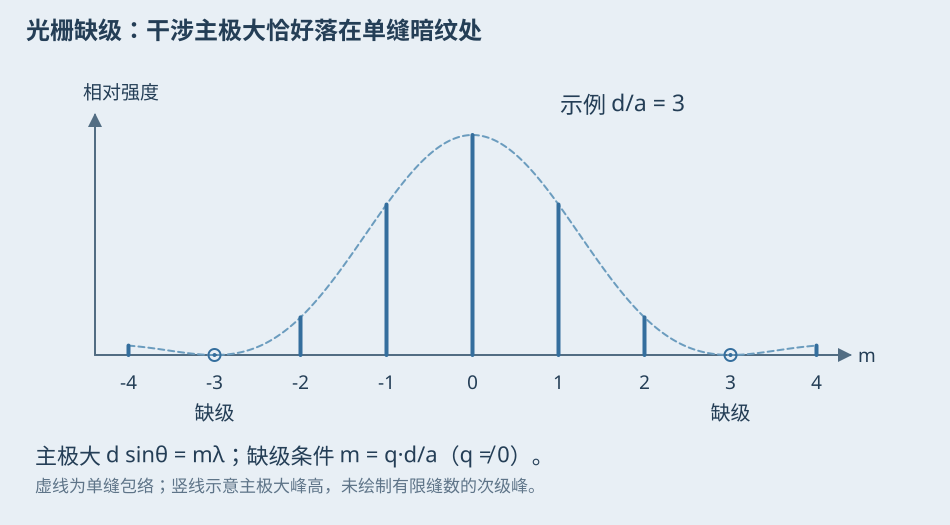

**题1.** 每毫米 800 条刻线，第一级衍射角 $30^\circ$，求光栅常数与波长。

**解：** $d=(1/800)\,\text{mm}=1.25\,\mu\text{m}$，$\lambda=d\sin30^\circ=625\,\text{nm}$。

**题2.** $d=2\times10^{-4}\,\text{cm}$、$\lambda=550\,\text{nm}$，最大可见主极大级次是多少？

**解：** $d=2\,\mu\text{m}$，$d/\lambda\approx3.636$，所以 $|m|_{\max}=3$，讲义选 C。这只给出几何上限，还应检查是否缺级。

**题3.** $\lambda=600\,\text{nm}$，第二级衍射角 $30^\circ$，且第三级缺级。求 $d$、可能的最小 $a$ 和所有可见主极大级次。

**解：**

$$d=\frac{2\lambda}{\sin30^\circ}=2.4\,\mu\text{m}.$$

由 $3=q d/a$，$a=q d/3$；取最小正整数 $q=1$，得 $a_{\min}=0.80\,\mu\text{m}$。此时 $d/a=3$，$m=\pm3$ 缺级；$|m|=4$ 对应 $90^\circ$，有限屏幕看不到。故只剩 $m=0,\pm1,\pm2$，共 **5 条**。

### 3. 练习与易错点

**题1（讲义练习）.** 每厘米 5000 条刻线，用 $589\,\text{nm}$ 单色光照射，不考虑缺级，屏上一共可见多少条主谱线？

**解：** $d=0.01/5000=2.0\times10^{-6}\,\text{m}$，可见 $m=0,\pm1,\pm2,\pm3$，共 **7 条**。

**题2（讲义练习）.** 单缝边缘到屏上三个方向的光程差为 $2\lambda,2.5\lambda,3.5\lambda$，比较亮度。

**解：** $2\lambda$ 为暗纹；其余两点的分子 $\sin^2\beta$ 都为 1，但分母 $\beta^2$ 不同，所以 $I(2.5\lambda)>I(3.5\lambda)>I(2\lambda)=0$。不能认为两条侧明纹等亮。

- 单缝暗纹用缝宽 $a$，光栅主极大用周期 $d$，不要混用。
- “最大级次”与“总条数”不同；总条数需包含中央、两侧及缺级。
- 非小角度下，屏上位置为 $x=f\tan\theta$，不要一律以 $f\sin\theta$ 代替。

材料：[光学讲义](截图/配套讲义/光学【蜂考突击课】.pdf)，PDF 第 16—21 页。

---

## 课时七 偏振光

| 考点 | 重要程度 | 占分 | 常见题型 |
| --- | --- | --- | --- |
| 马吕斯定律、布儒斯特定律 | 必考 | 2～4 | 选择、填空 |

### 1. 自然光与线偏振光

光是横波。自然光的电场振动方向在垂直于传播方向的平面内无固定优势；线偏振光的电场沿固定方向振动。偏振片的透振方向指允许通过的**电场振动方向**，不是光传播方向。

理想偏振片对自然光与线偏振光的处理不同：

| 入射光 | 透射光强 |
| --- | --- |
| 自然光，入射强度 $I_0$ | $I_1=I_0/2$，成为线偏振光 |
| 线偏振光，与透振轴夹角 $\alpha$ | $I=I_{\text{入}}\cos^2\alpha$ |

第二式即**马吕斯定律**。通过多片偏振片时逐片计算，第一片之后不要再次无条件除以 2。

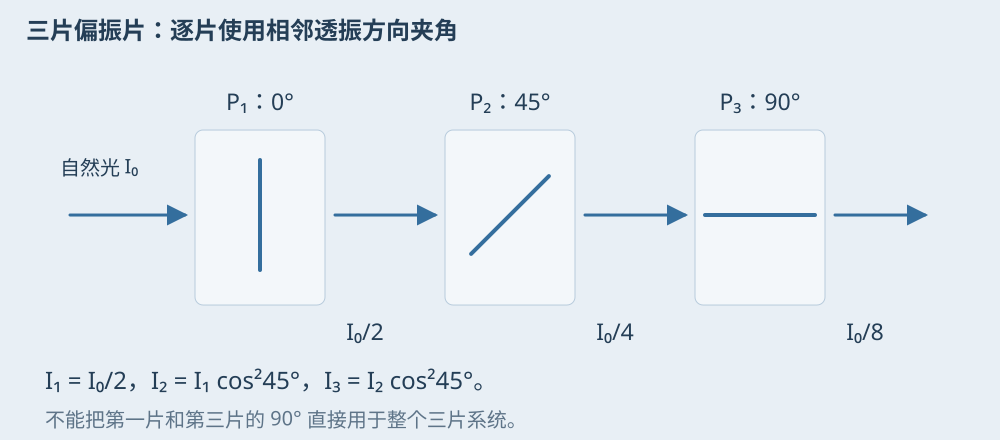

**题1.** 自然光 $I_0$ 依次穿过两片夹角 $45^\circ$ 的理想偏振片，求出射光强。

**解：** $I_1=I_0/2$，$I_2=(I_0/2)\cos^245^\circ=I_0/4$，讲义选 B。

**题2.** 自然光经过两片后为 $I_0/8$，求两轴的锐角夹角。

**解：** $(I_0/2)\cos^2\alpha=I_0/8$，得 $\cos^2\alpha=1/4$，故 $\alpha=60^\circ$。若不限定轴夹角的取值约定，还有等价角度。

**题3（讲义练习）.** 首末两片的透振轴互相垂直，中间一片与第一片成 $45^\circ$，求三片后的光强。

**解：** $I=(I_0/2)\cos^245^\circ\cos^245^\circ=I_0/8$。夹入中间偏振片后，最后一片与前一片不再正交，因而可以有透射光。

### 2. 布儒斯特定律

自然光从 $n_1$ 射向 $n_2$ 的透明介质界面，当入射角 $i_B$ 满足

$$\tan i_B=\frac{n_2}{n_1},\qquad i_B+r=90^\circ,$$

反射光为**电场垂直于入射面的完全线偏振光**，反射光与折射光的传播方向互相垂直。入射面由入射光线和法线决定；“垂直于入射面”不等于“垂直于界面”。对自然光入射，折射光一般为部分偏振光。

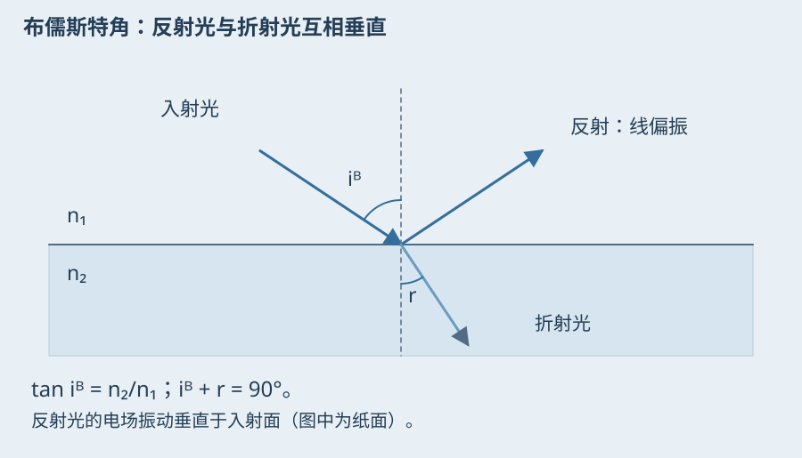

**题1.** 自然光以 $60^\circ$ 从空气射入玻璃，反射光完全偏振，求折射角和玻璃折射率。

**解：** $r=90^\circ-60^\circ=30^\circ$；$n_2=n_1\tan60^\circ\approx\sqrt3$。反射光的振动方向垂直于入射面，对应讲义选择题 C。

### 3. 自检

- 自然光过第一片才有 $I_0/2$；后续逐片应用马吕斯定律。
- 角度取相邻偏振片透振轴间的夹角，不是所有片相对第一片的夹角。
- 布儒斯特角从法线量起；入射光与反射光的夹角不等于 $90^\circ$。
- 马吕斯定律讨论透振轴投影；布儒斯特定律讨论界面反射，适用对象不同。

材料：[光学讲义](截图/配套讲义/光学【蜂考突击课】.pdf)，PDF 第 22—23 页。

---

## 课时八 气体动理论

| 考点 | 主要题型与方法 |
| --- | --- |
| 理想气体状态方程 | 状态量、分子数密度与质量密度的换算 |
| 能量均分与内能 | 区分平动能、总平均动能和系统内能 |
| 麦克斯韦速率分布 | 分布曲线面积、分子数和平均值 |
| 三种特征速率 | 公式、大小关系与温度、摩尔质量的影响 |

本课合并讲义“气体动理论（一）、（二）”。温度公式必须使用热力学温度 $T$，单位 K；$T=t+273.15$，本课按讲义精度计算的例题取 $T\approx t+273$。气体常量取 $R=8.31\,\mathrm{J/(mol\cdot K)}$，玻尔兹曼常量取 $k_{\mathrm B}=1.38\times10^{-23}\,\mathrm{J/K}$。

### 1. 理想气体状态方程

理想气体模型忽略分子自身占据的体积及碰撞以外的分子间相互作用，分子间及分子与容器壁的碰撞按完全弹性碰撞处理。设物质的量为 $n$，分子总数为 $N$，摩尔质量为 $M$，单个分子质量为 $m_0=M/N_{\mathrm A}$，则

$$PV=nRT=Nk_{\mathrm B}T,\qquad n=\frac{m}{M}=\frac{N}{N_{\mathrm A}}.$$

分子数密度记为 $n_N=N/V$，质量密度为 $\rho=m/V$，所以

$$P=n_Nk_{\mathrm B}T=\frac{\rho RT}{M}.$$

这里的 $P$ 为绝对压强。$1\,\mathrm L=10^{-3}\,\mathrm{m^3}$，$1\,\mathrm{atm}=1.013\times10^5\,\mathrm{Pa}$；摩尔质量代入 SI 公式时用 kg/mol，不能直接把氧气的 32 g/mol 写成数值 32。

#### 例题

**题1.** 氧气质量 $0.10\,\mathrm{kg}$，压强 $10\times10^5\,\mathrm{Pa}$，温度 $47^\circ\mathrm C$，$M=0.032\,\mathrm{kg/mol}$，求体积。

**解：** $T\approx320\,\mathrm K$，$n=0.10/0.032=3.125\,\mathrm{mol}$，因此

$$V=\frac{nRT}{P}=\frac{3.125\times8.31\times320}{10^6}=8.31\times10^{-3}\,\mathrm{m^3}=8.31\,\mathrm L.$$

**题2.** 氦气与氧气的压强、温度相同，它们的分子数密度、质量密度和单位体积内能是否相同？

**解：** $n_N=P/(k_{\mathrm B}T)$ 相同；$\rho=PM/(RT)$ 不同，氧气质量密度较大。单位体积内能还与分子有效自由度有关，在常温忽略振动时，氦气为 $3P/2$，氧气为 $5P/2$，也不相同。

### 2. 压强、温度与能量均分

平衡态理想气体满足

$$P=\frac13 n_Nm_0\overline{v^2}=\frac23n_N\overline{\varepsilon_{\mathrm{平}}},\qquad\overline{\varepsilon_{\mathrm{平}}}=\frac32k_{\mathrm B}T.$$

温度相同，分子的平均平动动能相同，不代表平均速率相同。总平均动能还要考虑转动等自由度。在经典能量均分适用、自由度不随温度变化的范围内，每个以平方项形式出现的有效自由度平均贡献 $k_{\mathrm B}T/2$。

| 分子模型 | 有效自由度 $i$ | 每个分子平均能量 | 理想气体内能 $U$ |
| --- | --- | --- | --- |
| 单原子，如 He、Ne | 3 | $3k_{\mathrm B}T/2$ | $3nRT/2$ |
| 刚性线形，如双原子及线形 CO₂ | 5 | $5k_{\mathrm B}T/2$ | $5nRT/2$ |
| 刚性非线形多原子 | 6 | $3k_{\mathrm B}T$ | $3nRT$ |

统一为

$$U=n\frac{i}{2}RT=\frac{i}{2}PV.$$

理想气体的内能在物质的量及分子模型固定时只取决于温度。讲义把多原子分子统一简化为 $i=6$，实际应先区分线形与非线形；高温下振动自由度激发后，以上刚性模型也需调整。状态方程忽略分子尺寸，不意味着计算内能时必须忽略转动。

#### 例题

**题1.** $32\,\mathrm g$ 氧气处于 $27^\circ\mathrm C$，忽略分子振动。求每个分子的平均平动动能、平均转动动能及全部气体内能。

**解：** $T\approx300\,\mathrm K$，$n=1\,\mathrm{mol}$，氧气为刚性双原子模型，$i=5$。因此

$$\overline{\varepsilon_{\mathrm{平}}}=\frac32k_{\mathrm B}T=6.21\times10^{-21}\,\mathrm J,$$

$$\overline{\varepsilon_{\mathrm{转}}}=k_{\mathrm B}T=4.14\times10^{-21}\,\mathrm J,$$

$$U=\frac52nRT=6.2325\times10^3\,\mathrm J\approx6.23\,\mathrm{kJ}.$$

注意前两问是“一个分子”的平均能量，最后一问是系统总内能，不能漏乘分子总数。

**题2.** 氦气与氮气质量密度相同，分子平均平动动能相同，求压强之比。

**解：** 平均平动动能相同意味着 $T$ 相同。由 $P=\rho RT/M$，

$$\frac{P_{\mathrm{He}}}{P_{\mathrm{N_2}}}=\frac{M_{\mathrm{N_2}}}{M_{\mathrm{He}}}=\frac{28}{4}=7.$$

**题3.** $4\,\mathrm{mol}$ CO₂ 在 $300\,\mathrm K$ 时，按刚性线形分子且忽略振动的模型计算内能。

**解：** CO₂ 是线形分子，取 $i=5$，

$$U=4\times\frac52\times8.31\times300=2.493\times10^4\,\mathrm J.$$

若课程题目另外明确采用“所有多原子均取 6 自由度”的简化约定，则会得到 $2.9916\times10^4\,\mathrm J$；这是模型假设的差异，不能把“含三个原子”直接等同于“刚性非线形”。

### 3. 速率分布函数与三种特征速率

设 $f(v)$ 为归一化速率分布函数，则

$$\int_0^\infty f(v)\,\mathrm dv=1,\qquad\frac{\mathrm dN}{N}=f(v)\,\mathrm dv.$$

曲线在区间 $[v_1,v_2]$ 下的面积是该区间的分子比例；乘以 $N$ 为分子数，乘以 100% 才写成百分数。$f(v)$ 本身不是一个速率处的概率，其量纲为速率的倒数。连续分布中，速率恰好等于某一个值的概率为零。

经典平衡态理想气体的麦克斯韦分布为

$$f(v)=4\pi\left(\frac{m_0}{2\pi k_{\mathrm B}T}\right)^{3/2}v^2\exp\left(-\frac{m_0v^2}{2k_{\mathrm B}T}\right).$$

| 名称 | 定义或含义 | 公式 |
| --- | --- | --- |
| 最概然速率 $v_p$ | $f(v)$ 最大处的速率 | $\sqrt{2RT/M}$ |
| 平均速率 $\bar v$ | $\int_0^\infty vf(v)\,\mathrm dv$ | $\sqrt{8RT/(\pi M)}$ |
| 方均根速率 $v_{\mathrm{rms}}$ | $\sqrt{\overline{v^2}}$ | $\sqrt{3RT/M}=\sqrt{3P/\rho}$ |

$$v_p<\bar v<v_{\mathrm{rms}}.$$

同种气体温度越高，曲线峰值越低、峰位右移、分布变宽，归一化面积始终为 1。同温下摩尔质量越小，三种速率都越大。平衡气体平均**速度矢量**为零，平均**速率**不为零。

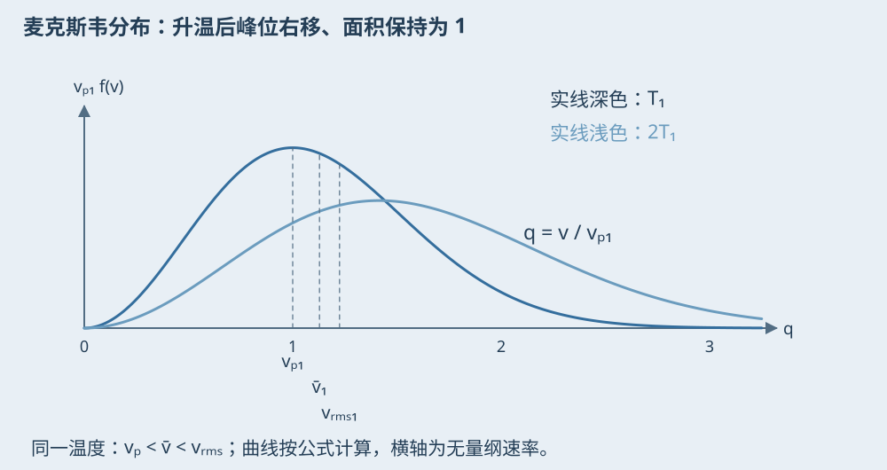

#### 例题

**题1.** 气体压强 $0.01\,\mathrm{atm}$，质量密度 $0.0124\,\mathrm{kg/m^3}$，求方均根速率。

**解：** $P=1.013\times10^3\,\mathrm{Pa}$，

$$v_{\mathrm{rms}}=\sqrt{\frac{3P}{\rho}}=\sqrt{\frac{3\times1013}{0.0124}}\approx495\,\mathrm{m/s}.$$

**题2.** 同温下氢气最概然速率为 $2000\,\mathrm{m/s}$，求氧气最概然速率。

**解：**

$$v_{p,\mathrm{O_2}}=2000\sqrt{\frac{M_{\mathrm{H_2}}}{M_{\mathrm{O_2}}}}=2000\sqrt{\frac2{32}}=500\,\mathrm{m/s}.$$

### 4. 非麦克斯韦分布的面积与平均值

题目若另给分段分布，应直接按给定函数积分，不能套用麦克斯韦三速率公式。

**题1.** 某气体共有 $N$ 个分子，给定曲线的纵坐标为 $Nf(v)$：在 $0\le v\le v_0$ 上由 0 线性增至 $a$，在 $v_0\le v\le2v_0$ 上恒为 $a$，其余为零。求 $a$、$1.5v_0$ 到 $2v_0$ 的分子比例及平均速率。

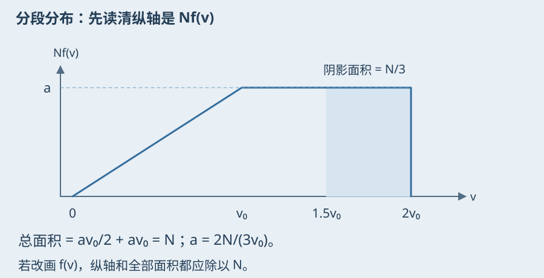

**解：** 总面积为分子总数，而非 1：

$$\frac12av_0+av_0=N\quad\Rightarrow\quad a=\frac{2N}{3v_0}.$$

因此

$$f(v)=\begin{cases}\dfrac{av}{Nv_0},&0\le v<v_0,\\[4pt]\dfrac aN,&v_0\le v\le2v_0,\\[4pt]0,&\text{其他}.\end{cases}$$

所求比例为

$$\frac{\Delta N}{N}=\frac{a(2v_0-1.5v_0)}N=\frac13.$$

平均速率为

$$\bar v=\int_0^{v_0}\frac{av^2}{Nv_0}\,\mathrm dv+\int_{v_0}^{2v_0}\frac{av}{N}\,\mathrm dv=\frac{av_0^2}{N}\left(\frac13+\frac32\right)=\frac{11}{9}v_0.$$

同理 $\overline{v^2}=31v_0^2/18$，故 $v_{\mathrm{rms}}=\sqrt{31/18}\,v_0$。本题先把纵轴读清，再决定面积归一化方式。

### 5. 本课易错点

1. 温度用 K，摩尔质量用 kg/mol；绝对压强不能用表压替代。
2. 平均平动动能只由温度决定，系统内能还与物质的量和有效自由度有关。
3. “同温同压”保证分子数密度相同，不保证质量密度、单位体积内能相同。
4. $\overline{v^2}$ 与 $\bar v^2$ 不同；应先求均方，再开平方。
5. 分布面积代表比例还是数量，取决于纵轴是 $f(v)$ 还是 $Nf(v)$。

本课材料：[气体与热力学讲义](截图/配套讲义/气体与热力学【蜂考突击课】.pdf)，PDF 第 3—9 页。

---

## 课时九 热力学第一定律与四种过程

| 考点 | 核心方法 |
| --- | --- |
| 热力学第一定律 | 先约定功和热量的正负，再列能量方程 |
| 定容、定压、等温过程 | 明确不变量，计算 $W,\Delta U,Q$ |
| 可逆绝热过程 | 泊松关系、绝热指数和温度变化 |
| 不同路径比较 | 内能看端点，功看路径，热量由第一定律求 |

### 1. 符号约定与准静态功

本笔记统一用 $U$ 表示气体内能，$W$ 表示**气体对外做功**，$Q$ 表示**气体吸收的热量**：

$$\boxed{Q=\Delta U+W},\qquad\Delta U=U_2-U_1.$$

| 情形 | 正负号 |
| --- | --- |
| 气体吸热 / 放热 | $Q>0$ / $Q<0$ |
| 气体膨胀对外做功 / 外界压缩气体 | $W>0$ / $W<0$ |
| 内能增加 / 减少 | $\Delta U>0$ / $\Delta U<0$ |

若题目另定义“外界对气体做功” $W_{\mathrm{外}}$，则 $W=-W_{\mathrm{外}}$，第一定律相应写成 $\Delta U=Q+W_{\mathrm{外}}$。

准静态体积功为

$$W=\int_{V_1}^{V_2}P\,\mathrm dV.$$

它等于 $P$—$V$ 图中有向曲线下的面积，**只有定压过程才能直接写成 $P(V_2-V_1)$**。不可逆过程计算边界功通常需要外压，不能把非平衡气体的状态压强随意代入上述准静态积分。

内能是状态函数；热量和功是过程量，气体并不“储存着某个热量”。理想气体物质的量、自由度固定时

$$\Delta U=nC_V\Delta T=n\frac i2R(T_2-T_1).$$

### 2. 摩尔热容与四种典型过程

在自由度 $i$ 恒定的模型内，

$$C_V=\frac i2R,\qquad C_P=C_V+R=\frac{i+2}{2}R,\qquad\gamma=\frac{C_P}{C_V}=\frac{i+2}{i}.$$

$C_V,C_P$ 的单位为 $\mathrm{J/(mol\cdot K)}$。单原子 $\gamma=5/3$，刚性双原子 $\gamma=7/5$，刚性非线形多原子 $\gamma=4/3$。只有对应定容、定压过程，才分别用 $Q=nC_V\Delta T$、$Q=nC_P\Delta T$。

| 过程及条件 | 气体做功 $W$ | 内能变化 $\Delta U$ | 吸收热量 $Q$ |
| --- | --- | --- | --- |
| 定容 $V$ 不变 | $0$ | $nC_V\Delta T$ | $nC_V\Delta T$ |
| 定压 $P$ 不变 | $P\Delta V=nR\Delta T$ | $nC_V\Delta T$ | $nC_P\Delta T$ |
| 理想气体等温、准静态 | $nRT\ln(V_2/V_1)$ | $0$ | $W$ |
| 理想气体可逆绝热，$i$ 恒定 | $nC_V(T_1-T_2)$ | $nC_V(T_2-T_1)$ | $0$ |

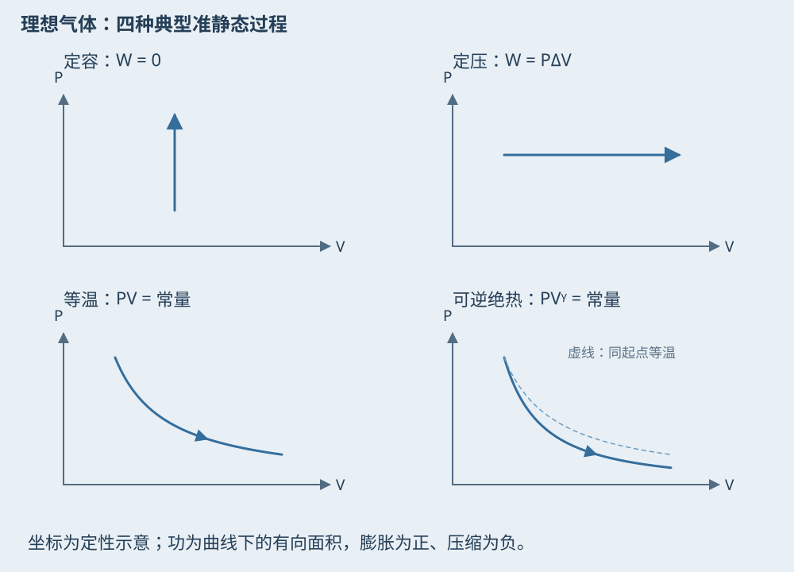

#### 可逆绝热关系

绝热只表示 $Q=0$。再加准静态可逆、理想气体、热容不变，才可使用

$$PV^\gamma=\text{常量},\qquad TV^{\gamma-1}=\text{常量},$$

$$\frac{T_2}{T_1}=\left(\frac{V_1}{V_2}\right)^{\gamma-1}=\left(\frac{P_2}{P_1}\right)^{(\gamma-1)/\gamma}.$$

由 $Q=0$ 得

$$W=-\Delta U=nC_V(T_1-T_2)=\frac{P_1V_1-P_2V_2}{\gamma-1}.$$

膨胀 $W>0$，温度下降；压缩 $W<0$，温度上升。公式手册把这里的功写成与 $\Delta T=T_2-T_1$ 同号时，与“气体对外做功为正”的约定不一致，应取负号。绝热自由膨胀等不可逆过程不能直接套 $PV^\gamma=\text{常量}$。

### 3. 四种过程例题

**题1.** $1\,\mathrm{mol}$ 单原子理想气体定容从 $300\,\mathrm K$ 升至 $500\,\mathrm K$，求功、内能变化和热量。

**解：** 定容 $W=0$，$C_V=3R/2$，

$$\Delta U=Q=\frac32\times8.31\times200=2493\,\mathrm J.$$

**题2.** 相同初始压强、体积和温度的氦气与氢气，分别定容升高相同温度。氦气吸热 $3\,\mathrm J$，氢气吸热多少？忽略氢分子振动。

**解：** 初始状态相同，由状态方程知物质的量相同。定容 $Q\propto i$，所以

$$Q_{\mathrm{H_2}}=\frac53Q_{\mathrm{He}}=5\,\mathrm J.$$

**题3.** $0.28\,\mathrm{kg}$ 氮气定压从 $20^\circ\mathrm C$ 升至 $100^\circ\mathrm C$，$M=0.028\,\mathrm{kg/mol}$，按刚性双原子模型求 $W,\Delta U,Q$。

**解：** $n=10\,\mathrm{mol}$，$\Delta T=80\,\mathrm K$。因此

$$W=nR\Delta T=6648\,\mathrm J,$$

$$\Delta U=n\frac52R\Delta T=16620\,\mathrm J,$$

$$Q=n\frac72R\Delta T=23268\,\mathrm J.$$

核对 $Q=\Delta U+W$，且吸热、升温、膨胀做功均为正。

**题4.** 某理想气体初态压强 $1\,\mathrm{atm}$、体积 $10\,\mathrm L$，准静态等温膨胀至 $20\,\mathrm L$，求功和热量。

**解：** 等温使 $nRT=P_1V_1=1013\,\mathrm J$，

$$\Delta U=0,\qquad W=Q=1013\ln\frac{20}{10}\approx702\,\mathrm J.$$

等温过程仍能吸热；吸收的能量全部转化为对外做功。

**题5.** $1\,\mathrm{mol}$ 刚性非线形多原子理想气体，从 $300\,\mathrm K$、$1\,\mathrm{atm}$ 经可逆绝热压缩到 $16\,\mathrm{atm}$，求末温和气体做功。

**解：** $i=6$，$\gamma=4/3$，所以

$$T_2=300\left(\frac{16}{1}\right)^{1/4}=600\,\mathrm K.$$

$$\Delta U=1\times3R(600-300)=7479\,\mathrm J,\qquad W=-7479\,\mathrm J.$$

气体做负功，等价于外界对气体做 $7479\,\mathrm J$ 的正功。

### 4. 路径、面积与第一定律的综合应用

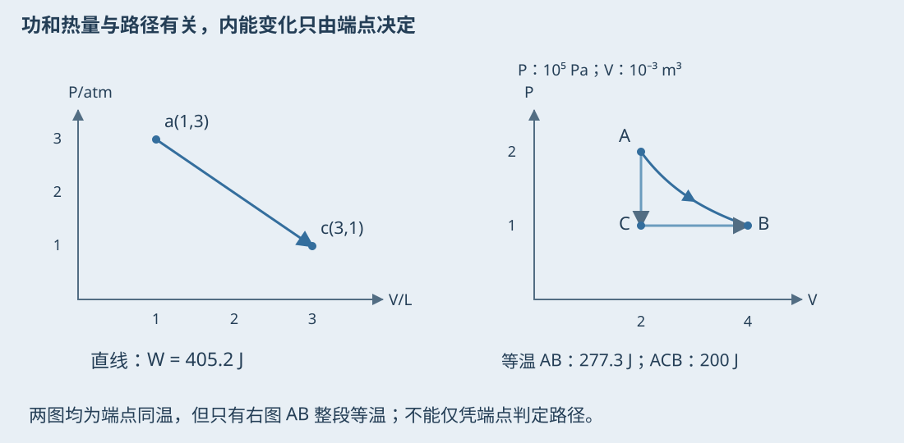

**题1.** 理想气体沿 $P$—$V$ 图上的直线，从 $a$ 点 $(V_1=1\,\mathrm L,P_1=3\,\mathrm{atm})$ 变至 $c$ 点 $(V_2=3\,\mathrm L,P_2=1\,\mathrm{atm})$，求 $W,\Delta U,Q$。

**解：** 两端 $P_1V_1=P_2V_2$，故 $T_1=T_2$、$\Delta U=0$。路径是直线，面积为梯形：

$$W=\frac{P_1+P_2}{2}(V_2-V_1)=2\times1.013\times10^5\times2\times10^{-3}=405.2\,\mathrm J.$$

因此 $Q=W=405.2\,\mathrm J$。端点同温不代表整个过程等温，不能把本题的直线路径替换成等温双曲线。

**题2.** $1\,\mathrm{mol}$ 氧气从 $A:(V_A=2\times10^{-3}\,\mathrm{m^3},P_A=2\times10^5\,\mathrm{Pa})$ 到 $B:(V_B=4\times10^{-3}\,\mathrm{m^3},P_B=10^5\,\mathrm{Pa})$。比较直接等温路径 $A\to B$ 与经过 $C:(V_C=V_A,P_C=P_B)$ 的定容—定压路径。

**解：** 端点 $PV$ 都为 $400\,\mathrm J$，总内能变化均为零。直接等温：

$$W_{AB}=Q_{AB}=400\ln2\approx277.3\,\mathrm J.$$

氧气 $i=5$，用 $\Delta U=5\Delta(PV)/2$ 分段计算：

| 路径 | $W/\mathrm J$ | $\Delta U/\mathrm J$ | $Q/\mathrm J$ |
| --- | --- | --- | --- |
| $A\to C$ 定容 | 0 | $\tfrac52(200-400)=-500$ | $-500$ |
| $C\to B$ 定压 | $10^5(4-2)10^{-3}=200$ | $\tfrac52(400-200)=500$ | 700 |
| $A\to C\to B$ 合计 | 200 | 0 | 200 |

同一初末态的内能变化相同，功和热量仍可不同。

**题3.** 单原子理想气体先从 $A:(V_A=2\,\mathrm{m^3},P_A=4\times10^5\,\mathrm{Pa})$ 定压膨胀到 $B:(V_B\approx3.48\,\mathrm{m^3},P_B=P_A)$，再绝热膨胀到 $C:(V_C=8\,\mathrm{m^3},P_C=10^5\,\mathrm{Pa})$。求总内能变化、总功和总吸热。

**解：** $P_AV_A=P_CV_C=8\times10^5\,\mathrm J$，故总 $\Delta U=0$。按讲义取整的 $V_B$ 计算：

$$W_{AB}=4\times10^5(3.48-2)=5.92\times10^5\,\mathrm J,$$

$$W_{BC}=\frac{P_BV_B-P_CV_C}{\gamma-1}=\frac{13.92\times10^5-8\times10^5}{2/3}=8.88\times10^5\,\mathrm J.$$

所以 $W=Q\approx1.48\times10^6\,\mathrm J$。$V_B$ 的 3.48 是近似值；若由绝热关系严格反算，应取约 $3.4822\,\mathrm{m^3}$，结果差别来自取整。

**题4.** 外界对 $10\,\mathrm{mol}$ 单原子理想气体做功 $200\,\mathrm J$，气体温度升高 $1\,\mathrm K$，气体吸热还是放热？

**解：** $W=-200\,\mathrm J$，$\Delta U=10\times3R/2=124.65\,\mathrm J$，

$$Q=\Delta U+W=124.65-200=-75.35\,\mathrm J.$$

气体放热 $75.35\,\mathrm J$。温度升高不等价于吸热，压缩做功同样可以增加内能。

### 5. 过程判断方法与易错点

1. 先看约束：定容限制 $V$，定压限制 $P$，等温限制 $T$，绝热限制 $Q$；它们不是同义条件。
2. 同起点向右膨胀，绝热曲线比等温曲线更陡，因为 $\lvert\mathrm dP/\mathrm dV\rvert=\gamma P/V$，而等温为 $P/V$。
3. 同一对状态之间，准静态压缩路径越高，$W$ 越负。若与连接同端点的可逆绝热路径相比，较低路径 $W>W_{\mathrm{绝}}$，则 $Q=\Delta U+W>0$；较高路径则放热。先明确积分方向，再比较面积。
4. 同样从 $T_1,V_1$ 膨胀到 $2V_1$：定压 $T_2=2T_1$；等温 $T_2=T_1$；可逆绝热 $T_2=T_1/2^{\gamma-1}$。三种过程温度变化的绝对值中定压最大、等温为零。
5. 只有理想气体、固定物质的量和分子模型，才能由 $\Delta T=0$ 直接推出 $\Delta U=0$。

本课材料：[气体与热力学讲义](截图/配套讲义/气体与热力学【蜂考突击课】.pdf)，PDF 第 10—19 页；公式手册绝热功的符号按本课约定订正。

---

## 课时十 循环过程与热机效率

| 考点 | 核心方法 |
| --- | --- |
| 循环功 | $P$—$V$ 图的有向面积 |
| 热机效率 | 分段统计吸热与放热，不能把净热量当作总吸热 |
| 卡诺循环 | 两条等温线、两条可逆绝热线，温度用 K |

### 1. 循环的功、热量与方向

循环结束后系统回到初始状态，内能变化为零：

$$\Delta U_{\mathrm{循环}}=0,\qquad W_{\mathrm{净}}=\oint P\,\mathrm dV=Q_{\mathrm{净}}.$$

在以 $V$ 向右、$P$ 向上的坐标图中，顺时针循环 $W_{\mathrm{净}}>0$，可作为热机；逆时针循环 $W_{\mathrm{净}}<0$，需外界输入功。面积的单位 $\mathrm{Pa\cdot m^3}=\mathrm J$，压强单位是 Pa，即 $\mathrm{N/m^2}$，不是讲义某图误标的 $\mathrm{N/m^3}$。

记循环各段正热量之和为 $Q_{\mathrm{in}}>0$，各段负热量绝对值之和为 $Q_{\mathrm{out}}>0$，则热机效率

$$\boxed{\eta=\frac{W_{\mathrm{净}}}{Q_{\mathrm{in}}}=1-\frac{Q_{\mathrm{out}}}{Q_{\mathrm{in}}}}.$$

不能用净吸热 $Q_{\mathrm{净}}$ 当作分母，否则会错误得到 100%。一段过程是否吸热要计算 $Q=\Delta U+W$，不能只按“膨胀/压缩”判断。

### 2. 定压—定容—等温循环

**题1.** $1\,\mathrm{mol}$ 单原子理想气体按 $a\to b\to c\to a$ 循环：$a$ 点 $T_a=300\,\mathrm K,V_a=2\times10^{-2}\,\mathrm{m^3}$；$a\to b$ 定压压缩到 $V_b=10^{-2}\,\mathrm{m^3}$；$b\to c$ 定容升温到 $300\,\mathrm K$；$c\to a$ 准静态等温膨胀。求各段热量、净功和热机效率。

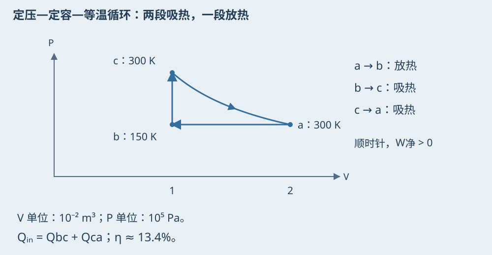

**解：** 定压段 $T_b=T_aV_b/V_a=150\,\mathrm K$。$P_a=P_b=124650\,\mathrm{Pa}$，$P_c=249300\,\mathrm{Pa}$。单原子 $C_V=3R/2,C_P=5R/2$。

| 过程 | $W/\mathrm J$ | $\Delta U/\mathrm J$ | $Q/\mathrm J$ |
| --- | --- | --- | --- |
| $a\to b$ 定压 | $nR(150-300)=-1246.5$ | $-1869.75$ | $-3116.25$ |
| $b\to c$ 定容 | 0 | $1869.75$ | $1869.75$ |
| $c\to a$ 等温 | $2493\ln2\approx1728.02$ | 0 | $1728.02$ |

$$Q_{\mathrm{in}}=1869.75+1728.02\approx3597.77\,\mathrm J,$$

$$Q_{\mathrm{out}}=3116.25\,\mathrm J,\qquad W_{\mathrm{净}}\approx481.52\,\mathrm J,$$

$$\eta\approx\frac{481.52}{3597.77}=13.4\%.$$

讲义中间量取整后给出约 $480\,\mathrm J$、13.3%；保留一致精度得到上述结果。两段吸热都要计入 $Q_{\mathrm{in}}$。

**题2.** 某顺时针矩形循环的压强在 $10\,\mathrm{Pa}$ 与 $40\,\mathrm{Pa}$ 间变化，体积在 $1\,\mathrm{m^3}$ 与 $4\,\mathrm{m^3}$ 间变化，求净功。

**解：**

$$W_{\mathrm{净}}=(40-10)(4-1)=90\,\mathrm J.$$

该信息可确定净功，若求效率，还需要气体模型及各段吸热量，不能只根据面积给效率。

### 3. 卡诺循环与效率上限

卡诺循环由两条等温过程和两条可逆绝热过程组成，只与高温热源 $T_h$ 和低温热源 $T_c$ 交换热量，$T_h>T_c>0$。

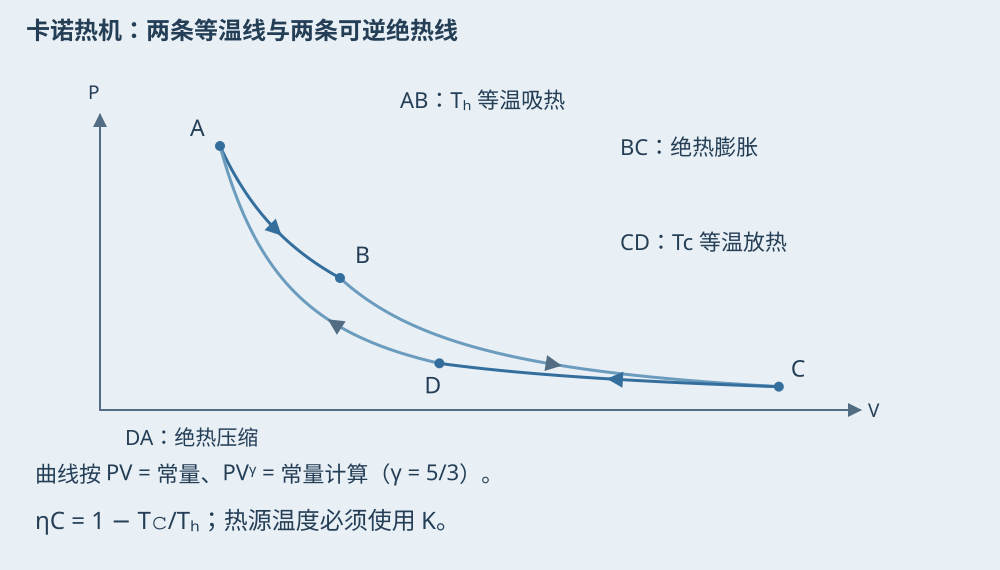

对可逆卡诺热机

$$\frac{Q_{\mathrm{out}}}{Q_{\mathrm{in}}}=\frac{T_c}{T_h},\qquad\boxed{\eta_C=1-\frac{T_c}{T_h}}.$$

在同一对恒温热源之间工作的任意热机，$\eta\le\eta_C$；不可逆过程的效率低于上限。温度必须用 K，不能用摄氏温度直接相除。给定总吸热量时，理论最大功为 $W_{\max}=Q_{\mathrm{in}}\eta_C$。

#### 例题

**题1.** 热机在 $600\,\mathrm K$ 与 $300\,\mathrm K$ 两热源间工作，每循环吸热 $33400\,\mathrm J$、放热 $20900\,\mathrm J$。求实际效率、净功及相同吸热量下的理论最大功。

**解：**

$$W=33400-20900=12500\,\mathrm J,$$

$$\eta=1-\frac{20900}{33400}\approx37.4\%,\qquad\eta_C=1-\frac{300}{600}=50\%,$$

$$W_{\max}=33400\times50\%=16700\,\mathrm J.$$

实际净功小于可逆上限，符合卡诺定理。

**题2.** 在 $727^\circ\mathrm C$ 与 $527^\circ\mathrm C$ 的两恒温热源间工作，每循环吸热 $2000\,\mathrm J$，求理论最大效率和最大净功。

**解：** 按讲义换算 $T_h\approx1000\,\mathrm K,T_c\approx800\,\mathrm K$，

$$\eta_{\max}=1-\frac{800}{1000}=20\%,\qquad W_{\max}=2000\times20\%=400\,\mathrm J.$$

讲义原题使用“以最大功率运转”的措辞；仅凭最大功率不能推出卡诺效率，还需要传热、循环时间等模型。这里明确求**可逆效率上限和每循环最大功**，不把“最大功率”等同于“最大效率”。

### 4. 三角形循环综合题

**题1.** 单原子理想气体按 $A\to B\to C\to A$ 循环，其中 $A:(V_A=10^{-3}\,\mathrm{m^3},P_A=10^5\,\mathrm{Pa})$，$B:(V_B=2\times10^{-3}\,\mathrm{m^3},P_B=3\times10^5\,\mathrm{Pa})$，$C:(V_C=2\times10^{-3}\,\mathrm{m^3},P_C=10^5\,\mathrm{Pa})$。$AB$ 为直线，$BC$ 定容，$CA$ 定压。求净功和效率。

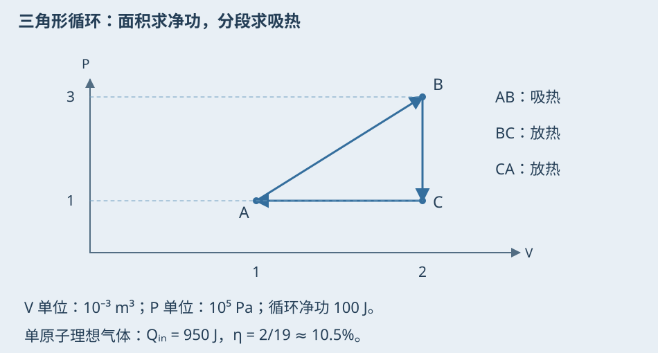

**解：** 三点的 $PV$ 分别为 $100,600,200\,\mathrm J$，单原子 $\Delta U=3\Delta(PV)/2$。

| 过程 | $W/\mathrm J$ | $\Delta U/\mathrm J$ | $Q/\mathrm J$ |
| --- | --- | --- | --- |
| $A\to B$ | $\tfrac12(10^5+3\times10^5)10^{-3}=200$ | $\tfrac32(600-100)=750$ | 950 |
| $B\to C$ | 0 | $\tfrac32(200-600)=-600$ | $-600$ |
| $C\to A$ | $10^5(1-2)10^{-3}=-100$ | $\tfrac32(100-200)=-150$ | $-250$ |

所以

$$W_{\mathrm{净}}=100\,\mathrm J=\frac12(3-1)10^5(2-1)10^{-3},$$

$$Q_{\mathrm{in}}=950\,\mathrm J,\qquad Q_{\mathrm{out}}=850\,\mathrm J,\qquad\eta=\frac{100}{950}=\frac2{19}\approx10.5\%.$$

分段第一定律与三角形面积的结果一致。

### 5. 反向循环与常见判断

1. 反向卡诺循环需要输入功，不能直接把它当作正向热机报告“热效率”。制冷机用制冷系数 $\varepsilon=Q_c/W_{\mathrm{输入}}$，可逆时 $\varepsilon_C=T_c/(T_h-T_c)$。例如 $T_h=400\,\mathrm K,T_c=300\,\mathrm K$，正向热机效率为 25%，反向制冷系数为 3，是不同指标。
2. 循环面积更大意味着净功绝对值更大，不必然意味着效率更高；还要比较 $Q_{\mathrm{in}}$。
3. 同一对热源间的可逆卡诺热机效率相同，与工质种类、循环面积和吸热量大小无关。
4. 所有循环都有 $\Delta U=0$，但一般既有吸热又有放热；不能把每一段的内能变化也写成零。
5. 卡诺公式的“只与两热源温度有关”有两恒温热源、可逆热机的条件；一般循环应先分段算热量。

本课材料：[气体与热力学讲义](截图/配套讲义/气体与热力学【蜂考突击课】.pdf)，PDF 第 20—23 页；[公式手册](截图/配套讲义/蜂考《大学物理》公式手册.pdf) 中热学部分用于核对。
