# 第五章 树与二叉树

| 考点 | 重要程度 | 占分 | 常见题型 |
| --- | --- | --- | --- |
| 树的定义与基本术语 | ★★ | 2 分 | 选择 |
| 树的性质（结点数、度、高度） | ★★★ | 2~4 分 | 选择、计算 |
| 二叉树的定义与性质 | ★★★ | 2~4 分 | 选择、计算 |
| 二叉树的存储结构 | ★★★ | 2~4 分 | 选择、代码 |
| **二叉树的遍历（先/中/后/层序）** | ★★★★★ | 4~8 分 | 选择、综合、代码 |
| **由遍历序列构造二叉树** | ★★★★ | 2~4 分 | 选择、综合 |
| 线索二叉树（概念 / 线索化 / 找前驱后继） | ★★★★ | 4~6 分 | 选择、综合、代码 |
| 树的存储结构（双亲 / 孩子 / 孩子兄弟） | ★★★ | 2~4 分 | 选择 |
| 树、森林与二叉树的转换 | ★★★ | 2~4 分 | 选择 |
| 树和森林的遍历 | ★★★ | 2~4 分 | 选择 |
| **哈夫曼树与哈夫曼编码** | ★★★★ | 4~6 分 | 选择、计算 |
| 并查集（含优化） | ★★★ | 2~4 分 | 选择、代码 |

---

## 5.1.1 树的基本概念

### 1. 树的定义

**树**是 $n$（$n\ge 0$）个**结点**的**有限集合**：

- $n=0$ 时，称为**空树**（一种特殊情况）；
- 在任意一棵**非空树**中应满足：

  1. **有且仅有一个**特定的称为**根**的结点；
  2. 当 $n>1$ 时，其余结点可分为 $m$（$m>0$）个**互不相交**的有限集合 $T_1,T_2,\dots,T_m$，其中每个集合**本身又是一棵树**，并且称为根结点的**子树**。

> **树是一种递归定义的数据结构。**

**非空树的特性**：

| 特性 | 说明 |
| --- | --- |
| 根结点 | **有且仅有一个**根结点 |
| **叶子结点**（终端结点） | **没有后继**的结点 |
| **分支结点**（非终端结点） | **有后继**的结点 |
| 前驱唯一 | 除了根结点外，任何一个结点都有**且仅有**一个前驱 |
| 后继个数 | 每个结点可以有 **0 个或多个**后继 |

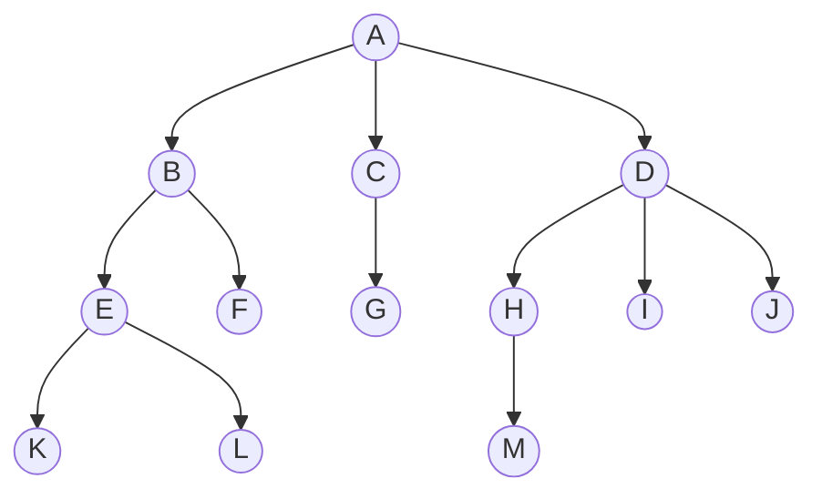

**树形逻辑结构的应用**：**行政区域划分**（中国 → 省 → 市）、**文件系统**（盘 → 文件夹 → 文件）。

### 2. 基本术语

**① 结点之间的关系描述**（用家族关系类比很好记）：

| 术语 | 含义 |
| --- | --- |
| **祖先结点** | 从根到该结点所经分支上的所有结点 |
| **子孙结点** | 以某结点为根的子树中的任一结点 |
| **双亲结点（父结点）** | 直接前驱 |
| **孩子结点** | 直接后继 |
| **兄弟结点** | 有同一个双亲的结点 |
| **堂兄弟结点** | 双亲在**同一层**的结点 |
| **路径** | 本章树的有向路径沿父到子向下；若把树视为无向图，路径也可经过双亲向上 |
| **路径长度** | 路径上**经过多少条边** |

**② 结点、树的属性描述**：

| 属性 | 定义 |
| --- | --- |
| **结点的层次（深度）** | **从上往下**数，**默认从 1 开始** |
| **结点的高度** | **从下往上**数 |
| **树的高度（深度）** | **总共多少层** |
| **结点的度** | 该结点**有几个孩子（分支）** |
| **树的度** | **各结点的度的最大值** |

> **非叶子结点的度 > 0**；**叶子结点的度 = 0**。

**③ 有序树 V.S 无序树**：

| 类型 | 含义 |
| --- | --- |
| **有序树** | 逻辑上看，树中结点的各子树**从左至右是有次序的**，**不能互换** |
| **无序树** | 逻辑上看，树中结点的各子树**从左至右是无次序的**，**可以互换** |

> 具体看你用树存什么，是否需要**用结点的左右位置反映某些逻辑关系**。

**④ 森林**：$m$（$m\ge0$）棵**互不相交**的树的集合（$m$ 可为 0，即**空森林**）。

> **考点**：森林与树的**相互转化**问题。

**本节考点**：树的定义（**递归定义**）与非空树的 5 条特性 → 结点间关系（父/子/兄弟/堂兄弟/路径/路径长度）→ 结点与树的属性（**层次从上往下、高度从下往上**；**结点的度 vs 树的度**）→ 有序树 vs 无序树 → 森林。

## 5.1.3 树的常考性质

### 考点 1：结点数 = 总度数 + 1

$$\boxed{\text{结点数} = \text{总度数} + 1}$$

> 理解：每个结点（除根外）都恰好是某条边（分支）的"孩子"，所以**结点数 = 边数 + 1**，而**边数 = 总度数**。

### 考点 2：度为 m 的树 V.S m 叉树

| | **度为 m 的树** | **m 叉树** |
| --- | --- | --- |
| 任意结点的度 | $\le m$（最多 $m$ 个孩子） | $\le m$（最多 $m$ 个孩子） |
| 是否有结点度 = m | **至少有一个结点度 $=m$** | 允许**所有**结点的度都 $<m$ |
| 是否可空 | **一定是非空树**，**至少有 $m+1$ 个结点** | **可以是空树** |

> **易错点**：这两个概念容易混 —— 度为 $m$ 的树**必须**存在度为 $m$ 的结点，所以**至少 $m+1$ 个结点**（1 个根 + $m$ 个孩子）；而 $m$ 叉树**可以是空树**。

### 考点 3：第 i 层最多有多少个结点

$$\boxed{\text{度为 }m\text{ 的树 / }m\text{ 叉树第 }i\text{ 层至多有 } m^{\,i-1}\text{ 个结点}\quad (i\ge1)}$$

| 层数 | 最多结点数 |
| --- | --- |
| 第 1 层 | $m^0$ |
| 第 2 层 | $m^1$ |
| 第 3 层 | $m^2$ |
| 第 4 层 | $m^3$ |

### 考点 4：高度为 h 的 m 叉树至多有多少个结点

$$\boxed{\text{至多 }\frac{m^h-1}{m-1}\text{ 个结点}}$$

> **推导**：由等比数列求和公式 $a+aq+aq^2+\dots+aq^{n-1}=\dfrac{a(1-q^n)}{1-q}$，
> 各层最多结点数相加：$m^0+m^1+\dots+m^{h-1}=\dfrac{m^h-1}{m-1}$。

### 考点 5：最少有多少个结点

$$\boxed{\text{高度为 }h\text{ 的 }m\text{ 叉树至少有 }h\text{ 个结点}}$$

$$\boxed{\text{高度为 }h\text{、度为 }m\text{ 的树至少有 }h+m-1\text{ 个结点}}$$

> **理解**：$m$ 叉树最少时就是**一条链**（每层 1 个），共 $h$ 个；
> 度为 $m$ 的树还必须**至少有一个度为 $m$ 的结点**，所以要在链的基础上再挂 $m-1$ 个孩子，共 $h+m-1$ 个。

### 考点 6：具有 n 个结点的 m 叉树的最小高度

$$\boxed{h_{\min}=\left\lceil\log_m\big(n(m-1)+1\big)\right\rceil}$$

**推导**（高度最小 ⇒ 尽量填满较高层，叶结点仍无孩子）：

$$\underbrace{\frac{m^{h-1}-1}{m-1}}_{\text{前 }h-1\text{ 层最多}}<n\le\underbrace{\frac{m^h-1}{m-1}}_{\text{前 }h\text{ 层最多}}$$

$$m^{h-1}<n(m-1)+1\le m^h$$

$$h-1<\log_m\big(n(m-1)+1\big)\le h$$

$$\Rightarrow\ h_{\min}=\left\lceil\log_m\big(n(m-1)+1\big)\right\rceil$$

**本节考点**：6 个常考性质 —— ① **结点数 = 总度数 + 1**；② 度为 $m$ 的树 vs $m$ 叉树；③ 第 $i$ 层至多 $m^{i-1}$ 个；④ 高度 $h$ 至多 $\frac{m^h-1}{m-1}$ 个；⑤ 最少结点数（$h$ / $h+m-1$）；⑥ 最小高度 $\lceil\log_m(n(m-1)+1)\rceil$。

## 5.2.1 二叉树的定义和基本术语

### 1. 二叉树的定义

**二叉树**是 $n$（$n\ge0$）个结点的**有限集合**：

1. 或者为**空二叉树**，即 $n=0$；
2. 或者由一个**根结点**和两个**互不相交**的、被称为根的**左子树**和**右子树**组成；左子树和右子树**又分别是一棵二叉树**。

**特点**：

1. 每个结点**至多只有两棵子树**（不存在度 $>2$ 的结点）；
2. 左右子树**不能颠倒** —— **二叉树是有序树**。

> **注意区别**：**二叉树 $\ne$ 度为 2 的有序树**。
> 度为 2 的有序树只要求最大结点度为 2，结点也可有 0、1、2 个孩子。区别在于：二叉树的单个孩子仍须区分左、右位置，而一般有序树只有一个孩子时无此空位置区分；二叉树还允许空树。

**二叉树的五种状态**：空二叉树、只有根结点、只有左子树、只有右子树、左右子树都有。

### 2. 几个特殊的二叉树

**① 满二叉树**

一棵高度为 $h$，且含有 $2^h-1$ 个结点的二叉树。

| 特点 | 说明 |
| --- | --- |
| 叶子结点 | **只有最后一层**有叶子结点 |
| 度为 1 的结点 | **不存在** |
| 层序编号 | 按层序从 1 开始编号：结点 $i$ 的**左孩子为 $2i$**、**右孩子为 $2i+1$**；结点 $i$ 的**父结点为 $\lfloor i/2\rfloor$**（如果有的话） |

**② 完全二叉树**

当且仅当其每个结点都与**高度为 $h$ 的满二叉树**中编号为 $1\sim n$ 的结点**一一对应**时，称为完全二叉树。

| 特点 | 说明 |
| --- | --- |
| 叶子结点 | 只有**最后两层**可能有叶子结点 |
| 度为 1 的结点 | **最多只有一个** |
| 层序编号 | 同满二叉树③的编号规律 |
| 分支 / 叶子 | $i\le\lfloor n/2\rfloor$ 为**分支结点**，$i>\lfloor n/2\rfloor$ 为**叶子结点** |

> **易错点**：完全二叉树中若某结点**只有一个孩子**，那么**一定是左孩子**。

**③ 二叉排序树（BST）**

一棵二叉树或者是空二叉树，或者是具有如下性质的二叉树：

- **左子树上所有结点的关键字均小于根结点的关键字**；
- **右子树上所有结点的关键字均大于根结点的关键字**；
- 左子树和右子树**又各是一棵二叉排序树**。

> **用途**：元素的**排序、搜索**。

**④ 平衡二叉树（AVL）**

AVL 是**二叉排序树**，且任一结点左右子树的高度差不超过 1；本章空子树高度记 0，叶结点高度记 1。

> **用途**：能有**更高的搜索效率**（"胖胖的、丰满的树"）。

**本节考点**：二叉树的定义（**递归定义**、至多两棵子树、**有序**）与"二叉树 vs 度为 2 的有序树"的区别 → 五种状态 → 四类特殊二叉树（满二叉树 / 完全二叉树 / 二叉排序树 / 平衡二叉树）的定义与特点。

## 5.2.2 二叉树的性质

### 1. 二叉树的常考性质

**考点 1：$n_0 = n_2 + 1$**

设非空二叉树中度为 0、1 和 2 的结点个数分别为 $n_0$、$n_1$ 和 $n_2$，则

$$\boxed{n_0=n_2+1}$$

（**叶子结点比二分支结点多一个**）

**推导**：设结点总数为 $n$：

1. 按结点类型数：$n=n_0+n_1+n_2$
2. 按"**结点数 = 总度数 + 1**"：$n=n_1+2n_2+1$

② − ① 得 $n_0=n_2+1$。

**考点 2：第 $i$ 层至多有多少个结点**

$$\boxed{\text{二叉树第 }i\text{ 层至多有 } 2^{\,i-1}\text{ 个结点}\quad(i\ge1)}$$

**考点 3：高度为 $h$ 的二叉树至多有多少个结点**

$$\boxed{\text{至多 }2^h-1\text{ 个结点}\quad(\text{即满二叉树})}$$

### 2. 完全二叉树的常考性质

**考点 1：具有 $n$（$n>0$）个结点的完全二叉树的高度 $h$**

$$\boxed{h=\left\lceil\log_2(n+1)\right\rceil\quad\text{或}\quad h=\left\lfloor\log_2 n\right\rfloor+1}$$

**推导一**（用满二叉树的结点数夹逼）：

$$\underbrace{2^{h-1}-1}_{\text{高 }h-1\text{ 的满二叉树}}<n\le\underbrace{2^h-1}_{\text{高 }h\text{ 的满二叉树}}\ \Rightarrow\ 2^{h-1}<n+1\le2^h\ \Rightarrow\ h-1<\log_2(n+1)\le h$$

$$\Rightarrow\ h=\left\lceil\log_2(n+1)\right\rceil$$

**推导二**（用完全二叉树本身的结点数范围）：

$$2^{h-1}\le n<2^h\ \Rightarrow\ h-1\le\log_2 n<h\ \Rightarrow\ h=\left\lfloor\log_2 n\right\rfloor+1$$

> **附带结论**：第 $i$ 个结点所在的层次为 $\left\lceil\log_2(i+1)\right\rceil$ 或 $\left\lfloor\log_2 i\right\rfloor+1$。

**考点 2：由结点数 $n$ 推出 $n_0$、$n_1$、$n_2$**

**突破口**：**完全二叉树最多只会有一个度为 1 的结点**，即 $n_1=0$ 或 $1$。

由 $n_0=n_2+1$ 可知 $n_0+n_2$ 一定是**奇数**，于是：

| 完全二叉树结点数 $n$ | $n_1$ | $n_0$ | $n_2$ |
| --- | --- | --- | --- |
| $2k$（**偶数**） | **1** | **k** | **k − 1** |
| $2k-1$（**奇数**） | **0** | **k** | **k − 1** |

**本节考点**：二叉树三条（$n_0=n_2+1$、第 $i$ 层至多 $2^{i-1}$、高 $h$ 至多 $2^h-1$）+ 完全二叉树两条（**高度公式**、**由 $n$ 反推 $n_0/n_1/n_2$**）。

## 5.2.3 二叉树的存储结构

### 1. 顺序存储

```c
#define MaxSize 100
struct TreeNode {
    ElemType value;         // 结点中的数据元素
    bool isEmpty;           // 结点是否为空
};
TreeNode t[MaxSize];
```

定义一个长度为 `MaxSize` 的数组 `t`，按照**从上至下、从左至右**的顺序依次存储**完全二叉树**中的各个结点。

```c
// 初始化时所有结点标记为空
for (int i = 0; i < MaxSize; i++) {
    t[i].isEmpty = true;
}
```

> `t[0]` 可以让**第一个位置空缺**，保证**数组下标和结点编号一致**。

**几个重要常考的基本操作**（完全二叉树）：

| 操作 | 公式 |
| --- | --- |
| $i$ 的**左孩子** | $2i$ |
| $i$ 的**右孩子** | $2i+1$ |
| $i$ 的**父结点** | $\lfloor i/2\rfloor$ |
| $i$ 所在的**层次** | $\lceil\log_2(i+1)\rceil$ 或 $\lfloor\log_2 i\rfloor+1$ |

**若完全二叉树中共有 $n$ 个结点**：

| 判断 | 条件 |
| --- | --- |
| $i$ 是否有**左孩子** | $2i\le n$ ? |
| $i$ 是否有**右孩子** | $2i+1\le n$ ? |
| $i$ 是**叶子还是分支**结点 | $i>\lfloor n/2\rfloor$ ?（$i>\lfloor n/2\rfloor$ 为叶子） |

> **思考**：如果结点从 0 开始编号，该怎么算？（各公式都要相应调整）

**顺序存储的缺陷与结论**：

- 二叉树顺序存储中，**一定要把二叉树的结点编号与完全二叉树对应起来**（否则 $2i$、$2i+1$、$\lfloor i/2\rfloor$ 的规律失效）；
- **最坏情况**：高度为 $h$ 且只有 $h$ 个结点的**单支树**（所有结点只有右孩子），也至少需要 $2^h-1$ 个存储单元；
- **结论**：二叉树的**顺序存储结构只适合存储完全二叉树**。

### 2. 链式存储

```c
// 二叉树的结点（链式存储）
typedef struct BiTNode{
    ElemType data;                      // 数据域
    struct BiTNode *lchild, *rchild;    // 左、右孩子指针
} BiTNode, *BiTree;
```

```c
// 定义一棵空树
BiTree root = NULL;

// 插入根结点
root = (BiTree) malloc(sizeof(BiTNode));
root->data = {1};
root->lchild = NULL;
root->rchild = NULL;

// 插入新结点
BiTNode *p = (BiTNode *) malloc(sizeof(BiTNode));
p->data = {2};
p->lchild = NULL;
p->rchild = NULL;
root->lchild = p;                       // 作为根结点的左孩子
```

> ⭐ **重要结论**：$n\ge1$ 个结点的**二叉链表共有 $n+1$ 个空链域**（可用于构造**线索二叉树**）。

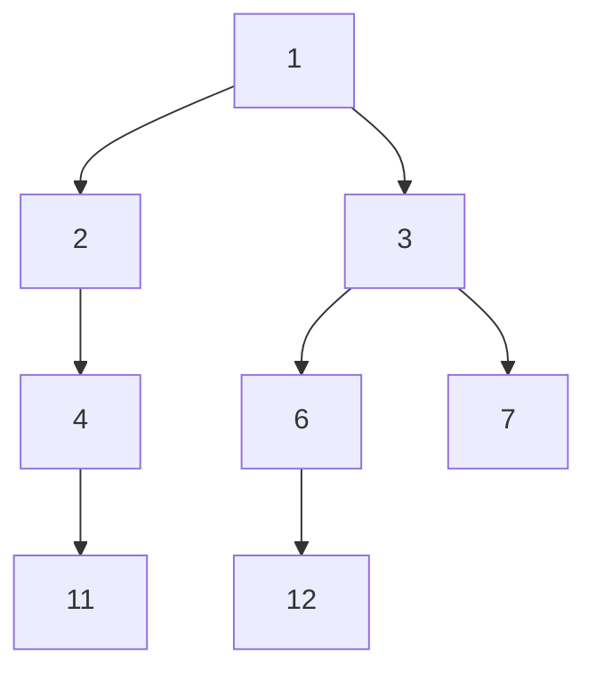

**链式存储的优缺点**：

| 操作 | 说明 |
| --- | --- |
| 找指定结点 $p$ 的**左/右孩子** | **超简单**（直接 `p->lchild` / `p->rchild`） |
| 找指定结点 $p$ 的**父结点** | **只能从根开始遍历寻找** |

> **Tips**：根据实际需求决定要不要加**父结点指针** —— 加上就变成**三叉链表**，方便找父结点。

```c
// 三叉链表
typedef struct BiTNode{
    ElemType data;
    struct BiTNode *lchild, *rchild;    // 左、右孩子指针
    struct BiTNode *parent;             // 父结点指针
} BiTNode, *BiTree;
```

**本节考点**：顺序存储（**结点编号要与完全二叉树对应**、$2i$/$2i+1$/$\lfloor i/2\rfloor$、判孩子与判叶子的条件、适合完全二叉树等位置较稠密的二叉树；一般二叉树也能存，但可能浪费大量空位置）→ 链式存储（`BiTNode` 定义、**$n$ 个结点有 $n+1$ 个空链域**、找父结点需遍历、三叉链表）。

## 5.3.1 二叉树的先中后序遍历

### 1. 什么是遍历

**遍历**：按照某种次序把**所有结点都访问一遍**。

| 遍历方式 | 依据的规则 |
| --- | --- |
| **层次遍历** | 基于树的**层次**特性确定的次序规则 |
| **先/中/后序遍历** | 基于树的**递归**特性确定的次序规则 |

**二叉树的递归特性**：① 要么是**空二叉树**；② 要么由"**根结点 + 左子树 + 右子树**"组成。

### 2. 三种遍历的定义

| 遍历 | 次序 | 英文 |
| --- | --- | --- |
| **先序遍历** | **根 左 右** | **NLR** |
| **中序遍历** | **左 根 右** | **LNR** |
| **后序遍历** | **左 右 根** | **LRN** |

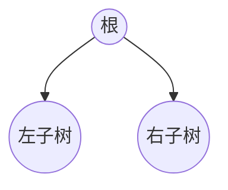

**例**：以 $A(B(D,E),C(F,G))$ 为例

| 遍历 | 序列 |
| --- | --- |
| 先序 | A B D E C F G |
| 中序 | D B E A F C G |
| 后序 | D E B F G C A |

### 3. 三种遍历的代码

**先序遍历**：

```c
void PreOrder(BiTree T){
    if(T != NULL){
        visit(T);               // 访问根结点
        PreOrder(T->lchild);    // 递归遍历左子树
        PreOrder(T->rchild);    // 递归遍历右子树
    }
}
```

**中序遍历**：

```c
void InOrder(BiTree T){
    if(T != NULL){
        InOrder(T->lchild);     // 递归遍历左子树
        visit(T);               // 访问根结点
        InOrder(T->rchild);     // 递归遍历右子树
    }
}
```

**后序遍历**：

```c
void PostOrder(BiTree T){
    if(T != NULL){
        PostOrder(T->lchild);   // 递归遍历左子树
        PostOrder(T->rchild);   // 递归遍历右子树
        visit(T);               // 访问根结点
    }
}
```

> **空间复杂度**：三种遍历都需要**递归工作栈**，空间复杂度为 **$O(h)$**（$h$ 为树的高度）。

### 4. 求遍历序列的技巧（重点）

**技巧一：分支结点逐层展开法** —— 把分支结点逐层展开成"根左右"等形式再读。

**技巧二："全世界路"法**（更直观）：

> **脑补空结点**，从根结点出发，画一条路：
> - 如果**左边还有没走的路**，优先往**左边**走；
> - 走到路的**尽头（空结点）**就**往回走**；
> - 如果**左边没路了**，就往**右边**走；
> - 如果**左、右都没路了**，则往**上面**走。

**关键结论**：**每个结点都会被"路过" 3 次**！

| 遍历 | 访问时机 |
| --- | --- |
| **先序遍历** | **第一次**路过时访问结点 |
| **中序遍历** | **第二次**路过时访问结点 |
| **后序遍历** | **第三次**路过时访问结点 |

### 5. 应用举例

**算数表达式的"分析树"**（如 $a+b*(c-d)-e/f$）：

| 遍历 | 对应表达式 |
| --- | --- |
| **先序遍历** | **前缀**表达式（`-+a*b-cd/ef`） |
| **中序遍历** | **中缀**表达式（`a+b*(c-d)-e/f`，**输出中缀时需保留必要括号**） |
| **后序遍历** | **后缀**表达式（`abcd-*+ef/-`） |

**求树的深度**：

```c
int treeDepth(BiTree T){
    if (T == NULL) {
        return 0;
    } else {
        int l = treeDepth(T->lchild);
        int r = treeDepth(T->rchild);
        // 树的深度 = Max(左子树深度, 右子树深度) + 1
        return l > r ? l + 1 : r + 1;
    }
}
```

**本节考点**：三种遍历的次序（**NLR / LNR / LRN**）与代码（**只是 `visit(T)` 的位置不同**）→ 求遍历序列的两种技巧（逐层展开 / **路过三次**：先序第一次、中序第二次、后序第三次）→ 遍历算数表达式树 → 求树的深度 → 空间复杂度 $O(h)$。

## 5.3.2 二叉树的层次遍历

### 1. 算法思想

1. 初始化一个**辅助队列**；
2. **根结点入队**；
3. 若**队列非空**，则**队头结点出队**，访问该结点，并将其**左、右孩子插入队尾**（如果有的话）；
4. **重复 ③ 直至队列为空**。

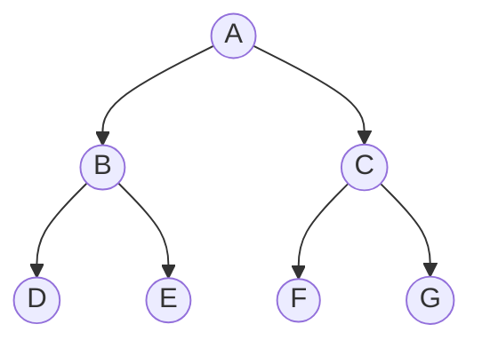

> 上图的层序序列：**A B C D E F G**

### 2. 代码实现

```c
// 层序遍历
void LevelOrder(BiTree T){
    if(T == NULL) return;              // 空树不能将空指针入队后解引用
    LinkQueue Q;
    InitQueue(Q);                       // 初始化辅助队列
    BiTree p;
    EnQueue(Q, T);                      // 将根结点入队
    while(!IsEmpty(Q)){                 // 队列不空则循环
        DeQueue(Q, p);                  // 队头结点出队
        visit(p);                       // 访问出队结点
        if(p->lchild != NULL)
            EnQueue(Q, p->lchild);      // 左孩子入队
        if(p->rchild != NULL)
            EnQueue(Q, p->rchild);      // 右孩子入队
    }
}
```

**用到的辅助结构**：

```c
// 二叉树的结点（链式存储）
typedef struct BiTNode{
    char data;
    struct BiTNode *lchild, *rchild;
} BiTNode, *BiTree;

// 链式队列结点
typedef struct LinkNode{
    BiTNode *data;                      // 存指针而不是结点！
    struct LinkNode *next;
} LinkNode;

typedef struct{
    LinkNode *front, *rear;             // 队头队尾
} LinkQueue;
```

> **要点**：链式队列的结点中存的是 **`BiTNode *`（指针）**，而不是整个结点 —— **存指针而不是结点**。

**本节考点**：层序遍历的算法思想（**队列**：根入队 → 出队访问 → 左右孩子入队）→ 代码实现 → 队列元素类型是**结点指针**。

## 5.3.3 由遍历序列构造二叉树

### 1. 重要结论

**结论 1**：**一般情况下，只给一种遍历序列不足以唯一确定二叉树。** 单结点、带空子树标记等特殊约束另论。

> 例如：中序序列 `BDCAE` 可以对应多种不同的二叉树形态。

**结论 2**：**一般情况下，缺少中序的上述两两组合不能保证唯一确定二叉树**；若附加“每个内部结点恰有两个孩子”等条件，前序+后序也可能唯一。

**各结点标识互异、序列合法且相容时，能唯一确定二叉树的三种常用组合**：

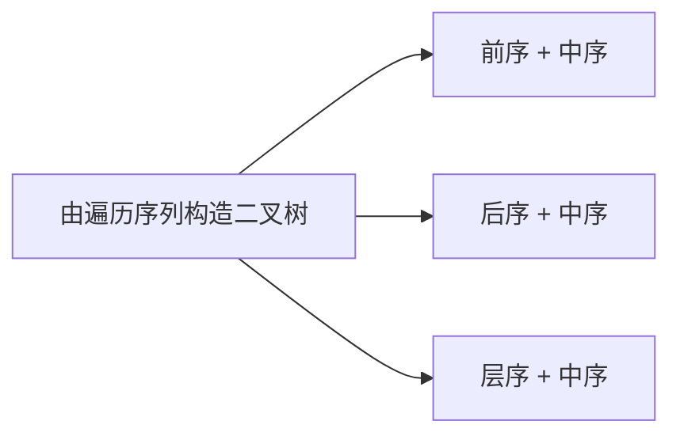

### 2. 前序 + 中序遍历序列

**方法**：

1. **前序序列的第一个**就是**根结点**；
2. 在中序序列中找到该根结点，其**左边**是**左子树的中序序列**，**右边**是**右子树的中序序列**；
3. 由左子树中序序列的**长度**，可推出**左子树的前序序列**（前序中紧随根结点之后的若干元素），剩下的是**右子树的前序序列**；
4. 对左右子树**递归**重复上述过程。

**例 1**：前序 `A D B C E`，中序 `B D C A E`

| 步骤 | 说明 |
| --- | --- |
| 根结点 | 前序第一个 = **A** |
| 划分中序 | `BDC` \| **A** \| `E` → 左子树中序 `BDC`，右子树中序 `E` |
| 划分前序 | **A** \| `DBC` \| `E` → 左子树前序 `DBC`，右子树前序 `E` |
| 递归 | 左子树：前序 `DBC` + 中序 `BDC` → 根 D，左 B 右 C |

**结果**：$A\big(D(B,C),\ E\big)$

**例 2**：前序 `D A E F B C H G I`，中序 `E A F D H C B G I`
→ 结果：$D\big(A(E,F),\ B(C(H,-),\ G(-,I))\big)$

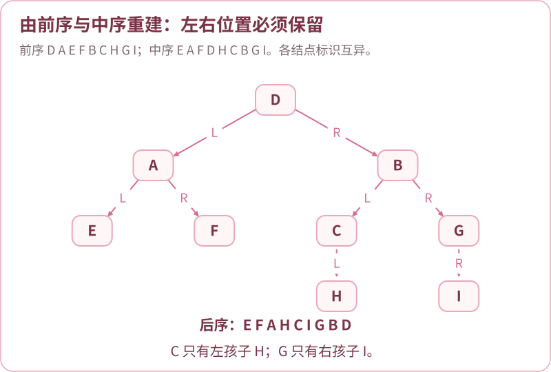

> **注意验证**：构造完后一定要用两个序列回代验证一遍。

### 3. 后序 + 中序遍历序列

**方法**：与"前序 + 中序"完全对称 ——

1. **后序序列的最后一个**就是**根结点**；
2. 在中序序列中找到该根结点，划分左右子树的中序序列；
3. 由左子树中序序列的**长度**推出左子树的后序序列（后序中**前若干元素**），剩下的是右子树的后序序列；
4. **递归**处理。

**例 3**：后序 `E F A H C I G B D`，中序 `E A F D H C B G I`

- 根结点 = 后序最后一个 = **D**；
- 中序划分：`EAF` \| **D** \| `HCBGI`；
- 后序划分：`EFA` \| `HCIGB` \| **D**。

### 4. 层序 + 中序遍历序列

**方法**：

1. **层序序列的第一个**就是**根结点**；
2. 在中序序列中划分出左右子树的中序序列；
3. 在层序序列中，**按顺序**找属于左子树的结点 —— **第一个**就是**左子树的根**；同理找出**右子树的根**；
4. **递归**处理。

**例 5**：层序 `A B C D E`，中序 `A C B E D`

- 根 = 层序第一个 = **A**；中序中 A 在**最左** → **左子树为空**，右子树中序 = `CBED`；
- 层序中剩下 `BCDE`，其中 **B** 是右子树的根（最先出现）；
- 中序 `C B E D` 中 B 左边是 `C`（左子树），右边是 `ED`（右子树）；
- 继续：层序中 **C** 先于 D 出现 → C 是 B 左子树的根；右子树 `ED` 中，层序 **D** 先出现 → D 为根，中序 `E D` 中 E 在左 → E 是 D 的左孩子。

**结果**：$A\big(-,\ B(C,\ D(E,-))\big)$

**本节考点**：**只给一种序列不能唯一确定**、一般情形用中序配合另一种序列保证唯一（需结点标识互异） → 三种构造方法（前序/后序/层序 + 中序）→ 关键是**用中序序列划分左右子树**、**用长度对应推出另一种序列的划分** → 构造完要**回代验证**。

## 5.3.4 线索二叉树的概念

### 1. 为什么要线索化？

**问题**：如何找到指定结点 $p$ 在**中序遍历序列中的前驱 / 后继**？

**朴素思路**：从根结点出发，重新进行一次中序遍历，用指针 `q` 记录当前访问的结点、`pre` 记录上一个被访问的结点：

- 当 `q == p` 时，`pre` 为**前驱**；
- 当 `pre == p` 时，`q` 为**后继**。

> **缺点**：**找前驱、后继很不方便；遍历操作必须从根开始**。

**突破口**：$n$ 个结点的二叉树有 **$n+1$ 个空链域** —— 可用来**记录前驱、后继的信息**！

### 2. 线索二叉树的概念

| 概念 | 含义 |
| --- | --- |
| **线索** | 指向前驱、后继的指针称为"**线索**" |
| **前驱线索** | 由**左孩子指针**充当 |
| **后继线索** | 由**右孩子指针**充当 |

**作用**：方便从**一个指定结点**出发，找到其**前驱、后继**；**方便遍历**。

### 3. 存储结构

```c
// 二叉树结点（链式存储）
typedef struct BiTNode{
    ElemType data;
    struct BiTNode *lchild, *rchild;
} BiTNode, *BiTree;                     // 术语：二叉链表

// 线索二叉树结点
typedef struct ThreadNode{
    ElemType data;
    struct ThreadNode *lchild, *rchild;
    int ltag, rtag;                     // 左、右线索标志
} ThreadNode, *ThreadTree;              // 术语：线索链表
```

**`tag` 标志位的含义**（**重要**）：

| 标志 | 取值 | 含义 |
| --- | --- | --- |
| `ltag` | **1** | `lchild` 指向**前驱** |
| `ltag` | **0** | `lchild` 指向**左孩子** |
| `rtag` | **1** | `rchild` 指向**后继** |
| `rtag` | **0** | `rchild` 指向**右孩子** |

> 记忆：**tag = 1 表示是"线索"**（指向前驱/后继）；**tag = 0 表示指向孩子**。

### 4. 三种线索二叉树

| 类型 | 线索化依据 | 线索指向 |
| --- | --- | --- |
| **中序线索二叉树** | 以**中序遍历序列**为依据 | 中序前驱、中序后继 |
| **先序线索二叉树** | 以**先序遍历序列**为依据 | 先序前驱、先序后继 |
| **后序线索二叉树** | 以**后序遍历序列**为依据 | 后序前驱、后序后继 |

**例**（同一棵树 $A(B(D(-,G),E),C(F,-))$）：

| 类型 | 遍历序列 |
| --- | --- |
| 中序线索二叉树 | D G B E A F C |
| 先序线索二叉树 | A B D G E C F |
| 后序线索二叉树 | G D E B F C A |

### 5. 手算画出线索二叉树（考点）

1. **确定线索二叉树类型** —— 中序、先序、还是后序？
2. **按照对应遍历规则**，确定各个结点的**访问顺序，并写上编号**；
3. 将 **$n+1$ 个空链域**连上**前驱、后继**。

**本节考点**：为什么线索化（$n+1$ 个空链域 + 找前驱后继不便）→ **`ltag`/`rtag` 的含义**（1 为线索、0 为孩子）→ 三种线索二叉树的区别（线索化依据不同）→ 手算画线索二叉树的三个步骤。

---

## 5.3.5 二叉树的线索化

### 1. 线索化的核心：遍历时连接前驱与后继

线索化不改变原来的孩子关系，只把**空孩子指针**改作线索。用 `pre` 记录刚访问过的结点，当前结点为 `p`：

| 条件 | 建立的线索 | 标志位 |
| --- | --- | --- |
| `p->lchild == NULL` | `p->lchild = pre`，指向当前结点的前驱 | `p->ltag = 1` |
| `pre != NULL` 且 `pre->rchild == NULL` | `pre->rchild = p`，指向前驱结点的后继 | `pre->rtag = 1` |
| 两项处理之后 | `pre = p`，使它成为下一次访问的前驱 | 不改孩子关系 |

**前提**：输入是尚未线索化的二叉树，所有 `ltag`、`rtag` 初始化为 `0`。同一棵树不能直接重复线索化，也不能混用不同遍历方式的线索。


### 2. 中序线索化

中序顺序为“左、根、右”。递归访问左子树后，`pre` 恰好是当前结点的中序前驱。

```cpp
// 沿用 ThreadNode / ThreadTree；不设置额外头结点。
// pre 按引用传递：递归返回后，调用者必须得到更新后的前驱。
void LinkThread(ThreadTree p, ThreadTree &pre) {
    if (p->lchild == NULL) {
        p->lchild = pre;
        p->ltag = 1;
    }
    if (pre != NULL && pre->rchild == NULL) {
        pre->rchild = p;
        pre->rtag = 1;
    }
    pre = p;
}

void InThread(ThreadTree p, ThreadTree &pre) {
    if (p == NULL) return;
    InThread(p->lchild, pre);
    LinkThread(p, pre);
    InThread(p->rchild, pre);
}

void CreateInThread(ThreadTree T) {
    ThreadTree pre = NULL;
    if (T == NULL) return;
    InThread(T, pre);
    pre->rchild = NULL;  // 中序最后一个结点一定没有右孩子
    pre->rtag = 1;      // 后继不存在，以空线索表示
}
```

**边界**：第一个被访问结点的前驱为 `NULL`；最后一个结点的后继为 `NULL`。空树不进入递归；单结点树的两个指针都是空线索。

### 3. 先序线索化与递归陷阱

先序顺序为“根、左、右”。访问根时可能刚把空左指针改成指向前驱的线索；如果继续无条件沿 `lchild` 递归，就会沿线索返回前面的结点，甚至无限递归。

```cpp
void PreThread(ThreadTree p, ThreadTree &pre) {
    if (p == NULL) return;
    LinkThread(p, pre);
    if (p->ltag == 0) PreThread(p->lchild, pre);
    if (p->rtag == 0) PreThread(p->rchild, pre);
}

void CreatePreThread(ThreadTree T) {
    ThreadTree pre = NULL;
    if (T == NULL) return;
    PreThread(T, pre);
    if (pre->rchild == NULL) pre->rtag = 1;
}
```

**关键**：递归只沿孩子指针，不沿线索。先序最后一个结点是叶结点，右指针为空，令 `rtag=1` 表示空后继线索。

### 4. 后序线索化

后序顺序为“左、右、根”，先递归处理孩子，再连接当前结点的线索。

```cpp
void PostThread(ThreadTree p, ThreadTree &pre) {
    if (p == NULL) return;
    PostThread(p->lchild, pre);
    PostThread(p->rchild, pre);
    LinkThread(p, pre);
}

void CreatePostThread(ThreadTree T) {
    ThreadTree pre = NULL;
    if (T == NULL) return;
    PostThread(T, pre);
    // 后序最后访问的是根；根可能有真实右孩子，不能覆盖它。
    if (pre->rchild == NULL) pre->rtag = 1;
}
```

三种线索化都访问每个结点一次，时间复杂度为 $O(n)$；递归栈为 $O(h)$，$h$ 为原二叉树高度。`pre` 只是额外的一个指针，不能因此把递归算法的辅助空间记为 $O(1)$。

**本节考点**：遍历顺序决定前驱后继 → `pre` 必须随访问更新 → 先序防止沿线索递归 → 末结点的空后继要处理 → 后序不能破坏根的真实右孩子。

---

## 5.3.6 在线索二叉树中找前驱、后继

### 1. 中序线索树：前驱与后继都容易找

| 所求结点 | 有对应线索 | 对应指针是孩子 |
| --- | --- | --- |
| `p` 的中序后继 | `rtag=1`，直接取 `rchild` | `rtag=0`，取右子树中最左下的结点 |
| `p` 的中序前驱 | `ltag=1`，直接取 `lchild` | `ltag=0`，取左子树中最右下的结点 |

“最左下”指连续沿真实左孩子走到不能再走，**不一定是叶结点**；最右下同理。

```cpp
ThreadNode *FirstNode(ThreadNode *p) {
    if (p == NULL) return NULL;
    while (p->ltag == 0) p = p->lchild;
    return p;
}

ThreadNode *LastNode(ThreadNode *p) {
    if (p == NULL) return NULL;
    while (p->rtag == 0) p = p->rchild;
    return p;
}

ThreadNode *NextNode(ThreadNode *p) {
    if (p == NULL) return NULL;
    return p->rtag == 1 ? p->rchild : FirstNode(p->rchild);
}

ThreadNode *PreNode(ThreadNode *p) {
    if (p == NULL) return NULL;
    return p->ltag == 1 ? p->lchild : LastNode(p->lchild);
}

void InOrderThread(ThreadTree T) {
    for (ThreadNode *p = FirstNode(T); p != NULL; p = NextNode(p))
        visit(p); // visit 只访问数据，不再建立线索
}

void RevInOrderThread(ThreadTree T) {
    for (ThreadNode *p = LastNode(T); p != NULL; p = PreNode(p))
        visit(p);
}
```

一次找前驱或后继最坏为 $O(h)$；**整棵线索树遍历**总时间为 $O(n)$，辅助空间为 $O(1)$，无需栈或递归。

### 2. 先序线索树

**找先序后继**：有左孩子就取左孩子；没有左孩子就取 `rchild`，它可能是真实右孩子，也可能是后继线索。

```cpp
ThreadNode *PreOrderNext(ThreadNode *p) {
    if (p == NULL) return NULL;
    return p->ltag == 0 ? p->lchild : p->rchild;
}
```

**找先序前驱**：`ltag=1` 时直接走线索。`ltag=0` 时，左子树结点都在 `p` 后面，不能靠左孩子得到前驱；一般需要父指针，或从根重新查找。

若已知父结点 `f`：`p` 为左孩子，或 `p` 为右孩子但没有左兄弟，则前驱为 `f`；若 `p` 为右孩子且左兄弟存在，前驱为左兄弟子树中**最后一个先序访问的结点**。根没有先序前驱。

### 3. 后序线索树

**找后序前驱**：有右孩子则前驱为右孩子；没有右孩子但有左孩子则为左孩子；没有孩子则直接沿前驱线索。

```cpp
ThreadNode *PostOrderPre(ThreadNode *p) {
    if (p == NULL) return NULL;
    if (p->rtag == 0) return p->rchild;
    if (p->ltag == 0) return p->lchild;
    return p->lchild; // 叶结点的前驱线索，可能为空
}
```

**找后序后继**：`rtag=1` 时直接走后继线索。`rtag=0` 时，右子树在 `p` 之前被访问，不能把右孩子当后继；一般需要父指针。

若已知父结点 `f`：`p` 为右孩子，或 `p` 为左孩子且没有右兄弟，则后继为 `f`；若 `p` 为左孩子且有右兄弟，后继为右兄弟子树中**第一个后序访问的结点**。根没有后序后继。

| 线索类型 | 无父指针时容易找前驱 | 无父指针时容易找后继 |
| --- | --- | --- |
| 中序 | 是 | 是 |
| 先序 | 不总是 | 是 |
| 后序 | 是 | 不总是 |

**题1.** 对树 `A(B(D(-,G),E),C(F,-))`，写出中序遍历，并求 B 的中序前驱、后继。

**答：** 中序为 `D G B E A F C`；B 的前驱是 G，后继是 E。

**解：** B 的左指针指向真实左子树，要在其中找最右下结点 G；B 的右指针指向真实右子树，要在其中找最左下结点 E。

---

## 5.4.1 树的存储结构

### 1. 双亲表示法

把结点放在数组中，每项保存数据与双亲下标。根的双亲下标约定为 `-1`；一般树不能直接套用二叉树的 `2i`、`2i+1` 下标关系。

```cpp
const int MAX_TREE_SIZE = 100;
struct PTNode {
    char data;
    int parent;
};
struct PTree {
    PTNode nodes[MAX_TREE_SIZE];
    int n;
};
```

**例**：A 的孩子依次为 B、C、D，B 的孩子为 E、F，C 的孩子为 G。

| 下标 | 0 | 1 | 2 | 3 | 4 | 5 | 6 |
| --- | --- | --- | --- | --- | --- | --- | --- |
| data | A | B | C | D | E | F | G |
| parent | -1 | 0 | 0 | 0 | 1 | 1 | 2 |

已知 E 的数组位置为 4，找其双亲只需读 `nodes[4].parent=1`，时间为 $O(1)$；找 E 的所有孩子通常要扫描整个数组，为 $O(n)$。存森林时，把每棵树根的 `parent` 设为 `-1`。

### 2. 孩子表示法

数组存各个结点，每项另带一个孩子链表的头指针，链表保存孩子的数组下标。

```cpp
struct ChildLink {
    int child;
    ChildLink *next;
};
struct CTNode {
    char data;
    ChildLink *firstChild;
};
```

上述例子中，A 的孩子链表为 `1→2→3`，B 为 `4→5`，C 为 `6`。这种结构结合了顺序存储与链式存储，适合经常找孩子的情况；只靠这些信息找双亲需要扫描孩子链表。存森林还需记录各棵树根的位置。

### 3. 孩子兄弟表示法

```cpp
typedef struct CSNode {
    char data;
    CSNode *firstChild;  // 第一个孩子
    CSNode *nextSibling; // 右边相邻的兄弟
} CSNode, *CSTree;
```

**左孩子、右兄弟**：每个结点只需要两个指针，就能表达任意多的孩子。根没有兄弟时 `nextSibling=NULL`；森林可把各棵树的根按顺序串成兄弟链。

| 表示法 | 找双亲 | 枚举孩子 | 特点 |
| --- | --- | --- | --- |
| 双亲表示法 | 已知下标时 $O(1)$ | 通常 $O(n)$ | 适合向上查找 |
| 孩子表示法 | 通常需扫描 | 沿本结点的孩子链表 | 每个结点另带孩子链表 |
| 孩子兄弟表示法 | 无父指针时需查找 | 从首孩子沿兄弟链走 | 与二叉链表形式对应 |

---

## 5.4.2 树、森林与二叉树的转换

### 1. 转换依据

转换改变的是**指针的解释**，结点数不变，原树中的父子边不一定还是二叉树中的父子边。二叉树左链表示第一个孩子，右链表示下一个兄弟。

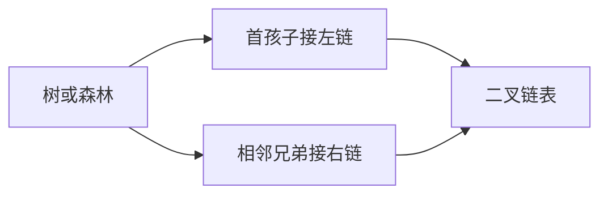

| 转换 | 操作 |
| --- | --- |
| 树转二叉树 | 对每个结点保留到首孩子的左链，把其孩子依次用右链相连 |
| 森林转二叉树 | 各树分别转换，再把各树根依次用右链连接，第一棵树根为二叉树根 |
| 二叉树转树 | 根无右孩子时，把每个结点左孩子及该左孩子的整条右链还原成其孩子 |
| 二叉树转森林 | 根及沿根右链上的结点分别作为各棵树的根，再按左孩子、右兄弟规则还原 |

**判别**：非空有序树转换所得二叉树的根没有右孩子；非空二叉树按上述规则总能还原为森林，森林中树的棵数等于“根及从根沿右链可到达的结点数”。

### 2. 手算例题

树 A 的孩子依次为 B、C、D，B 的孩子为 E、F，C 的孩子为 G。转换后的非空指针如下：

| 结点 | 左指针：首孩子 | 右指针：下一个兄弟 |
| --- | --- | --- |
| A | B | 空 |
| B | E | C |
| C | G | D |
| D | 空 | 空 |
| E | 空 | F |
| F | 空 | 空 |
| G | 空 | 空 |

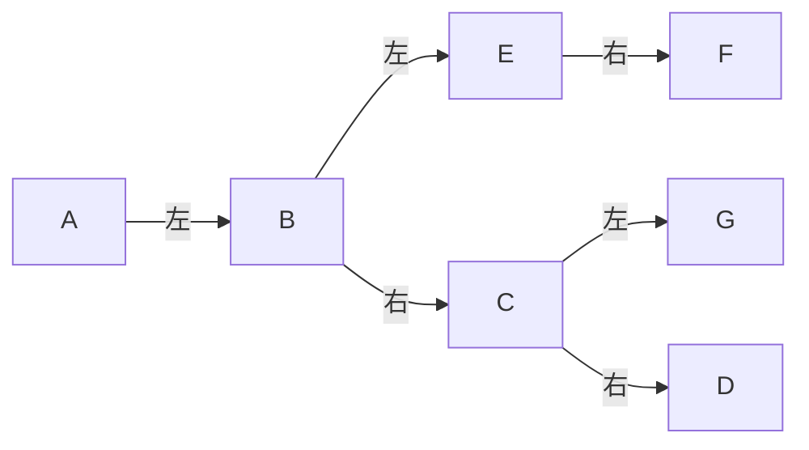

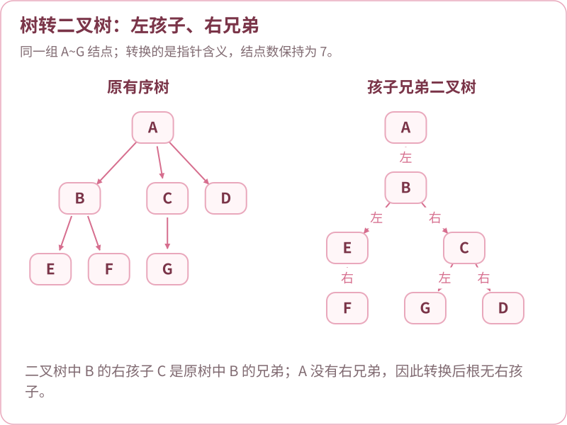

**易错**：二叉树中 B 的右孩子是 C，但在原树中 C 是 B 的兄弟，不是 B 的孩子；原树叶结点可能有右兄弟，因此转换后不一定是二叉树叶结点。

---

## 5.4.3 树和森林的遍历

### 1. 树的遍历

| 方法 | 访问规则 | 对例子 A 的遍历序列 |
| --- | --- | --- |
| 先根遍历 | 先访问根，再按从左到右顺序先根遍历各子树 | A B E F C G D |
| 后根遍历 | 先从左到右后根遍历各子树，再访问根 | E F B G C D A |
| 层次遍历 | 根入队，出队访问，并按从左到右顺序把孩子入队 | A B C D E F G |

一般树没有固定的“左子树、右子树”，所以通常**不定义树的中序遍历**。

```cpp
// 参数表示一棵树的根；兄弟由父结点的循环处理。
void PreRoot(CSTree T) {
    if (T == NULL) return;
    visit(T);
    for (CSTree p = T->firstChild; p != NULL; p = p->nextSibling)
        PreRoot(p);
}

void PostRoot(CSTree T) {
    if (T == NULL) return;
    for (CSTree p = T->firstChild; p != NULL; p = p->nextSibling)
        PostRoot(p);
    visit(T);
}
```

每个结点只访问一次，先根、后根遍历时间为 $O(n)$，递归辅助空间为 $O(h)$；层次遍历用队列，辅助空间最坏为 $O(n)$。

### 2. 森林的遍历

**先序遍历森林**：访问第一棵树的根 → 先序遍历第一棵树的子树森林 → 先序遍历剩余森林。等价于依次对各棵树做先根遍历。

**中序遍历森林**：中序遍历第一棵树的子树森林 → 访问第一棵树的根 → 中序遍历剩余森林。等价于依次对各棵树做后根遍历。

| 树 | 森林 | 对应二叉树 |
| --- | --- | --- |
| 先根遍历 | 先序遍历 | 先序遍历 |
| 后根遍历 | 中序遍历 | **中序遍历** |

**易错**：树的后根遍历对应二叉树的**中序**，不是后序。原因是右链表示兄弟，二叉树中序的“左、根、右”恰好先处理孩子森林，再访问本结点，再处理兄弟。

**题2.** 已知某树先根序列为 `A B E F C G D`，其孩子兄弟二叉树的先序序列是什么？后根序列 `E F B G C D A` 又对应哪种序列？

**答：** 二叉树先序序列仍为 `A B E F C G D`；后根序列对应二叉树的中序序列。

---

## 5.5.1 哈夫曼树与哈夫曼编码

### 1. 带权路径长度 WPL

结点的带权路径长度等于其权值乘以从根到该结点的**边数**。树的带权路径长度只对叶结点求和：

$$
WPL=\sum_{i=1}^{n}w_i l_i
$$

其中 $w_i$ 是第 $i$ 个叶结点的权值，$l_i$ 是该叶结点的深度（根的深度按 0 计）。给定一组叶结点权值，WPL 最小的二叉树称为**哈夫曼树，又称最优二叉树**。

**易错**：树的路径长度、树的带权路径长度不是同一概念；哈夫曼树的 WPL 不把内部结点再加一遍。

### 2. 构造：反复合并当前权值最小的两棵树

先把每个权值作为单结点树；每次取根权最小的两棵树，合并为新树，新根权等于两者之和；把新树放回候选集合，直到只剩一棵树。

**例**：权值为 `1, 2, 2, 3, 7`。

| 次数 | 选取的两个最小权值 | 新根权值 | 合并后候选权值 |
| --- | --- | --- | --- |
| 1 | 1、2 | 3 | 2、3、3、7 |
| 2 | 2、3 | 5 | 3、5、7 |
| 3 | 3、5 | 8 | 7、8 |
| 4 | 7、8 | 15 | 15 |

$$
WPL=3+5+8+15=31
$$

**快捷验算**：WPL 等于构造中所有新内部结点权值的和。一次合并让两个子树中的每个叶结点深度增加 1，增加的 WPL 恰好是新根权值。

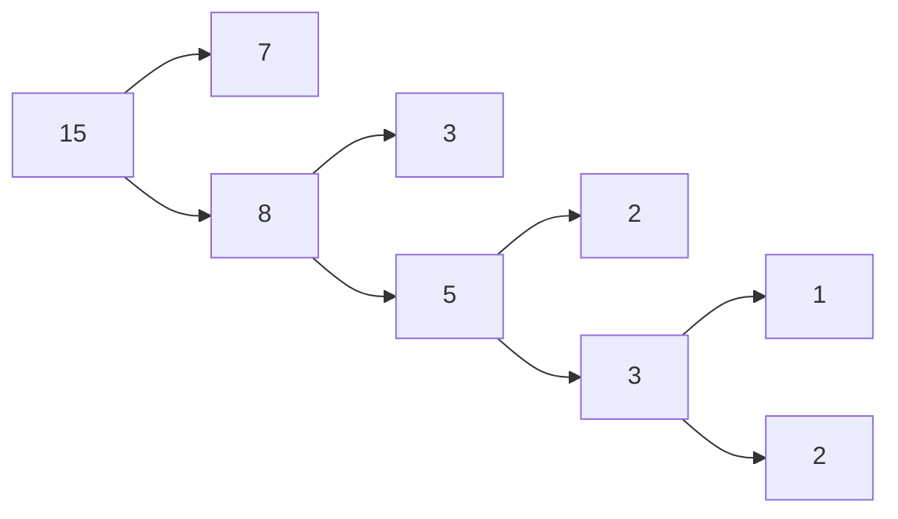

### 3. 重要性质与复杂度

- $n$ 个原始结点全部成为叶结点；每次合并产生一个内部结点，共 $n-1$ 次合并，**总结点数为 $2n-1$**。
- 不存在度为 1 的结点；当 $n\ge2$ 时每个内部结点恰有两个孩子。
- 在最优安排中，大权值通常放在较浅位置；交换左右子树不改变 WPL。
- 树形、编码可能不唯一，但最小 WPL 相同。WPL 最优不代表树高最小，也不保证是完全二叉树。

用最小堆反复取两项、放回一项，构造时间为 $O(n\log n)$，保存树和候选集合需要 $O(n)$ 空间；若每轮都线性扫描寻找两个最小值，时间为 $O(n^2)$。

### 4. 哈夫曼编码与前缀码

**前缀码**：任一码字都不是其他码字的前缀。把字符放在叶结点上，约定左边为 0、右边为 1，从根走到叶的路径就是码字，因此不会在尚未走完另一码字时提前到达一个字符叶结点。

**哈夫曼编码**：以字符频次或概率为叶权构造哈夫曼树，得到最小加权平均码长的二进制前缀编码。

| 字符 | C | A | B | D |
| --- | --- | --- | --- | --- |
| 频次 | 80 | 10 | 8 | 2 |
| 一种哈夫曼编码 | 0 | 10 | 111 | 110 |
| 对总长度的贡献 | 80 | 20 | 24 | 6 |

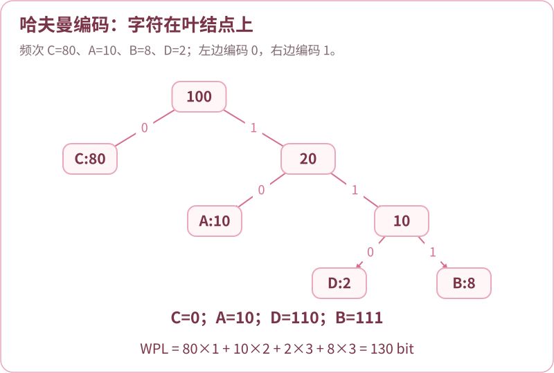

共 100 个字符：定长编码需要 $100\times2=200$ bit；上述编码需要 $130$ bit，平均码长为 $1.3$ bit/字符。编码后长度占原来的 $65\%$，节省 $35\%$；这里未计算码表等元数据开销。

**解码**：从根开始逐位读入，0 向左、1 向右；到叶结点输出字符，再返回根。对于上述码表，`010111110` 分解为 `0 / 10 / 111 / 110`，解码为 `CABD`。

**题3.** 权值为 `1, 2, 2, 3, 7` 的哈夫曼树有多少个结点？WPL 是多少？

**答：** 9 个结点，WPL 为 31。

**解：** 5 个叶结点产生 4 个内部结点；合并权值之和为 $3+5+8+15=31$。只有一个字符时需单独约定其码字，不能机械地套用“非空码字一定至少 1 位”来解释单叶树的路径长度。

---

## 5.5.2 并查集

### 1. 用森林表示互不相交的集合

每个集合用一棵树表示，根作为集合代表。`Find(x)` 返回 x 所在树的根；`Union(x,y)` 把两个不同集合合并。判断两个元素是否属于同一集合，应比较**根**，不能只比较直接双亲。

用双亲数组 `S` 存储森林：

| 数值 | 含义 |
| --- | --- |
| `S[x] < 0` | x 是根；优化版本中 `-S[x]` 是集合大小 |
| `S[x] >= 0` | x 不是根；`S[x]` 是双亲下标 |

初始化时令所有 `S[x]=-1`，表示 n 个单元素集合。与根满足 `parent[x]==x` 的另一种写法相比，这里**用负值判断根**，两套终止条件不可混用。

```cpp
void Initial(int S[], int n) {
    for (int i = 0; i < n; ++i) S[i] = -1;
}

int FindBasic(const int S[], int x) {
    while (S[x] >= 0) x = S[x];
    return x;
}

// 参数必须是两个集合的根；这一基础版本不维护集合大小。
void UnionBasic(int S[], int root1, int root2) {
    if (root1 != root2) S[root2] = root1;
}
```

不优化时，树可能退化成链；Find 最坏为 $O(n)$。如果两个根已知，修改一个双亲的合并操作为 $O(1)$；若输入是任意元素，合并前两次 Find 的成本也要计算。

### 2. 按集合大小合并：小树并入大树

根的负值同时记录集合大小。`S[root1]` 越小，绝对值越大，集合越大。

```cpp
// root1、root2 都必须是根；与保存负集合大小的表示配套使用。
void UnionBySize(int S[], int root1, int root2) {
    if (root1 == root2) return;
    if (S[root1] > S[root2]) { // root1 所在集合较小
        int t = root1;
        root1 = root2;
        root2 = t;
    }
    S[root1] += S[root2];    // 先累计大小，再覆盖小树根
    S[root2] = root1;
}
```

一个结点的深度每增加 1，其所在集合大小至少翻倍，所以树高（按层数）不超过 $\lfloor\log_2 n\rfloor+1$，Find 最坏为 $O(\log n)$。

### 3. 路径压缩：查找时把沿途结点直接挂到根上

```cpp
int Find(int S[], int x) {
    int root = x;
    while (S[root] >= 0) root = S[root];
    while (x != root) {
        int parent = S[x];  // 先保存原双亲
        S[x] = root;        // 再改指向
        x = parent;
    }
    return root;
}

void Merge(int S[], int x, int y) {
    UnionBySize(S, Find(S, x), Find(S, y));
}
```

路径压缩只改变查找路径上的双亲，不改变集合成员和根记录的集合大小，也不会自动压缩没有经过的旁支。

**例**：6 个元素依次做 `Merge(0,1)`、`Merge(2,3)`、`Merge(0,2)`、`Merge(4,5)`；大小相同保留第一个根。

| 状态 | S[0] | S[1] | S[2] | S[3] | S[4] | S[5] |
| --- | --- | --- | --- | --- | --- | --- |
| 初始化 | -1 | -1 | -1 | -1 | -1 | -1 |
| 合并 0、1 | -2 | 0 | -1 | -1 | -1 | -1 |
| 合并 2、3 | -2 | 0 | -2 | 2 | -1 | -1 |
| 合并 0、2 | -4 | 0 | 0 | 2 | -1 | -1 |
| 合并 4、5 | -4 | 0 | 0 | 2 | -2 | 4 |
| 执行 Find(3) 后 | -4 | 0 | 0 | 0 | -2 | 4 |

Find(3) 经过 `3→2→0`，压缩后 3 直接指向 0。Find(1) 与 Find(3) 相等，说明同属一个集合；Find(4) 不相等。

### 4. 复杂度、应用与易错点

| 实现 | 查找代价 |
| --- | --- |
| 不优化 | 单次最坏 $O(n)$ |
| 仅按大小或按秩合并 | 单次最坏 $O(\log n)$ |
| 按大小或按秩合并 + 路径压缩 | 一系列操作的**均摊**代价 $O(\alpha(n))$ |

$\alpha(n)$ 为反阿克曼函数，增长极慢。**均摊近似常数不代表每一次 Find 的最坏时间都是常数，也不代表压缩后整棵树高度始终为 $\alpha(n)$。** 数组空间为 $O(n)$；上述迭代 Find 的额外空间为 $O(1)$。

并查集用于动态连通性、等价类划分、Kruskal 最小生成树的判环。Kruskal 考察边 `(u,v)`：若两端根相同，加入会形成环；否则接受这条边并合并集合。

**易错**：必须合并两个**根**；根相同应直接返回，不能把集合大小累计两遍；更新根的负大小时先求和，再覆盖小树根的双亲；路径压缩不会把不同集合合并。

## 本章小结

| 问题 | 解题入口 |
| --- | --- |
| 二叉树结点数、度数、高度 | 先明确根从第几层算，再用边数关系与 $n_0=n_2+1$ |
| 由遍历序列构造树 | 中序划分左右子树，另一序列确定根 |
| 线索化与遍历 | 区分孩子和线索，核对 ltag/rtag |
| 树、森林转二叉树 | 左孩子、右兄弟；不要把兄弟当孩子 |
| 遍历对应 | 先根对应先序，后根对应中序 |
| 哈夫曼树 | 每轮选两个最小权值；WPL 用合并权值之和复核 |
| 并查集 | 双亲数组找根，按大小合并与路径压缩配合 |

### 公式的适用条件

$m$ 叉树的对数及等比求和公式默认 $m\ge2,n\ge1$，层次从 1 计；$m=1$ 时为链，高度等于结点数，空树高度另约定为 0。“度为 m 的树、高 h、最少 h+m-1 个结点”还要求参数可实现，例如 $m\ge1$ 时高度至少 2（度为 0 的非空树只有根）。结点数上界在上层尽可能填满时达到，不能说每个结点都有 m 个孩子，因为叶结点无孩子。

二叉链表空链域公式针对非空树，空树没有实际结点的孩子域；若把根指针算入则是另一种计数口径。遍历时间为 $O(n)$，递归空间看树高，层序遍历空间看最大宽度。顺序存储的右单支树高 h 时最后编号为 $2^h-1$；按 1 起始下标分配时还要给不用的 0 号位留空间。

哈夫曼构造默认叶权非负（常见频次、概率为正）且至少一个符号；构造所得树没有一度结点。叶权为 0 时，其他同 WPL 的树可能有冗余结构，不能把构造性质无条件推广到所有最优树。
