# 第八章 排序

| 考点 | 重要程度 | 占分 | 常见题型 |
| --- | --- | --- | --- |
| 排序的基本概念（稳定性、内外部排序） | ★★ | 2 分 | 选择 |
| 插入排序（直接插入、折半插入、希尔） | ★★★ | 2~4 分 | 选择 |
| **冒泡排序、快速排序（Partition）** | ★★★★★ | 4~8 分 | 选择、综合、代码 |
| 简单选择排序 | ★★ | 2 分 | 选择 |
| **堆排序（建堆、插入、删除）** | ★★★★ | 4~6 分 | 选择、综合 |
| 归并排序 | ★★★ | 2~4 分 | 选择、综合 |
| 基数排序、计数排序 | ★★ | 2 分 | 选择 |
| **各种内部排序算法的比较（时间/空间/稳定性）** | ★★★★★ | 4~6 分 | 选择、综合 |
| 外部排序（败者树、置换-选择排序、最佳归并树） | ★★★ | 2~4 分 | 选择、综合 |


---

## 8.1 排序的基本概念

**本节知识总览**：

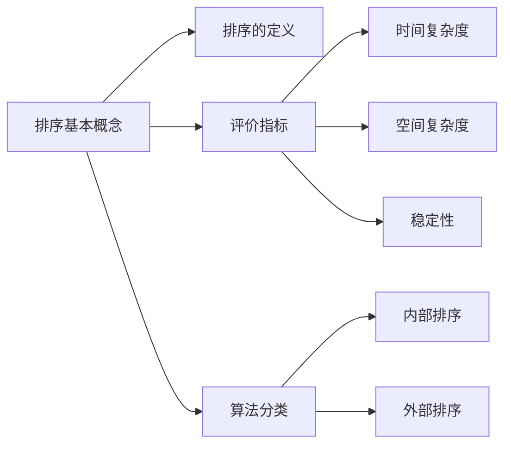

### 1. 排序的定义

**排序（Sort）**：重新排列列表中的元素，使表中的元素满足**按关键字有序**的过程。

> **输入**：$n$ 个记录 $R_1, R_2, \ldots, R_n$，对应的关键字为 $k_1, k_2, \ldots, k_n$。
>
> **输出**：输入序列的一个重排 $R_1', R_2', \ldots, R_n'$，使得有 $k_1' \leqslant k_2' \leqslant \ldots \leqslant k_n'$（也可递减）。

**Eg**：

| 排序前 | 6 | 3 | 2 | 8 | 10 | 1 | 4 | 7 | 9 | 5 |
| --- | --- | --- | --- | --- | --- | --- | --- | --- | --- | --- |
| 排序后 | 1 | 2 | 3 | 4 | 5 | 6 | 7 | 8 | 9 | 10 |

**排序算法的应用**：

- 游戏排行榜：按"荣耀战力"排序；
- 财富排行榜：按"财富值"排序。

> 关键字不同，排序结果不同——关键字是排序的依据。

### 2. 排序算法的评价指标

#### 2.1 时间复杂度与空间复杂度

- **时间复杂度**：排序过程中**关键字的比较次数**和**元素移动次数**；
- **空间复杂度**：排序过程中所需的**辅助存储空间**。

#### 2.2 稳定性

**定义**：若待排序表中有两个元素 $R_i$ 和 $R_j$，其对应的关键字相同即 $key_i = key_j$，且在排序前 $R_i$ 在 $R_j$ 的前面，若使用某一排序算法排序后，$R_i$ **仍然在** $R_j$ 的前面，则称这个排序算法是**稳定的**，否则称排序算法是**不稳定的**。

**Eg**：序列 `6 3 2 5 1 4 3̲`（两个 3，紫色在前、红色在后）：

| 排序结果 | 关键字相同的元素相对位置 | 稳定性 |
| --- | --- | --- |
| `1 2 3 3 4 5 6`（紫色 3 仍在红色 3 前面） | 相对位置**不变** | **稳定** |
| `1 2 3̲ 3 4 5 6`（红色 3 跑到紫色 3 前面） | 相对位置**改变** | **不稳定** |

> **问**：稳定的排序算法一定比不稳定的好？
>
> **答**：不一定，要看实际需求。

### 3. 排序算法的分类

| 分类 | 特点 | 关注重点 |
| --- | --- | --- |
| **内部排序** | 数据**都在内存中** | 如何使算法的**时间、空间复杂度更低** |
| **外部排序** | 数据太多，**无法全部放入内存** | 除了时间/空间复杂度，还要关注**如何使读/写磁盘次数更少** |

**内部排序 vs 外部排序的本质区别**：

- 内存（如 8GB DDR4）读写速度可达 60GB/s；
- 磁盘（如 1TB 机械硬盘）读写速度约 100MB/s；
- 上述**示例参数**相除约为 600 倍，实际比例随设备与访问方式变化——数据量太大无法全部装入内存时，频繁读写磁盘会成为瓶颈，因此外部排序需要专门设计以减少磁盘 I/O。

### 4. 本节知识回顾

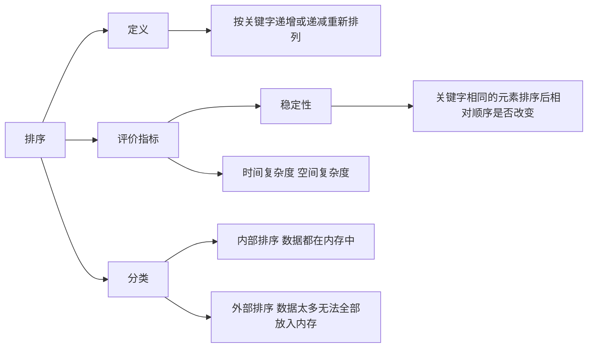

**本节考点**：**排序 = 按关键字递增/递减重新排列** → **评价指标三件套：时间复杂度、空间复杂度、稳定性** → **稳定性定义：关键字相同的元素排序后相对顺序是否改变（不变=稳定，改变=不稳定）** → **分类：内部排序（数据全在内存，关注时空复杂度）vs 外部排序（数据太大放不进内存，还要关注读写磁盘次数）** → **稳定不一定比不稳定好，看实际需求**。

可视化练习：https://www.cs.usfca.edu/~galles/visualization/Algorithms.html

---

## 8.2 插入排序

**本节知识总览**：

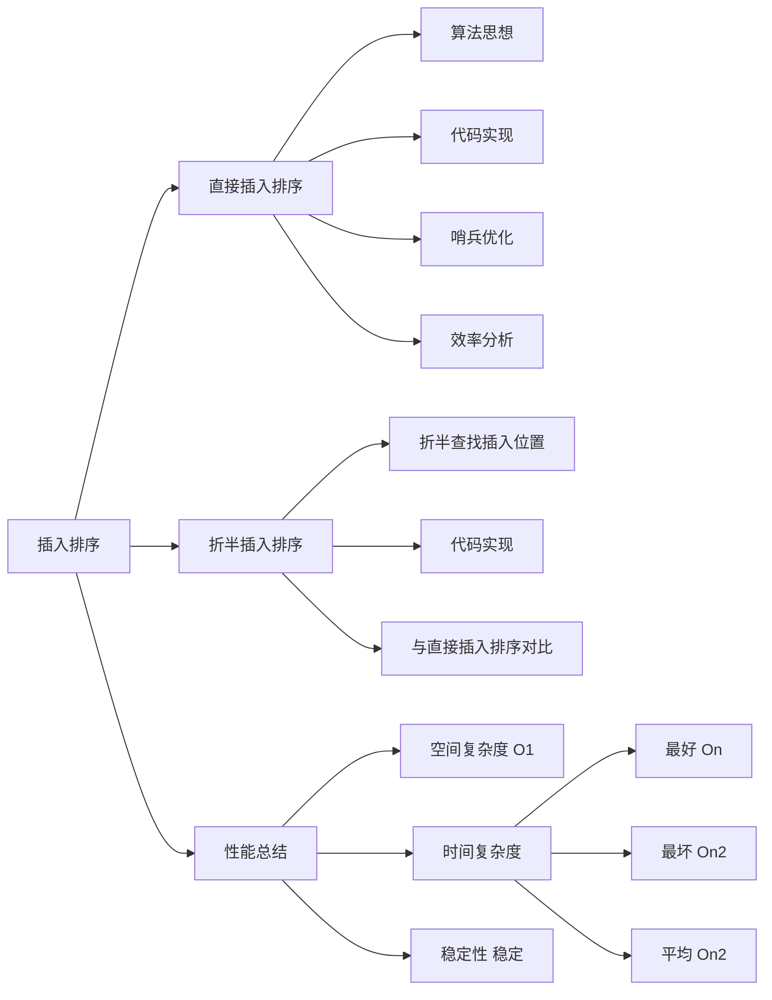

### 8.2.1 直接插入排序

#### 1. 算法思想

每次将一个**待排序的记录**按其关键字大小插入到前面**已排好序的子序列**中，直到全部记录插入完成。

> 类比打扑克牌：每摸到一张新牌，就把它插入到手中已排好序的牌的正确位置。

#### 2. 排序过程演示

初始序列：`[49, 38, 65, 97, 76, 13, 27, 49̲]`（最后一个 49 加下划线以示区分）

| 趟数 | 操作 | 排序结果 |
| --- | --- | --- |
| 初始 | — | `[49]` 38 65 97 76 13 27 49̲ |
| 第1趟 | 38 插入到 49 前面 | `[38 49]` 65 97 76 13 27 49̲ |
| 第2趟 | 65 已在 49 后面，不动 | `[38 49 65]` 97 76 13 27 49 |
| 第3趟 | 97 已在 65 后面，不动 | `[38 49 65 97]` 76 13 27 49̲ |
| 第4趟 | 76 插入到 65 和 97 之间 | `[38 49 65 76 97]` 13 27 49̲ |
| 第5趟 | 13 插入到最前面，前面全部右移 | `[13 38 49 65 76 97]` 27 49̲ |
| 第6趟 | 27 插入到 13 和 38 之间 | `[13 27 38 49 65 76 97]` 49̲ |
| 第7趟 | 49̲ 插入到 49 和 65 之间 | `[13 27 38 49 49̲ 65 76 97]` |

> 注意第7趟：49̲ 插入到 49 后面而非前面，**保持了稳定性**。

#### 3. 代码实现

```c
// 直接插入排序
void InsertSort(int A[], int n) {
    int i, j, temp;
    for (i = 1; i < n; i++)                  // 将各元素插入已排好序的序列中
        if (A[i] < A[i - 1]) {               // 若 A[i] 关键字小于前驱
            temp = A[i];                     // 用 temp 暂存 A[i]
            for (j = i - 1; j >= 0 && A[j] > temp; --j)  // 检查所有前面已排好序的元素
                A[j + 1] = A[j];             // 所有大于 temp 的元素都向后挪位
            A[j + 1] = temp;                 // 复制到插入位置
        }
}
```

#### 4. 哨兵优化

利用 `A[0]` 作为**哨兵**（不存放数据），可以省去内层循环中 `j >= 0` 的边界检查。

```c
// 直接插入排序（带哨兵）
void InsertSort(int A[], int n) {
    int i, j;
    for (i = 2; i <= n; i++)                 // 依次将 A[2]~A[n] 插入到前面已排序序列
        if (A[i] < A[i - 1]) {               // 若 A[i] 关键码小于其前驱，将 A[i] 插入有序表
            A[0] = A[i];                     // 复制为哨兵，A[0] 不存放元素
            for (j = i - 1; A[0] < A[j]; --j) // 从后往前查找待插入位置
                A[j + 1] = A[j];             // 向后挪位
            A[j + 1] = A[0];                 // 复制到插入位置
        }
}
```

**哨兵的作用**：

- 数组下标从 0 到 n，`A[0]` 作为哨兵，数据存放在 `A[1]` ~ `A[n]`；
- 当内层循环 `j` 减到 0 时，`A[0]`（哨兵）与自身比较，`A[0] < A[0]` 为假，循环自然终止；
- 省去了循环中的下标边界判断；关键字比较次数不一定减少，不能把边界判断与关键字比较混为一谈。

#### 5. 算法效率分析

| 指标 | 值 | 说明 |
| --- | --- | --- |
| **空间复杂度** | $O(1)$ | 仅使用常数个辅助变量（temp / 哨兵） |
| **最好时间复杂度** | $O(n)$ | 序列已有序，每趟只需 1 次比较，共 $n-1$ 趟，无需移动 |
| **最坏时间复杂度** | $O(n^2)$ | 序列逆序，第 $i$ 趟比较 $i+1$ 次、移动 $i+2$ 次 |
| **平均时间复杂度** | $O(n^2)$ | — |
| **稳定性** | **稳定** | 相同关键字元素相对顺序不变 |

**最坏情况推导**（严格逆序 `[80, 70, 60, 50, 40, 30, 20, 10]`）：

| 趟数 | 比较关键字次数 | 移动元素次数 |
| --- | --- | --- |
| 第1趟 | 2 | 3 |
| 第2趟 | 3 | 4 |
| 第 $i$ 趟 | $i+1$ | $i+2$ |
| 第 $n-1$ 趟 | $n$ | $n+1$ |

总比较次数 $\approx \sum_{i=1}^{n-1}(i+1) = O(n^2)$，总移动次数 $\approx \sum_{i=1}^{n-1}(i+2) = O(n^2)$。

### 8.2.2 折半插入排序

#### 1. 算法思想

在直接插入排序的基础上**优化查找过程**：先用**折半查找**找到应该插入的位置，再移动元素。

> 直接插入排序中，查找插入位置是**顺序查找**（从后往前逐个比较）；折半插入排序将其改为**折半查找**，减少了关键字比较次数。

#### 2. 排序过程演示

初始序列（哨兵在 A[0]）：`[_, 20, 30, 40, 50, 60, 70, 80, 55, 60, 90, 10]`

**插入 55（i=8）**：

1. 哨兵 `A[0] = 55`，折半查找范围 `[low=1, high=7]`
2. `mid=4, A[4]=50 < 55` → `low=5`
3. `mid=6, A[6]=70 > 55` → `high=5`
4. `mid=5, A[5]=60 > 55` → `high=4`
5. `low=5 > high=4`，查找停止，插入位置为 `low=5`
6. 将 `[5, 7]` 内元素（60, 70, 80）右移，`A[5] = 55`

结果：`[_, 20, 30, 40, 50, 55, 60, 70, 80, 60, 90, 10]`

**插入 60（i=9）**：

1. 哨兵 `A[0] = 60`，折半查找范围 `[low=1, high=8]`
2. `mid=4, A[4]=50 < 60` → `low=5`
3. `mid=6, A[6]=60 == 60` → 为保证稳定性，`low=mid+1=7`（继续在右边找）
4. `mid=7, A[7]=70 > 60` → `high=6`
5. `low=7 > high=6`，查找停止，插入位置为 `low=7`
6. 将 `[7, 8]` 内元素（70, 80）右移，`A[7] = 60`

> **关键**：当 `A[mid] == A[0]` 时，为保证**稳定性**，应继续令 `low = mid + 1`，在 mid 右边继续查找。

**插入 10（i=11）**：

1. 哨兵 `A[0] = 10`，折半查找范围 `[low=1, high=10]`
2. `mid=5, A[5]=55 > 10` → `high=4`
3. `mid=2, A[2]=30 > 10` → `high=1`
4. `mid=1, A[1]=20 > 10` → `high=0`
5. `low=1 > high=0`，查找停止，插入位置为 `low=1`
6. 将 `[1, 10]` 内所有元素右移，`A[1] = 10`

最终结果：`[_, 10, 20, 30, 40, 50, 55, 60, 60, 70, 80, 90]`

#### 3. 代码实现

```c
// 折半插入排序
void InsertSort(int A[], int n) {
    int i, j, low, high, mid;
    for (i = 2; i <= n; i++) {               // 依次将 A[2]~A[n] 插入前面的已排序序列
        A[0] = A[i];                         // 将 A[i] 暂存到 A[0]
        low = 1; high = i - 1;               // 设置折半查找的范围
        while (low <= high) {                // 折半查找（默认递增有序）
            mid = low + (high - low) / 2;          // 取中间点
            if (A[mid] > A[0]) high = mid - 1;  // 查找左半子表
            else low = mid + 1;              // 查找右半子表（A[mid]==A[0] 时也走这里，保证稳定性）
        }
        for (j = i - 1; j >= high + 1; --j)  // 统一后移元素，空出插入位置
            A[j + 1] = A[j];
        A[high + 1] = A[0];                  // 插入操作（high+1 == low）
    }
}
```

**要点**：

- 折半查找结束时 `low > high`，插入位置为 `low`（即 `high + 1`）；
- 当 `A[mid] == A[0]` 时，执行 `low = mid + 1`（而非 `high = mid - 1`），保证相同关键字元素的相对顺序不变；
- 元素移动操作与直接插入排序**完全相同**，只是查找方式不同。

#### 4. 与直接插入排序的对比

| 对比项 | 直接插入排序 | 折半插入排序 |
| --- | --- | --- |
| 查找方式 | 顺序查找 | 折半查找 |
| 关键字比较次数 | 较多 | **减少**（$O(n\log n)$ 量级） |
| 元素移动次数 | 不变 | **不变**（仍需逐个后移） |
| 时间复杂度 | $O(n^2)$ | $O(n^2)$（移动操作仍是瓶颈） |
| 稳定性 | 稳定 | 稳定 |
| 适用数据结构 | 顺序表、链表 | **仅适用于顺序表**（需要随机访问才能折半查找） |

> 折半插入排序减少了比较次数，但**元素移动次数不变**，整体时间复杂度仍为 $O(n^2)$。

### 3. 本节知识回顾

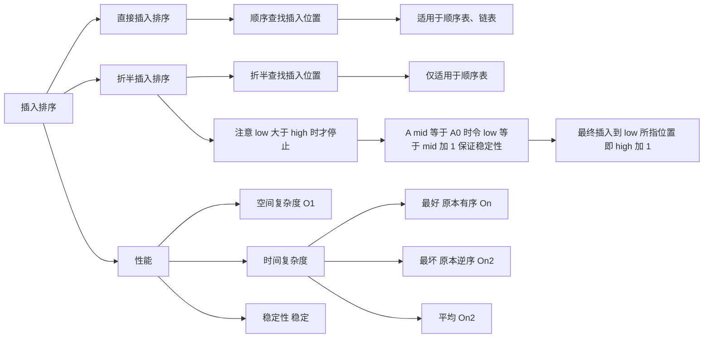

**本节考点**：**直接插入排序 = 顺序查找插入位置 + 后移元素** → **哨兵 A[0] 省去 j≥0 检查** → **折半插入排序 = 折半查找插入位置 + 后移元素（比较次数减少但移动次数不变，时间复杂度仍 O(n²)）** → **折半查找仅适用于顺序表** → **A[mid]==A[0] 时令 low=mid+1 保证稳定性** → **最终插入位置为 low（即 high+1）** → **空间 O(1)，最好 O(n)，最坏/平均 O(n²)，稳定**。

可视化练习：https://www.cs.usfca.edu/~galles/visualization/InsertionSort.html

---

### 8.2.3 希尔排序

#### 1. 算法思想

**希尔排序（Shell Sort）** 又称**缩小增量排序**，核心思想：

1. 先将待排序表分割成若干形如 $L[i,\ i+d,\ i+2d,\ \ldots,\ i+kd]$ 的"特殊"子表（按增量 $d$ 分组）；
2. 对各个子表分别进行**直接插入排序**；
3. **缩小增量 $d$**，重复上述过程，直到 $d=1$ 为止（此时整个表作为一组，做一次直接插入排序）。

> 希尔排序先追求表中元素**部分有序**，再逐渐逼近**全局有序**。当 $d=1$ 时，表"基本有序"，最后一趟直接插入排序效率很高。

**增量序列**：希尔本人建议每次将增量缩小一半，即 $d_1 = n/2,\ d_2 = d_1/2,\ \ldots,\ d_k = 1$。考试中可能遇到各种增量序列，需按给定增量逐步模拟。

#### 2. 排序过程演示

##### 增量序列 $d_1=4,\ d_2=2,\ d_3=1$

初始序列（$n=8$，A[0] 为暂存单元）：

| 下标 | 0 | 1 | 2 | 3 | 4 | 5 | 6 | 7 | 8 |
| --- | --- | --- | --- | --- | --- | --- | --- | --- | --- |
| 元素 | — | 49 | 38 | 65 | 97 | 76 | 13 | 27 | 49̲ |

**第一趟 $d_1 = n/2 = 4$**：将表分为 4 个子表，分别排序。

| 子表 | 元素 | 排序后 |
| --- | --- | --- |
| 子表1（下标 1,5） | {49, 76} | {49, 76} |
| 子表2（下标 2,6） | {38, 13} | {13, 38} |
| 子表3（下标 3,7） | {65, 27} | {27, 65} |
| 子表4（下标 4,8） | {97, 49̲} | {49̲, 97} |

第一趟结果：`[_, 49, 13, 27, 49̲, 76, 38, 65, 97]`

**第二趟 $d_2 = d_1/2 = 2$**：将表分为 2 个子表，分别排序。

| 子表 | 元素 | 排序后 |
| --- | --- | --- |
| 子表1（下标 1,3,5,7） | {49, 27, 76, 65} | {27, 49, 65, 76} |
| 子表2（下标 2,4,6,8） | {13, 49̲, 38, 97} | {13, 38, 49, 97} |

第二趟结果：`[_, 27, 13, 49, 38, 65, 49̲, 76, 97]`

**第三趟 $d_3 = d_2/2 = 1$**：整个表作为一组，做直接插入排序。

第三趟结果：`[_, 13, 27, 38, 49, 49, 65, 76, 97]` ✅

##### 增量序列 $d_1=3,\ d_2=1$（另一组增量示例）

初始序列同上：`[_, 49, 38, 65, 97, 76, 13, 27, 49̲]`

**第一趟 $d_1 = 3$**：分为 3 个子表。

| 子表 | 元素 | 排序后 |
| --- | --- | --- |
| 子表1（下标 1,4,7） | {49, 97, 27} | {27, 49, 97} |
| 子表2（下标 2,5,8） | {38, 76, 49̲} | {38, 49̲, 76} |
| 子表3（下标 3,6） | {65, 13} | {13, 65} |

第一趟结果：`[_, 27, 38, 13, 49, 49̲, 65, 97, 76]`

**第二趟 $d_2 = 1$**：整个表做直接插入排序。

第二趟结果：`[_, 13, 27, 38, 49, 49̲, 65, 76, 97]` ✅

#### 3. 代码实现

```c
// 希尔排序
void ShellSort(int A[], int n) {
    int d, i, j;
    // A[0]只是暂存单元，不是哨兵，当j<=0时，插入位置已到
    for (d = n / 2; d >= 1; d = d / 2)       // 步长变化
        for (i = d + 1; i <= n; ++i)
            if (A[i] < A[i - d]) {            // 需将A[i]插入有序增量子表
                A[0] = A[i];                  // 暂存在A[0]
                for (j = i - d; j > 0 && A[0] < A[j]; j -= d)
                    A[j + d] = A[j];          // 记录后移，查找插入的位置
                A[j + d] = A[0];              // 插入
            } // if
}
```

**与直接插入排序的关键区别**：

| 对比项 | 直接插入排序 | 希尔排序 |
| --- | --- | --- |
| A[0] 的角色 | **哨兵**（兼暂存，省去 $j \geq 0$ 检查） | **仅暂存**（不是哨兵，需 $j > 0$ 边界检查） |
| 步长 | 固定为 1 | 从 $n/2$ 逐步缩小到 1 |
| 内层循环步长 | `j--` | `j -= d` |
| 循环终止条件 | `A[0] < A[j]`（哨兵保证不会越界） | `j > 0 && A[0] < A[j]`（必须显式检查 $j>0$） |

#### 4. 算法执行过程详解

以增量序列 $d=4, 2, 1$ 为例，逐步跟踪代码执行。

初始：`[_, 49, 38, 65, 97, 76, 13, 27, 49̲]`

**第一趟 $d=4$**（$i$ 从 5 到 8）：

| $i$ | $A[i]$ vs $A[i-4]$ | 操作 | 数组状态 |
| --- | --- | --- | --- |
| 5 | $A[5]=76 > A[1]=49$ | 不交换 | `[_, 49, 38, 65, 97, 76, 13, 27, 49̲]` |
| 6 | $A[6]=13 < A[2]=38$ | 38→A[6], 13→A[2] | `[_, 49, 13, 65, 97, 76, 38, 27, 49̲]` |
| 7 | $A[7]=27 < A[3]=65$ | 65→A[7], 27→A[3] | `[_, 49, 13, 27, 97, 76, 38, 65, 49̲]` |
| 8 | $A[8]=49̲ < A[4]=97$ | 97→A[8], 49̲→A[4] | `[_, 49, 13, 27, 49̲, 76, 38, 65, 97]` |

**第二趟 $d=2$**（$i$ 从 3 到 8）：

| $i$ | $A[i]$ vs $A[i-2]$ | 操作 | 数组状态 |
| --- | --- | --- | --- |
| 3 | $A[3]=27 < A[1]=49$ | 49→A[3], 27→A[1] | `[_, 27, 13, 49, 49̲, 76, 38, 65, 97]` |
| 4 | $A[4]=49̲ > A[2]=13$ | 不交换 | `[_, 27, 13, 49, 49̲, 76, 38, 65, 97]` |
| 5 | $A[5]=76 > A[3]=49$ | 不交换 | `[_, 27, 13, 49, 49̲, 76, 38, 65, 97]` |
| 6 | $A[6]=38 < A[4]=49̲$ | 49̲→A[6], 38→A[4] | `[_, 27, 13, 49, 38, 76, 49̲, 65, 97]` |
| 7 | $A[7]=65 < A[5]=76$ | 76→A[7], 65→A[5] | `[_, 27, 13, 49, 38, 65, 49̲, 76, 97]` |
| 8 | $A[8]=97 > A[6]=49̲$ | 不交换 | `[_, 27, 13, 49, 38, 65, 49̲, 76, 97]` |

**第三趟 $d=1$**（$i$ 从 2 到 8，等价于直接插入排序）：

| $i$ | $A[i]$ vs $A[i-1]$ | 操作 | 数组状态 |
| --- | --- | --- | --- |
| 2 | $A[2]=13 < A[1]=27$ | 27→A[2], 13→A[1] | `[_, 13, 27, 49, 38, 65, 49̲, 76, 97]` |
| 3 | $A[3]=49 > A[2]=27$ | 不交换 | 不变 |
| 4 | $A[4]=38 < A[3]=49$ | 49→A[4], 38→A[3] | `[_, 13, 27, 38, 49, 65, 49, 76, 97]` |
| 5 | $A[5]=65 > A[4]=49$ | 不交换 | 不变 |
| 6 | $A[6]=49̲ < A[5]=65$ | 65→A[6], 49̲→A[5] | `[_, 13, 27, 38, 49, 49̲, 65, 76, 97]` |
| 7 | $A[7]=76 > A[6]=65$ | 不交换 | 不变 |
| 8 | $A[8]=97 > A[7]=76$ | 不交换 | 不变 |

最终结果：`[_, 13, 27, 38, 49, 49̲, 65, 76, 97]` ✅

#### 5. 算法性能分析

| 指标 | 结论 |
| --- | --- |
| **空间复杂度** | $O(1)$（仅用常数个辅助单元 A[0]） |
| **时间复杂度** | 与增量序列 $d_1, d_2, d_3, \ldots$ 的选择有关，不同增量序列有不同理论界，不能给出脱离增量的统一精确阶。本节折半增量的最坏时间为 $\Theta(n^2)$；某些实验中的幂次拟合不能当作通用渐近结论 |
| **稳定性** | **不稳定** |
| **适用性** | **仅适用于顺序表**，不适用于链表 |

**不稳定的反例**：

原始序列：`[65, 49, 49̲]`（两个 49 中后者用 49̲ 标记）

| 趟次 | 增量 | 结果 |
| --- | --- | --- |
| 第一趟 | $d=2$ | `[49̲, 49, 65]` |
| 第二趟 | $d=1$ | `[49̲, 49, 65]` |

两个 49 的相对顺序发生了改变（原来 49 在前、49̲ 在后，排序后 49̲ 在前），因此希尔排序**不稳定**。

#### 6. 本节知识回顾

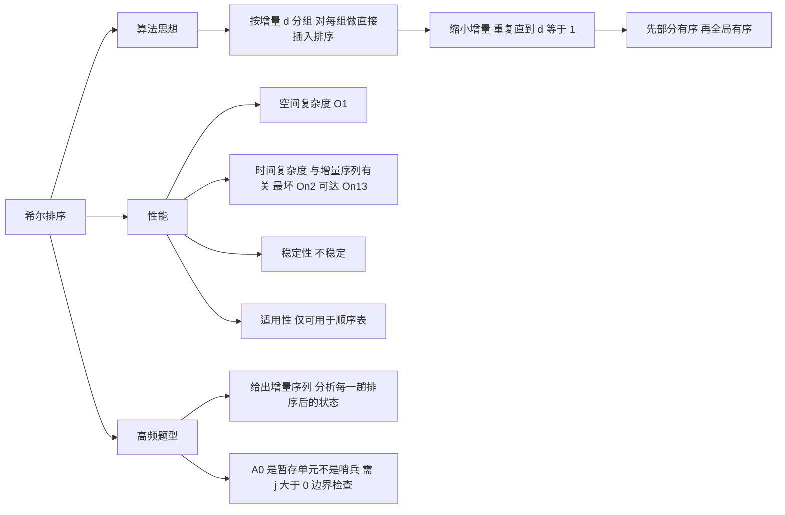

**本节考点**：**希尔排序 = 按增量分组 + 组内直接插入排序 + 缩小增量重复** → **A[0] 是暂存单元不是哨兵（需 $j>0$ 检查）** → **空间 $O(1)$，时间复杂度与增量序列有关（最坏 $O(n^2)$，可达 $O(n^{1.3})$）** → **不稳定** → **仅适用于顺序表** → **高频题型：给出增量序列，分析每一趟排序后的状态**。

可视化练习：https://www.cs.usfca.edu/~galles/visualization/ShellSort.html

---

## 8.3 交换排序

**本节知识总览**：

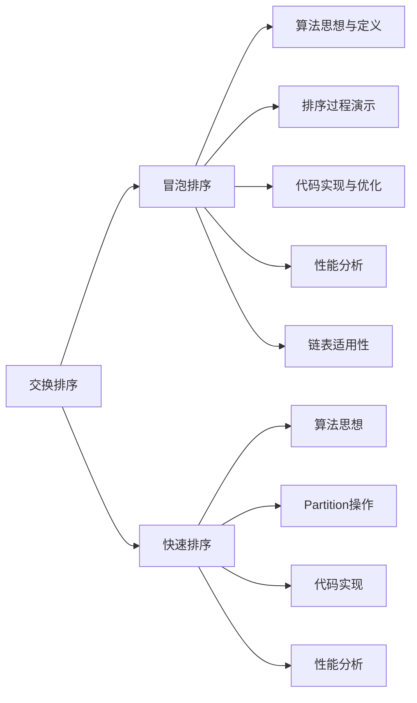

### 8.3.1 冒泡排序

#### 1. 算法思想

**冒泡排序（Bubble Sort）** 属于**交换排序**，核心思想：

从后往前（或从前往后）**两两比较相邻元素的值**，若为逆序（即 $A[i-1] > A[i]$），则**交换它们**，直到序列比较完。称这样过程为"**一趟**"冒泡排序。

> **关键特征**：每一趟排序都可以使一个元素移动到最终位置；已经确定最终位置的元素在之后的处理中无需再对比。如果某一趟排序过程中未发生"交换"，则算法可提前结束。最多只需 $n-1$ 趟排序。

#### 2. 排序过程演示

初始序列（0-indexed，无哨兵）：`[49, 38, 65, 97, 76, 13, 27, 49̲]`（最后一个 49 加下划线以示区分）

**第1趟**（从后往前比较，共 7 次比较，5 次交换）：

| 比较对 | 比较结果 | 是否交换 | 数组状态 |
| --- | --- | --- | --- |
| A[6]=27 vs A[7]=49̲ | 27 < 49 | 否 | `[49, 38, 65, 97, 76, 13, 27, 49̲]` |
| A[5]=13 vs A[6]=27 | 13 < 27 | 否 | `[49, 38, 65, 97, 76, 13, 27, 49̲]` |
| A[4]=76 vs A[5]=13 | 76 > 13 | **是** | `[49, 38, 65, 97, 13, 76, 27, 49]` |
| A[3]=97 vs A[4]=13 | 97 > 13 | **是** | `[49, 38, 65, 13, 97, 76, 27, 49̲]` |
| A[2]=65 vs A[3]=13 | 65 > 13 | **是** | `[49, 38, 13, 65, 97, 76, 27, 49̲]` |
| A[1]=38 vs A[2]=13 | 38 > 13 | **是** | `[49, 13, 38, 65, 97, 76, 27, 49̲]` |
| A[0]=49 vs A[1]=13 | 49 > 13 | **是** | `[13, 49, 38, 65, 97, 76, 27, 49̲]` |

第1趟结束：`[13, 49, 38, 65, 97, 76, 27, 49̲]` — 最小元素 13 "冒"到最前面 ✅

**第2趟**（跳过已就位的 pos 0，共 6 次比较，5 次交换）：

| 比较对 | 比较结果 | 是否交换 | 数组状态 |
| --- | --- | --- | --- |
| A[6]=27 vs A[7]=49̲ | 27 < 49̲ | 否 | `[13, 49, 38, 65, 97, 76, 27, 49̲]` |
| A[5]=76 vs A[6]=27 | 76 > 27 | **是** | `[13, 49, 38, 65, 97, 27, 76, 49̲]` |
| A[4]=97 vs A[5]=27 | 97 > 27 | **是** | `[13, 49, 38, 65, 27, 97, 76, 49]` |
| A[3]=65 vs A[4]=27 | 65 > 27 | **是** | `[13, 49, 38, 27, 65, 97, 76, 49̲]` |
| A[2]=38 vs A[3]=27 | 38 > 27 | **是** | `[13, 49, 27, 38, 65, 97, 76, 49̲]` |
| A[1]=49 vs A[2]=27 | 49 > 27 | **是** | `[13, 27, 49, 38, 65, 97, 76, 49̲]` |

第2趟结束：`[13, 27, 49, 38, 65, 97, 76, 49̲]` — 最小的两个元素"冒"到最前边 ✅

**第3趟**（跳过 pos 0,1，共 5 次比较，4 次交换）：

| 比较对 | 比较结果 | 是否交换 | 数组状态 |
| --- | --- | --- | --- |
| A[6]=76 vs A[7]=49̲ | 76 > 49 | **是** | `[13, 27, 49, 38, 65, 97, 49̲, 76]` |
| A[5]=97 vs A[6]=49̲ | 97 > 49̲ | **是** | `[13, 27, 49, 38, 65, 49̲, 97, 76]` |
| A[4]=65 vs A[5]=49̲ | 65 > 49̲ | **是** | `[13, 27, 49, 38, 49̲, 65, 97, 76]` |
| A[3]=38 vs A[4]=49̲ | 38 < 49 | 否 | `[13, 27, 49, 38, 49̲, 65, 97, 76]` |
| A[2]=49 vs A[3]=38 | 49 > 38 | **是** | `[13, 27, 38, 49, 49̲, 65, 97, 76]` |

第3趟结束：`[13, 27, 38, 49, 49, 65, 97, 76]` — 最小的3个元素"冒"到最前边 ✅

**第4趟**（跳过 pos 0,1,2，共 4 次比较，1 次交换）：

| 比较对 | 比较结果 | 是否交换 | 数组状态 |
| --- | --- | --- | --- |
| A[6]=97 vs A[7]=76 | 97 > 76 | **是** | `[13, 27, 38, 49, 49̲, 65, 76, 97]` |
| A[5]=65 vs A[6]=76 | 65 < 76 | 否 | `[13, 27, 38, 49, 49̲, 65, 76, 97]` |
| A[4]=49̲ vs A[5]=65 | 49̲ < 65 | 否 | `[13, 27, 38, 49, 49̲, 65, 76, 97]` |
| A[3]=49 vs A[4]=49̲ | 49 == 49̲ | 否 | `[13, 27, 38, 49, 49̲, 65, 76, 97]` |

第4趟结束：`[13, 27, 38, 49, 49̲, 65, 76, 97]` — 最小的4个元素"冒"到最前边 ✅

**第5趟**（跳过 pos 0,1,2,3，共 3 次比较，**0 次交换**）：

| 比较对 | 比较结果 | 是否交换 |
| --- | --- | --- |
| A[6]=76 vs A[7]=97 | 76 < 97 | 否 |
| A[5]=65 vs A[6]=76 | 65 < 76 | 否 |
| A[4]=49̲ vs A[5]=65 | 49̲ < 65 | 否 |

第5趟无任何交换 → **序列已整体有序，算法提前终止！**

最终结果：`[13, 27, 38, 49, 49̲, 65, 76, 97]` ✅

> **稳定性验证**：原始序列中 49 在前、49̲ 在后；排序后仍然是 49 在前、49̲ 在后（第4趟中 49 vs 49̲ 相等不交换）。相对顺序不变 → **稳定**。

#### 3. 代码实现

```c
// 交换函数
void swap(int &a, int &b) {
    int temp = a;
    a = b;
    b = temp;
}

// 冒泡排序
void BubbleSort(int A[], int n) {
    for (int i = 0; i < n - 1; i++) {           // 外层循环控制趟数，最多 n-1 趟
        bool flag = false;                       // 表示本趟冒泡是否发生交换的标志
        for (int j = n - 1; j > i; j--)          // 一趟冒泡过程：从后往前比较
            if (A[j - 1] > A[j]) {               // 若为逆序
                swap(A[j - 1], A[j]);            // 交换
                flag = true;                      // 标记发生了交换
            }
        if (flag == false)                        // 本趟遍历后没有发生交换
            return;                               // 说明表已经有序，提前结束
    }
}
```

**要点**：

- `i` 所指位置之前的元素都已"有序"（每趟确定一个元素的最终位置）；
- `j` 从 `n-1` 递减到 `i+1`，比较 `A[j-1]` 与 `A[j]`；
- **只有 $A[j-1] > A[j]$ 时才交换**（严格大于才交换，等于不交换），因此算法是**稳定的**；
- `flag` 标志位实现**提前终止**：某趟无交换 → 已有序 → 直接返回。

#### 4. 算法性能分析

| 指标 | 结论 | 说明 |
| --- | --- | --- |
| **空间复杂度** | $O(1)$ | 仅使用常数个辅助变量（temp、flag） |
| **最好时间复杂度** | $O(n)$ | 序列已有序，只需 1 趟，比较 $n-1$ 次，交换 0 次 |
| **最坏时间复杂度** | $O(n^2)$ | 序列逆序，比较次数 = 交换次数 = $\frac{n(n-1)}{2}$ |
| **平均时间复杂度** | $O(n^2)$ | — |
| **稳定性** | **稳定** | 只有 $A[j-1] > A[j]$ 才交换，相等不交换 |

**最好情况推导**（有序 `[1, 2, 3, 4, 5, 6, 7, 8]`）：

- 第1趟：比较 $n-1$ 次，交换 0 次，`flag=false` → 提前返回
- 总比较次数 = $n-1$，总交换次数 = 0
- 时间复杂度 = $O(n)$

**最坏情况推导**（逆序 `[8, 7, 6, 5, 4, 3, 2, 1]`）：

- 每次交换需要移动元素 **3 次**（swap 函数中的三步赋值）
- 比较次数 = $(n-1)+(n-2)+\cdots+1 = \frac{n(n-1)}{2}$
- 交换次数 = 比较次数 = $\frac{n(n-1)}{2}$
- 时间复杂度 = $O(n^2)$

#### 5. 冒泡排序是否适用于链表？

**可以。** 但需调整方向：**从前往后"冒泡"**，每一趟将更大的元素"冒"到链尾。

以单链表 `L → 49 → 38 → 65 → 97 → 76 → 13 → 27 → 49̲ → NULL` 为例：

- 从前往后两两比较相邻节点的值，若逆序则交换（修改指针指向，而非交换数据域）；
- 每一趟将当前未排序部分的最大值"冒"到链尾；
- 下一趟缩短遍历范围（跳过已就位的尾部节点）。

> 链表版的基本相邻比较、交换仍为常数开销；交换总数由逆序对数决定，提前终止的比较次数可能因扫描方向不同而变化，不能保证与反向扫描数组逐次相同，时间复杂度仍为 $O(n^2)$，空间复杂度 $O(1)$，且仍然**稳定**。

#### 6. 知识回顾与重要考点

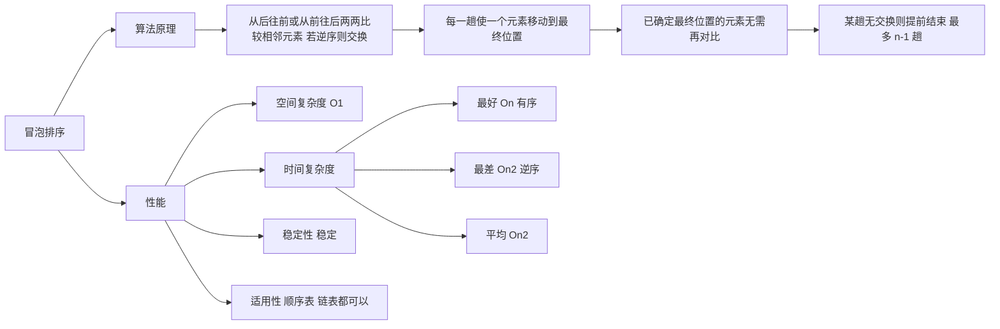

**本节考点**：**冒泡排序 = 两两比较相邻元素 + 逆序则交换 + 每趟确定一个元素最终位置** → **flag 提前终止（某趟无交换→已有序）** → **最多 $n-1$ 趟** → **空间 $O(1)$，最好 $O(n)$（有序），最坏/平均 $O(n^2)$（逆序）** → **稳定（只有严格大于才交换）** → **顺序表、链表都适用（链表需从前往后冒泡）**。

可视化练习：https://www.cs.usfca.edu/~galles/visualization/BubbleSort.html

---

### 8.3.2 快速排序

#### 1. 算法思想

快速排序是常用且实践中通常较快的比较排序。平均/期望时间为 $O(n\log n)$，但不具有“所有输入、所有实现均最快”的保证；计数、基数排序在适当条件下还可达到线性时间。

**核心思想**：在待排序表 $L[1\ldots n]$ 中任取一个元素 `pivot` 作为**枢轴**（或基准，通常取首元素），通过一趟排序将待排序表划分为独立的两部分 $L[1\ldots k-1]$ 和 $L[k+1\ldots n]$，使得 $L[1\ldots k-1]$ 中的所有元素**小于等于** `pivot`，$L[k+1\ldots n]$ 中的所有元素**大于等于** `pivot`，则 `pivot` 放在了其最终位置 $L(k)$ 上。这个过程称为一次**"划分"**。然后分别递归地对两个子表重复上述过程，直至每部分内只有一个元素或空为止，即所有元素放在了其最终位置上。

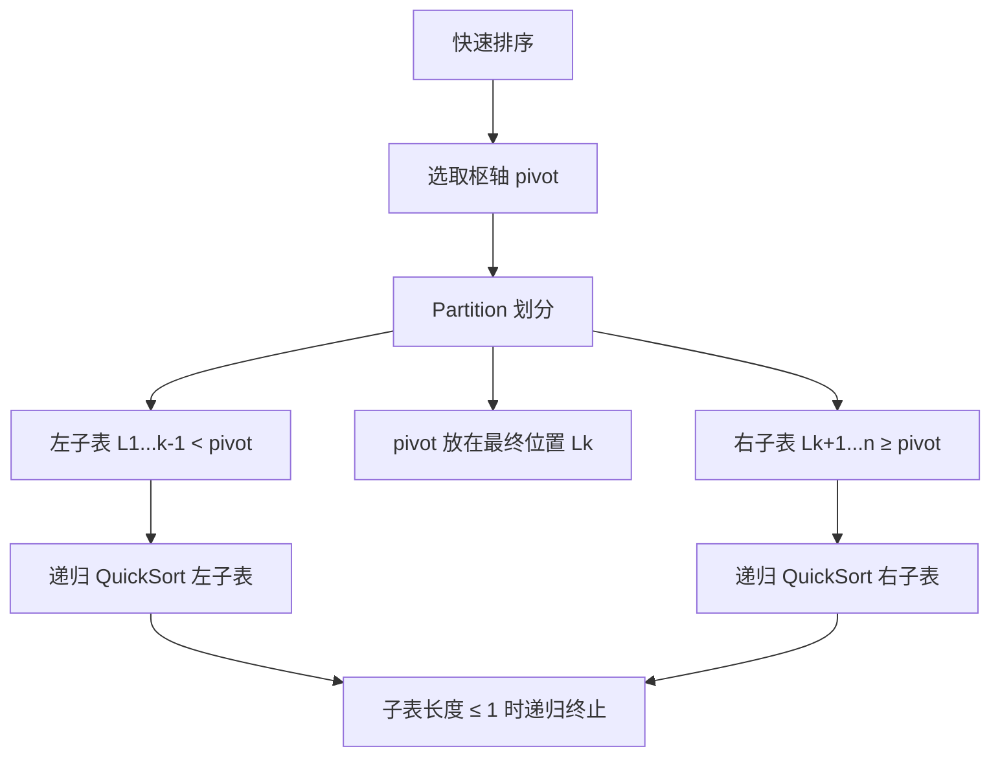

> **注意**：408 原题中说，对所有尚未确定最终位置的所有元素进行一遍处理称为"一趟"排序，因此一次"划分" ≠ 一趟排序。一次划分可以确定一个元素的最终位置，而一趟排序也许可以确定多个元素的最终位置。

#### 2. 划分操作（Partition）详解

**Partition 操作**是快速排序的核心，使用 `low` 和 `high` 两个指针从两端向中间扫描：

1. 将第一个元素 `A[low]` 作为枢轴 `pivot`，暂存起来；
2. `high` 从右往左扫描，找到第一个 $< pivot$ 的元素，将其移到 `low` 位置；
3. `low` 从左往右扫描，找到第一个 $> pivot$ 的元素，将其移到 `high` 位置；
4. 重复步骤 2-3，直到 `low == high`；
5. 将 `pivot` 放到 `low`（即 `high`）位置，返回该位置。

##### 示例：`[49, 38, 65, 97, 76, 13, 27, 49]`，`low=0`，`high=7`

**第 1 趟 Partition**（枢轴 `pivot = 49`）：

| 步骤 | 操作 | low | high | 数组状态 |
|------|------|-----|------|----------|
| 初始 | 保存 pivot=49 | 0 | 7 | `[_, 38, 65, 97, 76, 13, 27, 49]` |
| ① | high 从右扫描：A[7]=49≥49→high=6；A[6]=27<49→A[0]=27 | 0 | 6 | `[27, 38, 65, 97, 76, 13, _, 49]` |
| ② | low 从左扫描：A[0]=27≤49→low=1；A[1]=38≤49→low=2；A[2]=65>49→A[6]=65 | 2 | 6 | `[27, 38, _, 97, 76, 13, 65, 49]` |
| ③ | high 继续：A[5]=13<49→A[2]=13 | 2 | 5 | `[27, 38, 13, 97, 76, _, 65, 49]` |
| ④ | low 继续：A[2]=13≤49→low=3；A[3]=97>49→A[5]=97 | 3 | 5 | `[27, 38, 13, _, 76, 97, 65, 49]` |
| ⑤ | high 继续：A[4]=76≥49→high=3；low==high=3 | 3 | 3 | `[27, 38, 13, _, 76, 97, 65, 49]` |
| 结束 | A[3]=pivot=49 | 3 | 3 | `[27, 38, 13, 49, 76, 97, 65, 49]` |

返回 `p = 3`。枢轴 49 已在最终位置。左子表 `[27, 38, 13]`（下标 0-2），右子表 `[76, 97, 65, 49]`（下标 4-7）。

#### 3. 递归过程完整演示

以 `[49,38,65,97,76,13,27,49]` 为例，按下面的挖坑法代码、先左后右递归，只有以下 4 次非平凡划分：

| 调用区间 | 枢轴 | 最终下标 | 划分后整个数组 |
| --- | --- | --- | --- |
| [0,7] | 49 | 3 | 27,38,13,49,76,97,65,49 |
| [0,2] | 27 | 1 | 13,27,38,49,76,97,65,49 |
| [4,7] | 76 | 6 | 13,27,38,49,49,65,76,97 |
| [4,5] | 49 | 4 | 13,27,38,49,49,65,76,97 |

其余调用都是空区间或单元素，立即返回；包含终止调用的最大同时调用深度为 4（[0,7]→[4,7]→[4,5]→[5,5]）。

最终有序数组：`[13, 27, 38, 49, 49, 65, 76, 97]`

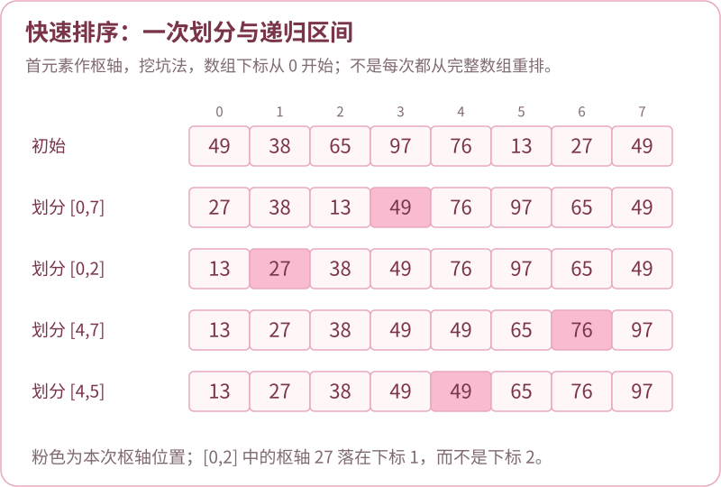

#### 4. 代码实现（以下片段兼容 C）

```c
// 用第一个元素将待排序序列划分成左右两个部分
int Partition(int A[], int low, int high) {
    int pivot = A[low];           // 第一个元素作为枢轴
    while (low < high) {          // 用 low、high 搜索枢轴的最终位置
        while (low < high && A[high] >= pivot) --high;
        A[low] = A[high];         // 比枢轴小的元素移动到左端
        while (low < high && A[low] <= pivot) ++low;
        A[high] = A[low];         // 比枢轴大的元素移动到右端
    }
    A[low] = pivot;               // 枢轴元素存放到最终位置
    return low;                   // 返回存放枢轴的最终位置
}

// 快速排序
void QuickSort(int A[], int low, int high) {
    if (low < high) {             // 递归跳出的条件
        int pivotpos = Partition(A, low, high);  // 划分
        QuickSort(A, low, pivotpos - 1);         // 划分左子表
        QuickSort(A, pivotpos + 1, high);        // 划分右子表
    }
}
```

> **注意**：快速排序使用 **0-indexed** 数组（与直接插入排序的 1-indexed + A[0] 哨兵不同）。

#### 5. 性能分析

##### 5.1 时间复杂度

时间复杂度 = $O(n \times \text{递归层数})$，每一层处理当前所有未排序元素，比较次数 $\leq O(n)$。

| 情况 | 递归深度 | 时间复杂度 | 说明 |
|------|----------|-----------|------|
| **最好** | $\lfloor\log_2 n\rfloor + 1$ | $O(n\log_2 n)$ | 每次划分均匀，递归树为完全二叉树 |
| **最坏** | $n$ | $O(n^2)$ | 每次划分极不均匀（如原序列已有序或逆序） |
| **平均** | $O(\log_2 n)$ | $O(n\log_2 n)$ | — |

**最坏情况分析**：若初始序列**有序或逆序**，每次选首元素作枢轴，划分结果一边为 0 个元素、另一边为 $n-1$ 个元素，递归树退化为单支树，深度为 $n$。

例如 `[1, 2, 3, 4, 5, 6, 7, 8]`：

```
第1层: pivot=1, 左空, 右[2,3,4,5,6,7,8]
第2层: pivot=2, 左空, 右[3,4,5,6,7,8]
...
第8层: pivot=8, 完成
```

共 $n$ 层，每层比较 $O(n)$ 次，总时间 $O(n^2)$。

**较好情况分析**：若每次枢轴将序列划分为较均匀的两部分，递归深度最小，算法效率最高。例如 `[49, 38, 65, 97, 76, 13, 27, 49]` 包含单元素终止调用时，本例最大调用深度为 4。

##### 5.2 空间复杂度

空间复杂度 = $O(\text{递归层数})$，主要来自递归调用栈。

| 情况 | 递归深度 | 空间复杂度 |
|------|----------|-----------|
| **最好** | $\lfloor\log_2 n\rfloor + 1$ | $O(\log_2 n)$ |
| **最坏** | $n$ | $O(n)$ |

##### 5.3 优化思路

尽量选取可以将数据**中分**的枢轴元素：

1. **选头、中、尾三个位置的元素，取中间值**作为枢轴元素；
2. **随机选一个元素**作为枢轴元素。

##### 5.4 稳定性

**快速排序是不稳定的。**

反例：`[2̲, 2, 1]`（下划线标记第一个 2）

| 步骤 | 操作 | 数组状态 |
|------|------|----------|
| 初始 | pivot = 2̲ (A[0]) | `[_, 2, 1]` |
| high 扫描 | A[2]=1 < 2 → A[0]=1 | `[1, 2, _]` |
| low 扫描 | A[0]=1≤2→low=1；A[1]=2≤2→low=2；low==high=2 | `[1, 2, _]` |
| 放置 pivot | A[2]=2̲ | `[1, 2, 2]` |

原来在位置 0 的 2̲ 跑到了位置 2，而原来在位置 1 的 2 仍在位置 1，**相对顺序改变** → 不稳定。

#### 6. 知识回顾与重要考点

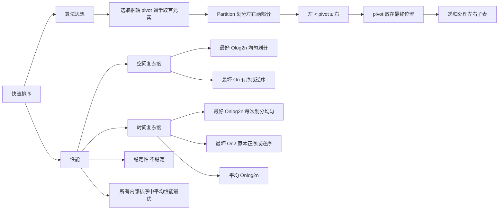

**本节考点**：**快速排序 = 选枢轴 + Partition 划分 + 递归排序子表** → **每次划分确定一个元素最终位置** → **时间：最好/平均 $O(n\log_2 n)$，最坏 $O(n^2)$（有序/逆序时）** → **空间：最好 $O(\log_2 n)$，最坏 $O(n)$** → **不稳定** → **优化：三数取中或随机选枢轴** → **所有内部排序算法中平均性能最优**。

可视化练习：https://www.cs.usfca.edu/~galles/visualization/ComparisonSort.html

---

## 8.4 选择排序

### 8.4.1 简单选择排序

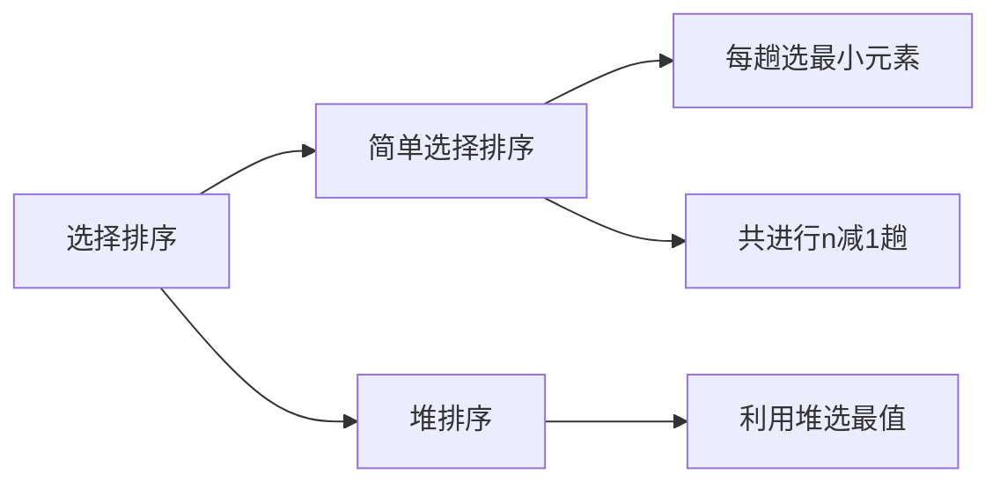

**算法思想**：每一趟在待排序元素中选取关键字**最小**的元素，加入有序子序列。

- 共需 **n−1 趟**处理（最后剩一个元素自动就位）
- 每趟操作：在 `A[i…n−1]` 中找最小元素，与 `A[i]` 交换

---

#### 排序过程演示

对序列 `[49, 38, 65, 97, 76, 13, 27, 49]`（下标 0~7）进行简单选择排序：

| 趟次 | 待排序范围 | 最小值 | 最小值位置 | 交换操作 | 排序后数组状态 |
|:---:|:---:|:---:|:---:|:---:|:---:|
| 初始 | — | — | — | — | [49, 38, 65, 97, 76, 13, 27, 49] |
| 第1趟 | A[0…7] | **13** | idx 5 | swap(A[0], A[5]) | [**13**, 38, 65, 97, 76, 49, 27, 49] |
| 第2趟 | A[1…7] | **27** | idx 6 | swap(A[1], A[6]) | [13, **27**, 65, 97, 76, 49, 38, 49] |
| 第3趟 | A[2…7] | **38** | idx 6 | swap(A[2], A[6]) | [13, 27, **38**, 97, 76, 49, 65, 49] |
| 第4趟 | A[3…7] | **49** | idx 5 | swap(A[3], A[5]) | [13, 27, 38, **49**, 76, 97, 65, 49] |
| 第5趟 | A[4…7] | **49** | idx 7 | swap(A[4], A[7]) | [13, 27, 38, 49, **49**, 97, 65, 76] |
| 第6趟 | A[5…7] | **65** | idx 6 | swap(A[5], A[6]) | [13, 27, 38, 49, 49, **65**, 97, 76] |
| 第7趟 | A[6…7] | **76** | idx 7 | swap(A[6], A[7]) | [13, 27, 38, 49, 49, 65, **76**, **97**] |

> 第7趟结束后，最后一个元素 97 自动就位，排序完成。

---

#### C 代码实现

```c
// 交换函数
void swap(int *a, int *b) {
    int temp = *a;
    *a = *b;
    *b = temp;
}

// 简单选择排序
void SelectSort(int A[], int n) {
    for (int i = 0; i < n - 1; i++) {    // 一共进行 n-1 趟
        int min = i;                      // 记录最小元素位置
        for (int j = i + 1; j < n; j++)   // 在 A[i...n-1] 中选择最小的元素
            if (A[j] < A[min]) min = j;   // 更新最小元素位置
        if (min != i) swap(&A[i], &A[min]); // 封装的 swap() 函数共移动元素3次
    }
}
```

---

#### 算法性能分析

| 指标 | 结果 | 说明 |
|:---:|:---:|:---:|
| **空间复杂度** | $O(1)$ | 仅用常数个辅助变量 |
| **时间复杂度** | $O(n^2)$ | 无论有序、逆序、乱序，一定需要 n−1 趟 |
| **比较次数** | $\frac{n(n-1)}{2}$ | $(n-1)+(n-2)+\cdots+1 = \frac{n(n-1)}{2}$ 次 |
| **交换次数** | $\le n-1$ | 每趟最多交换一次，可能达到 n−1 次 |
| **稳定性** | **不稳定** | 见下方反例 |

**稳定性反例**：序列 `[2, 2̲, 1]`（第一个 2 记为 2，第二个记为 2̲）

| 趟次 | 操作 | 结果 |
|:---:|:---:|:---:|
| 第1趟 | min=1@idx2, swap(A[0],A[2]) | [1, **2̲**, **2**] |
| 第2趟 | 比较两个 2，相等不交换 | [1, 2̲, 2] |

两个 2 的相对顺序被改变 → **不稳定**。

**适用性**：既可以用于**顺序表**，也可用于**链表**。

---

#### 知识回顾与考点总结

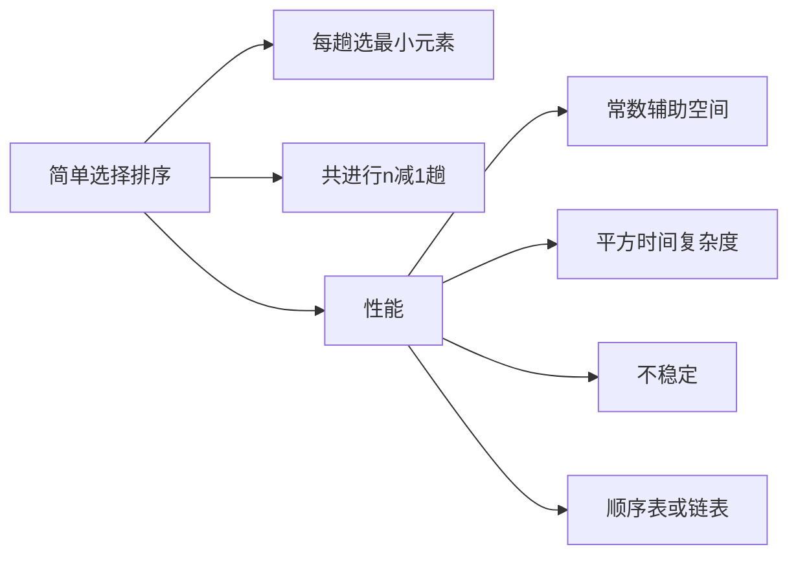

**本节考点**：**简单选择排序 = 每趟选最小 + 交换到前端** → **n−1 趟完成** → **时间 $O(n^2)$（最好/最坏/平均相同）** → **空间 $O(1)$** → **不稳定** → **顺序表、链表均可**。

可视化练习：https://www.cs.usfca.edu/~galles/visualization/SelectionSort.html

### 8.4.2（1）堆排序

**本节知识总览**：

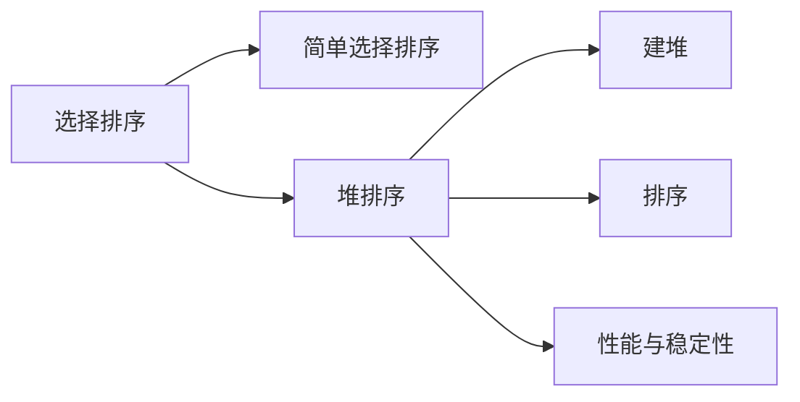

> **选择排序**：每一趟在待排序元素中选取关键字最小（或最大）的元素加入有序子序列。**简单选择排序**每趟选最小需要 $O(n)$——若能把"选最小"优化到 $O(\log n)$，就得到**堆排序**。

#### 1. 什么是"堆（Heap）"

若 $n$ 个关键字序列 $L[1\dots n]$ 满足下面某一条性质，则称为**堆**：

- ① $L(i)\ge L(2i)$ 且 $L(i)\ge L(2i+1)$（$1\le i\le\lfloor n/2\rfloor$）——**大根堆（大顶堆）**；
- ② $L(i)\le L(2i)$ 且 $L(i)\le L(2i+1)$（$1\le i\le\lfloor n/2\rfloor$）——**小根堆（小顶堆）**。

即（把序列视为完全二叉树）：**大根堆：完全二叉树中，根 ≥ 左、右；小根堆：根 ≤ 左、右**（对比 BST：左 ≤ 根 ≤ 右——堆只要求根与两个孩子的大小关系）。

**Eg**：大根堆 `87, 45, 78, 32, 17, 65, 53, 09`；小根堆 `09, 45, 17, 65, 53, 32, 87, 78`。

#### 2. 顺序存储的"完全二叉树"

**重要常考基本操作**（下标从 1 开始）：

| 操作 | 公式 |
| --- | --- |
| $i$ 的左孩子 | $2i$ |
| $i$ 的右孩子 | $2i+1$ |
| $i$ 的父结点 | $\lfloor i/2\rfloor$ |
| $i$ 所在的层次 | $\lceil\log_2(i+1)\rceil$ 或 $\lfloor\log_2 i\rfloor+1$ |

若完全二叉树中共有 $n$ 个结点，则：

- 判断 $i$ 是否有左孩子：$2i\le n$？
- 判断 $i$ 是否有右孩子：$2i+1\le n$？
- 判断 $i$ 是否是叶子/分支结点：$i>\lfloor n/2\rfloor$？（编号 $\le\lfloor n/2\rfloor$ 的结点都是**分支结点**）

#### 3. 建立大根堆

**思路**：把所有**非终端结点**都检查一遍，是否满足大根堆的要求，如果不满足，则进行调整。

- 在顺序存储的完全二叉树中，**非终端结点编号 $i\le\lfloor n/2\rfloor$**；
- 检查当前结点是否满足**根 ≥ 左、右**，若不满足，**将当前结点与更大的一个孩子互换**（"小元素不断**下坠**"）；
- 若元素互换破坏了下一级的堆，则采用相同的方法**继续往下调整**（小元素不断"下坠"）；
- **从最底层的分支结点开始调整**（自底向上，从 $i=\lfloor n/2\rfloor$ 依次递减到 1）。

**Eg**（初始序列 `53, 17, 78, 09, 45, 65, 87, 32`，$n=8$，从 $i=4$ 开始）：

| 处理结点 | 操作 | 序列状态 |
| --- | --- | --- |
| 初始 | —— | 53, 17, 78, 09, 45, 65, 87, 32 |
| $i=4$：09（左孩子 32） | $09<32$ → 交换（09 下坠） | 53, 17, 78, **32**, 45, 65, 87, **09** |
| $i=3$：78（孩子 65、87） | $78<87$ → 换更大孩子 87；78 到叶子，停 | 53, 17, **87**, 32, 45, 65, **78**, 09 |
| $i=2$：17（孩子 32、45） | $17<45$ → 换更大孩子 45 | 53, **45**, 87, 32, **17**, 65, 78, 09 |
| $i=1$：53（孩子 45、87） | $53<87$ → 换 87；53 到 #3 后从孩子 65、78 中选 78，再下移；53 到叶子，停 | **87, 45, 78, 32, 17, 65, 53, 09** ✅ |

**建大根堆代码**：

```cpp
#include <utility>

// A[1..len] 保存元素，A[0] 是暂存位，数组容量至少为 len+1。
void HeadAdjust(int A[], int k, int len);

//建立大根堆
void BuildMaxHeap(int A[], int len){
    for(int i=len/2; i>0; i--)      //从后往前调整所有非终端结点
        HeadAdjust(A, i, len);
}

//将以 k 为根的子树调整为大根堆
void HeadAdjust(int A[], int k, int len){
    A[0] = A[k];                    //A[0]暂存子树的根结点
    for(int i=2*k; i<=len; i*=2){   //沿key较大的子结点向下筛选
        if(i<len && A[i]<A[i+1])
            i++;                    //取key较大的子结点的下标
        if(A[0] >= A[i]) break;     //筛选结束
        else{
            A[k] = A[i];            //将A[i]调整到双亲结点上
            k = i;                  //修改k值，以便继续向下筛选
        }
    }
    A[k] = A[0];                    //被筛选结点的值放入最终位置
}
```

#### 4. 基于大根堆进行排序

**堆排序**：每一趟将**堆顶元素**加入有序子序列（**与待排序序列中的最后一个元素交换**），并将**待排序元素序列再次调整为大根堆**（小元素不断"下坠"）。

**Eg**（承接上面的堆 `87, 45, 78, 32, 17, 65, 53, 09`，演示 n−1 趟）：

| 趟 | 堆顶↔堆底交换 | 堆顶下坠调整后 | 就位结果 |
| --- | --- | --- | --- |
| 1 | 87 ↔ 09 | 09 先后被 78、65 替换而下移 | 87 就位 → `78, 45, 65, 32, 17, 09, 53 \| 87` |
| 2 | 78 ↔ 53 | 53 与更大的孩子 65 交换（53>09 停） | `65, 45, 53, 32, 17, 09 \| 78, 87` |
| 3 | 65 ↔ 09 | 09 与 53 交换 | `53, 45, 09, 32, 17 \| 65, 78, 87` |
| 4 | 53 ↔ 17 | 17 先后被 45、32 替换而下移 | `45, 32, 09, 17 \| 53, 65, 78, 87` |
| 5 | 45 ↔ 17 | 17 与 32 交换 | `32, 17, 09 \| 45, 53, 65, 78, 87` |
| 6 | 32 ↔ 09 | 09 与 17 交换 | `17, 09 \| 32, 45, 53, 65, 78, 87` |
| 7 | 17 ↔ 09 | （只剩最后 1 个待排序元素，不用再调整） | `09 \| 17, 32, 45, 53, 65, 78, 87` ✅ |

> ⚠️ **基于"大根堆"的堆排序得到"递增序列"**；基于"小根堆"的堆排序得到"递减序列"。

**堆排序完整代码**：

```cpp
//堆排序的完整逻辑
void HeapSort(int A[], int len){
    BuildMaxHeap(A, len);           //初始建堆
    for(int i=len; i>1; i--){       //n-1趟的交换和建堆过程
        std::swap(A[i], A[1]);      //堆顶元素和堆底元素交换
        HeadAdjust(A, 1, i-1);      //把剩余的待排序元素整理成堆
    }
}
```

#### 5. 算法效率分析

**建堆的时间复杂度**：

- 一个结点，每"下坠"一层，**最多只需对比关键字 2 次**（与左右孩子各比一次）；
- 若树高为 $h$，某结点在第 $i$ 层，则将这个结点向下调整最多只需要"下坠" $h-i$ 层，关键字对比次数不超过 $2(h-i)$；
- $n$ 个结点的完全二叉树树高 $h=\lfloor\log_2 n\rfloor+1$；第 $i$ 层最多有 $2^{i-1}$ 个结点，而**只有第 $1\sim(h-1)$ 层的结点才有可能需要"下坠"调整**；
- 将整棵树调整为大根堆，关键字对比次数不超过：

$$\sum_{i=1}^{h-1}2^{i-1}\cdot 2(h-i)=\sum_{i=1}^{h-1}2^i(h-i)=\sum_{j=1}^{h-1}2^{h-j}j\ \le\ 2n\sum_{j=1}^{h-1}\frac{j}{2^j}\ \le\ 4n$$

（**差比数列求和（错位相减法）**：$\sum\frac{j}{2^j}<2$）

> **建堆的过程，关键字对比次数不超过 $4n$，建堆时间复杂度 = $O(n)$。**

**排序的时间复杂度**：

- 总共需要 $n-1$ 趟，每一趟交换后都需要尝试下筛；可能立即结束而不实际下坠；
- 根结点最多"下坠" $h-1$ 层，每下坠一层最多对比 2 次，因此每一趟排序复杂度不超过 $O(h)=O(\log_2 n)$；
- 共 $n-1$ 趟 → 总时间复杂度 $O(n\log_2 n)$。

> **堆排序的时间复杂度 = $O(n)+O(n\log_2 n)=O(n\log_2 n)$；空间复杂度 = $O(1)$。**

**稳定性：堆排序是"不稳定"的。**

**Eg**（初始序列 `1, 2, 2̲`）：初始化大根堆时，"若左右孩子一样大，则**优先和左孩子交换**"；排序后 2̲ 与 2 的相对次序改变 → **不稳定**。

> **截屏练习**：基于"小根堆"如何建堆、排序？（答：思路对称——建堆时"大元素下坠"；排序每趟堆顶（最小）与堆底交换 → 得到"递减序列"。）

#### 6. 本节知识回顾

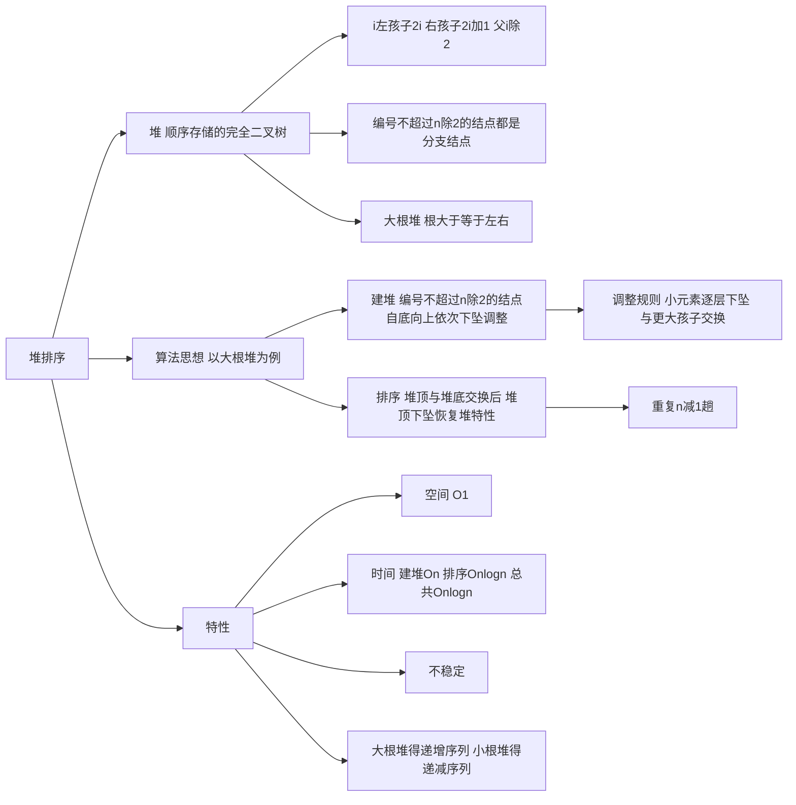

**本节考点**：**堆的定义（大/小根堆：$L(i)$ 与 $L(2i)$、$L(2i+1)$ 的大小关系；顺序存储 `2i / 2i+1 / ⌊i/2⌋`、编号 $\le\lfloor n/2\rfloor$ 是分支结点）** → **建堆：从 $i=\lfloor n/2\rfloor$ 自底向上，对每个分支结点"下坠"调整（与更大的孩子交换），建堆时间 $O(n)$（对比次数不超过 $4n$）** → **排序：每趟堆顶与堆底交换 + 堆顶下坠，共 $n-1$ 趟；大根堆 → 递增序列，小根堆 → 递减序列** → **⚠️ 手算高频题：给出初始序列，画建堆和每趟排序后的序列（本节的 8 元素例题必须滚瓜烂熟）** → **总时间 $O(n\log_2 n)$（建堆 $O(n)$ + 排序 $O(n\log_2 n)$），空间 $O(1)$** → **不稳定（反例 `1,2,2̲`）** → **代码：BuildMaxHeap / HeadAdjust（A[0] 暂存、沿更大孩子向下筛选）/ HeapSort 三个函数**。

---

### 8.4.2（2）堆的插入和删除

**本节知识总览**：

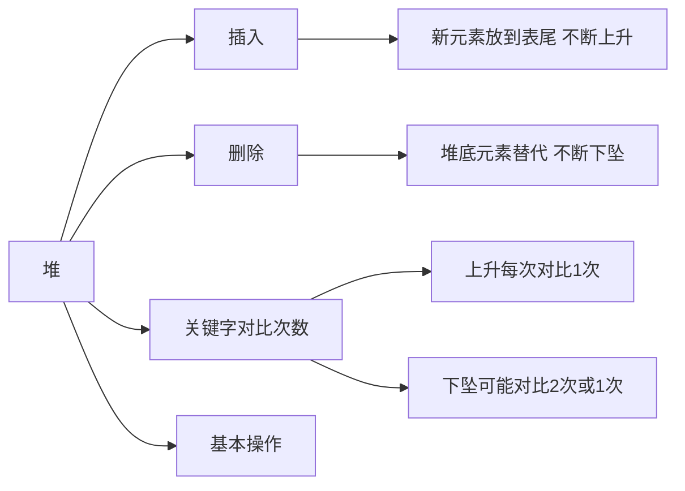

#### 1. 在堆中插入新元素

以**小根堆**为例（堆序列 `09, 17, 65, 32, 45, 78, 87, 53`）：

- **新元素放到表尾（堆底）**；
- 根据小根堆的要求，**新元素不断"上升"**——与**父结点**对比，**若新元素比父结点更小，则将二者互换**；就这样一路"上升"，**直到无法继续上升为止**。

**Eg1**：插入 **13** → 放到表尾 #9；$13<32$（父，#4）→ 互换；$13<17$（父，#2）→ 互换；$13>09$（父，#1）→ 停止上升。**对比关键字的次数 = 3 次**。

**Eg2**：插入 **46** → 放到表尾 #10；$46>45$（父，#5）→ 无需互换，直接停止。**对比关键字的次数 = 1 次**。

> 插入新元素后，只需比较到父结点这一条路径 ⇒ **插入时间复杂度 $O(\log_2 n)$**（每次上升只对比 1 次）。

#### 2. 在堆中删除元素

**过程**：

- **被删除的元素用堆底元素（表尾）替代**；
- 若删除堆顶，只需下筛；若删除任意位置，应先与父结点比较，不满足父子堆序时上筛，否则下筛。堆底替代值可能比新父结点更小（小根堆），不能无条件只下筛。

**Eg1**：删除 **13**（#2）→ 用堆底 **46** 替代 → 46 与两个孩子 $17$、$45$ 比较（小根堆需与**更小的孩子**互换）→ $46>17$，与 17 互换，46 下坠到 #4 → 46 再与孩子 $53$、$32$ 比较 → $46>32$，与 32 互换，46 下坠到叶子 #9 → 停止。
**对比关键字的次数 = 4 次**（下坠两层，每层对比 2 次）。结果：`09, 17, 65, 32, 45, 78, 87, 53, 46`。

**Eg2**：删除 **65**（#3）→ 用堆底 **46** 替代 → 46 与孩子 $78$、$87$ 比较 → $46<78$ 且 $46<87$，**满足小根堆，不再下坠** → 停止。
**对比关键字的次数 = 2 次**。结果：`09, 17, 46, 32, 45, 78, 87, 53`。

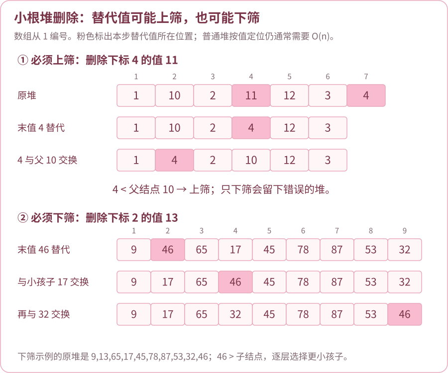

#### 3. 关键字对比次数小结

| 操作 | 对比次数 |
| --- | --- |
| 每次"**上升**"调整 | **只需对比关键字 1 次**（只与父结点比） |
| 每次"**下坠**"调整 | **可能需要对比关键字 2 次**（与左右两个孩子各比一次），**也可能只需对比 1 次**（只有一个孩子时，只与该孩子比一次） |

#### 4. 基本操作

| 操作 | 公式 |
| --- | --- |
| $i$ 的左孩子 | $2i$ |
| $i$ 的右孩子 | $2i+1$ |
| $i$ 的父结点 | $\lfloor i/2\rfloor$ |

#### 5. 本节知识回顾

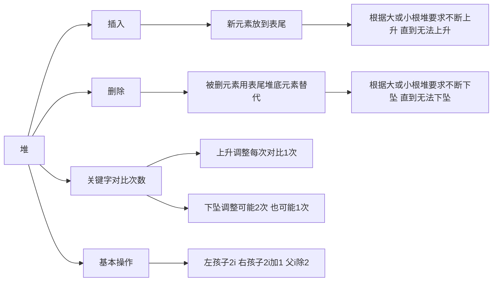

**本节考点**：**插入：新元素放表尾 → 不断"上升"（与父结点比，比父更小/大则换），每次上升只对比 1 次，$O(\log_2 n)$** → **删除：被删元素用堆底元素替代 → 不断"下坠"（与更小/更大的孩子互换），下坠一层可能对比 2 次（有两个孩子）或 1 次（只有一个孩子）** → **⚠️ 高频手算题：给出堆的插入/删除序列，画出每步的堆形态并数对比次数（本节的两个例题必会）** → **基本操作 $2i$、$2i+1$、$\lfloor i/2\rfloor$**。

---

## 8.5 归并、基数与计数排序

### 8.5.1 归并排序

**本节知识总览**：

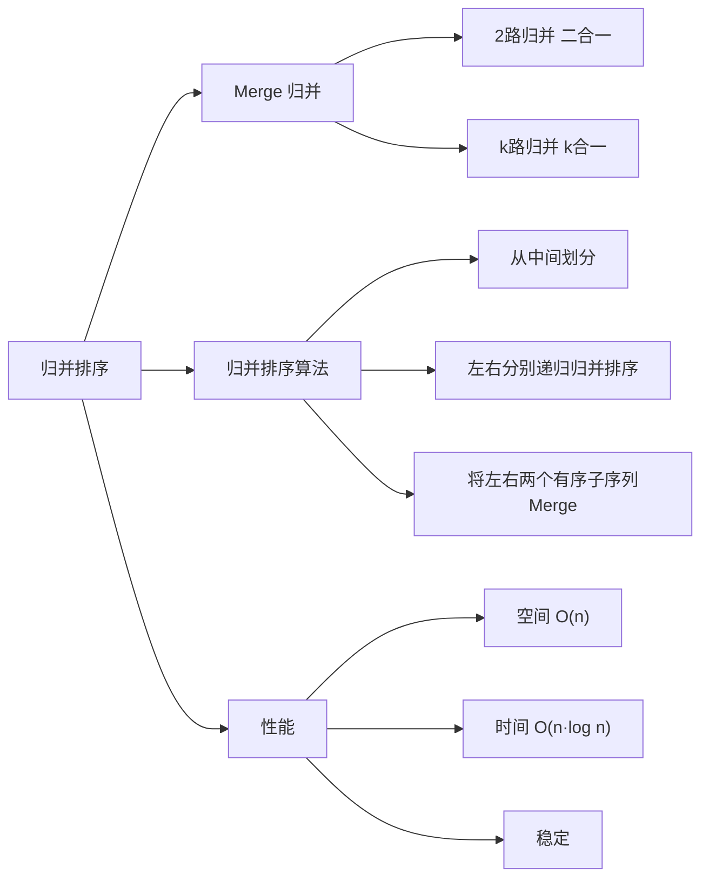

#### 1. 归并（Merge）

**归并**：把**两个或多个已经有序的序列合并成一个**。

- **"2 路"归并——二合一**：对比 $i$、$j$ 所指元素，**选择更小的一个放入 $k$ 所指位置**；
  > **"2 路"归并——每选出一个（小）元素需对比关键字 1 次。**
- **"4 路"归并——四合一**：对比 $p_1,p_2,p_3,p_4$ 所指元素，选择更小的一个放入 $k$ 所指位置。
  > **朴素线性扫描 m 个活跃段首选最小，需 m-1 次比较；若有段耗尽，活跃数会减少。用堆或败者树更新则为 O(log m)，不是每次必需 m-1 次。**

- **只剩一个子表未合并时**，可以**将该表中剩余元素全部加到总表**（不必再逐个比较）。

**Eg**（2 路归并：左 `12, 16, 24, 33, 45, 56, 60` + 右 `7, 10, 21, 24̲, 37`）：

| 步骤 | 比较 | 取谁 | 输出 |
| --- | --- | --- | --- |
| 1 | 12 vs 7 | 7（右） | 7 |
| 2 | 12 vs 10 | 10（右） | 7, 10 |
| 3 | 12 vs 21 | 12（左） | 7, 10, 12 |
| 4 | 16 vs 21 | 16（左） | …, 16 |
| 5 | 24 vs 21 | 21（右） | …, 21 |
| 6 | 24 vs 24̲ | **24（左）**（相等时优先取靠前的，保证稳定性） | …, 24 |
| 7 | 33 vs 24̲ | 24̲（右） | …, 24̲ |
| 8 | 33 vs 37 | 33（左） | …, 33 |
| 9 | 45 vs 37 | 37（右） | …, 37 |
| 剩 | 右表已空 → 左表剩余**全部**加入 | —— | **7, 10, 12, 16, 21, 24, 24̲, 33, 37, 45, 56, 60** |

#### 2. 归并排序（手算模拟）

> **内部排序中一般采用 2 路归并**；核心操作：**把数组内的两个有序序列归并为一个**。

**Eg**（初始序列 `49, 38, 65, 97, 76, 13, 27`）：

| 趟 | 说明 | 结果 |
| --- | --- | --- |
| 一趟归并 | 相邻两个一组（最后落单的 27 单独成组） | `38 49 \| 65 97 \| 13 76 \| 27` |
| 二趟归并 | 每两个组归并 | `38 49 65 97 \| 13 27 76` |
| 三趟归并 | 整个表归并 | **13 27 38 49 65 76 97** ✅ |

#### 3. 代码实现

```cpp
//A[low...mid]和A[mid+1...high]各自有序，将两个部分归并
//B 由调用者分配，容量与 A 相同。
void Merge(int A[], int B[], int low, int mid, int high){
    int i,j,k;
    for(k=low; k<=high; k++)
        B[k]=A[k];                      //将A中所有元素复制到B中
    for(i=low, j=mid+1, k=i; i<=mid && j<=high; k++){
        if(B[i] <= B[j])
            A[k]=B[i++];                //将较小值复制到A中（相等时优先取靠前的，保证稳定性）
        else
            A[k]=B[j++];
    }
    while(i<=mid)   A[k++]=B[i++];      //没有归并完的部分复制到尾部
    while(j<=high)  A[k++]=B[j++];
}
```

```cpp
#include <vector>

void MergeSortImpl(int A[], int B[], int low, int high){
    if(low<high){
        int mid=low+(high-low)/2;       //从中间划分，避免 low+high 溢出
        MergeSortImpl(A, B, low, mid);  //对左半部分归并排序
        MergeSortImpl(A, B, mid+1, high);//对右半部分归并排序
        Merge(A, B, low, mid, high);    //归并
    }
}

// A[0..n-1]：辅助数组只申请一次，由 vector 自动释放。
void MergeSort(int A[], int n){
    if(n<=1) return;
    std::vector<int> B(n);
    MergeSortImpl(A, B.data(), 0, n-1);
}
```

> **归并排序算法要点**（四步）：① 若 **low < high**，则将序列**从中间 mid=low+(high-low)/2 分开**；② 对**左半部分 [low, mid]** 递归地进行归并排序；③ 对**右半部分 [mid+1, high]** 递归地进行归并排序；④ 将**左右两个有序子序列 Merge 为一个**。
>
> 注意：Merge 前**必须先把 [low, high] 内的元素复制到辅助数组 B**；`B[i] <= B[j]` 用 `<=` 而非 `<`，是**保证稳定性**的关键。

#### 4. 算法效率分析

- 2 路归并的"**归并树**"——形态上就是一棵**倒立的二叉树**；
- **二叉树第 $h$ 层最多有 $2^{h-1}$ 个结点**；若树高为 $h$，则 $n\le 2^{h-1}$，即 $h-1=\lceil\log_2 n\rceil$；
- 因此：**$n$ 个元素进行 2 路归并排序，归并趟数 = $\lceil\log_2 n\rceil$**；
- **每趟归并的时间复杂度为 $O(n)$**（一遍扫描），故：

$$\text{算法时间复杂度}=O(n\log_2 n)\qquad\text{空间复杂度}=O(n)\ (\text{来自于辅助数组 }B)$$

#### 5. 稳定性

**归并排序是稳定的**（`B[i] <= B[j]` 保证两个元素相等时**优先使用靠前的那个**；不过归并从叶子层开始，逐层合并时相等元素相对次序不变）。

#### 6. 本节知识回顾

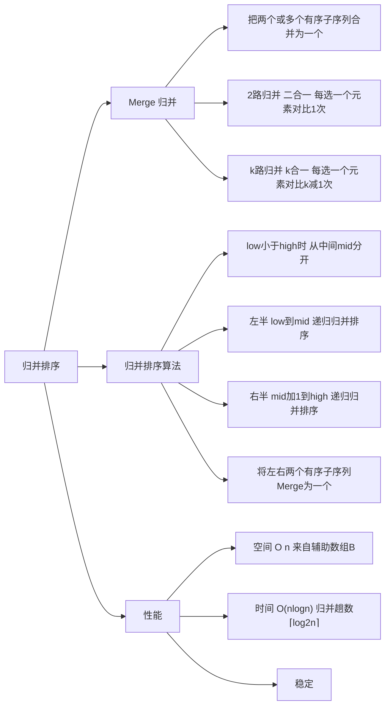

**本节考点**：**归并 = 把两个或多个已有序的序列合并成一个；$m$ 路归并每选出一个元素对比 $m-1$ 次（2 路归并对比 1 次）** → **只剩一个子表未合并时可把剩余元素全部追加** → **⚠️ 手算高频题：给出序列，写出每一趟 2 路归并的结果（本节 7 元素例题：`49,38,65,97,76,13,27` 三趟 → `13 27 38 49 65 76 97`）** → **代码：Merge（辅助数组 B、`B[i]<=B[j]` 保稳定、剩余部分复制到尾部）+ MergeSort（mid 划分 + 两次递归 + Merge）** → **趟数 = $\lceil\log_2 n\rceil$（归并树是倒立二叉树，第 $h$ 层最多 $2^{h-1}$ 个结点）** → **时间 $O(n\log_2 n)$、空间 $O(n)$（辅助数组，注意不是 $O(1)$）** → **稳定**。

---

### 8.5.2 基数排序

**本节知识总览**：

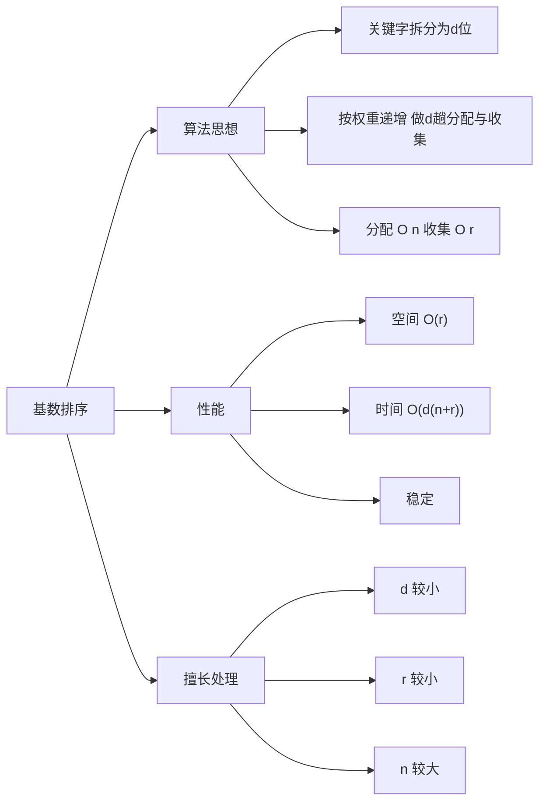

#### 1. 算法思想

**基数排序**：将整个关键字**拆分为 $d$ 位（或"组"）**，**按照各个关键字位权重递增的次序**（如：个、十、百），做 $d$ 趟"**分配**"和"**收集**"。

- 若当前处理的关键字位可能取得 $r$ 个值，则**需要建立 $r$ 个队列**；
- **分配**：顺序扫描各个元素，根据**当前处理的关键字位**，将元素插入相应队列（**队尾**）。**一趟分配耗时 $O(n)$**；
- **收集**：维护各队列首尾指针，**整段拼接**可在 $O(r)$ 内收集；若把 n 个结点逐个出队则为 $O(n+r)$。

**数学描述**：假设长度为 $n$ 的线性表中每个结点 $a_j$ 的关键字由 **$d$ 元组** $(k_j^{d-1},k_j^{d-2},k_j^{d-3},\dots,k_j^1,k_j^0)$ 组成，其中 $0\le k_j^i\le r-1$（$0\le j<n,\ 0\le i\le d-1$），**$r$ 称为"基数"**。

- $k_j^{d-1}$ 是**最高位关键字（最主位关键字）**，$k_j^0$ 是**最低位关键字（最次位关键字）**；
- ⚠️ **基数排序不是基于"比较"的排序算法**。

**得到递增序列的过程**（逐字）：

> **初始化**：设置 $r$ 个空队列，$Q_0,Q_1,\dots,Q_{r-1}$；
> 按照各个**关键字位权重递增的次序**（个、十、百），对 $d$ 个关键字位分别做"分配"和"收集"；
> **分配**：顺序扫描各个元素，若当前处理的关键字位 $=x$，则将元素插入 $Q_x$ **队尾**；
> **收集**：把 $Q_0,Q_1,\dots,Q_{r-1}$ 各个队列中的结点**依次出队并链接**。

**得到递减序列**：初始化 $Q_{r-1},Q_{r-2},\dots,Q_0$，收集时按 $Q_{r-1},Q_{r-2},\dots,Q_0$ 的次序出队（**从高位队列往低位队列收集**）。

#### 2. 完整演示（要求得到按关键字"递减"的有序序列）

**初始序列**：`520, 211, 438, 888, 007, 111, 985, 666, 996, 233, 168`（都是 按前导零补齐为 3 位，$d=3$，$r=10$）

| 趟 | 关键字位 | 分配（按该位值入队） | 收集结果 |
| --- | --- | --- | --- |
| **第一趟** | **个位**（权重最低） | Q0: 520；Q1: 211, 111；Q3: 233；Q5: 985；Q6: 666, 996；Q7: 007；Q8: 438, 888, 168 | **438, 888, 168, 007, 666, 996, 985, 233, 211, 111, 520** ← 按"个位"递减 |
| **第二趟** | **十位** | Q0: 007；Q1: 211, 111；Q2: 520；Q3: 438, 233；Q6: 168, 666；Q8: 888, 985；Q9: 996 | **996, 888, 985, 168, 666, 438, 233, 520, 211, 111, 007** ← 按"十位"递减，"十位"相同的按"个位"递减 |
| **第三趟** | **百位**（权重最高） | Q0: 007；Q1: 168, 111；Q2: 233, 211；Q4: 438；Q5: 520；Q6: 666；Q8: 888；Q9: 996, 985 | **996, 985, 888, 666, 520, 438, 233, 211, 168, 111, 007** ✅ 得到按"百位"递减；"百位"相同则按"十位"递减，"十位"还相同则按"个位"递减 |

> **每趟内的关键细节**：
> - 分配时，**同一队列内先入队的元素排在前面**（"个位"越大的越先入队——因为上一趟已按低位排好递减序）；
> - 收集时，**从高编号队列向低编号队列**依次把整个队列接在结果链表尾部（递减序列）；
> - 收集一个非空队列可为 $O(1)$（尾指针拼接整条链后，将结果尾指针更新为该队列 rear，再清空队列首尾指针）。

#### 3. 算法效率分析

**基数排序通常基于链式存储实现**（元素在分配/收集中"散开又聚拢"，用链式队列最方便）：

```c
typedef struct LinkNode{
    ElemType data;
    struct LinkNode *next;
}LinkNode, *LinkList;

typedef struct{                 //链式队列
    LinkNode *front, *rear;     //队列的队头和队尾指针
}LinkQueue;

LinkQueue Q[10];                //针对十进制关键字位，需要 r=10 个队列
```

| 指标 | 结论 |
| --- | --- |
| **空间复杂度** | $O(r)$ —— 需要 $r$ 个辅助队列 |
| **一趟分配** | $O(n)$ —— 顺序扫描 $n$ 个元素 |
| **一趟收集** | $O(r)$ —— 收集 $r$ 个队列（每个队列 $O(1)$ 链接） |
| **总时间复杂度** | 共 $d$ 趟分配、收集 → $O(d(n+r))$ |
| **稳定性** | **稳定** |

**稳定性说明**：若序列中有两个相同的关键字（如两个 12），分配时**靠前的 12 先入队**，收集时**靠前的 12 先出队**——相对次序不变 → **基数排序是稳定的**。

#### 4. 基数排序的应用与擅长处理的问题

**Eg**：某学校 10000 学生，将学生信息按**年龄递减**排序。生日可拆分为三组关键字：**年（1991~2005）、月（1~12）、日（1~31）**，权重 **年 > 月 > 日**：

- 第一趟按"**日**"递增分配、收集；第二趟按"**月**"递增；第三趟按"**年**"递增（**从权重低的开始**）→ 结果按年龄递减；
- 时间复杂度 $O(d(n+r))=O(30000)$；对比：若用 $O(n^2)$ 排序 $\approx O(10^8)$，若用 $O(n\log_2 n)$ 排序 $\approx O(140000)$。

**基数排序擅长解决的问题**（三个条件）：

1. 数据元素的**关键字可以方便地拆分为 $d$ 组，且 $d$ 较小**（反例：给 5 个人的**身份证号**排序——$d=18$ 偏大，需要分配、回收 18 趟）；
2. **每组关键字的取值范围不大，即 $r$ 较小**（反例：给**中文人名**排序——每个字可能有上万种取值，$r$ 太大）；
3. **数据元素个数 $n$ 较大**（擅长：给十亿人的身份证号排序）。

#### 5. 本节知识回顾

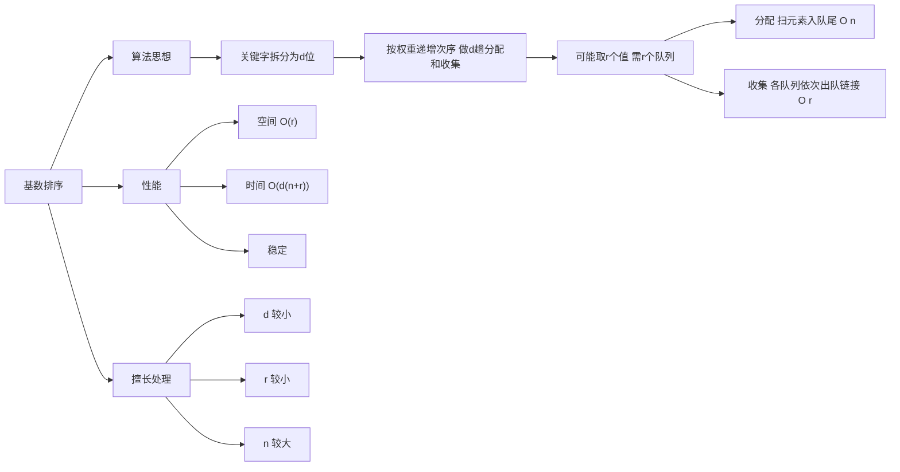

**本节考点**：**基数排序 = 关键字拆成 $d$ 位 + 按权重递增（个、十、百）做 $d$ 趟"分配（入队尾）"和"收集（依次出队链接）"** → **可能取 $r$ 个值就建 $r$ 个队列；递减序列收集时从 $Q_{r-1}$ 到 $Q_0$，递增序列从 $Q_0$ 到 $Q_{r-1}$** → **⚠️ 手算高频题：给出 520/211/438/… 这组数，逐趟写出分配与收集结果（本节的三趟演示必须会）** → **⚠️ 基数排序不是基于"比较"的排序算法** → **空间 $O(r)$（$r$ 个链式队列）；时间 $O(d(n+r))$（$d$ 趟分配 $O(n)$ + 收集 $O(r)$）；**稳定**（先入队先出队）** → **擅长处理的三个条件：$d$ 小、$r$ 小、$n$ 大（反例：身份证号（$d$ 大）、中文人名（$r$ 大））**。

---

### 8.5.3 计数排序

#### 1. 用频次和累计频次确定位置

计数排序不依靠两两比较关键字，而是利用**整数关键字的有限取值范围**直接计数。设关键字位于 $[0,k)$：

1. 建立 `C[0..k-1]`，统计每个值出现的次数。
2. 对 C 求前缀和，使 `C[v]` 表示原数组中**小于等于 v 的元素数**。
3. 从右向左扫描输入，把值 v 放在 `B[--C[v]]`。


**例**：输入 `A=[2,4,3,0,2,3,0,3]`，关键字位于 `[0,5)`。

| 关键字 v | 0 | 1 | 2 | 3 | 4 |
| --- | --- | --- | --- | --- | --- |
| 频次 | 2 | 0 | 2 | 3 | 1 |
| 累计频次 | 2 | 2 | 4 | 7 | 8 |

| 逆向处理的原下标 | 元素 | 放入 B 的下标 | 更新后的对应计数 |
| --- | --- | --- | --- |
| 7 | 3 | 6 | C[3]=6 |
| 6 | 0 | 1 | C[0]=1 |
| 5 | 3 | 5 | C[3]=5 |
| 4 | 2 | 3 | C[2]=3 |
| 3 | 0 | 0 | C[0]=0 |
| 2 | 3 | 4 | C[3]=4 |
| 1 | 4 | 7 | C[4]=7 |
| 0 | 2 | 2 | C[2]=2 |

最终 `B=[0,0,2,2,3,3,3,4]`。初始累计计数是“个数”，数组下标从 0 开始，所以应**先减 1 再取下标**。

#### 2. 教学实现与稳定性

```cpp
#include <vector>

// 前提：n >= 0，k > 0，所有 A[i] 都在 [0,k)，B 容量至少为 n。
// 输入 A 与输出 B 不重叠。
void CountSort(const int A[], int B[], int n, int k) {
    std::vector<int> C(k, 0);
    for (int i = 0; i < n; ++i) ++C[A[i]];
    for (int v = 1; v < k; ++v) C[v] += C[v - 1];
    for (int i = n - 1; i >= 0; --i)
        B[--C[A[i]]] = A[i];
}
```

若相等关键字 `3a` 在 `3b` 前面，从右向左扫描时先放 `3b`，它得到较大的输出下标，再放 `3a` 到较小位置，因此**保持原相对顺序，排序稳定**。有附带信息时，应把整条记录放入 B，而不只是复制关键字。

如果沿用累计频次与递减位置的写法，却从左向右扫描，相同关键字会逆序，稳定性被破坏。只按计数重写一串整数虽然也能得到有序数值，却没有保留附带记录的相对顺序，不能据此证明稳定性。

#### 3. 支持负数的实现

当关键字范围为 `[minValue,maxValue]` 时，令 $k=maxValue-minValue+1$，用 `value-minValue` 作为计数下标。

```cpp
#include <algorithm>
#include <vector>
#include <cstddef>

void CountingSort(std::vector<int> &A) {
    if (A.empty()) return;
    const int lo = *std::min_element(A.begin(), A.end());
    const int hi = *std::max_element(A.begin(), A.end());
    const std::size_t k = static_cast<std::size_t>(
        static_cast<long long>(hi) - lo + 1);
    std::vector<std::size_t> C(k, 0);
    std::vector<int> B(A.size());
    for (int value : A)
        ++C[static_cast<std::size_t>(static_cast<long long>(value) - lo)];
    for (std::size_t v = 1; v < k; ++v) C[v] += C[v - 1];
    for (std::size_t i = A.size(); i > 0; --i) {
        const int value = A[i - 1];
        const std::size_t v = static_cast<std::size_t>(
            static_cast<long long>(value) - lo);
        B[--C[v]] = value;
    }
    A.swap(B);
}
```

这是取值范围较小时的实现；如果数值极其稀疏，`max-min+1` 很大，会浪费内存甚至分配失败，应换用其他排序方法。差值先转成 `long long` 再计算，避免 `int` 减法溢出。代码中的计数下标和输出长度需要能被目标平台的 `size_t` 表示。

| 指标 | 结论 |
| --- | --- |
| 时间 | $O(n+k)$，与原序列有序程度无关 |
| 辅助空间 | $O(n+k)$：输出数组 B 与计数数组 C |
| 稳定性 | 上述累计计数、逆向放置版本稳定 |
| 原地性 | 不是原地排序 |
| 适用条件 | 关键字可映射到较小的整数区间 |

当 $k=O(n)$ 时可达线性时间；这不违反比较排序的下界，因为它利用了关键字范围，**不是基于比较的排序**。

#### 4. 计数思想的应用

**题1.** 数组含 n 个整数，且每个值均在 `[0,n)`，找出出现次数严格大于 $n/2$ 的主元素；不存在则返回 -1。

**解：** 建长度 n 的计数数组，扫描时累加频次，若某项大于 `n/2` 即找到主元素。时间 $O(n)$，空间 $O(n)$。若希望压缩到 $O(1)$ 辅助空间，可用候选抵消法，但最后必须再扫描验证候选频次。

**题2.** 在 n 个整数中找出没有出现的最小正整数。

**解：** 答案一定在 `[1,n+1]`。建长度 `n+1` 的标记数组，只标记 `[1,n]` 中出现过的数，忽略非正数和大于 n 的数；从 1 扫描到 n，首个未标记值就是答案，否则为 `n+1`。时间 $O(n)$，辅助空间 $O(n)$。例：`[-5,3,2,3]` 的答案为 1，`[1,2,3]` 的答案为 4。

---

## 8.6 内部排序算法的比较与选择

| 算法 | 最好时间 | 平均时间 | 最坏时间 | 辅助空间 | 稳定 |
| --- | --- | --- | --- | --- | --- |
| 直接插入 | $O(n)$ | $O(n^2)$ | $O(n^2)$ | $O(1)$ | 是 |
| 折半插入 | $O(n\log n)$ | $O(n^2)$ | $O(n^2)$ | $O(1)$ | 是 |
| 希尔 | 依赖增量序列 | 依赖增量序列 | 依赖增量序列 | $O(1)$ | 否 |
| 冒泡（带提前结束） | $O(n)$ | $O(n^2)$ | $O(n^2)$ | $O(1)$ | 是 |
| 快速 | $O(n\log n)$ | $O(n\log n)$ | $O(n^2)$ | 平均 $O(\log n)$，最坏 $O(n)$ | 否 |
| 简单选择 | $O(n^2)$ | $O(n^2)$ | $O(n^2)$ | $O(1)$ | 否 |
| 堆 | 互异关键字常记 $\Theta(n\log n)$；全相等可为 $\Theta(n)$ | $O(n\log n)$ | $O(n\log n)$ | $O(1)$ | 否 |
| 二路归并 | $O(n\log n)$ | $O(n\log n)$ | $O(n\log n)$ | 数组实现 $O(n)$ | 是 |
| 基数（LSD） | $O(d(n+r))$ | $O(d(n+r))$ | $O(d(n+r))$ | 链式分配 $O(r)$ | 是 |
| 计数 | $O(n+k)$ | $O(n+k)$ | $O(n+k)$ | $O(n+k)$ | 是 |

折半插入在有序输入上虽然不需要移动元素，但仍进行二分定位，因此其标准实现的最好时间为 $O(n\log n)$。希尔排序不能脱离增量序列写一个通用的平均复杂度；采用简单折半增量时最坏可达 $O(n^2)$。基数排序的数组桶实现通常另需 $O(n+r)$ 辅助空间，表中 $O(r)$ 指复用原结点链接的实现。

**稳定算法的条件**：直接插入不越过相等元素；折半插入把新元素放在已有相等元素之后；冒泡只交换严格逆序对；归并相等时先取左段；LSD 每一趟分配、收集都稳定。

| 场景 | 选择思路 |
| --- | --- |
| 规模小或基本有序 | 直接插入的常数开销低，接近线性 |
| 一般数组排序，重视平均速度 | 快速排序；注意有序输入与枢轴选择 |
| 要求最坏 $O(n\log n)$ 且辅助空间小 | 堆排序 |
| 要求稳定、可接受额外数组空间 | 归并排序 |
| 链表排序 | 归并便于通过改链完成，不依赖随机存取 |
| 整数范围小 | 计数排序 |
| 关键字易拆分、位数小 | 基数排序 |
| 数据无法全部装入内存 | 外部归并排序，重点分析磁盘 I/O |

**易错**：稳定性是对算法全部可能输入的保证，某次输出未改变相等元素顺序不代表算法稳定；有序数据可能是直接插入的最好情况，却是朴素快速排序的最坏情况。

---

## 8.7 外部排序

### 8.7.1 外存与内存之间的数据交换

数据量太大，无法全部装入内存时，需要分批读取、排序、写回外存。课程模型中，磁盘 I/O 按**块**进行：一次读入或写出一个磁盘块；记录必须先进入内存，才能参与比较与移动。

$$
T_{\text{外部排序}}=T_{\text{磁盘读写}}+T_{\text{初始内部排序}}+T_{\text{内部归并}}
$$

通常磁盘读写开销最值得优化。比较次数减少与 I/O 次数减少是不同目标，不能只写一个内部排序时间复杂度来评价外部排序。

### 8.7.2 外部归并排序与多路平衡归并

#### 1. 先生成初始归并段，再逐趟归并

**归并段**是一个内部已有序的连续记录序列，它可跨越多个磁盘块。

1. 内存一次容纳 L 条记录，读入一批，在内存中排序后写回；重复后得到 $r=\lceil N/L\rceil$ 个初始归并段。
2. 每趟把最多 k 个已有序段归并成一个更长的有序段，直到只剩一个。

```mermaid
graph LR
    A[外存中的原文件] --> B[分批读入内存排序]
    B --> C[初始有序段]
    C --> D[逐趟多路归并]
    D --> E[整体有序文件]
```

#### 2. k 路归并的缓冲过程

至少需要 **k 个输入缓冲区 + 1 个输出缓冲区**，每区至少能装一块。每次只比较各输入段的当前首记录，选最小者进入输出区。

| 事件 | 动作 |
| --- | --- |
| 某输入缓冲区用完，而该段还有数据 | 读入该段下一块 |
| 某输入段完全读完 | 将其标为耗尽，不再参与选最小 |
| 输出区满 | 写回外存，再清空输出区 |
| 本组所有输入段耗尽 | 写出未满的最后一个输出块 |

**例**：段一为 `[8,9,26,36,42,48]`，段二为 `[1,25,27,28,37,45]`，每块装 3 条记录。

| 次序 | 当前两个首记录 | 选出 | 缓冲动作 |
| --- | --- | --- | --- |
| 1–3 | 从 8 与 1 开始逐步比较 | 1、8、9 | 输出块写出 |
| 4 | 26 与 25 | 25 | 暂留输出区 |
| 5 | 26 与 27 | 26 | 段一首块耗尽，补入 36、42、48 |
| 6 | 36 与 27 | 27 | 输出块写出；段二补入 28、37、45 |
| 后续 | 继续比较首记录 | 28、36、37、42、45、48 | 每满一块写出 |

两个有序段无需全部装入内存。若关键字相同，按段的先后顺序选取，并且初始段内部排序稳定，可保持整体稳定性。

#### 3. 归并趟数与 I/O 次数

多路**平衡**归并要求每趟把 m 个段组织成 $\lceil m/k\rceil$ 个新段，而不只是任意地选若干段合并。固定采用 k 路时：

$$
s=\lceil\log_k r\rceil \quad (r\ge1,\ k\ge2)
$$

若共有 b 个磁盘块，按每个阶段将整个文件读一遍、写一遍的模型，初始段生成需 $2b$ 次块 I/O，每趟归并再需 $2b$ 次：

$$
I/O_{\text{总}}=2b(1+s)
$$

这是**包含初始段生成和最终结果写回**的常用计算模型；题目若只问归并阶段、最终结果不用落盘，或各段末块有额外空余，需按其读写约定具体计算。

**例**：16 块文件，每次生成一个长度为 2 块的初始段，得到 8 段。

| 方式 | 段数变化 | 归并趟数 | 包含初始生成的块 I/O |
| --- | --- | --- | --- |
| 二路平衡归并 | 8→4→2→1 | 3 | $32\times4=128$ |
| 四路平衡归并 | 8→2→1 | 2 | $32\times3=96$ |

**易错**：8 个段采用四路平衡归并，第一趟应得到 2 段。如果第一趟人为分成 3 组，仍可能属于“最多四路归并”，但不符合这里的四路平衡归并组织方式。

#### 4. 优化方向与约束

| 方法 | 作用 | 代价或配套措施 |
| --- | --- | --- |
| 增大归并路数 k | 降低 $\lceil\log_k r\rceil$ | 更多输入缓冲区；选最小的比较开销增大 |
| 减少初始段数 r | 降低归并趟数 | 增大工作区，或用置换—选择生成更长初始段 |
| 用败者树选最小 | 降低多路归并的内部比较开销 | 需要维护比赛树 |
| 优化不等长段的归并次序 | 减少总读写量 | 用最佳归并树安排短段先归并 |

若内存可供 M 个块缓冲区，在不考虑其他结构开销时，一般有 $k\le M-1$；缓冲区大小、双缓冲和败者树等会占用额外空间，不能无限提高 k。

---

### 8.7.3 败者树

#### 1. 为什么多路归并需要比赛树

朴素 k 路归并每输出一个记录，要在 k 个段首记录中选最小，通常需 $k-1$ 次关键字比较。k 越大，减少 I/O 趟数的同时也会增加内部比较开销。

**败者树**的叶子对应各归并段当前参与比较的记录；每场比较让较小者晋级，在内部结点记下**较大者来自哪个段**。最后的总冠军另存于 `ls[0]`，其余内部位置存失败者的段号。更新一个叶子时，只需沿它到根的路径重新比赛。

| 结构 | 内部结点记录 | 更新方式 |
| --- | --- | --- |
| 胜者树 | 子树中获胜者 | 由变化叶子逐层重算 |
| 败者树 | 该场失败者 | 新记录与沿途旧败者比赛，胜者继续向上 |

#### 2. 八路归并的例子

8 个段当前首记录依次是 `27,12,1,17,2,9,11,4`。

| 比赛层次 | 比较 | 本层失败者 | 晋级者 |
| --- | --- | --- | --- |
| 第一层 | 27 与 12；1 与 17；2 与 9；11 与 4 | 27、17、9、11 | 12、1、2、4 |
| 第二层 | 12 与 1；2 与 4 | 12、4 | 1、2 |
| 决赛 | 1 与 2 | 2 | 1 |

初次建树共比较 $8-1=7$ 次，冠军是第 3 段的记录 1。输出 1 后，从第 3 段补入 6，只沿原路径比较：

| 更新次序 | 比较 | 本场失败者 | 晋级者 |
| --- | --- | --- | --- |
| 1 | 6 与旧败者 17 | 17 | 6 |
| 2 | 6 与旧败者 12 | 12 | 6 |
| 3 | 6 与旧败者 2 | 6 | 2 |

新冠军是第 5 段的 2，只比较 3 次，不必重建整棵树。

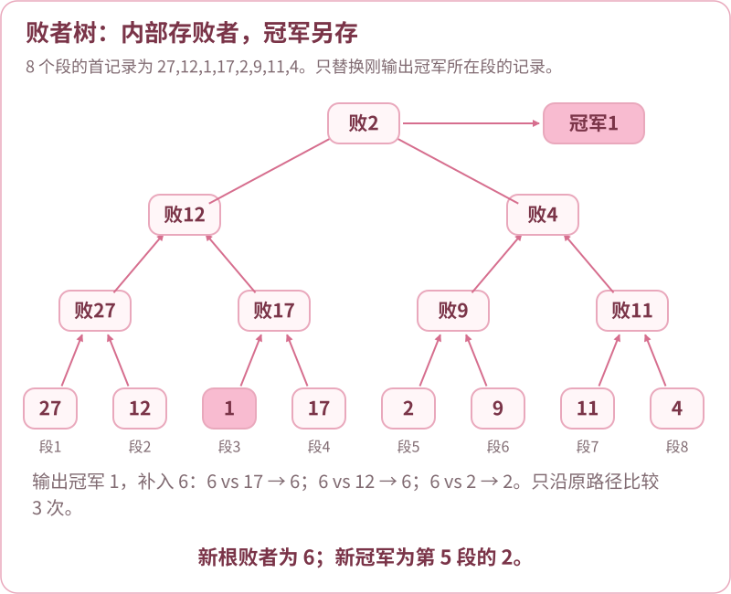

#### 3. 存储与调整伪代码

使用长度为 k 的 `ls` 数组：`ls[0]` 存冠军段号；`ls[1..k-1]` 存内部比赛的败者段号。当前记录另存在 `head[0..k-1]` 中。若把叶子概念性地放在堆式位置 `k..2k-1`，第 s 段的叶子位置就是 `k+s`。

```text
Replay(s):                     // 已建好树；只替换刚输出冠军所在段的首记录
    winner = s
    t = (k + s) / 2            // 整数除法，找到该叶子的父结点
    while t > 0:
        if head[winner] 应排在 head[ls[t]] 之后:
            交换 winner 与 ls[t]
        t = t / 2
    ls[0] = winner
```

每次比较后，败者留在 `ls[t]`，较小者继续上升。建树可自底向上计算左右子树胜者并保存败者，首次需要 $k-1$ 次关键字比较；**不能在败者数组尚未初始化时直接调用调整伪代码**。

若某段耗尽，将它视为正无穷；全部段都耗尽时结束。实现时可用额外的“耗尽”标志，而不要假定某个普通整数绝不可能作为输入。相等关键字可再按段的原始次序比较，以维持稳定性。

#### 4. 效率与易错点

| 项目 | 结论 |
| --- | --- |
| 首次建树 | $k-1$ 次关键字比较，$O(k)$ 时间 |
| 单次更新 | $O(\log k)$；k 为 2 的幂时路径上恰有 $\log_2 k$ 场比赛 |
| k 非 2 的幂 | 叶深可能不同，最多 $\lceil\log_2 k\rceil$ 场比较 |
| 总输出 N 条记录 | 内部选择代价为 $O(k+N\log k)$ |
| 结构空间 | $O(k)$，不含块缓冲区 |

败者树减少的是**内部选最小记录的比较次数**；在归并路数和段数固定时，不会直接减少磁盘读写次数或归并趟数。败者树中的一个叶子表示一个段的当前记录，并不保存该段的全部数据。

---

### 8.7.4 置换—选择排序

#### 1. 用有限工作区生成更长的初始段

普通分批内部排序中，工作区能放 w 条记录，一个初始段一般就只有 w 条。置换—选择允许**输出一个、补入一个**，只要新记录不小于当前段最后输出的记录，就仍有机会进入当前段。

把最后输出的关键字记为 `last`（课件记作 `MINIMAX`）：

| 新读入的关键字 x | 处理 |
| --- | --- |
| $x\ge last$ | 留在本段的可选集合中 |
| $x<last$ | 冻结，留给下一个归并段 |
| 本段所有可选记录用完 | 结束当前段，解冻其余记录，开始新段 |

**相等的值可以留在本段**，条件是“不小于”，不应把课件中“比 MINIMAX 大”的口头描述机械实现为严格大于。

```mermaid
graph LR
    A[读满工作区] --> B[输出可选最小记录]
    B --> C[读入一个新记录]
    C --> D{不小于last}
    D -->|是| E[本段可用]
    D -->|否| F[冻结到下一段]
    E --> G{还有本段记录}
    F --> G
    G -->|有| B
    G -->|无| H[结束本段并解冻]
    H --> B
```

输入已读完时不再补入记录，继续输出工作区中剩余记录；若工作区也空，算法结束。

#### 2. 课件完整例子

工作区容量为 3，输入顺序：

```text
4,6,9,7,13,11,16,14,10,22,30,2,
3,19,20,17,1,23,5,36,12,18,21,39
```

初始读入 `4,6,9`。一边输出最小值，一边补入下一条记录：

| 输出 | 新补入 | 是否冻结 | 说明 |
| --- | --- | --- | --- |
| 4 | 7 | 否 | 7 可以出现在 4 后面 |
| 6 | 13 | 否 | 仍参与本段 |
| 7 | 11 | 否 | 仍参与本段 |
| 9 | 16 | 否 | 仍参与本段 |
| 11 | 14 | 否 | 仍参与本段 |
| 13 | 10 | 是 | 10 小于 13 |
| 14 | 22 | 否 | 仍参与本段 |
| 16 | 30 | 否 | 仍参与本段 |
| 22 | 2 | 是 | 2 小于 22 |
| 30 | 3 | 是 | 工作区全被冻结，结束本段 |

得到三个有序初始段：

| 段 | 内容 | 长度 |
| --- | --- | --- |
| 1 | 4、6、7、9、11、13、14、16、22、30 | 10 |
| 2 | 2、3、10、17、19、20、23、36 | 8 |
| 3 | 1、5、12、18、21、39 | 6 |

第一段有 10 条记录，明显超过工作区容量 3。**各段内部有序，段与段之间并不整体有序**，仍需后续外部归并。

#### 3. 实现思想与性能

可用最小堆或败者树维护工作区，比较键可设置为“所属段号、关键字、原始序号”。新记录小于 `last` 时令所属段号加 1，自动延后到下一个段；本段输出完再推进段号。

```text
用最先读到的最多 w 条记录建立候选结构，段号设为 0
while 候选结构非空:
    取最小的（段号, 关键字, 原始序号）记录
    如果段号改变，结束上一段并开始新段
    输出该记录
    若输入还有记录 x:
        若 x 的关键字不小于刚输出的关键字，给 x 当前段号
        否则给 x 下一段号
        把 x 放入候选结构
```

初始段长度取决于输入顺序：原序列递增时可生成很长、甚至覆盖全文件的一段；严格递减时各段通常只有工作区容量那么长。对通常讨论的随机输入，平均段长常近似为 $2w$，**这不是对所有输入的保证**。

采用堆或败者树，处理 N 条记录的内部选择代价为 $O(N\log w)$，工作区为 $O(w)$，另外需要 I/O 缓冲。它优化的是初始段长度和段数 r，不能保证 r 变小后归并趟数一定减少，因为趟数还经过向上取整。

---

### 8.7.5 最佳归并树

#### 1. 归并次序决定不等长段的读写量

将每个初始归并段作为叶结点，段的**块数**作为权值；每次归并产生一个内部结点，权值为参与合并的段长之和。某个初始段距离最终根有几条边，它的数据就参与几次归并。

$$
WPL=\sum_i w_i d_i,\qquad
I/O_{\text{归并阶段}}=2WPL
$$

上式按每次归并完整读取输入并将结果写回外存计算，**不含初始段生成**。WPL 既等于带权叶深之和，也等于所有内部合并结点的权值之和。若叶权使用“记录数”，WPL 的单位也是记录搬运量，不能未经换算就称为块 I/O 次数。

#### 2. 二路最佳归并：按哈夫曼方法安排

**例**：5 个初始段长度为 `2,5,1,6,2` 块。每次把当前最短的两个段合并：

| 次数 | 合并的段长 | 新段长度 |
| --- | --- | --- |
| 1 | 1、2 | 3 |
| 2 | 2、3 | 5 |
| 3 | 5、5 | 10 |
| 4 | 6、10 | 16 |

$$
WPL_{\min}=3+5+10+16=34,\qquad I/O=68
$$

另一种次序：`5+1=6`、`6+2=8`、`6+8=14`、`2+14=16`，WPL 为 44，I/O 为 88。可见相同数据量、相同归并路数，仅改变归并次序也会改变总读写量。

```mermaid
graph LR
    R[16] --> A[6]
    R --> B[10]
    B --> C[原段5]
    B --> D[5]
    D --> E[原段2]
    D --> F[3]
    F --> G[原段1]
    F --> H[原段2]
```

这里追求的是**加权读写总量最小**，树形可能不平衡，不要与固定每趟尽量合并 k 路的平衡归并混淆。

#### 3. k 路最佳归并与虚段

把最多 k 路归并统一表示为每个内部结点都有 k 个孩子的树，可在需要时补长度为 0 的虚段，再构造 k 叉哈夫曼树。设真实初始段数为 r，必须满足：

$$
(r+z-1)\bmod(k-1)=0
$$

最少补入的虚段数为：

$$
z=\big((k-1)-((r-1)\bmod(k-1))\big)\bmod(k-1)
$$

每次从当前候选中选**最短的 k 个段**合并，新段放回候选，直到只剩一个。虚段没有实际记录，不产生读写，只为安排第一次合并的路数。真实执行不需要创建空文件。

**例**：三路归并，段长为 `2,3,6,9,12,17,18,24`，r=8。因为 `(8-1)%2=1`，应补 1 个 0 长度虚段。

| 次数 | 选取的三个最短段 | 合并后长度 |
| --- | --- | --- |
| 1 | 0、2、3 | 5 |
| 2 | 5、6、9 | 20 |
| 3 | 12、17、18 | 47 |
| 4 | 20、24、47 | 91 |

$$
WPL_{\min}=5+20+47+91=163,\qquad I/O_{\min}=326
$$

等价的真实操作是第一步先做一次二路归并 `2+3`，随后每次三路归并。**不能先随意做几次三路归并，最后不足 k 路时才补虚段**，那样可能已经增加了大段的参与次数。

用最小堆维护候选；当 k 固定时，构造最佳归并方案的时间为 $O(r\log r)$，空间为 $O(r)$。这一复杂度描述的是**计算归并方案**，实际磁盘读写代价仍按 WPL 另计。

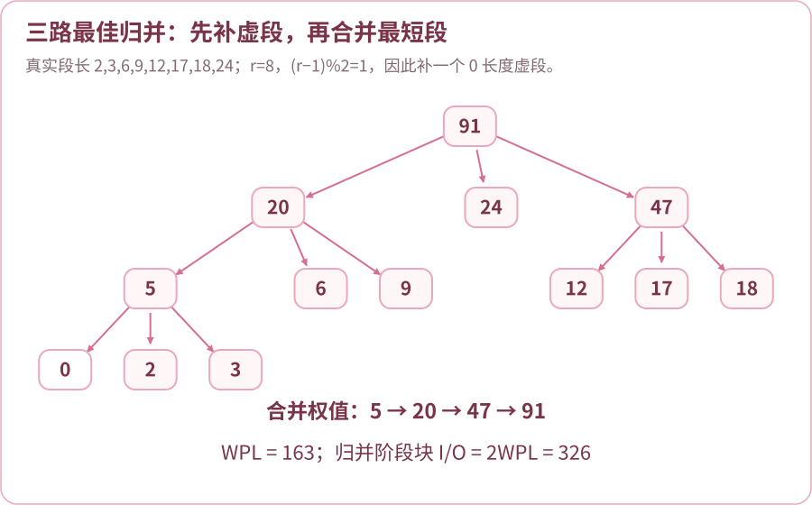

#### 4. 外部排序的题目检查表

| 问题 | 核对内容 |
| --- | --- |
| 算初始段数 | 普通分批法用 $\lceil N/L\rceil$；置换—选择按实际输出划段 |
| 算平衡归并趟数 | $\lceil\log_k r\rceil$，别漏向上取整 |
| 算缓冲区个数 | 至少 k 个输入区和 1 个输出区 |
| 算磁盘 I/O | 区分初始段生成、归并阶段、最终写回；认清块数单位 |
| 用败者树 | 首次 $k-1$ 次，后续每次更新 $O(\log k)$ |
| 手算置换—选择 | 新值小于 last 才冻结；段结束后解冻 |
| 构造最佳归并树 | 先检查是否需要虚段，再反复合并最短段 |

### 排序实现的适用条件与补充

- 同名排序函数展示不同版本，应分别编译。引用参数 `int &a` 是 C++ 语法；取值/索引类型、所需头文件及 0/1 起始下标需配套。哨兵排序应实际分配 n+1 个元素，不能把长度为 n 的数组直接传入按 A[1..n] 访问的版本。
- 插入排序逆序计数应明确实现：对上面的带前置比较哨兵版本，第 i 趟（i 从 1 计）有 i 次数据后移、2 次暂存/回填；内层关键字比较 i+1 次，另有外层触发比较 1 次。若不计外层触发比较，才写 i+1；不能混作同一口径。
- 快排的“每层 O(n)×层数”给出上界，精确分析可用递推；平均 O(n log n) 需随机排列或随机枢轴等概率假设。所示二路划分在全相等输入时也会退化到 O(n²)；随机枢轴不能消除这一重复键问题，三路划分更合适。左右两侧都可能含等于枢轴的值。
- 堆序定义只对存在的孩子生效：2i<=n 才比较左孩子，2i+1<=n 才比较右孩子。堆顶读取本身为 O(1)，删除堆顶并恢复堆序最坏 O(log n)。
- 堆排序统一 O(n log n) 是上界，不代表所有输入耗时同阶。本章下筛遇到相等即可停止，所以全相等数据建堆和各轮调整合计可为 Θ(n)；关键字互异的常用最好阶为 Θ(n log n)。
- LSD 基数排序是本节讨论的版本，MSD 从最高位分配后递归处理桶，不能把 LSD 的整轮收集规则直接反向套用。较短数字需补前导零；有负号、变长字符串或复合关键字时，应先规定编码、缺失位及比较顺序。
- 归并排序 log n 层来自反复均分直到单元素，而不能仅从 n<=2^(h-1) 推出等号；数组归并额外 O(n) 缓冲及 O(log n) 递归栈，总计 O(n)。链式归并可改链拼接，空间结论需按具体迭代/递归实现计算。

#### 小根堆删除任意位置的完整示例

位置已知时最坏 O(log n)；若只给待删值，先在普通堆中定位它通常需 O(n)。下面与前文一样从 1 编号，A[0] 不存数据，len 是当前元素个数。

```cpp
bool DeleteMinHeapAt(int A[], int &len, int index){
    if(index<1 || index>len) return false;
    A[index]=A[len--];
    if(index>len) return true;
    if(index>1 && A[index]<A[index/2]){
        while(index>1 && A[index]<A[index/2]){
            std::swap(A[index], A[index/2]); index/=2;
        }
    } else {
        while(index<=len/2){
            int child=2*index;
            if(child<len && A[child+1]<A[child]) ++child;
            if(A[index]<=A[child]) break;
            std::swap(A[index], A[child]); index=child;
        }
    }
    return true;
}
```
